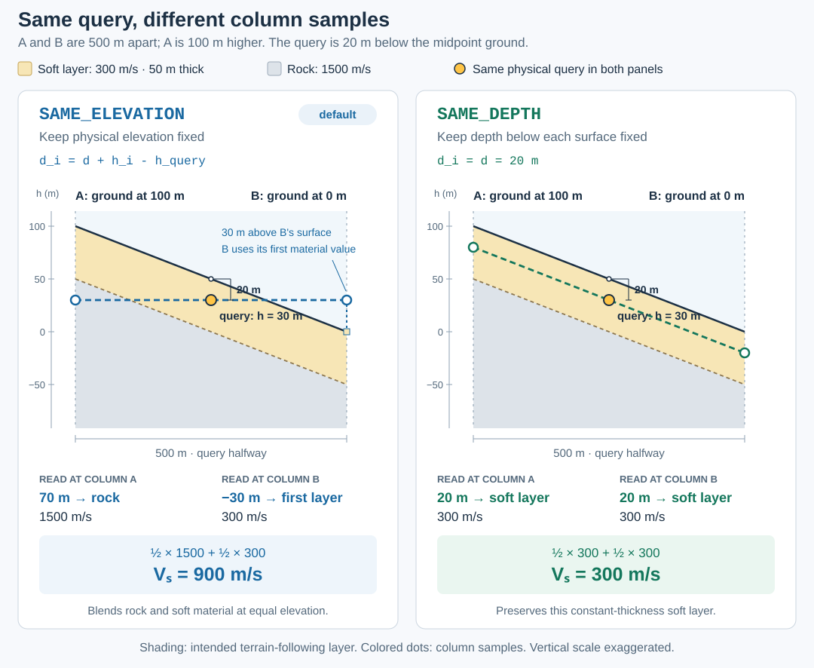
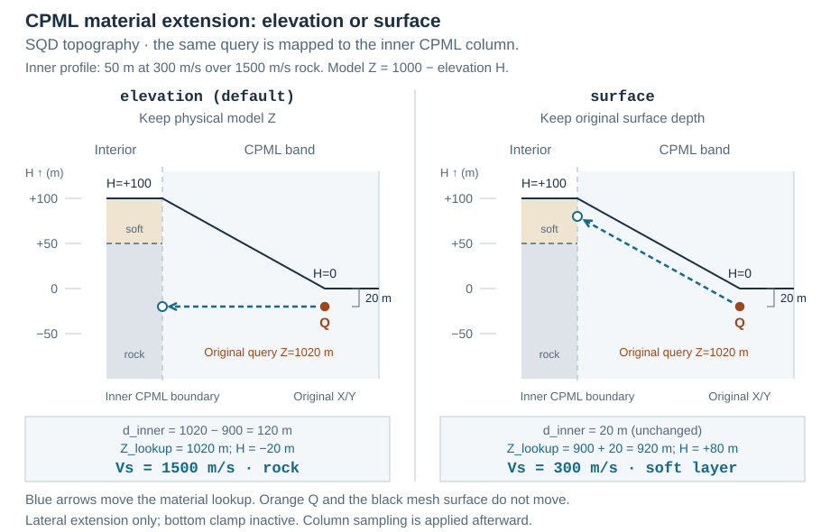

# Hercules GPU — Extended README

This is the comprehensive engineering reference: runtime controls, numerical
formulations, implementation details, input/output examples, and development
and validation history. For a concise operational guide and parameter index,
see [Technical README](Technical%20README.md). The
[documentation site](https://hercules-suite.github.io/Hercules-GPU/) provides
the full input reference; its [source](../docs-site/README.md) is maintained
with the solver. Current parser and solver code under `quake/forward/` take
precedence over historical notes.

Use one `parameters.in` for simulation controls and `source.in` for
source-specific controls. Units are SI; at zero PROJ azimuth solver X is UTM
grid north and Y is grid east. Rotated runs use the local axes described below;
Z/depth is positive downward. Nonlinear examples require case-specific
calibration of geostatic state, tolerances, substeps, damping, and material
properties. Reported historical benchmarks apply to their stated cases and
versions; consolidating these documents does not validate new combinations.

## Contents

- [Domain rotation](#rotated-domains-and-material-grids)
- [Domain sizing](#octree-compatible-domain-sizing) and [compilation](#host-and-cuda-compilation)
- [Runtime controls](#runtime-performance-controls) and [diagnostics](#advanced-and-diagnostic-controls)
- [Launcher defaults](#phase-launcher-defaults), [launching](#launch-a-simulation), and [mesh import](#mesh-generation-and-import)
- [Nonlinear constitutive models](#nonlinear-gpu-execution-and-constitutive-models)
- [Acoustic coupling](#acoustic-and-elastic-coupling), [basin grids](#basin-bottom-grid), and [3D material files](#3d-velocity-model-files)
- [Poroelasticity](#poroelastic-u-p-formulation) and [acoustic limitations](#scalar-acoustic-corrections-and-limitations)
- [Absorbing boundaries](#absorbing-boundaries-and-cpml)
- [Point forces](#single-point-body-force-source) and [compliant-base forces](#distributed-compliant-base-force-source)
- [Additional derivations and historical results](#additional-derivations-and-historical-results)
- [Station binary output](#single-file-station-binary-output)
- [Structured DRM box output](#structured-drm-box-output)

## Repository components

| File           | Description |
| -------------- | ----------- |
| `octor`        | Hercules mesh generator/partitioner/load balancer module
| `quake`        | Hercules solver module
| `user.mk`      | User-specified compiler and linker settings. This should be the only file we need to change.
| `systemdef.mk` | generic system-specific compile and linker settings. Tailored by entries in user.mk
| `common.mk`    | system-independent settings

## Rotated domains and material grids

In a PROJ build, required `region_azimuth_leftface_deg` is the finite angle
of solver +X clockwise from UTM grid north in the region origin's UTM zone.
Angles are normalized modulo 360 degrees. Zero retains X north/Y east;
+Y is always 90 degrees clockwise from +X and Z stays positive down.
`region_origin_latitude_deg` and `region_origin_longitude_deg` fix the
rotation pivot at solver `(0,0)`, not the centre of the rectangle.
`region_length_north_m` and `region_length_east_m` remain the local X and Y
side lengths; shallow/deep depths and octree sizing rules are unchanged.
UTM grid north is distinct from true geographic north.

Optional `3D_velocity_model_azimuth_deg` (finite degrees) defaults to
`region_azimuth_leftface_deg` when omitted, aligning the material axes with
the solver axes. An explicit value sets the material grid's +X orientation
independently in the same UTM zone; explicit `0` keeps UTM north/east axes.
The required `3D_velocity_model_origin_latitude_deg` and
`3D_velocity_model_origin_longitude_deg` locate its `(x=0,y=0)` point when
`3D_velocity_model=yes`. `x.in` and `y.in` contain metre offsets along its
own axes. Existing north/east grids require explicit `0`; a grid prepared
along the rotated solver axes can omit the material angle. The two origins may
differ. For domain angle $\theta$ and projected offsets $\Delta N,\Delta E$:

```math
\begin{aligned}
X &= \cos\theta\,\Delta N + \sin\theta\,\Delta E,\\
Y &= -\sin\theta\,\Delta N + \cos\theta\,\Delta E,\\
\Delta N &= \cos\theta\,X - \sin\theta\,Y,\\
\Delta E &= \sin\theta\,X + \cos\theta\,Y.
\end{aligned}
```

After subtracting the material origin expressed in solver coordinates,
rotate by the relative angle $\theta_{material}-\theta_{domain}$ into
material-grid axes. CPML material extension clamps the query in solver
coordinates first. Cached elevations at material columns use the inverse
rotation back into solver topography coordinates. Topography beyond its
horizontal coverage retains the existing edge-clamping behavior. Extend
material coverage past every intended query and its interpolation stencil;
the existing upper grid boundary remains exclusive.

Example additions to a complete case (illustrative, not scientifically
validated input):

```ini
region_origin_latitude_deg  = 37.791109
region_origin_longitude_deg = 26.383378
region_length_north_m       = 90000
region_length_east_m        = 90000
region_depth_shallow_m      = 0
region_depth_deep_m         = 39375
region_azimuth_leftface_deg = 30
cvmdb_input_file = profile
Istanbul_velocity_model = no
basin_velocity_model = no
3D_velocity_model = yes
3D_velocity_model_directory = input/materialfiles
3D_velocity_model_origin_latitude_deg  = 37.791109
3D_velocity_model_origin_longitude_deg = 26.383378
# Omit the next line for a material grid aligned with the domain.
3D_velocity_model_azimuth_deg = 0  # explicit override: UTM north/east grid
```

For these matching origins, solver `(1000,0)` samples material
`(866.0254,500)` metres with the explicit zero override. Omit the material
azimuth or set it to `30` for a grid prepared along the domain axes; the same
solver point then samples `(1000,0)`.
A valid background profile and the other required simulation/source inputs
are still necessary. Nonzero domain rotation currently requires the profile
background and `Istanbul_velocity_model=no`: legacy etree CVM and Istanbul
coordinate readers have not been migrated and are rejected. The general
3-D and basin models are supported; a PROJ basin grid stays aligned with
UTM north/east while queries rotate back into those axes.

Geographic stations, output-plane origins, point/SRFH source locations,
and planar-fault origins use the same mapping. Geographic fault strikes
are corrected from true north into solver axes, including UTM convergence.
Point/SRFH and kinked-fault strikes use quadrant-safe `atan2` directions.
The PROJ planar-fault path now uses projected origin coordinates instead of
the old constant metres-per-degree approximation. Cartesian source
coordinates and force components remain local. Output-plane strikes,
DRM-box strikes, and incident-wave directions are clockwise from solver +X.
Topography, groundwater, buildings, local DRM inputs, and directional
permeability use solver axes; prepare/resample these local grids for the
rotated domain because their files carry no independent geographic frame.

Output XYZ positions, displacement/velocity/acceleration vectors, and
strain/stress components stay in solver axes. PROJ writes
`coordinate_frame.txt` in each enabled station, plane, and structured DRM
output directory. It is overwritten at setup, including restarts, and
records `utm_zone`, `hemisphere`, `N0`, `E0`, `c`, and `s`, with
$c=\cos\theta$ and $s=\sin\theta$. Binary layouts are unchanged. For
`station_binary=yes`, the sidecar is in `output_stations_directory` even
when `station_output_binary_file` is elsewhere. A Python reader is:

```python
from pathlib import Path
frame = dict(line.split(" = ", 1) for line in
             Path("outputfiles/stations/coordinate_frame.txt").read_text().splitlines()
             if line and not line.startswith("#"))
c, s = float(frame["c"]), float(frame["s"])
def vector_to_utm(ux, uy, uz):
    return c*ux - s*uy, s*ux + c*uy, uz

def position_to_utm(x, y):
    return float(frame["N0"]) + c*x - s*y, float(frame["E0"]) + s*x + c*y
```

Convert tensor components with $T_{UTM}=A T_{solver} A^T$, using
$A=[[c,-s,0],[s,c,0],[0,0,1]]$. These are UTM grid components; conversion to
true north/east additionally requires meridian convergence. Inverse-project
positions using the recorded UTM zone and hemisphere for latitude/longitude.

Rebuild persisted meshes and regenerate source forces whenever either
origin or azimuth changes; previously stored material coefficients cannot
be corrected by relabeling output. Non-PROJ builds retain the existing
`domain_surface_corners` mapping and solver-aligned material axes when the
material angle is omitted or explicitly `0`; explicit nonzero overrides of
`3D_velocity_model_azimuth_deg` are rejected there. Local analytical geometry
and interpolation checks do not establish CUDA/MPI simulation validation.

## Octree-compatible domain sizing

Hercules domains must be compatible with the dyadic octree grid. Define

```math
\begin{aligned}
L_{\mathrm{north}} &= \mathtt{region\_length\_north\_m}, \\
L_{\mathrm{east}}  &= \mathtt{region\_length\_east\_m}, \\
L_{\mathrm{depth}} &= \mathtt{region\_depth\_deep\_m}
                     -\mathtt{region\_depth\_shallow\_m}, \\
L_{\max} &= \max(L_{\mathrm{north}},L_{\mathrm{east}},L_{\mathrm{depth}}).
\end{aligned}
```

At a common octree level $`N`$, every physical extent $`D`$ must be an integer
multiple of $`\Delta_N=L_{\max}/2^N`$. Equivalently,

```math
D=m\frac{L_{\max}}{2^N},\qquad m\in\mathbb{Z},\quad 0<D\le L_{\max},
```

or

```math
D=\sum_{i=0}^{N}a_i\frac{L_{\max}}{2^i},\qquad a_i\in\{0,1\}.
```

Use exact whole-metre extents with the current Octor path, which reduces the
physical dimensions using integer metre values.

For $`L_{\max}=\mathtt{region\_length\_east\_m}=1{,}000{,}000\,\mathrm{m}`$,
the dyadic sequence begins $`1{,}000{,}000`$, $`500{,}000`$, $`250{,}000`$,
$`125{,}000`$, $`62{,}500`$, and $`31{,}250\,\mathrm{m}`$. Thus
$`\mathtt{region\_length\_north\_m}=750{,}000\,\mathrm{m}`$ is compatible
because $`750{,}000=500{,}000+250{,}000`$, and a depth thickness of
$`187{,}500\,\mathrm{m}`$ is compatible because
$`187{,}500=125{,}000+62{,}500`$. If
$`\mathtt{region\_depth\_shallow\_m}=10{,}000\,\mathrm{m}`$, the corresponding
bottom coordinate is
$`\mathtt{region\_depth\_deep\_m}=197{,}500\,\mathrm{m}`$.

For topographic meshes using `topography_surface_refinement=maximum_level`
(default), choose the forced surface target `maximum_octant_level` from the wavelength
target. Let $`V_{S,\min}^{\mathrm{model}}`$ be the smallest shear velocity in
the active solid material model. Choose the smallest integer $`N`$ satisfying

```math
\frac{
\max\!\left(
\mathtt{region\_length\_north\_m},
\mathtt{region\_length\_east\_m},
\mathtt{region\_depth\_deep\_m}-\mathtt{region\_depth\_shallow\_m}
\right)
}{2^N}
\le
\frac{
\max\!\left(V_{S,\min}^{\mathrm{model}},
\mathtt{simulation\_shear\_velocity\_min}\right)
}{
\mathtt{simulation\_wave\_max\_freq\_hz}\,
\mathtt{simulation\_node\_per\_wavelength}
},
```

then set $`\mathtt{maximum\_octant\_level}=N`$. The accepted input range is
0 through 30. For example, with a maximum extent of
$`1{,}000{,}000\,\mathrm{m}`$, $`V_{S,\min}^{\mathrm{model}}=500\,\mathrm{m/s}`$,
$`\mathtt{simulation\_shear\_velocity\_min}=400\,\mathrm{m/s}`$,
$`\mathtt{simulation\_wave\_max\_freq\_hz}=2\,\mathrm{Hz}`$, and
$`\mathtt{simulation\_node\_per\_wavelength}=8`$, the wavelength target is
$`31.25\,\mathrm{m}`$. Level 14 gives $`61.035\,\mathrm{m}`$, while level 15
gives $`30.518\,\mathrm{m}`$, so the smallest acceptable value is
$`\mathtt{maximum\_octant\_level}=15`$.
This explicit parameter is required only with `include_topography=yes`.
This is not a global cap: the subsequent material wavelength rule can refine
further. Acoustic or other feature-specific rules can also require finer cells.

## Topography surface refinement

`topography_surface_refinement` accepts `maximum_level` (default) or
`wavelength`, case-insensitively. It is read only with `include_topography=yes`.
The default preserves forced refinement near the surface to
`maximum_octant_level` and the existing surface-size consistency check.
`wavelength` skips both and delegates sizing to the ordinary material rule,
as in the topography-off refinement path. Add this to an otherwise complete
topography case:

```ini
include_topography             = yes
topography_surface_refinement = wavelength
mesh_input_mode               = 0
# Keep maximum_octant_level and all other required topography/material inputs.
```

`maximum_octant_level` remains required (integer 0–30, no default) for geometry
classification/proximity bookkeeping even in wavelength mode. The startup log
reports the mode. Regenerate the mesh to change its sizing; importing an
existing mesh retains its stored cells.

For element edge length $`h`$, maximum frequency $`f_{\max}`$ and requested
`simulation_node_per_wavelength` $`n`$, the ordinary sizing targets are

```math
h \le \frac{V_S}{f_{\max} n}\quad\text{(solid)},\qquad
h \le \frac{V_P}{f_{\max} n\,r_a}\quad\text{(acoustic)},
```

where solid properties already reflect the existing shear-velocity floor and
$`r_a`$ is `acoustic_mesh_refinement_factor`. This option does not change
air/material classification, material interpolation, enabled building/DRM or
interface refinement, or octree 2:1 balancing. Those rules can produce finer
cells than the simple wavelength estimate.

Coarser surface cells reduce terrain resolution. FEM retains whole-cube
staircase geometry; VT computes cut volumes using the resulting element size.
Wavelength resolution alone does not establish surface-geometry accuracy.
Inspect surface representation, source/receiver ownership, actual timestep
limits and waveform convergence after rebuilding.

The decision is shared by elastic, viscoelastic, nonlinear elastoplastic and
poroelastic solids and supported acoustic–elastic, porous–water and
porous–elastic paths. Existing restrictions remain: acoustic field-specific
constraints require FEM with topography; local-matching rejects topography;
VT retains its existing pore-pressure constraint limitations. Acoustic free
surfaces still require supported flat, complete-face geometry; this option
does not add acoustic cut cells. Hydrostatic/geostatic initialization,
constitutive models, time integration, GPU kernels and field exchanges are
unchanged, but use the resulting mesh.

Local regression checks cover the parser, rank-broadcast serialization, and
production refinement/classification functions. They do not establish CUDA/MPI
propagation accuracy, coupled-physics accuracy or hydrostatic/geostatic
equilibrium for a coarser mesh. Those require case-specific comparisons.

## Host and CUDA compilation

From a fresh checkout, copy [`user.mk.example`](../user.mk.example) to `user.mk`
in the repository root and edit the placeholders. Set the MPI wrappers and
installation prefix to match the job launcher, and point CUDA, GSL, and PROJ
settings at the headers and libraries for that toolchain. Choose a CUDA
architecture supported by the target GPU and toolkit, and use the actual
GSL and PROJ library directories, such as `lib` or `lib64`.

The forward solver separates host orchestration from CUDA launch code:
`quake/forward/psolve.cc` is compiled with the configured MPI C++ compiler,
while `quake/forward/psolve_gpu_launch.cu` is compiled with NVCC. Use a parallel
build such as `make -j 8` (or the scheduler-provided CPU count) so these objects
and the remaining solver modules compile concurrently. This also keeps an edit
limited to host orchestration from triggering the previously expensive NVCC
compilation of the entire solver source.

The nonlinear constitutive kernels make PTX assembly the most expensive
forward-solver build phase. Sources under `quake/forward/nonlinear/` therefore
instantiate independent production objects for the classic constitutive
families, Manzari--Dafalias, PressureDependMultiYield03, production RIVA-Sand,
and `RIVASand02`, plus small runtime and material-point
objects. The research successor also has its own material-point CUDA object
because its frozen restart state contains 138 values. The runtime selects one
family kernel for the globally configured `material_model`. This keeps the
equations normally inlined, avoids relocatable device code, and lets
`make -j 8` compile the independent kernels concurrently. The split also creates stable
boundaries for moving model-specific implementation details without returning
to a single production PTX-assembly job.
Prefer an explicit outer job count such as `-j 8` over bare `-j`, which gives
GNU Make no concurrency limit.

### Build provenance and startup summary

The rank-zero **Some Input Data** block in stdout and `monitor_file` includes
`Hercules Git commit` (the full build-time Git object ID) and `Build tracked tree`
(`clean`, `modified`, or `unavailable`). Make generates an ignored
`quake/forward/build_revision.h` and embeds it through a small host-only object.
Every build checks for a changed revision or tracked-tree state; unchanged
metadata does not force recompilation, and a revision-only change recompiles
only that object and relinks the solver. The executable never queries Git at
runtime, so copying it to a job directory retains its build identity. A source
copy without `.git`, or a build without working Git, reports `unknown` and
`unavailable`. Untracked and ignored files are excluded from the tree-state
flag. The ID alone does not identify local patches, compiler options, external
libraries or input data; preserve those separately, and use a clean rebuild
when reproducing a published executable.

The same block reports maximum frequency in Hz, the parsed integer
`simulation_node_per_wavelength`, `dt` in seconds, simulation
start/end times and configured duration in seconds (end minus start, not
wall-clock runtime),
`region_origin_latitude_deg`, `region_origin_longitude_deg`,
`region_length_east_m` (solver Y), `region_length_north_m` (solver X), and
`region_depth_deep_m` (the deep boundary, not deep minus shallow extent).
It also reports `source_directory` and `source_directory_output`, plus:

- With topography: `topographybase_zcoord`, `type_of_etree`,
  `maximum_octant_level`, `computation_method` and `topography_directory`.
- With a 3-D velocity model: `3D_velocity_model_directory` and the canonical
  `3D_velocity_model_depth_reference`, including the `legacy` default.
- With explicit seabed geometry: `seabed_geometry_file`,
  `seabed_water_vp_m_s` and `seabed_water_density_kg_m3`.
- For configured ASCII stations: `output_stations_directory`, including its
  default when omitted. Full-Biot binary runs also use that directory for fluid companions; other binary stations do not.
- For configured planes: `output_planes_directory`, including its default.

Topography controls and the source/ASCII-station paths are echoed from the
input before their owning modules initialize; their existing validation and
initialization order are unchanged. Missing required values are shown as
`<not set>` rather than fabricated defaults. The summary describes the
configuration and is not evidence that meshing or propagation completed.


### Console output streams

Routine Hercules configuration, meshing/solver progress, execution-path reports,
CPML counts, geometry and source diagnostics, nonlinear/hydrostatic/geostatic
initialization summaries, checkpoint success messages and timing tables go to
**stdout**. Warnings and errors go to **stderr**, including timestep/stability
warnings, invalid inputs, allocation failures and MPI/CUDA failures. Existing
rank-zero guards and opt-in diagnostic controls still apply.

`psolve` makes stdout line-buffered before MPI initialization so completed lines
remain visible when redirected to a batch log. This adds no MPI barrier or
cross-rank ordering guarantee. `monitor_file` retains the existing monitor
messages: routine entries are mirrored to stdout and monitor warnings/errors to
stderr. Messages printed directly by other modules are not automatically copied
to `monitor_file`; preserve both console logs with it.

For Slurm, keep the two streams separate in the batch script:

```bash
#SBATCH --output=hercules-%j.out
#SBATCH --error=hercules-%j.err
```

Avoid `2>&1` or MPI stream-merging options if separate logs are wanted. Module
commands, MPI launchers and external libraries may still send informational
messages to stderr; Hercules does not redirect their output.

## Runtime performance controls

Defaults listed below are either exported by `run_phaseA_phaseB.sh` or selected inside the solver/octor code when the corresponding envs are unset.

- `HERCULES_ADJUST_ASSIGN_OMP=1|0`
	Enables or disables OpenMP parallelization in assignment adjust core. Default is `1` (enabled).
- `HERCULES_ADJUST_DIST_OMP=1|0`
	Enables or disables OpenMP parallelization in parent-centric distribution adjust core. Default is `1` (enabled).
- `HERCULES_SPARSE_CLEAR_MODE=auto|range|nodes|full` (or `2|0|1|3`)
	Selects sparse host force reset mode in GPU solver path.
	Default is `full`/`3`.
	`auto`/`2` prefers `full` when topography touches a large fraction of local nodes, otherwise falls back to `range` or `nodes`.
	`range`/`0` uses exact contiguous ranges built from the topography node set and forces range `memset`.
	`nodes`/`1` can be faster for highly fragmented 3D model cases.
	`full`/`3` clears the full local host force array with one contiguous `memset`.
- `HERCULES_FULL_CLEAR_OMP=1|0`
	Enables or disables OpenMP parallelization for full-array host force clear when `HERCULES_SPARSE_CLEAR_MODE=full`. Default is `1`
	(enabled).
- `HERCULES_STATION_IO_OMP=1|0`
	Enables or disables OpenMP parallelization for host-side station setup,
	displacement/kinematic processing, acoustic kinematic reconstruction,
	formatting, and per-station file writes. Default is `1` (enabled). CUDA
	pressure, pore-pressure, strain, and stress interpolation/gather kernels are
	not controlled by this setting.
- `HERCULES_STATION_ROUTE_MODE=interval|all`
	Controls station ownership lookup during setup. Default is `interval`, which uses the octree partition interval to skip stations that cannot belong to the current rank before calling the local octree search. `all` restores the older behavior where every rank searches every station.
- `HERCULES_PLANE_IO_OMP=1|0`
	Enables or disables OpenMP parallelization for plane-strip construction and
	metadata setup in all output backends, reconstructed acoustic-plane
	kinematics on each timestep, and legacy host-side plane interpolation.
	Default is `1` (enabled). This setting does not control CUDA plane
	interpolation, packed-result device-to-host transfer, or file writing.
- `HERCULES_PLANE_IO_MODE=mpiio|hybrid|legacy`
	Selects the plane-output backend. Default is `mpiio`, including when the
	variable is unset or empty: fused GPU interpolation and a packed device-to-host
	transfer feed the distributed MPI-IO writer, in which each rank writes its
	owned strips through a precomputed file view. `hybrid` uses the same GPU
	interpolation followed by the rank-0 strip gather and buffered `fwrite`
	writer. `legacy` selects CPU interpolation and the rank-0 writer. A configured
	dedicated I/O pool (`IO_PES>0`) selects the existing legacy I/O-pool backend
	and logs the fallback if a GPU backend was requested or selected by default.
	All backends preserve the `planedisplacements.N` binary layout. Plane nodes
	are excluded from the every-step displacement-output patch and are evaluated
	only at `output_planes_print_rate` for the GPU backends. Timers report
	`Plane GPU Interpolation`, `Plane Result D2H`, `Plane Host Patch` (only for
	reconstructed acoustic points), and either `Plane Root Gather` plus
	`Plane Root fwrite` or `Plane MPI-IO Write` inside `Print Planes`/`Solver I/O`.
- `HERCULES_PLANE_MPIIO_BATCH=<snapshots>`
	Sets the number of packed plane snapshots accumulated per rank before each
	collective MPI-IO write. Default is `64`; use `1` to restore one collective
	write per snapshot. A partial final batch is flushed before solver timing is
	reduced and again defensively when the files are closed. Buffer memory scales
	with the sum of the local per-plane payloads times this value; the run log
	reports the selected batch size and maximum buffer allocation per rank.
	Snapshots become visible in the output files when their batch is flushed;
	use `1` when immediate per-snapshot visibility is required. This setting has
	no effect unless the selected backend is MPI-IO (the default with `IO_PES=0`).
- `HERCULES_PLANE_METADATA=0|1`
	Optional setup-only point audit; default is `0` (disabled, also when unset
	or empty). With `1`, each solver rank owning plane points writes
	`plane_point_metadata.RANK.csv` in the plane output directory after
	`solver_init()` has established CPML membership. This works with all plane
	backends and adds no per-step transfers or work. See
	[plane amplitude diagnostics](#diagnose-large-plane-displacements) for the
	columns and how to join them to existing displacement files.
- `HERCULES_CONTRIB_PACK_OMP=1|0`
	Enables or disables OpenMP parallelization while packing contribution messages for MPI communication. Default is `1` (enabled).
- `HERCULES_CONTRIB_UNPACK_OMP=1|0`
	Enables or disables OpenMP parallelization while unpacking contribution messages when a message's destination mapping has no duplicates. Default is `1` (enabled).
- `HERCULES_CONTRIB_RECV_MODE=waitsome|waitall`
	Selects how contribution messages are received and unpacked. Default is `waitsome`, which unpacks completed receives as they arrive so MPI receive wait and local unpack work can overlap. `waitall` restores the older deterministic receive behavior. Setting `HERCULES_REPRO_MODE=1` or `2` also forces deterministic `waitall`.
- `HERCULES_SPARSE_UPLOAD_MODE=auto|dense|sparse|range` (or `0|1|2|3`)
	Selects host-to-device force upload mode for topography sparse upload path. Default is `dense`/`1`.
	Use `auto`/`0` to enable the heuristic path selection explicitly.
	`dense`/`1` forces one full-array H2D copy and avoids sparse host gather, often better for large models where `Sparse force upload build` dominates.
	`sparse`/`2` forces sparse gather + scatter path.
	`range`/`3` copies cached merged contiguous spans derived from topography node ranges plus source nodes; this is an experimental middle ground between `dense` and `sparse`.
- `HERCULES_TOPO_FORCE_MODE=cpu|gpu` (or `0|1`)
	Selects CPU or GPU-native topography effective-force assembly. Default is `gpu`/`1`.
	`gpu`/`1` computes eligible VT topography effective-force elements directly into the device force buffer before stiffness/damping. It skips nonlinear-topography and topo-BKT elements the same way the CPU effective-force path does.
	Use `cpu`/`0` to force the legacy host topography effective-force path. This requires both displacement time levels on the host at every topographic node, so `auto` and explicitly requested `boundary` synchronization fall back to `full`; the default GPU path remains device-resident. Both CPU and GPU paths exclude cells reassigned to Cartesian CPML; otherwise their solid stiffness would be counted twice.
	For topography runs with `computation_method=fem`, there is no per-step effective-force topography assembly; the solver now treats that as no host-side topography force so the GPU source path can still skip the dense host-to-device force upload.
	The run log prints a one-line `Force path:` summary showing whether source force is on CPU/GPU, whether host force upload is required, and which topography effective-force path was selected.
- `HERCULES_DISP_SYNC_MODE=auto|full|boundary` (or `0|1`)
	Selects how updated displacements are synchronized between GPU and host. Default is `auto`.
	`full`/`0` keeps the legacy full-array copy each step.
	`boundary`/`1` keeps displacement history resident on the GPU and copies only the boundary/adjustment nodes needed by MPI displacement exchange, then patches those host-updated nodes back to the GPU for the next step.
	With `HERCULES_GPU_MPI_BACKEND=cuda_aware` and a CUDA-aware MPI build,
	`boundary` sends those displacement boundary values directly from device
	memory and performs the hanging-node adjustment on the GPU, eliminating the
	host staging for that exchange.
	Station and plane output no longer force a full displacement host path.
	With a GPU plane backend (`mpiio`, the default, or `hybrid`),
	plane interpolation reads device-resident displacements directly and does
	not enter the every-step host output patch. The legacy plane backend and station fallback paths patch
	only their interpolation nodes, including the separate tetrahedral station
	stencil used by VT topography. For
	correctness, `boundary` still falls back to `full` when CPU VT/checkpoint/DRM/
	nonlinear/fixed-base/geostatic/incident-plane-wave paths require full host
	displacement arrays. Completed station and plane output files are flushed
	and closed immediately after the solver time loop, before post-solver
	finalization. The run log prints `Displacement sync path:`, the boundary
	node count, and the sparse output patch node count when relevant.
- `HERCULES_PRESSURE_FORCE_SYNC_MODE=sparse|full` (or `1|0`)
	Selects acoustic pressure-force synchronization before the scalar MPI/adjust phase. Default is `sparse`, which gathers only the pressure nodes touched by communication schedules and hanging-node adjustment, exchanges on the existing host schedule path, and scatters only those force entries back to the GPU. `full` restores the legacy full `nharbored` pressure-force D2H/H2D copies.
- `HERCULES_PRESSURE_FIELD_SYNC_MODE=resident|full` (or `1|0`)
	Selects acoustic pressure-field host/device synchronization. Default is `resident`, which keeps pressure history arrays resident on the GPU, swaps their device pointers between steps, and patches only schedule/adjusted pressure nodes back to the current device field after host-side pressure sharing. Station output uses fused GPU interpolation, reconstructed planes use a sparse pressure-node patch, and checkpoint/restart forces the legacy `full` host-visible path.
	When both acoustic pressure synchronization modes are sparse/resident,
	`HERCULES_GPU_MPI_BACKEND=cuda_aware` sends both acoustic pressure arrays
	directly from GPU memory and applies the scalar hanging-node adjustment on
	the GPU. Acoustic station output is interpolated directly on the GPU: one
	fused kernel reads each local eight-node stencil from the two device
	histories and returns only pressure plus its three-component gradient. This
	supports every-step acoustic motion reconstruction without patching station
	nodal pressure arrays on the host. Reconstructed acoustic plane output gathers only
	the local plane pressure nodes needed for host-side pressure gradients, so
	it no longer forces a full acoustic pressure-field host path.
- `HERCULES_PORE_PRESSURE_FORCE_SYNC_MODE=sparse|full` (or `1|0`)
	Selects poroelastic pore-pressure force synchronization before the scalar
	MPI/adjust phase. Default is `sparse`, which gathers only nodes touched by
	communication schedules and hanging-node adjustment, exchanges through the
	existing host schedules, and scatters only those force entries back to the
	GPU. `full` restores the full `nharbored` D2H/H2D copies.
- `HERCULES_PORE_PRESSURE_FIELD_SYNC_MODE=resident|full` (or `1|0`)
	Selects poroelastic pore-pressure field synchronization. Default is
	`resident`, which keeps pore-pressure histories resident on the GPU and
	patches only MPI/adjust nodes after host-side pressure sharing. When station
	pressure output is enabled, a fused GPU interpolator returns one scalar per
	local poroelastic station directly from the resident field and nodal mass
	mask; it does not patch station stencils into a host field.
	`full` restores full `nharbored` field D2H/H2D copies.
- `HERCULES_GPU_MPI_BACKEND=host|cuda_aware`
	Selects the MPI exchange backend for GPU-resident scalar and vector fields.
	The default is `cuda_aware` when the linked Open MPI reports CUDA-buffer
	support through `MPIX_Query_cuda_support()`. This enables direct device
	packing, MPI messages, and GPU hanging-node adjustment for eligible
	poroelastic pressure, acoustic pressure, elastic displacement-boundary, and
	elastic force-contribution exchanges. The solver automatically uses the
	host schedules whenever checkpointing or a host-side correction/output path
	requires them. Set `host` explicitly to use the sparse/resident GPU
	gather-scatter path with the existing host MPI schedules.
	`HERCULES_PORE_PRESSURE_SYNC_BACKEND=host|cuda_aware` remains a legacy alias
	when `HERCULES_GPU_MPI_BACKEND` is unset. `run_phaseA_phaseB.sh` applies a
	Phase A-only `UCX_TLS=sm,self,tcp` default when the active Open MPI reports
	CUDA support and `UCX_TLS` is not already set, because Phase A is CPU meshing
	and large rank-count mesh builds should avoid mlx5 reliable-connection
	endpoint pressure. For Phase B, the wrapper defaults CUDA-aware Open MPI runs
	to `OMPI_MCA_pml=ucx`, unsets `OMPI_MCA_btl`, and sets
	`UCX_TLS=dc,sm,self,cuda_copy,cuda_ipc`. The scalable DC transport avoids the
	per-peer reliable-connection queue-pair pressure observed in large jobs,
	while `cuda_ipc` enables direct intra-node transfers between GPU ranks and
	`cuda_copy` provides the general CUDA-memory fallback. On systems whose UCX
	stack cannot open CUDA IPC handles reliably, set
	`PHASE_B_UCX_TLS=dc,sm,self,cuda_copy` to disable only the IPC transport.
	Unified mode applies this setting to its single MPI job from startup, so it
	also covers the larger Phase-A rank set. Set `PHASE_B_UCX_TLS` or
	`PHASE_B_OMPI_MCA_PML` only when intentionally overriding the Phase B
	default. A user-defined global `UCX_TLS` or `OMPI_MCA_pml` still takes
	precedence for both phases.
	Set `PHASE_B_KEEP_OMPI_MCA_BTL=1` only if a site MPI stack requires an
	explicit inherited BTL setting.

### Scalar MPI schedules and profiling

`HERCULES_SCALAR_MPI_SCHEDULE=compact|full` selects the scalar communication
graph. `compact` is the default on both host and CUDA-aware MPI backends.
Setup retains nodes used by acoustic pressure/velocity potential, final active
BrickUP elements, open-pore target assembly, station/plane interpolation and
acoustic receiver recovery. It closes dependencies through the selected
field-specific hanging-node map (or the existing geometric fallback) and
propagates activity between owners and sharers. Neighbor global IDs and counts
are checked before filtering. A rank without local active cells still
participates when it owns or harbors a required degree of freedom.

The resulting separate acoustic, pore-pressure and open-pore-target schedules
retain original message/node order and duplicate entries. Empty peer messages
are removed; an entirely empty device schedule needs no stream synchronization.
Unbatched host scalar records contain one scalar plus the existing debug ID when enabled. Batched packets carry contiguous scalar segments using the setup-verified mappings.
Initialization exchanges and solid-vector schedules retain their full maps;
time levels, quadrature, constraint operators and physical boundary conditions
are unchanged. Host sparse GPU-transfer lists remain conservative supersets;
this optimization compacts MPI traffic, not all host/device transfers.
`full` restores the original general node mappings. Set both batching and
overlap to `0` as well to restore the sequential exchange path and legacy host
record format. All communication settings must be identical on all solver ranks.
Startup reports global original/retained node-entry and peer-schedule counts,
counting each contributor-to-owner edge once over dangling and anchored lists.

`HERCULES_SCALAR_MPI_BATCH=0|1` defaults to `1`. For sealed acoustic–poroelastic
coupling with the same transport backend for both fields, it assembles both
RHS vectors before exchanging them together, then updates and shares both
fields together. Including the unchanged four solid phases, the dependency
sequence goes from 12 to 8 exchange phases per step. Open-pore coupling must
finish the acoustic field first because the hydraulic target reads that new
field. It combines only the pore RHS and target contributions, reducing 14 to
12 phases. A packet concatenates each field's existing compact mapping; it
does not pad one field to the other field's nodes. Each shared neighbor receives
one message per phase. Neighbors used by only one field still receive that
field. Peer unpack order, duplicate-node handling and field-specific hanging
constraints are preserved. Batching works with host and CUDA-aware MPI and
with `compact` or `full` schedules. Different acoustic/pore backends retain
separate exchanges. Phase counts describe dependencies, not a runtime speedup.

`HERCULES_GPU_MPI_OVERLAP=0|1` defaults to `1`. On CUDA-aware scalar paths, the
anchored RHS exchange starts before an independent interior pressure update is
queued. Setup partitions all harbored nodes into two disjoint lists: nodes
that incoming anchored contributions can modify, and all remaining nodes.
The pore partition also includes incoming hydraulic-target destinations when
that target is batched. Dangling contributions and constraint distribution
finish before this split, so the interior update cannot read an unfinished
RHS. Receive completion, ordered unpack and boundary updates follow. These
launches use the same node-local formulas, including free-surface, CPML,
drainage and open-pore terms. No interior update overlap is attempted on the
host transport; its existing staging and fallback behavior remain available.
Consecutive host pore-RHS/target uploads protect their shared pinned staging
buffer with a completion event before the CPU rewrites it.

Both scalar batches and solid-vector device exchanges omit the immediate
host wait after GPU unpack when overlap is enabled. A CUDA event protects
receive-buffer reuse on the next call; MPI send completion separately protects
send-buffer reuse. Packing still waits for GPU readiness before MPI sends,
and subsequent field consumers remain ordered on the main CUDA stream.
The solver drains the final GPU tail before collecting solver timings.
There are no per-step buffer allocations or additional MPI collectives.
This implements overlap for scalar node updates, not a split of all solid
stiffness or nonlinear element kernels. Disable overlap with `0` to use
whole-field pressure updates and synchronous unpack; disable batching as well
for the previous sequential path. Neither switch alone skips diagnostic pore pressure;
how often it is updated is controlled separately below.

`HERCULES_PORE_PRESSURE_UPDATE=output|step` defaults to `output`.
It applies only to fresh linear runs where the undrained fast path is active:
zero permeability, undrained boundaries, no open-pore coupling and no nonlinear
analysis. Since fluid stiffening is already in the solid operator, pore pressure
is diagnostic and its linear increment equation telescopes from the initial
zero displacement/excess pressure. At a required state the solver reconstructs
`p = -M_lumped^-1 Q^T u` using the existing element quadrature, assembled mass,
MPI contribution maps and hanging-node constraints. It does not accumulate
unexchanged increments or allocate another displacement history. Floating-point
rounding can differ from the incremental recurrence.

All ranks reconstruct the state preceding an ASCII pressure station output,
even ranks without local stations. Only stations in poroelastic
elements trigger this work. Displacement-only binary stations and plane/DRM motion
do not consume pore pressure. The final two pressure states are also reconstructed.
Intervening steps skip pore RHS assembly, update and all four standalone pore
exchange phases. With sealed scalar batching, acoustic-only packets are used on
skipped steps and combined acoustic/pore packets on reconstruction steps; the
four combined phases themselves still occur for the acoustic field. Both host
and CUDA-aware MPI, full/compact maps, and batching/overlap controls remain usable.

`step` retains the original incremental update on every step. Checkpoint reads
or writes automatically select that path regardless of the request, preserving
both saved pressure time levels and the existing checkpoint format; no checkpoint
schema or restart-state migration is introduced. Nonlinear, diffusion, drained
and open-pore paths always retain every-step pressure feedback. Pore-pressure-ratio
(`Ru`) output currently requires nonlinear analysis and an initial effective-stress
reference, so it also retains every-step updates. The selected
update mode and output consumers are reported at startup, and reconstructed/skipped
step counts after the loop. This control must agree on all ranks. It is separate
from `poroelastic_undrained_fast_path=no`, which changes the mechanical formulation.

`HERCULES_GPU_MPI_PROFILE=0|1` defaults to `0`. Set `1` consistently on all
solver ranks to record device-helper and scalar-batch calls, send/receive bytes
and messages, and CPU elapsed times for posting receives, packing/waiting for
GPU readiness, posting sends, waiting for receives, unpacking, and waiting for
sends. End-of-loop output reports cumulative rank average/min/max for solid
force, displacement, acoustic RHS/field, pore RHS/field, open-pore target, and
combined acoustic+pore RHS/field or pore RHS+target packets when active. The
combined counters count actual packets and their concatenated bytes once.
Consistent-mass mechanical and storage exchanges have separate categories;
ordinary Biot relative-fluid exchanges are also counted. Mass storage traffic
is no longer mixed with ordinary pore RHS/field traffic. The dedicated mass
packet transport counts actual packets on both CUDA-aware and host MPI,
including combined solid/fluid payloads. Earlier profiles omitted
the mechanical mass exchanges using tags 180–183, so those reports cannot
establish total mass-solver communication cost.
It adds no per-step collective, allocation or GPU synchronization. With overlap,
unpack time measures enqueue work; receive-wait time can overlap an interior
GPU update. These CPU timings do not isolate kernel duration or network transfer.
Host schedule timers and dangling communication counters cover only the host helper;
batched host traffic is in the scalar-batch profile instead. Scalar exchanges
remain nested under `Compute Physics`, so top-level `Communication` is not total
MPI cost. The pipeline, RHS/field exchange, and interior/boundary enqueue timers
are reported separately; nested timings must not be added together.

For an identical-mesh comparison, preserve partition, timestep, source and
output cadence and run each combination of `compact|full` and
`host|cuda_aware`, for example:

```bash
export HERCULES_SCALAR_MPI_SCHEDULE=compact
export HERCULES_SCALAR_MPI_BATCH=1
export HERCULES_GPU_MPI_OVERLAP=1
export HERCULES_GPU_MPI_PROFILE=1
export HERCULES_GPU_MPI_BACKEND=cuda_aware
BASE_IN=/absolute/path/parameters.in PSOLVE_BIN=/absolute/path/quake/forward/psolve ./run_phaseA_phaseB.sh
```

This change requires target-system CUDA/MPI propagation and performance
comparison before claiming a speedup. Check standalone and coupled elastic,
acoustic and poroelastic cases, sealed/open-pore interfaces, refinement across
ranks, ranks without local active cells, both acoustic scalar formulations,
viscoelastic/nonlinear solid paths, station/plane pressure and motion outputs,
and restart. The linear undrained diagnostic-pressure update still runs each
step. Existing limits remain: poroelastic–elastic supports `no_flow`, saturated
CPML candidates remain elastic CPML, and VT pore constraints use the geometric
fallback. This change does not add poroelastic CPML or validate those limits.

## Advanced and diagnostic controls

- `HERCULES_REPRO_MODE=0|1|2`
	`0` disables repro mode. `1` disables remaining OpenMP-sensitive
	deterministic communication paths and uses deterministic MPI unpack ordering. `2` is stricter and also disables additional CPU OpenMP paths guarded by repro mode; `run_phaseA_phaseB.sh` does not auto-set this env.
- `HERCULES_ALLOW_MULTI_RANK_PER_GPU=0|1`
	Allows more than one local MPI rank to share the same GPU. Default is unset/`0`, which aborts when local MPI ranks exceed visible GPUs. This guard is intentional; set it only for diagnostic oversubscription runs.
- `HERCULES_MESH_IMPORT_VERIFY=0|1`
	Controls the extra convergence-check refinement pass when `mesh_input_mode=1`.
	Default is `0`. This applies only when `HERCULES_MESH_IMPORT_TREE_MODE=refine`.
- `HERCULES_MESH_IMPORT_TREE_MODE=cursor|refine`
	Controls how Phase B rebuilds the octree from an existing `mesh.e`.
	Default is `cursor`, which streams saved mesh leaves from the etree and
	imports them directly into the local octor tree. Set to `refine` to restore
	the older recursive `octor_refinetree()` search path.
- `HERCULES_MESH_IO_MODE=mpiio|sharded|single`
	Selects Phase-A mesh storage. `sharded` lets every MPI rank write an etree
	shard concurrently and publishes a manifest for automatic Phase-B import;
	`mpiio` writes one flat, indexed archive collectively and Phase B reads its
	overlapping record ranges through MPI-IO; `single` retains the serialized
	rank-0 etree writer. Direct `psolve` runs default to `single` for
	compatibility. `run_phaseA_phaseB.sh` defaults to `sharded` in two-phase mode
	and `mpiio` in unified mode. The MPI-IO archive records the native Hercules
	mesh-record ABI and is therefore intended for compatible builds on the same
	platform family; its header rejects incompatible record sizes.
- `HERCULES_PHASE_MODE=two-phase|unified`
	Controls `run_phaseA_phaseB.sh` and defaults to `unified`. `two-phase`
	launches separate Phase-A and Phase-B MPI jobs. `unified` keeps the Phase-A
	MPI world alive, optionally writes the MPI-IO archive according to the input
	file's `output_mesh` value, and redistributes mesh leaves directly from the
	CPU ranks to the requested Phase-B rank count in memory. The Phase-B ranks per
	node are derived from `PHASE_B_NP / allocated_nodes`; no GPU count is
	hard-coded. Unified mode requires `BASE_IN`, an explicit Phase-A rank count,
	and `PHASE_B_OMP_NUM_THREADS` when it cannot be inferred from the allocation.
	On Linux, the selected ranks divide the union of Phase-A CPU masks into
	disjoint blocks before enabling their Phase-B OpenMP threads. With an active
	`3D_velocity_model_memory=numa` model, selection and division stay within
	detected NUMA domains; see [NUMA model storage](#3d-velocity-model-files).
- `HERCULES_UNIFIED_IDLE_POLL_USEC=100..1000000`
	Sets how often inactive Phase-A ranks enter MPI to test for their Phase-B
	completion message. The default is `10000` microseconds. Between tests they
	sleep instead of blocking in a world barrier, preventing inactive MPI ranks
	from aggressively polling on CPUs assigned to the active GPU ranks.
- `HERCULES_UNIFIED_MPI_YIELD_WHEN_IDLE=0|1`
	Controls the unified launch value of Open MPI's `mpi_yield_when_idle` and
	defaults to `0`. The active Phase-B ranks therefore retain aggressive MPI
	progress; low CPU use applies only to the inactive ranks through Hercules'
	targeted sleep/poll loop. Set `1` only for an intentional diagnostic run.
- `HERCULES_FORCE_GENERIC_DAMPING=0|1`
	Diagnostic/validation override for the viscoelastic damping kernels.
	Default unset/`0`: allow the optimized BKT-family kernels, including
	the fused BKT2 path below. Set to `1` to force the generic per-element
	`kernelDampingCalcConv` for all BKT-family damping, bypassing the
	fast kernels. Use it to produce a generic-kernel reference from an
	otherwise-identical run and verify the fast kernels — they must match
	the generic kernel to single-precision tolerance for a
	spatially-uniform relaxation spectrum (the auto-detected common
	case). A one-time rank-0 line is printed to the monitor/stdout when
	the override is active so a forced run cannot be mistaken for a
	normal one. Read once at startup; production runs leave it unset.
- `HERCULES_BKT2_FUSED=0|1`
	Default unset/`1`: use shared histories and fused convolution/force
	for eligible BKT2 cube elements with device-resident force and displacement
	synchronization. Host-staged paths retain the reference kernels. `0` retains
	the previous separate
	hoisted-coefficient convolution and force kernels. The generic override
	above takes precedence. Both switches are read once; never switch history
	layouts during a run. See [BKT2 GPU execution](#bkt2-gpu-execution).
- `HERCULES_SRC_DEBUG=0|1`
	Diagnostic logging for the source-application path (POINT, FORCE,
	SRFH, PLANE, PLANEWITHKINKS). Default unset/`0`: no output. Set to
	`1` to have the owning rank print, per source-application call,
	one `[SRC DEBUG <type>]` line with the source amplitude inputs
	(`mu`, `area`, `maxSlip`, `muArea`, `M0`, source local
	coordinates, `strike/dip/rake`, `forceVec`) plus eight further
	lines giving the 24 entries of the `nodalForce[8][3]` weighting
	array. Useful for validating reciprocity-based Green's-tensor
	workflows: lets you read off the **effective** strike Hercules
	applied after the UTM grid-convergence correction (which differs
	from the user-input `strike.in` value for SRFH). See
	`doc/reciprocity_workflow.md` for the full kernel-construction
	workflow.
- `OCTOR_IMPORT_PATH_CACHE=0|1`
	Controls a small parent-path cache used by cursor mesh import.
	Default is `1`, which reuses the shared root-to-leaf prefix between
	consecutive etree leaves. Set to `0`/`off`/`false`/`no` to disable it for
	comparison runs.
- `OCTOR_EXTRACT_PROFILE=0|1|2`
	Controls `octor_extractmesh()` profiling:
	`0` disables the Extractmesh profile.
	`1` prints the coarse stage profile: `setcom`, `vertex`, `indirect`,
	`node`, `elem`, `dnode`, `cleanup`, and `total`.
	`2` prints the coarse profile plus detailed `vertex`, `indirect`, and
	`node` sub-stage profiles. Mesh-input runs set this to `1` by default
	unless you define it yourself. Use `2` only for diagnostic runs because it
	adds extra timing/reduction work.
- `OCTOR_SETCOM_ALL2ALL=0|1`
	Controls construction of Octor's communication manager during mesh
	extraction. The two-phase launcher defaults Phase A to `0`, using Octor's
	neighbor-discovery path; the all-to-all shortcut produced invalid hanging-node
	topology during extraction of a 2,304-rank production mesh. Mesh-input Phase B
	and unified in-memory reconstruction still default to `1` because their
	distributed ownership is already known. Set `1` explicitly for two-phase Phase
	A only after validating the generated mesh at the intended rank count. Unified
	Phase-A generation is unchanged unless this variable is explicitly exported
	for the whole unified launch.
- `OCTOR_NODE_SORT_MODE=radix|qsort`
	Controls the node-table Morton/Z-order sort inside `octor_extractmesh()`.
	Default is `radix`, a linear-time 8-bucket radix sort over the 30 Morton
	bit planes. Set to `qsort` or `legacy` to restore the original C library
	`qsort()` path.
- `OCTOR_INIT_TASKS_PER_RANK=<integer>`
	Controls the number of coarse bootstrap octree tasks per MPI rank before
	parallel refinement. Default is the original octor value, `10`.
	Higher values are experimental; `1024` improved initial refinement balance
	in one run but caused an unsafe partitioning tree shape.

### OpenMP build option

- `USE_OPENMP` now defaults to `1` in `quake/forward/Makefile`.
	Use `USE_OPENMP=0` only if you want to disable OpenMP explicitly.
	Examples: `make` (OpenMP on by default) or `make USE_OPENMP=0`.

## Phase launcher defaults

- `run_phaseA_phaseB.sh` now auto-sets the following when they are unset:
	`OMP_PROC_BIND=close`, `OMP_PLACES=cores`,
	`HERCULES_ADJUST_ASSIGN_OMP=1`, `HERCULES_ADJUST_DIST_OMP=1`,
	`HERCULES_SPARSE_CLEAR_MODE=full`, `HERCULES_FULL_CLEAR_OMP=1`,
	`HERCULES_STATION_IO_OMP=1`, `HERCULES_STATION_ROUTE_MODE=interval`,
	`HERCULES_PLANE_IO_OMP=1`,
	`HERCULES_CONTRIB_PACK_OMP=1`, `HERCULES_CONTRIB_UNPACK_OMP=1`,
	`HERCULES_CONTRIB_RECV_MODE=waitsome`,
	`HERCULES_SPARSE_UPLOAD_MODE=dense`,
	`HERCULES_PHASE_MODE=unified`.
	These are the current recommended runtime defaults.
- OpenMP thread defaults:
	Phase A defaults to `PHASE_A_OMP_NUM_THREADS=1` when unset.
	Phase B uses `PHASE_B_OMP_NUM_THREADS` when set; otherwise it uses
	`OMP_NUM_THREADS` when set; otherwise it auto-derives a per-rank value
	for multi-rank-per-node launches.
- Unified MPI arguments:
	`UNIFIED_MPI_ARGS="--hetero-nodes --map-by core --bind-to core"` (default)
	when unset or empty. This starts Phase A with core mapping/binding for
	both `node` and `numa` material storage. These are Open MPI arguments;
	[`--hetero-nodes`](https://docs.open-mpi.org/en/v5.0.10/man-openmpi/man1/mpirun.1.html)
	requests treatment of allocated nodes as having different topologies.
	A nonempty `UNIFIED_MPI_ARGS` replaces the entire default argument list.
	For multithreaded Phase A, supply a binding with enough CPUs per rank;
	NUMA material storage also requires those CPUs to be in one domain.
	Phase B divides the union of the initial rank CPU masks among active ranks
	(within each selected domain for NUMA model storage),
	so Phase-A bindings must collectively cover the CPUs intended for Phase B.
- Phase B mapping defaults:
	`PHASE_B_MAP_MODE=auto` is the default and is the conservative recommended setting.
	For multi-rank-per-node GPU runs it uses node-level Open MPI placement such as
	`--map-by ppr:<ranks_per_node>:node:PE=<threads> --bind-to core --rank-by slot`.
	Available explicit modes are:
	`auto` (default conservative behavior),
	`per-node` (force one rank per node),
	`single-node` (single-node slot binding),
	`numa` (opt-in NUMA-aware placement for nodes where ranks/node divides evenly across local NUMA domains).
	The `numa` mode is experimental and should be used only when you want to test locality-sensitive placement explicitly.
- You can still override any of these by exporting your own value before running the script.

## Launch a simulation

- Script: `run_phaseA_phaseB.sh`
- Positional arguments: `PHASE_A_NP PHASE_B_NP [BASE_IN]`

Example (cluster case directory + external GPU binary):

```bash
cd /path/to/case

export PHASE_A_OMP_NUM_THREADS=1
export PHASE_B_OMP_NUM_THREADS=64
# To request separate Phase-A and Phase-B launches instead:
# export HERCULES_PHASE_MODE=two-phase
# Optional: override script defaults when needed
# export OMP_PROC_BIND=spread
# export OMP_PLACES=threads
# export HERCULES_ADJUST_ASSIGN_OMP=0
# export HERCULES_ADJUST_DIST_OMP=0
# export HERCULES_SPARSE_CLEAR_MODE=auto
# export HERCULES_FULL_CLEAR_OMP=0
# export HERCULES_STATION_IO_OMP=0
# export HERCULES_STATION_ROUTE_MODE=all
# export HERCULES_PLANE_IO_OMP=0
# Plane output defaults to mpiio; choose an alternative only if needed:
# export HERCULES_PLANE_IO_MODE=hybrid
# export HERCULES_PLANE_IO_MODE=legacy
# export HERCULES_PLANE_MPIIO_BATCH=64
# export HERCULES_SPARSE_UPLOAD_MODE=dense
# export HERCULES_SPARSE_UPLOAD_MODE=range
# export HERCULES_TOPO_FORCE_MODE=cpu
# export HERCULES_PRESSURE_FORCE_SYNC_MODE=full
# export HERCULES_PRESSURE_FIELD_SYNC_MODE=full
# Advanced/debug overrides:
# export HERCULES_CONTRIB_PACK_OMP=0
# export HERCULES_CONTRIB_UNPACK_OMP=0
# export HERCULES_CONTRIB_RECV_MODE=waitall
# export HERCULES_REPRO_MODE=1
# export HERCULES_MESH_IMPORT_VERIFY=1
# export HERCULES_FORCE_GENERIC_DAMPING=1
# export HERCULES_SRC_DEBUG=1
# export PHASE_B_MAP_MODE=numa

PSOLVE_BIN=<path to psolve> \
<path to run_phaseA_phaseB.sh> \
288 4 \
inputfiles/parameter.in
```

Notes:

- With `BASE_IN`, the script auto-generates temporary Phase A, Phase B, and
	unified inputs. The two-phase inputs override `output_mesh`, `mesh_only_mode`,
	and `mesh_input_mode`; the unified input preserves the base input's
	`output_mesh` behavior and sets `mesh_only_mode=0` and `mesh_input_mode=0`.
- `BASE_IN` must define `mesh_etree_output_file` for two-phase runs and for
	unified runs with `output_mesh=1`; it is optional for unified
	`output_mesh=0`. Generated inputs use the same resolved mesh path. Relative
	paths are resolved from the run directory, except when only the
	input-file-relative path already exists.
- When mesh output is enabled, the launcher creates the archive/manifest parent
	directory and prints the resolved `Mesh path`.
- The two-phase script defaults `HERCULES_MESH_IO_MODE=sharded`. In Phase A,
	each MPI rank writes `<mesh_etree_output_file>.partNNNNNN.etree` concurrently,
	then rank 0 publishes a small text manifest at `mesh_etree_output_file`.
	Phase B detects that manifest automatically and each rank reads only the shards
	that overlap its space-filling-curve interval. This removes the serialized
	rank-0 gather/writer from mesh output. Set `HERCULES_MESH_IO_MODE=single` to
	retain the legacy single-etree writer. Keep the manifest and all `.part*.etree`
	files together when moving or archiving a generated mesh.
- Unified mode is the default and avoids the Phase-A-to-Phase-B filesystem
	round trip. The script launches `PHASE_A_NP` ranks once, then the solver
	selects `PHASE_B_NP / allocated_nodes` local ranks per node, redistributes the
	mesh by SFC ownership, and runs the GPU phase on the resulting communicator.
	For example:

	`PHASE_B_OMP_NUM_THREADS=35 PSOLVE_BIN=/path/to/psolve ./run_phaseA_phaseB.sh 576 16 inputfiles/parameter.in`

	In unified mode, `output_mesh=1` writes one MPI-IO archive at
	`mesh_etree_output_file`; its directory/index is embedded in the header, so
	there are no `.part*.etree` files or external manifest. The archive write is
	synchronous and completes before the handoff. Set `output_mesh=0` in the input
	when only the immediate in-memory handoff is needed and no reusable archive
	should be written. Set `HERCULES_PHASE_MODE=two-phase` explicitly to use the
	separate-launch workflow.
	The timing report separates unified handoff setup, record packing, transfer,
	tree import, and reconstruction. Tree import is a subset of transfer and is
	displayed diagnostically without being double-counted in the accounted
	wall-clock total.
- Phase B mapping is controlled by `PHASE_B_MAP_MODE`.
	`auto` is the default and is recommended unless you are intentionally testing an alternative placement.
	For example, on NVL72 with `4` GPU ranks per node and `PHASE_B_OMP_NUM_THREADS=35`,
	`auto` typically uses a node-level mapping like `ppr:4:node:PE=35`,
	while `PHASE_B_MAP_MODE=numa` tries `ppr:2:numa:PE=35` when the local node exposes two NUMA domains.
- For multi-node Phase B runs, `PHASE_B_NP` must divide evenly by the allocated
	node count. This prevents accidental uneven GPU layouts such as 48 Phase B
	ranks on 10 four-GPU nodes; use 40 ranks on 10 GB200 nodes or request 12
	nodes for 48 ranks.

## Nonlinear GPU execution and constitutive models

- `HERCULES_NONLINEAR_BACKEND`
	Selects the nonlinear constitutive-update and internal-force backend.
	`gpu` is the default and uses the CUDA implementation for all current
	nonlinear material models, with double-precision constitutive state and
	device-resident force assembly. `cpu` explicitly selects the established
	CPU/GSL reference implementation. Setting `gpu` explicitly remains useful
	for reproducible launch environments. This setting changes execution, not
	the calibrated values in `parameters.in`. The selected nonlinear backend is
	reported to standard output during solver startup.
- `HERCULES_NONLINEAR_STATS_INTERVAL`
	Enables sampled Manzari-Dafalias GPU workload diagnostics when set to a
	positive integer `N`; unset or `0` is the default and adds no diagnostic work.
	Every `N` global time steps, Hercules reports globally reduced integration-
	point-slot counts classified as `zero_or_inactive`, `one_step`, and
	`multi_step`, together with total, mean, and maximum accepted constitutive
	substeps. For Forward Euler, `one_step` identifies an elastic-predictor return
	or a one-part plastic update. With the default fixed policy, a plastic point is
	`multi_step` whenever `no_substeps > 1`; with the opt-in demand policy, the
	classification reflects the requested count. For Modified Euler, a
	one-step point can be either
	elastic or a plastic update accepted in one substep. Zero/inactive slots also
	include elements skipped because their displacement increment is zero and the
	three unused slots of a five-point nonlinear-topography element. The sampled
	path clears only the existing diagnostic substep-count array, runs an extra
	device scan, and performs global MPI reductions; use it for diagnosis rather
	than production timing. All solver ranks must use the same interval.
- The specialized Manzari--Dafalias production kernel keeps only the committed
	constitutive state it consumes. It does not allocate or write the four legacy
	previous-state shadow arrays required by the classic yield-surface/backbone
	kernel. This removes 1,216 bytes of unused device state per nonlinear element
	and the same amount of device-memory write traffic per updated element and
	time step. Startup reports the omitted allocation. Its failure-only
	constitutive diagnostics use a per-thread shared-memory record so detailed
	failure reports do not enlarge the normal production thread's local stack.
	PDMY03 instead retains the legacy shadow allocation/writes and its compact
	thread-local diagnostic record. Those shadows do not enter the PDMY03
	constitutive equations, but controlled target-system production measurements
	favored the established generated kernel over their omission despite better
	static PTXAS spill totals. This model-specific execution choice does not alter
	the committed stress/history state.
- `material_model=ManzariDafalias` is a device-first, pressure-dependent
	effective-stress sand model. Production execution currently requires the GPU
	backend. `manzari_dafalias_integration_scheme=modified_euler` is the default
	and uses the established adaptive explicit Modified-Euler implementation.
	`manzari_dafalias_integration_scheme=forward_euler` selects the OpenSees
	integration-scheme-5 constitutive stage. After any elastic/yield intersection,
	Hercules applies that first-order stage to each fraction. The optional
	`manzari_dafalias_forward_euler_substeps` control defaults to `fixed`, for
	which `no_substeps` is the exact count over every plastic remainder. This
	preserves established inputs and integration-sensitivity studies. The opt-in
	`demand` policy treats `no_substeps` as a cap and sizes work with an MD-specific
	stress-ratio/deviatoric-strain heuristic. It is not the PDMY03 subdivision
	criterion, which also depends on nested-surface spacing, confinement,
	elastoplastic modulus, and volumetric strain. On one dense-sand cyclic path at
	30 m depth, changing from a fixed 322 substeps per step to a demanded mean of
	1.0 moved shear-stress NRMS against the Modified-Euler reference from 0.20% to
	0.44%; this is a path-specific characterization, not general validation.
	Setting `no_substeps=1` recovers OpenSees's original single-update behavior
	under either policy. Forward Euler and its subdivision policies are compiled
	as separate device entry functions, so ptxas allocates registers for each
	entry. While the scheme was a runtime branch, a Forward-Euler run inherited
	Modified Euler's allocation: 255 registers with 6,564 bytes of spill stores
	and 21,532 bytes of spill loads per thread, against zero spills for PDMY03 on
	the same build.
	Specializing the integrator lets each entry carry only its own working set. On
	the measured demand-policy build, Forward Euler's spill loads fell from 21,532
	to 2,108 bytes per thread and its spill stores from 6,564 to 508, while
	Modified Euler was unchanged.
	In that measured demand-policy build, both the demand Forward-Euler and
	Modified-Euler entries remained at the 255-register ceiling because ptxas
	allocates up to the cap and spills only the excess. Occupancy therefore
	remained 2 blocks of 128 threads (8 of 64 warps) per SM.
	`NL_MD_FE_MIN_BLOCKS_PER_SM` (default 2) and `NL_MD_ME_MIN_BLOCKS_PER_SM`
	(default 2) set that bound per scheme and are compile-time overridable, e.g.
	`-DNL_MD_FE_MIN_BLOCKS_PER_SM=3`. The useful value is empirical: raising it
	lowers the per-thread register budget to `65536/(block*N)` and trades more
	spilling for more latency hiding. The neutral value 2 preserves the measured
	allocation until target-system timing justifies a higher residency.
	Forward Euler has no embedded local-error estimate, adaptive retry, or stress
	correction. It therefore ignores `backbone_errTol` and
	`manzari_dafalias_recovery`, reports the resulting absolute yield drift, and
	is more sensitive to substep size. Hercules retains its finite-state and
	minimum-effective-pressure safeguards. Modified Euler remains the production
	default.
	For Modified Euler, `backbone_errTol` is the dimensionless local stress-increment error
	target, `no_substeps` caps accepted adaptive substeps, and `error_tolerance` bounds
	the absolute yield-surface residual after a plastic stress correction. The
	elastic predictor uses the one-sided admissibility condition
	`f_trial <= error_tolerance`. A trial increment that crosses from strictly
	inside to outside the yield surface is split at its elastic intersection;
	only the remainder enters Modified Euler. The same admissibility dispatch is
	applied to every adaptive substep: when its first-stage plastic multiplier is
	nonpositive and its elastic predictor remains admissible, Hercules accepts
	the elastic substep without evaluating a discontinuous plastic second stage.
	This avoids a false embedded-error singularity at an unloading/loading switch.
	Because alpha evolves within Modified Euler, every adaptive substep also
	reapplies the reversal-direction test and re-anchors `alpha_in` to the current
	alpha before evaluating the hardening modulus when a new reversal is found.
	This preserves the required positive loading-side hardening gap for a
	multiaxial direction switch inside one global increment.
	A consistency denominator with magnitude below `1e-10` follows the
	UW/OpenSees neutral-loading branch: stress and directional history remain
	unchanged while the local strain is assigned to plastic strain. Any other
	invalid first or second Modified-Euler stage is rejected and retried with a
	smaller fraction before Hercules reports failure.
	Final validation retains that one-sided elastic condition, so a negative
	yield function represents a valid state inside the surface; the absolute
	criterion remains confined to plastic stress correction.
	Elastic stages leave alpha, fabric, and plastic strain unchanged; these history
	variables evolve only under plastic flow.
	Plastic correction is limited to `min(no_substeps, 50)` iterations. Each
	corrected state is transactional: Hercules first tries a genuinely bracketed
	segment projection, then rejects the candidate and halves the constitutive
	substep if the absolute criterion remains unsatisfied. It aborts with GPU
	constitutive failure code 3 only after the minimum local fraction or another
	integration limit is reached, never by continuing from an off-surface or
	partially updated state. The failure report includes the limiting reason,
	retry counts, local error, effective mean stress, element coordinates, and
	the stress and strain-increment tensors. A minimum-local-error failure also
	reports both Modified-Euler raw/accepted plastic multipliers, consistency
	denominators, hardening moduli/gaps, and integration progress so a
	loading-switch discontinuity can be distinguished from an ordinary
	insufficient substep. `manzari_dafalias_recovery` selects the exhaustion
	policy. `strict` is the default and retains finite accepted/rejected-work
	limits without accepting a state above `backbone_errTol`. `force_accept`
	retains those limits but, at the minimum local fraction, commits a finite,
	stress-ratio-capped admissible state in the style of the OpenSees fallback.
	The stress cap is mapped through the elastic compliance so the additive
	strain split is preserved; alpha and alpha-in are recentered on the accepted
	stress while the finite candidate fabric is retained.
	`unlimited_substeps` disables the accepted-substep and rejected-attempt caps
	while retaining the strict error test. `opensees` combines force acceptance,
	uncapped work, and the fixed OpenSees normalized minimum fraction of `1e-6`.
	The other modes use a normalized local-fraction floor that adapts between
	`1e-9` and `1e-6` from the strain roundoff scale. Non-strict modes are
	opt-in robustness fallbacks: they can increase runtime or accept a state
	whose embedded error exceeds `backbone_errTol`, so the startup report names
	the active policy and production results require independent checking. This
	error-control floor
	is distinct from the physical effective-pressure cutoff
	`p_min=1e-4 P_atm`. Predictor and averaged-candidate crossings are first
	resolved by adaptive fraction reduction. At the minimum representable
	fraction, the remaining total strain is completed on an isotropic `p_min`
	state; plastic strain is updated consistently with the elastic stress change,
	and alpha/alpha-in are reset. This prevents tensile skeleton stress without
	returning a partially integrated global increment.
- `material_model=PressureDependMultiYield03` (alias `PDMY03`) is a
	device-first implementation of the standard PDMY03 automatically generated
	nested-surface formulation. It includes pressure-dependent elastic moduli,
	translated yield surfaces, phase-transformation contraction/dilation, and
	post-liquefaction-zone history. The update is explicit and deterministic; it
	does not use the Manzari--Dafalias Modified-Euler error/recovery loop.
	Hercules estimates the requested subincrements from the number of yield
	surfaces crossed and the shear/volumetric strain increment. `no_substeps`
	caps that request. If the request is larger, Hercules integrates exactly
	`no_substeps`, records the clamping diagnostic, and continues rather than
	treating the cap as constitutive nonconvergence. `backbone_errTol`,
	`error_tolerance`, and `manzari_dafalias_recovery` do not control this PDMY03
	integrator. The current interface supports the standard automatic curve with
	2--40 surfaces; custom user-supplied G/Gmax surface coordinates are not yet
	accepted.
	PDMY03 production execution currently requires the GPU backend. Its history
	storage is allocated only when PDMY03 is selected and uses the maximum surface
	count actually present on the local rank. Startup reports the global and
	maximum per-rank nonlinear counts, estimated host/device constitutive storage,
	and maximum-rank timings for classification, host allocation, constant and
	geostatic preparation, and GPU upload. Large cases classify nonlinear
	eligibility once in parallel and compact the cached flags in deterministic
	element order; large FEM cases also prepare independent PDMY03 element
	constants in parallel with the configured OpenMP threads. Startup statistics
	are reduced over the active solver communicator, so unified Phase-A-to-Phase-B
	handoffs do not wait on inactive mesh ranks. FEM
	setup does not perform the VT topography-element lookup; that lookup is needed
	only for the tetrahedral VT formulation. At the elastic-to-plastic transition, Hercules
	matches OpenSees by clamping tensile mean stress to zero and accepting an
	exactly zero state. This prevents a numerical initialization abort but is not
	a substitute for the physical in-situ effective stress required by a
	production soil model. Use `approximate_geostatic_state=yes`, a nonzero ramped
	geostatic loading stage, or a valid restart; otherwise startup warns that the
	physical initialization is absent.
- RIVA-Sand means **R**eversible--**I**rreversible **V**olumetric
  **A**ccumulation model for Sand. `material_model=RIVASand` selects the native binary64 port of the frozen
	Ottawa F65 RIVA-Sand pressure-dependent bounding-surface model. Production
	execution is CUDA-only. The compiled kernel retains 112 calibrated constants,
	four host-increment reversal controls, and all 39 logical history fields; the
	startup report prints parameter SHA-256
	`9585f0c155c9444885c5115e7753a1a5d97c783e2c685938a49a65435c9e8f83`.
	`no_substeps` is the exact number of equal Forward-Euler subdivisions per
	nonzero Hercules increment; an exact zero increment preserves history
	without subdivision. Reversal detection executes once before subdivision, so
	changing this number cannot create extra physical reversal events. Start
	with one and increase it only after a timestep/substep convergence study.
	`backbone_errTol` and `error_tolerance` remain required by the common
	nonlinear input block but do not control this fixed explicit update.
- RIVA-Sand uses one compressive geostatic-admission path for both analytical
	`approximate_geostatic_state=yes` stresses and the committed stress from a
	ramped `approximate_geostatic_state=no` solve. An admissible stress is
	unchanged. An over-bound stress is preserved, its mapping origins are
	recentered, and a closed-form radial rule prevents its normalized deviatoric
	stress from moving farther from the bounding cone. This adds no iterations
	or constitutive substeps. A physical mean effective stress at or below
	`p_min` is rejected instead of being silently changed at the start of
	shaking. At the first post-geostatic step Hercules initializes every active
	RIVA-Sand integration point and reports the global initialized count, admitted
	count, and maximum admitted cone ratio. The frozen 93-value numerical oracle
	remains unchanged; the committed admission selector is compared separately.
	The exact extension is specified in
	`benchmark_inputs/nonlinear_material_point/RIVA_SAND_GEOSTATIC_ADMISSION.md`.
	The internal residual cone-pressure research control remains zero and is not
	exposed in `parameters.in`.
- RIVASand and RIVASand02 use compact `Vs_limit Dr` rows by default.
  Optional positive G0 after Dr selects an explicit stiffness override:
  `Vs_limit Dr G0`. Their remaining material inputs use reference values.
  RIVASandCustom and RIVASandCustom02 require the full row:

  `Vs_limit Dr G0 M kd h m zeta e_max e_min Q R n_G`.

  Use G0=0 in every row for automatic stiffness, or positive G0 in every
  row for explicit stiffness; mixed modes and inconsistent row widths are
  rejected. G0 is dimensionless. The reference value 483.48301127222084
  preserves the former 48.976829 MPa stiffness at 101.3 kPa. Every numeric
  input must be finite; Dr and n_G lie in [0,1], G0>=0, M,kd,h,Q>0,
  m,zeta,R>=0, and e_max>e_min>=0 containing the anchor e=0.601.

  Automatic stiffness targets the actual mesh bulk-density times Vs squared,
  not Vs_limit and not buoyant density. After stress-preserving geostatic
  admission, each integration point is calibrated using its full initialized
  shear-modulus evaluator, including pressure guards and bias multipliers.
  Approximate=yes uses its admitted K0 field; ramped no uses the actually
  solved effective stress. The cached elastic scale is fixed throughout
  dynamics, so pressure-dependent degradation is retained. Bulk stiffness
  follows the existing nu=0.30 and does not also match mesh Vp. Near-zero
  effective stress must still pass admission; it is not silently changed.

  This adds one target-modulus double per element and one elastic-scale double
  per quadrature point; unrelated families allocate neither. Per-step updates
  load the cached scale but do not repeat the calibration. Checkpoints now
  store the per-point scale. Original models retain marker 4. Both
  `RIVASand02` and `RIVASandCustom02` now default to:

  ```ini
  rivasand02_reversaltype = 3
  rivasand02_biasvolume = 1
  ```

  These optional integer scalars belong in `parameters.in` or a material-point
  input, not in a material row. Invalid values, duplicates, and explicit use
  with other models are rejected. Reversal type 1 compares adjacent valid
  increments; type 2 uses accumulated loading-branch strain. Type 3 uses the
  unguarded full-host elastic stress-ratio predictor from OpenSees_RIVA
  `355d8f042`, evaluating
  $(\alpha_{trial}-\alpha_0):(\alpha_{trial}-\alpha)<0$ from the committed
  mechanical state. It applies at most one event, in the first substep.
  Before cyclic activation it retains the strain-based initialization rule.
  `reversalGuard` and `reversalLatch` are not exposed.

  BiasVolume modes follow that same OpenSees revision:

  | Mode | Behavior |
  | --- | --- |
  | 0 | Preserve the original bias-driven reversible-volume contribution. |
  | 1 (default) | Disable that contribution; retain separate phase-transformation volume. |
  | 2 | Preserve it with the upstream correction to its contractive mean part. |

  Mode 2 gates the correction by fixed bias, reference-pressure ratio,
  effective-pressure ratio, and accumulated plastic activity. It evolves
  `field_bias_mean_activity` once after the host increment, keeping that
  activity fixed during local substeps. This additional scalar is zero in
  modes 0/1 and is the 139th flattened state value. Mode 2 remains an optional
  research choice; selecting it does not establish field stability or convergence.
  None of these modes disables BrickUP fluid-pressure coupling or the separate
  phase-transformation mechanism.

  RS02 checkpoint marker = `10 + 3*BiasVolume + (reversaltype-1)`; the defaults
  use marker 15. Each of the nine combinations has its own marker. The new
  139-value layout rejects all older RS02 markers through 9 and changes to
  either selector on restart. Rerun initialization, keeping model, mesh, and
  material inputs unchanged. To reproduce an earlier response rule, explicitly
  select mode 0 and the earlier reversal type in a fresh run. The 257-value
  upstream reference calibration has SHA-256
  `16c8567fd2370c562899b9ec00cc2fc313be137f239cde5d0e22cc1cd3eee800`;
  this identifies the reference record, with runtime selector overrides
  recorded separately. User material-row values are unchanged.

  On a rejected RS02 GPU update, the solver writes
  `rivasand02_failure.rank<R>.step<S>.txt` in the run directory before aborting.
  This is a diagnostic snapshot, not a restart checkpoint. A repeat failure
  at the same rank and step overwrites that filename. The download and file
  write occur only after failure; no per-point history transfer is added to
  successful timesteps. The log also reports the full incoming tensor strain
  increment and cached `E_ref` in Pa. Non-finite strain increments are rejected,
  including NaNs that must not be mistaken for a zero increment.

  The text starts with `RIVASAND02_FAILURE_V2`, followed by `key=value` records:
  model, parameter hash, kernel/checkpoint revisions, rank, element, quadrature
  point, step, reversal type, BiasVolume mode, substeps, whether an update was attempted,
  initialization/admission flags, compatibility residual, increment, material,
  and state. For example, `increment=0 0 0 0 0 1e-6` uses physical tensor order
  `[xx yy zz xy yz xz]`. The eleven `material` entries are
  `h m M kd zeta e_max e_min Q R n_G E_ref`; `E_ref` uses Pa.
  `state_values=139` identifies the subsequent `state` array in the native
  `riva_ib_state_values` order. A rejected constitutive call preserves its
  input history; a failure of the subsequent compatibility check instead
  records the resulting state. Thus the printed pressure and residual alone
  do not identify the rejected trial. Investigation replay helpers remain
  local-only under `.local-diagnostics/`.

  The material-point driver takes Dr [G0] or the twelve Custom values,
  without Vs_limit. Automatic mode additionally requires
  material_point_riva_density (kg/m3) and material_point_riva_vs (m/s).
  Full reference histories are retained using explicit reference G0.

  The 02 kernel retains the plastic-activity and material-specific density
  corrections, with kernel revision 5 and the 139-value BiasVolume history.
  OpenSees reversalLatch is not included. Both generations
  return effective skeleton stress; BrickUP owns pressure and its total-stress
  contribution. Automatic initial Vs matching is not a new cyclic calibration
  and does not establish full-mesh CUDA/MPI qualification.
  See `benchmark_inputs/nonlinear_material_point/RIVA_VELOCITY_STIFFNESS.md`.
- RIVA-Sand is compatible with BrickUP through explicit field ownership.
	RIVA-Sand is the effective-skeleton law: its compatibility state separates
	total volumetric strain into elastic confining, irreversible plastic, and
	reversible plastic parts, and reconstructs effective mean stress from the
	elastic confining part. BrickUP independently solves fluid mass balance,
	`d(zeta) = alpha*d(eps_v) + d(p_f)/M`, together with Darcy flow and the
	configured drainage boundaries. Equilibrium then uses
	`stress_total = stress_effective - alpha*p_f*I`. Hercules never copies the
	standalone diagnostic `1-p'/p'_anchor` or RIVA-Sand effective-pressure loss into
	`p_f`, so the same pore-pressure contribution is not generated twice. The
	nonlinear undrained fast path remains disabled, as for MD and PDMY03.
- Checkpoints preserve the historical displacement prefix and append a
	versioned coupled-state section containing both BrickUP pressure time levels
	and the complete RIVA-Sand integration-point state, including prior strain/stress.
	A RIVA-Sand/BrickUP restart rejects a legacy displacement-only checkpoint instead
	of silently resetting pore pressure or constitutive history. It also requires
	`RIVA_KERNEL_REVISION=2`, so a checkpoint created before geostatic admission
	and non-expansive regularization cannot silently resume under new equations.
- Manzari--Dafalias rows use 17 values in `material_properties_list`:
	`Vs_limit G0 e_init Mc c lambda_c e0 ksi P_atm m h0 ch nb A0 nd z_max cz`.
	Poisson's ratio and density come from the element's `Vp`, `Vs`, and `rho`.
	All other material families retain the established 16-column layout.
	There are no implicit calibrated Manzari--Dafalias constants: every row must
	provide all 17 values. The constants in the material-point and OpenSees
	fixtures are characterization inputs, not production defaults.
- PressureDependMultiYield03 rows use 22 values in
	`material_properties_list`:

	`Vs_limit Gref Kref friction_angle peak_shear_strain ref_pressure pressure_dependence phase_transform_angle loading_type ca cb cc cd ce da db dc surface_count liquefaction1 liquefaction2 atmospheric_pressure cohesion`

	Stress-like quantities use Pa and both angles use degrees. `liquefaction1`
	and `liquefaction2` are dimensionless OpenSees coefficients and must not be
	rescaled when changing stress units. `loading_type` is 0 for triaxial
	compression, 1 for triaxial extension, or 2 for direct simple shear.
	`surface_count` is an integer from 2 through 40. Continuous values are
	linearly interpolated by element `Vs`; the two categorical fields are selected
	from the nearest `Vs_limit` row. These inputs are case-specific calibration
	parameters and have no production defaults.
	`benchmark_inputs/nonlinear_material_point/opensees_pdmy03_cyclic_shear.tcl`
	provides an independent OpenSees 3.8 affine-brick characterization of the
	synthetic fixture. The companion comparator checks the tensor-shear path and
	all six stresses; the reference development run produced stress NRMSE about
	`1.9e-10` after 100 kPa elastic consolidation and the cyclic plastic path.
	`plot_opensees_pdmy03.py` writes PNG and PDF comparisons of shear response,
	effective mean stress, prescribed strain history, and component error.
	For the coupled SSPbrickUP/BrickUP triaxial and cyclic-shear workflows,
	`plot_opensees_pdmy03_brickup.py` writes stress-response, pore-pressure,
	effective-stress-path, and total-confinement-drift panels.
- The public Physics models guide now contains a complete `parameters.in`
	nonlinear block for every accepted `material_model`: `linear`,
	`vonMises_ep`, `vonMises_fa`, `vonMises_faM`, `vonMises_baE`,
	`vonMises_baH`, `vonMises_GQH`, `vonMises_MKZ`, `vonMises_RO`,
	`MohrCoulomb`, `DruckerPrager`, `ManzariDafalias`,
	`PressureDependMultiYield03`, `RIVASand`, `RIVASandCustom`,
	`RIVASand02`, and `RIVASandCustom02`. The displayed rows are syntax or regression
	fixtures, never implicit production calibrations. They use two identical
	property rows to make the nonlinear Vs interval explicit without adding an
	interpolation gradient.
- The documented pressure-dependent recipes for Mohr--Coulomb,
	Drucker--Prager, Manzari--Dafalias, PDMY03, and RIVA-Sand set
	`approximate_geostatic_state=yes`,
	`geostatic_loading_time_sec=0`, and `geostatic_cushion_time_sec=0`. This is
	the internally consistent approximate-K0 choice when a case has neither a
	calibrated ramp nor a valid restart. The parser rejects a positive ramp or
	cushion together with the approximate state. If a calibrated ramp is used,
	set the approximate flag to `no`; for a sealed, zero-permeability nonlinear
	BrickUP case, use the approximate effective-stress state, a permeable
	consolidation stage, or a restart rather than a positive undrained ramp.
- The same guide includes reviewable configuration blocks for acoustic--elastic,
	poroelastic--elastic, nonlinear BrickUP, and acoustic--poroelastic open-pore
	interfaces; lossless, Rayleigh, mass, material-Q BKT, and parametric-Q BKT
	damping; and baseline, attenuating, heterogeneous, acoustic, and topographic
	CPML operation. Keep these snippets synchronized with
	`docs-site/app/docs/content.ts`, the parameter reference, and the parser.
- With `approximate_geostatic_state=yes`, Hercules uses the integrated 1-D
	density column stored with each mesh element, rather than a homogeneous
	local-density half-space, and applies `K0 = 1 - sin(phi)`. For an active
	BrickUP element, `alpha*rho_f*g*z_w` is removed from total overburden so the
	constitutive skeleton starts from effective stress. The BrickUP pressure
	unknown remains zero initially because it represents **excess** pore pressure.
	The small kinematic yield surface is centered on that pre-existing stress
	ratio so self weight is not interpreted as a new plastic increment.
	The static stress is subtracted again before dynamic force assembly, so this
	initialization does not inject an unbalanced gravity force. This remains an
	approximation and must be checked against the intended effective overburden
	profile before a production liquefaction analysis.
- Whenever nonlinear analysis overlaps BrickUP poroelastic elements, the Biot
	pressure traction remains explicit and the constitutive model owns the
	skeleton volumetric response. The linear undrained fast path
	(`lambda += alpha^2*M`) is automatically disabled even if requested. This is
	particularly important for Manzari--Dafalias, PDMY03, and RIVA-Sand, whose skeleton stress is
	effective stress, but it also avoids bypassing every other nonlinear
	constitutive volumetric update.
- The synthetic fixture includes a standalone OpenSees driver for both
	Modified Euler and Forward Euler, plus a characterization comparator under
	`benchmark_inputs/nonlinear_material_point/`. OpenSees runs that reference in
	kPa to preserve its low-pressure regularization scale; the comparator converts
	stress to Pa and does not treat implementation differences as an automatic
	pass/fail validation.
- Two canonical OpenSees characterizations are provided in the same directory.
	The drained monotonic triaxial driver maintains 100 kPa lateral confinement;
	Hercules replays the solved strain path, and radial-stress drift measures
	disagreement in strength and contraction/dilation tendency. Both drivers
	first consolidate with OpenSees' forced-elastic stage. The conversion tool
	seeds the recorded stress, strain, alpha, alpha-in, and fabric at the stage
	boundary and replays only the common elastoplastic history; it does not
	incorrectly pass the elastic consolidation strain through Hercules'
	pressure-dependent plastic stage. The drained driver uses one retained corner
	for all affine face constraints and records SSPbrick's actual center-point
	strain, stress, and material state. Obsolete version-5 output used an invalid
	multiple-retained-node constraint layout, while version 6 used a response
	prefix unsupported by SSPbrick. Version 8 also uses OpenSees' default elastic
	outer tangent because the optional accumulated tangent used by version 7
	became ill-conditioned during early drained plastic loading. Version 9 uses
	a force-residual convergence test for the stress-controlled lateral response
	and independently rejects any monotonic state whose radial material stress
	misses the confinement target by more than 1 Pa; version 8 could accept a
	small displacement correction with about 22 kPa of residual confinement
	error. Older versions are rejected by the current conversion and comparison
	tools. The
	constant-volume cyclic-simple-shear driver reports effective-stress reduction,
	the inferred excess pore pressure `delta_u=p'_0-p'`, `r_u`, and cyclic stress
	reversals. The latter validates constitutive undrained tendency only: it does
	not exercise Hercules U-P pressure degrees of freedom, storage, Darcy flow,
	drainage boundaries, or solid-fluid coupling.
- A coupled one-element benchmark now compares OpenSees
	`SSPbrickUP -lumped` with Hercules BrickUP under sealed, zero-permeability
	undrained triaxial compression. The conversion tool emits
	`material_point_brickup=yes`; the standalone GPU replay then executes the
	production BrickUP pressure-force and pressure-update kernels for the exact
	OpenSees affine strain history. Its independent CPU reference checks
	`p-p0=-M*(ev-ev0)`, with `M=Kf/n`, while the comparison script reports
	effective stress, total stress, pore pressure, `r_u`, confinement, storage,
	and material-state differences. OpenSees's row-summed pressure capacity and
	Hercules's lumped nodal storage therefore use the same representation. This
	isolates the common uniform sealed mode
	without mixing the two programs' global time integrators. The setup keeps
	SSPbrickUP's small `alpha` input (the pressure-field stabilization
	coefficient) distinct from the unit Biot coupling assumed by that element.
	Driver version 4 uses conventional symmetry supports, distributes each face
	traction over four nodes, prescribes the same axial displacement on all four
	top nodes, and rebuilds the transient analysis after opening the pressure
	DOFs. The coupled stage follows the official OpenSees Penalty/Newmark setup
	so the time-varying displacement constraint supplies the solid velocity that
	drives the U-P pressure equation. It also avoids the unsupported combination
	of a prescribed DOF and an `equalDOF` retained node under the Transformation
	handler. The validated version-4 acceptance bounds are effective-stress
	NRMSE at most `5.0e-5`, pore-pressure difference at most `1.0e-6 kPa`, and
	Hercules total radial-confinement error at most `2.0e-1 kPa`; a thresholded
	comparison prints an explicit `PASS`. These values characterize this exact
	100-kPa fixture rather than defining production constitutive tolerances. A
	companion plotting script compares deviatoric response, pore-pressure
	buildup, effective stress path, and confinement drift in PNG and PDF form.
	It does not validate nonuniform pressure, Darcy diffusion, drainage/open-pore
	boundaries, multi-element exchange, or the complete production time-stepping loop. The
		full commands and input-only controls are documented in
		`benchmark_inputs/nonlinear_material_point/README.md`.
- Two additional coupled one-element workflows use OpenSees
		`PressureDependMultiYield03` with `SSPbrickUP -lumped`. Both consolidate to
		100 kPa, close the pressure drainage constraints, enable plastic stage 1,
		and replay the same affine strain path through Hercules PDMY03 and the
		production BrickUP CUDA pressure kernels. One follows a reversing undrained
		triaxial path at constant total radial confinement. The other preserves the
		consolidated lateral strains, maintains total vertical confinement, and
		applies four cycles of x-z simple shear; its OpenSees reference reaches
		`r_u` approximately one. The shared comparator reports effective- and
		total-stress NRMSE, pore-pressure and `r_u` differences, and the relevant
		confinement drift. Acceptance thresholds are intentionally not hard-coded
		until both generated replays are reviewed on the target CUDA/MPI system.
		Driver version 2 explicitly supplies OpenSees 3.8.0's `mType` argument
		between the phase-transformation angle and `ca`. Version-1 reference CSVs
		are rejected because that omitted argument shifted every subsequent PDMY03
		constant and did not represent the intended material.
		Material-point CSV headers are generated from the same result-field table as
		the data rows, including all six PDMY03 surface/substep diagnostics. The
		PDMY03 BrickUP comparator also repairs the short-lived legacy header that
		omitted those names, so an existing successful replay remains usable.
- The short PDMY03 suite fixtures also exercise the BrickUP storage update.
		The cyclic fixture uses the `alpha=1` limit `M=Kf/n`; the zero/tension-onset
		fixture uses `alpha=0.8` and an explicit material-point grain modulus to
		check `1/M=(alpha-n)/Ks+n/Kf`. These are standalone numerical regressions,
		not production calibrations.
- For a new calibration of a model supported by both production backends,
	compare CPU and GPU nonlinear station histories, final yield statistics, and
	force/displacement norms before a production run. Manzari--Dafalias,
	PDMY03, RIVA-Sand, and the intermediate-bias research successor are
	production-GPU-only; validate each with its shared host/CUDA
	material-point regression and an appropriate independent characterization,
	then run a GPU production case. Keep geostatic, tolerance, substep, stiffness-damping, and
	`material_properties_list` values case-specific.
- With `abc_type=cpml`, solid elements in the absorbing band are always
	linear elastic and are excluded from the CPU and GPU nonlinear constitutive
	maps, even when their `Vs` is covered by `material_properties_list`.
- With `include_acoustic=yes`, acoustic elements are always excluded from the
	CPU and GPU solid constitutive maps, including when the nonlinear property
	table starts at `Vs=0` or an Istanbul payload carries a nonzero `nl_id`.
- Before an element or production run, the standalone material-point mode can
	drive a prescribed tensor-strain history through both constitutive backends
	and fail on any state mismatch:
	`mpirun -np 1 psolve --nonlinear-material-point test.in`. See
	`benchmark_inputs/nonlinear_material_point/README.md` for the test-only
	constant layout and synthetic smoke fixture. A one-point result validates
	correctness, not GPU performance or physical calibration.
- CUDA-aware force exchange and boundary-only displacement synchronization can
	be combined with this path by setting `HERCULES_GPU_MPI_BACKEND=cuda_aware`
	and `HERCULES_DISP_SYNC_MODE=boundary`, subject to the usual run-time safety
	checks.
- The `nl_id` nonlinear-element selector is a legacy Istanbul-model
	classification and is active only with `Istanbul_velocity_model=yes`.
	Non-Istanbul runs ignore `nl_id` and select eligible elements from the `Vs`
	range covered by `material_properties_list`.

## Mesh generation and import

- `output_mesh`
	`1` writes the generated mesh to disk and is the default when the setting is
	omitted. In unified mode this write completes before the in-memory handoff. With
	`HERCULES_MESH_IO_MODE=sharded`, `mesh_etree_output_file` is the manifest
	path; with `mpiio`, it is the single archive path; with `single`, it is the
	legacy etree database path.
	`0` skips mesh etree output.
- `mesh_only_mode`
	`1` runs meshing/setup and exits before time-stepping solver iterations.
	`0` runs the full solver after setup.
- `mesh_input_mode`
	`1` builds mesh from an existing mesh etree (import path).
	`0` builds mesh from the velocity/topography models (normal meshing path).
	Regenerate meshes made before the DRM Qs/Qp material-payload extension;
	current sharded manifests and MPI-IO archives use format version 2.

### Separate mesh and solver settings

- Phase A (generate mesh database):
	`output_mesh=1`, `mesh_only_mode=1`, `mesh_input_mode=0`
- Phase B (import mesh and solve):
	`output_mesh=0`, `mesh_only_mode=0`, `mesh_input_mode=1`

## Acoustic and elastic coupling

- `include_acoustic`
	`yes` enables acoustic material handling for water/fluid regions. Elements
	whose material properties satisfy `Vp > 0`, `rho > 0`, and
	`Vs <= 1.0e-6` are treated as acoustic. Acoustic elements have `Vs` forced
	to zero and their material damping coefficients are cleared during mesh
	setup/import. If this is `no`, the solver aborts when it encounters
	nonpositive `Vs` in the material model.
- `acoustic_interface_coupling`
	Optional. `yes` enables the current normal-projected coupling treatment on
	acoustic element faces adjacent to elastic material. Default is `yes`, but
	it is only active when `include_acoustic=yes`.
- `acoustic_interface_method`
	Optional, case-insensitive: `field-specific-constraints` (default for coupled
	scalar acoustics), `shared-geometric-constraints`, or `local-matching`. Select the geometric constraints,
	experimental field-specific constraints, or experimental automatic face
	matching during meshing. This is independent of quadrature, face filters,
	gravity, and CPML. See [details and limits](#interface-constraints-and-local-matching).
- `acoustic_interface_projection`
	Optional. `point` (default) uses the legacy one-point quadrature on each
	acoustic-elastic interface fragment. `face_mass` uses a 2x2 face quadrature
	to weakly project the normal velocity/pressure traction over each fragment
	before assembling nodal interface forces. This is an experimental diagnostic
	option intended to reduce grid-scale interface forcing in
	`acoustic_formulation=velocity_potential` runs. PML fragments retain the
	selected quadrature, with independent cofactor histories at each point.
	Full-Biot open pores support both options on flat/FEM Hex8 geometry.
	Full-Biot VT requires `face_mass` for both `open_pore` and `no_flow`;
	its tetrahedral interface weights are implemented only in that path.
- `acoustic_interface_face_filter`
	Optional. `all` (default), `bathymetry`, or `bottom_only`. This applies when
	acoustic interface coupling is enabled. `all` couples every
	acoustic-elastic interface face using mesh-face normals.
	`bottom_only` couples only acoustic `Z+` faces, which correspond to the
	water-bottom interface in the depth-positive mesh. This is a diagnostic
	option for bathymetry/shoreline cases. Differences between filters can help
	isolate the effect of lateral wet/dry stair-step shoreline coupling, but
	first verify that compared runs use identical, finite source forces.
	`bathymetry` also couples only acoustic `Z+` faces, but reconstructs a
	local bathymetry normal from nearby acoustic-to-elastic transition depths
	and scales each projected bottom patch by the reconstructed surface area.
	This restores inclined-bottom normal coupling without reintroducing raw
	stair-step side-wall faces.
	Omitting the parameter or using the `default` alias selects `all`.
	Existing explicit `bathymetry` and `bottom_only` settings retain their
	behavior. Other accepted aliases are `reconstructed_bathymetry` and
	`bathymetry_normal` for `bathymetry`, `none` for `all`, and `bottom` or
	`z_plus` for `bottom_only`. Values are case-insensitive.
	`bathymetry` omits lateral and upward-facing acoustic-solid interfaces, so
	check that this representation is appropriate for the model geometry.
	Stability with this filter does not by itself validate waveform accuracy.
	The source-corrected Izmir comparison completed 100 s with finite output
	for all three filters using identical generated forces; slow acoustic
	motion and reconstruction accuracy remain under investigation.
	The monitor reports candidate and actually coupled face/fragment counts by
	face direction, so this option also shows how much lateral interface area
	was filtered. In `bathymetry` mode it also reports how many bottom faces
	were reconstructed, how many fell back to flat, and the average/maximum
	projected area scale and bathymetry slope.
- `acoustic_interface_max_level`
	Optional. When set to a nonnegative octree level, mixed acoustic/elastic
	octants are refined up to that level during meshing. Default is `-1`, which
	disables this extra interface-refinement limit.
- `acoustic_mesh_refinement_factor`
	Optional. Extra refinement multiplier for fully acoustic elements during
	fresh mesh generation. The acoustic mesh-size target becomes
	`Vp / (simulation_node_per_wavelength * simulation_wave_max_freq_hz *
	acoustic_mesh_refinement_factor)`, while elastic elements still use the
	usual shear-wave rule. Default is `1.0`. Values must be `>= 1.0`. This does
	not replace `acoustic_interface_max_level`: that parameter refines mixed
	water/solid interface octants, while this parameter refines the acoustic
	water volume. When using a two-phase workflow, set this before generating
	the mesh etree in phase A; importing an already-generated mesh preserves the
	existing mesh resolution.
- `acoustic_formulation`
	Optional. Single controlling variable for scalar acoustic physics:
	`velocity_potential` (default), `pressure`, or `none` (`potential` is
	accepted as an alias for `velocity_potential`). `velocity_potential`
	enables the current validated potential formulation (`p = -dphi/dt`), which
	is the recommended acoustic-elastic coupling path. `pressure` enables the
	legacy pressure-variable acoustic solver. `none` is an explicit opt-out:
	it keeps acoustic material handling and interface classification available,
	but does not allocate scalar acoustic DOFs. `pressure` and
	`velocity_potential` require `include_acoustic=yes`; when
	`include_acoustic=no`, the acoustic module is inactive.
	Acoustic elements assemble scalar acoustic mass/stiffness instead of
	displacement mass/stiffness, while elastic elements continue to use
	displacement DOFs. The standard GPU solid stiffness kernel rejects scalar-acoustic
	elements before gathering displacement. The solid displacement update reads
	assembled solid mass first: nodes without positive solid mass are zeroed,
	with previous-displacement history preserved for acceleration output and
	coupling. Shared water–solid nodes with positive solid mass still receive
	the mechanical update. This uses the existing classification and mass
	arrays; it adds no input control, field exchange, or allocation. The legacy
	`none` formulation retains its displacement stiffness path. The separate
	fused BKT2 stiffness/history kernel is unchanged; its nodal displacement
	update uses the same mass check. In single precision the standard stiffness
	helper accumulates into its input buffer: rejecting scalar-acoustic cells
	also removes an unintended solid-force contribution from that buffer when
	their solid stiffness coefficients are zero. On a flat model
	surface, acoustic scalar nodes on the top
	external domain face use the condition selected by
	`acoustic_free_surface_gravity`. When `acoustic_interface_coupling=yes`,
	scalar acoustic formulations build an explicit acoustic-solid interface table. In octree
	meshes, nonconforming interface faces are split into area-weighted fragments
	with fragment centers and normals, and CUDA kernels apply the normal
	traction and normal-motion coupling only on those fragments. Each fragment
	interpolates the scalar acoustic field on the acoustic element and solid
	normal acceleration (`pressure`) or velocity (`velocity_potential`) on the
	adjacent solid element, so refined solid
	neighbors can couple to coarser acoustic faces. Fragment subdivision follows
	`acoustic_interface_max_level` and finer neighboring leaves, including
	remote leaves resolved on their MPI owner. The table uses the owner's
	corrected mesh-level acoustic/elastic classification, so mixed elements kept elastic still
	couple to adjacent acoustic elements. Subdivision has a per-face cap of
	`32 x 32` fragments to avoid accidental table blow-up.
	The legacy `acoustic_pressure_formulation` key is still accepted as a
	backward-compatibility alias only when `acoustic_formulation` is absent:
	`yes` maps to `velocity_potential`, and explicit `no` maps to `none`. New
	input files should use `acoustic_formulation`.
- `acoustic_free_surface_gravity`
	Optional yes/no control for the flat acoustic free surface. Default is `no`,
	which preserves the established pressure-release condition (`p=0`, or
	`phi[n+1]=phi[n]` for velocity potential). `yes` enables the linearized
	gravity condition `q_tt = g q_z`, with `g=9.81 m/s^2`, for either scalar
	formulation. Hercules applies it weakly by adding
	`integral_Gamma N_i N_j/(rho g)` to the acoustic surface mass; the Hex8 top
	face is lumped as `h^2/(4 rho g)` per node. This supports linear surface-
	gravity waves without adding a bulk `rho g` load, a moving mesh, or a
	hydrostatic prestress solve. With `seabed_geometry_file`, complete horizontal
	acoustic top faces must coincide with local topography over water, or solver
	Z=0 with `include_topography=no`. Separate
	flat water bodies may have different elevations. Without explicit seabed
	geometry, the flat acoustic surface is at solver
	`Z=topographybase_zcoord` with topography, `Z=surface_shift_m` with buildings,
	or the octree top otherwise. A Hex8 top face must coincide with that datum;
	with topography its center must also be exposed at the topographic surface,
	so buried water beneath land is excluded. This supports flat water surfaces,
	not a general curved or cut-cell fluid free-surface operator. The same
	detection selects the pressure-release nodes when this option is `no`.
	The startup `Acoustic free-surface geometry` line identifies local topography
	or the legacy solver datum, then reports the exact exposed face count and
	summed harbored surface-node copies (the last
	count includes MPI replicas). Where this face intersects a
	lateral acoustic CPML, the surface mass uses the tangential Jacobian
	`kappa_x*kappa_y`; the solver also adds the paired `x/y` mass-proportional
	damping and CFS restoring/memory terms on the four top-face nodes. The
	vertical CPML stretch is intentionally excluded because `z` is normal to the
	gravity surface. Corner PML faces include both tangential directions. This
	adds no per-step work to non-surface PML elements. Gravity-surface elements
	carrying a vertical CPML stretch are guarded at setup: geometric bottom-band
	overlap and M-PML cross-z damping have separate diagnostics. See
	[`cpml_gravity_in_bottom_band`](#absorbing-boundaries-and-cpml) for the
	case-specific stability evidence, remedies and diagnostic override.
	Each top node has its own memory, consistent with the lumped surface
	mass. Changing this
	option affects phase-B solver setup but not mesh generation, so an existing
	compatible mesh etree can be reused.
- `acoustic_interface_diagnostics_file`
	Optional acoustic-interface diagnostic output path. When this path is set
	and `acoustic_formulation` is `pressure` or `velocity_potential`, the solver
	writes one row per local acoustic-solid interface fragment after mesh setup.
	The file records the acoustic element id, face id, fragment area, fragment
	center in local and model coordinates, outward normal, element level/size,
	and adjacent elastic element local index/id and local fragment coordinates
	when the adjacent element is local. This file can be very large, so it is
	disabled when unset.
- `print_station_pressures`
	Optional. `yes` writes scalar pressure station histories when
	`acoustic_formulation` is `pressure` or `velocity_potential`, and writes
	BrickUP pore pressure when `include_poroelastic=yes`. Pressure is appended as a
	`Pressure(Pa)` column in the normal `station.N` files after any requested
	displacement, velocity, and acceleration columns. For stations whose
	containing element is acoustic, the motion columns are reconstructed from
	the pressure gradient; for elastic stations they continue to use the
	elastic displacement field. The pressure column is `nan` for stations whose
	containing element has neither acoustic pressure nor poroelastic pore
	pressure. CUDA-aware resident runs report the rank-reduced
	`Acoustic Station Gather` and `Pore-pressure Station Gather`
	kernel-plus-copy timings when those paths are active.
- `acoustic_station_gradient`
	Optional, case-insensitive `linear` (default) or `element`. Applies to
	acoustic station motion in both `pressure` and `velocity_potential` modes.
	`linear` combines adjacent same-material water-cell derivatives to recover
	the pressure gradient at the actual station position before the existing
	acceleration and time integration. `element` keeps the historical single-cell
	Hex8 derivative. Pressure interpolation and solver propagation are unchanged.
	ASCII/binary station displacement and requested velocity/acceleration share
	this setting. Plane reconstruction does not use it; see
	[Acoustic station gradient recovery](#acoustic-station-gradient-recovery).
- `print_station_pore_pressure_ratios`
	Optional; default `no`. With `include_poroelastic=yes` and
	`include_nonlinear_analysis=yes`, `yes` appends `Ru(-)` to every normal
	`station.N` row using the conventional experimental definition
	`r_u(t) = Delta_u(t) / sigma'_v0`. `Delta_u` is the BrickUP excess-pressure
	unknown (the same value written by the optional `Pressure(Pa)` column), and
	`sigma'_v0 > 0` is the initial vertical effective-stress magnitude at that
	station. With `approximate_geostatic_state=yes`, the denominator comes from
	Hercules' integrated 1-D total-overburden column, adjusted from the owning
	element center to the exact station depth, minus
	`poroelastic_biot_alpha * rho_f * g * z_w`. With a ramped geostatic phase,
	`Ru(-)` remains `nan` while that numerical reference does not yet exist.
	The last geostatic force evaluation fixes the denominator from the committed
	vertical skeleton stress at the owning nonlinear element's station-output
	quadrature point, before the first dynamic output row. This is the same
	constitutive state used by the nonlinear stress columns and to initialize
	RIVA-Sand before dynamics. The final value is
	written as `sigma_v0_eff_pa` in `station_mediums.txt` for auditability.
	Hercules rejects `print_station_pore_pressure_ratios=yes` when
	`approximate_geostatic_state=no` and both geostatic times are zero, because
	that combination supplies no physical initial effective-stress denominator.
	The valid alternatives are approximate initialization with zero loading and
	cushion times, or numerical geostatic initialization with a positive loading
	or cushion interval.
	The ratio switch also activates the sparse/fused pore-pressure station
	gather when `print_station_pressures=no`, so enabling only `Ru(-)` does not
	download the bulk pressure field. Hercules does not clip the ratio: dilation
	can give negative values and strong buildup can exceed one. Stations outside
	an active saturated BrickUP element, CPML stations, and zero/nonpositive
	reference-stress locations write `nan` rather than a misleading ratio.
- `reconstruct_acoustic_plane_displacements`
	Optional. `yes` reconstructs displacement at acoustic output-plane points
	from the pressure gradient and writes those reconstructed values into the
	standard `planedisplacements.N` files. Elastic plane points continue to use
	the elastic displacement field, so mixed water/solid planes remain a single
	three-component displacement file. This requires `include_acoustic=yes` and
	`acoustic_formulation=pressure` or `acoustic_formulation=velocity_potential`.
	Default is `yes` for these scalar-acoustic configurations. Set explicit `no`
	to disable reconstruction and retain the legacy plane-output behavior.
	When acoustics is disabled or `acoustic_formulation=none`, an omitted key
	resolves to `no`; explicit `yes` still requires a scalar-acoustic formulation.
	With `velocity_potential`, the stored scalar is first converted to physical
	pressure, `p[n] = -(phi[n] - phi[n-1])/dt`, before evaluating `-grad(p)/rho`.
	This matches station reconstruction in both formulations. The existing
	per-step host buffer swap retains the previous plane-node scalar values,
	so the resident GPU path needs no additional gather or device-to-host copy.
	Inside CPML, both station and plane reconstruction apply the inverse
	coordinate stretch to the pressure gradient before time integration. The
	output point keeps its own three gradient memories, using coefficients from
	its containing element's solver CPML profile; this adds no field exchange.
	The startup log reports the selected reconstruction formula. See the
	[acoustic correction note](#scalar-acoustic-corrections-and-limitations)
	when interpreting plane files from older executables.
- `basin_material_type`
	Optional. Controls material assigned inside `basin_velocity_model` geometry.
	Default is `elastic`, which preserves the historical hard-coded basin
	material. Set to `acoustic_water` to assign water properties inside the
	basin geometry: `Vs=0`, `Qs=0`, `Qp=0`, and configurable `Vp/rho`. This
	requires `include_acoustic=yes`.
- `basin_water_vp`, `basin_water_rho`
	Optional acoustic-water basin properties used only when
	`basin_material_type=acoustic_water`. Defaults are `1500.0 m/s` and
	`1000.0 kg/m3`.
- `station_mediums_output_file`
	Optional ASCII station diagnostic output path; ignored with
	`station_binary=yes`. The solver writes this metadata
	file after solver setup finalizes BrickUP and CPML membership, and rewrites
	it after a ramped geostatic reference refresh. It records each station's
	owning medium (`acoustic`, `poroelastic` or `elastic`), pressure eligibility, owner rank,
	element id/level, local coordinates, and material properties. If unset, it
	defaults to `output_stations_directory/station_mediums.txt`. The metadata
	includes `sigma_v0_eff_pa`, the positive station-specific denominator used
	by optional `Ru(-)` output; it is `nan` where the initial effective-stress
	reference itself is unavailable or nonpositive.
	Poroelastic pressure is defined only when the owning element belongs to the
	final active BrickUP map and the receiver is saturated. Elastic-only CPML
	cells are labeled `elastic` with pressure undefined, even if shared nodes
	carry pressure from adjacent active soil. Their `Pressure(Pa)` and `Ru(-)`
	columns are `nan`; skeleton motion still uses the normal solid output path.
- `acoustic_quality_factor`
	Optional, dimensionless. Default `0`; omitting the parameter or setting
	it to `<= 0` disables interior acoustic damping. This default was verified
	in the documented flat-water CPS comparisons and MPI/backend consistency
	tests; see [validation scope](#interface-constraints-and-local-matching).
	Those results apply to the recorded configurations and durations.
	Positive values enable stiffness-proportional numerical damping referenced
	to `simulation_wave_max_freq_hz`, with stronger damping at higher frequencies.
	It works for `pressure` and `velocity_potential`, skips CPML elements, and is
	independent of material-profile `Qp`/`Qs`. CPML absorption and energy transfer
	into coupled solids remain separate from this control.
- `acoustic_poroelastic_interface`
	Optional. Default `no_flow`, which keeps an acoustic-poroelastic contact
	sealed for the pore fluid while the existing acoustic pressure traction
	still acts on the solid skeleton. With `brick_up`, set `open_pore` to add weak
	compliance-projected pressure continuity on detected acoustic-poroelastic
	interface fragments, driving pore pressure toward the adjacent acoustic
	pressure using four-point (2x2 Gauss) hydraulic quadrature, independently of
	`acoustic_interface_projection`. The interface weight uses the adjacent poroelastic element's
	`1/M`, matching the heterogeneous interior pressure capacity. This requires
	`include_acoustic=yes`, the acoustic scalar formulation, and
	`include_poroelastic=yes`. With `full_biot`, open pores instead use natural
	fluid traction and return solid motion plus Darcy flux; the pressure penalty
	is inactive. Flat/FEM accepts either projection; VT requires `face_mass`.
	See [full-Biot hydraulic conditions](#full-biot-u-w-p-formulation).
- `acoustic_poroelastic_pressure_penalty_factor`
	Optional. Default `1.0`. Multiplies the open-pore weak interface compliance
	used by `acoustic_poroelastic_interface=open_pore`. The target exchange
	uses the existing device-resident scalar schedule when CUDA-aware MPI is
	active, with sparse host staging as the fallback.

The scalar-acoustic early exits were compared against commit `158a1d4` in
an ignored local investigation on 2026-11-15. Two reversed-order comparisons
on 16 Horizon nodes (64 GPU ranks) used a 4096 x 4096 x 2048 m water–elastic
model, uniform 4 m cells, 256 m CPML and a 1 s pulse record. Fitted acoustic
interior GPU work fell by 25–26%: its solid stiffness contribution fell by
about 60% and its solid displacement contribution by about 28%. Elastic
interior cost was essentially unchanged. Separate unprofiled solver times
averaged 21.405 s before and 21.365 s after, so this CPML-dominated partition
showed no meaningful whole-run speedup. Recorded waveforms agreed within
`1.2e-13` aggregate relative L2. These double-precision before/after tests
establish implementation consistency, not independent analytical accuracy
or single-precision propagation validation; the fixtures are not distributed.

### Open-pore hydraulic quadrature

With `poroelastic_formulation=brick_up`,
`acoustic_poroelastic_interface=open_pore` always uses four-point (2x2 Gauss)
integration on each detected rectangular interface fragment. No new input is
required. `acoustic_interface_projection=point|face_mass` still selects only the
mechanical traction/motion quadrature. At each hydraulic point, the acoustic
Hex8 trace supplies pressure and the poroelastic Hex8 trace supplies the nodal
load weights. Each side uses its own fragment center and half widths, so
nonmatching elements sample the same physical points. Remote solid vertices
are resolved at setup for every open-pore path; missing trace geometry aborts
instead of falling back to acoustic nodes or centroid integration.

For fragment $f$, let $A_f$ be its existing effective area, $h_s$ the adjacent
solid edge length, $M_s$ its storage modulus, and $\gamma$ the existing positive
`acoustic_poroelastic_pressure_penalty_factor`. With four equal normalized
weights, the boundary capacity $b_j$ and pressure target $r_j$ receive

```math
c_f = \frac{\gamma A_f h_s}{2M_s}, \qquad
b_j \mathrel{+}= \frac{c_f}{4}\sum_{q=1}^{4}N_j^s(x_q), \qquad
r_j \mathrel{+}= \frac{c_f}{4}\sum_{q=1}^{4}N_j^s(x_q)
                 \sum_i N_i^a(x_q)p_i^a.
```

The setup capacity and runtime target share the same quadrature rule. For a
constant pressure, $r_j=p^a b_j$; on a rectangular fragment the capacity agrees
with the former midpoint capacity within roundoff. Varying pressure now changes
the nodal targets: on a matching face with $p^a=200+100\xi$ Pa, the two nodes
at $\xi=-1$ have $r_j/b_j=166.666\ldots$ Pa and those at $\xi=+1$ have
$233.333\ldots$ Pa, instead of assigning every node the 200 Pa centroid value.
For bilinear face traces and constant fragment compliance, 2x2 Gauss integrates
the shape-pressure product exactly on the represented rectangle.

The pressure formulation supplies its existing acoustic pressure time level;
velocity potential still uses $p_i^a=-(\phi_i^{\mathrm{Tm2}}-
\phi_i^{\mathrm{Tm1}})/\Delta t$. The pressure update, penalty scaling,
material parameters and time integration are unchanged. The kernel reads each
acoustic nodal value once and accumulates the four points before one atomic
addition per loaded solid node. It uses the existing CUDA-aware or host-staged
scalar exchange without extra per-step MPI rounds. The startup monitor names
the 2x2 Gauss hydraulic rule separately from mechanical projection.

This changes the spatial integration of the existing weak pressure-continuity
operator; it does not introduce a new fluid-inertia or Darcy interface law.
It uses the existing mesh-face geometry and area convention, without adding a
cut-face or curved-surface reconstruction. VT pressure constraints still retain
their documented geometric fallback. Earlier Horizon open-pore comparisons
below used centroid hydraulic integration and do not validate this upgrade.
Local analytical host checks cover the production capacity/target algebra,
constant and varying pressure, both acoustic formulations, six face orientations,
nonmatching fragments and reordered remote trace indices. CUDA/MPI propagation
and performance validation on the target system are still required.

### Interface constraints and local matching

`acoustic_interface_method` accepts three values. Omitting it selects
`field-specific-constraints` for coupled pressure or velocity-potential acoustics.
If acoustics, scalar acoustics or interface coupling is disabled, an omitted method
uses `shared-geometric-constraints`; explicit unsupported choices still abort.
Coupled VT also supports native `field-specific-constraints`; incompatible
coarse P1 traces abort setup. Full-Biot open pores with porous CPML require
`field-specific-constraints` on every geometry.
Selecting a constraint method does not change `acoustic_interface_projection`
(`point` or `face_mass`), `acoustic_interface_face_filter`,
`acoustic_free_surface_gravity`, or `abc_type`.

| Value | Behavior |
| --- | --- |
| `shared-geometric-constraints` | Acoustic and solid fields share the geometric hanging-node constraints. |
| `field-specific-constraints` | Default for coupled scalar acoustics. Separate maps retain only constraints required by an incident coarser element of the same field. Nodes constrained solely by the other material become independent for their own field. |
| `local-matching` | Experimental. During fresh generation, refine the coarser leaf at every detected acoustic–solid interface, rebalance, re-extract and reclassify until opposing faces match in size. Use geometric acoustic/solid constraints on the resulting mesh; pore pressure retains its independent map. |

Both alternatives accept either scalar acoustic formulation. In `pressure`
mode the interface applies pressure traction to the solid and solid normal
acceleration to the acoustic equation. In `velocity_potential` mode it obtains
traction from the potential time difference and drives the acoustic equation
with solid normal velocity. The field constraints and matching rules are the
same for both. Selecting pressure does not remove the need to check time-step,
mesh and interface accuracy; it does not change what `acoustic_station_gradient`
affects (station motion, not the pressure column). Velocity potential remains
the default.

Pressure-formulation validation (2026-10-08 UTC): a local 58-run CUDA/MPI
comparison exercised all three methods. All 58 runs used
`acoustic_quality_factor = 0`. Fourteen 110 s flat-water runs covered
coarse/fine meshes, both formulations and two half-time-step pressure controls.
Forty 4 s source-excited checks covered `point`/`face_mass`, gravity, finer water,
buildings combined with synthetic `vonMises_ep` nonlinear elastoplastic and
BrickUP open-pore coupling, one/eight ranks, both MPI backends and existing
pressure controls. Four 6 s real-terrain Izmir crop runs checked field-specific
FEM topography with gravity, eight/sixteen ranks and both backends. Matched
MPI/backend/formulation comparisons agreed below $10^{-6}$ aggregate relative
L2 in motion and acoustic pressure; available pore-pressure, strain, stress and
nonlinear station-state columns were also checked. Undefined elastic pressure
NaNs were excluded, not other output components.

Against the independent source-matched CPS reference, median submerged-receiver
pressure errors over $10 \le t < 100$ s were about 18.38% on the coarse mesh and
8.34% on the fine mesh for both newly enabled methods and both formulations.
Halving the coarse time step from 0.005 to 0.0025 s changed pressure error to
about 18.40%; changing the evolved variable did not improve pressure accuracy
in these zero-initialized tests. No simulated response was filtered, fitted or
shifted; the benchmark's prescribed source filter was retained. These local-only
fixtures are unavailable in a clean checkout. Gravity/module/topography checks
establish implementation consistency within the stated durations, not
independent gravity-wave accuracy, calibrated constitutive response, or
full-duration Izmir stability. Existing geometric restrictions below still apply.

The two alternatives require `include_acoustic=yes`,
`acoustic_interface_coupling=yes`, `acoustic_formulation=pressure` or
`acoustic_formulation=velocity_potential`,
and supported solid traces. Both alternatives accept `include_buildings=yes`,
`include_nonlinear_analysis=yes` and `include_poroelastic=yes`, separately or
together, subject to the existing restrictions of those modules. Nonlinear
geostatic initialization, tolerances, substeps, damping and
`material_properties_list` remain case-specific calibrated inputs. This change
does not select a constitutive model or supply production material values.
Field-specific constraints also
support `include_topography=yes` with `computation_method=fem`: retained
material cells still use regular Hex8 traces. Air cells (`Vp=-1`, zero density)
and carved voids carry no field, including when their MPI owner is remote.
Both `type_of_etree=sqd` and `full` retain their existing material-query meaning;
the constraint map uses the actual mesh cells, not a new terrain interpolation.
VT field-specific maps use native P1 solid/pore traces and Hex8 acoustic traces.
The same positive weights distribute forces and assign fields. Face midpoints
can use two diagonal parents from the existing geometric halo; inconsistent
incident traces or missing parents abort and require remeshing.
Local matching still requires `include_topography=no`. Stepped or sloping
**material-defined** seabeds can be used within the full-Hex8 scope.
Unknown values and unsupported combinations abort with an explanatory message.

For an existing FEM-topography case such as Izmir, keep its topography datum,
directory, etree type and other physical inputs, and select:

```ini
include_topography = yes
computation_method = fem
acoustic_interface_method = field-specific-constraints
```

This choice does not remesh an imported mesh. Acoustic volume refinement remains
optional and also works with shared geometric constraints. Changing the volume
refinement factor requires fresh meshing to change the existing resolution.

Field maps resolve the actual incident leaves through batched MPI owner
queries. Every retained stencil must equal the corresponding same-field Hex8
or native VT P1 trace; unsupported mixed-corner stencils abort rather than approximate it.
The same maps handle mass, damping, free-surface flags, force distribution and
field assignment. Device arrays are uploaded once at setup. Existing CUDA
adjustment kernels, CUDA-aware exchanges, host-staged fallback and owner
schedules remain in use. Independently of `acoustic_interface_method`, a separate
pore-pressure map is built for regular Hex8 and FEM-topography BrickUP models,
including standalone poroelastic–elastic runs with `include_acoustic=no`.
It uses final active porous cells, including porous CPML cells, and handles
pore-pressure capacity, drained and open-pore boundary weights, pressure RHS
distribution and pressure assignment on both MPI backends. Saturated solids
carry both displacement and pore pressure; dry solids and buildings still carry
solid displacement. The monitor reports acoustic, solid and active pore-pressure
keep/release/absent counts and identifies FEM topography when selected. Missing
remote replies still abort; only an owner-confirmed carved void is omitted.
Coupling uses the actual solid face vertices on both sides of MPI partitions.
Missing remote vertices are added as non-owned harbored nodes during setup;
their global IDs order the existing force-contribution and displacement-sharing
schedules. Both alternative methods use the solid trace for `point` and
`face_mass`. All three methods, including `shared-geometric-constraints`,
resolve actual remote solid vertices when `face_mass` is selected and use the
same four-point face quadrature on local and remote neighbors. They no longer
fall back to point integration on remote faces. Open-pore boundary mass and
water-pressure target loads also use actual solid vertices and their shape functions.
The [hydraulic projection](#open-pore-hydraulic-quadrature) uses four-point
quadrature independently of the mechanical `point`/`face_mass` selection. In particular,
independent fine-solid nodes must not be replaced by a coarse acoustic trace
when the neighboring solid element is remote. This also applies without
topography. The monitor reports remote fragments and additional harbored nodes.
The shared-geometric method retains its geometric hanging-node
constraints for acoustic and solid fields. Its `face_mass` correction
uses the same trace and global-ID schedule ordering as the alternatives,
including on ranks that only own nodes requested by another rank. Coupling-off
and non-acoustic cases do not build these traces.
`open_pore` also builds actual solid traces with
`shared-geometric-constraints + point`: hydraulic quadrature requires its
own solid-side load weights on remote faces. This uses the existing global-ID
MPI schedules. Sealed shared-geometric `point` coupling keeps its existing path.
This is a constrained experimental implementation,
not a general mortar method.

Horizon checks on 2026-10-04 covered an 8 s FEM case with the water surface
shifted below an air region, CPML, gravity on/off, both refinement directions,
`point`/`face_mass`, and mesh import. One versus eight GPU ranks and host versus
CUDA-aware MPI agreed within $2\times10^{-11}$ relative L2 across the tested
plane and station histories. The previous remote-solid fallback produced a
1.43% plane-history difference between one and eight ranks in the solid-finer
case. The corrected implementation also reproduced the original one-rank
topography-free operator and the shared-geometric baseline. These comparisons
check implementation consistency; they do not establish continuum accuracy or
long-time stability for arbitrary coastlines.
The same build imported the existing 1,179,872,281-element Izmir mesh on 512
Horizon GPUs and completed 20 s with FEM topography, gravity and the original
physical/source controls. All 18 stations recorded nonzero, finite motion
(largest displacement component 0.1384 m); station histories and generated
source forces passed output-integrity checks. Setup resolved 34,534 remote
solid fragments using 12,310 additional harbored nodes. This is a short-run
integration check, not validation of the full 100 s production simulation.

The subsequent module extension was checked on Horizon with 66 successful
candidate runs and six historical solver controls, yielding 49 accepted
physical-output comparisons. Four-second synthetic cases covered both methods,
buildings, yielding `vonMises_ep` solids, explicit BrickUP no-flow/open-pore
coupling, combined modules, both refinement directions, `point`/`face_mass`,
one/eight GPU ranks, host/CUDA-aware MPI, nonlinear CPU/GPU execution, drained
pore pressure with finite Darcy permeability, and matching-mesh import.
The final build also replayed the previous 8 s FEM/gravity baselines. Raw
responses were not filtered. Across the accepted comparisons, the largest
relative L2 differences were $2.02\times10^{-9}$ for an individual plane-motion
component and $2.50\times10^{-8}$ for a physical station column. The existing
CPU pre-arrival skip leaves the diagnostic `Fs` at its initialized zero where
GPU execution evaluates its negative elastic value; that diagnostic was
excluded from CPU/GPU comparisons, with no motion, pressure, strain or stress
column excluded. These synthetic materials are not production calibrations,
and these checks do not validate every constitutive model or long-time stability.

In the partition-crossing `local-matching + face_mass` control, the worst
plane-component one/eight-rank discrepancy dropped from 3.33% before the
remote-quadrature fix to $1.85\times10^{-13}$ relative L2 afterward. The new
one-rank result also reproduced the original one-rank operator. The final
follow-up change only guards the absent carving timer when printing timing
for imported building meshes; six import checks and the two FEM/gravity
regressions passed with that final build. Earlier failed or incorrectly
specified test attempts were excluded and replaced by corrected runs.

The later default-method correction explicitly compared
`shared-geometric-constraints + face_mass` on one/eight Horizon GPUs. In 4 s
flat-water cases, the worst plane-component relative L2 discrepancy changed
from 3.33% to $1.93\times10^{-13}$ on a matching interface, from 2.78% to
$1.81\times10^{-13}$ with the solid twice as fine, and from 1.54% to
$7.67\times10^{-14}$ with water twice as fine. The corrected one-rank results
reproduced the previous one-rank operator. These are raw, unfiltered outputs.
Checks also covered host/CUDA-aware exchanges, the unchanged default `point`
path, matching and nonmatching building/nonlinear/open-pore combinations,
8 s FEM/gravity cases, the legacy pressure formulation, coupling disabled,
and regressions of both alternative methods. The default-method correction
was not part of the earlier production-sized Izmir check.

One combined yielding/open-pore case with finer solids exceeded the strict
host/CUDA comparison tolerance in host performance mode: plane displacement
differed by $4.67\times10^{-8}$ relative L2, and the largest station-column
difference was $3.84\times10^{-5}$ in acceleration. Host repeats also varied;
the previous solver showed a host/CUDA difference on the same one-rank model.
With the existing `HERCULES_REPRO_MODE=strict`, host/CUDA and one/eight-rank
plane comparisons agreed within $1.5\times10^{-12}$, and station comparisons
within $4.6\times10^{-9}$. The original performance-mode failures are retained
as a repeatability limitation, not counted as strict passes. No host execution
defaults were changed by the face-integration correction.

Local matching inspects all detected water–solid faces, including those omitted
by a force face filter, and resolves refinement requests on their MPI owners.
There is no hardcoded seabed, band width, or extra target-level parameter.
`acoustic_interface_max_level` still refines mixed material cells and
`acoustic_mesh_refinement_factor` still controls the acoustic volume target.
Matching only adds refinement, and matching passes can propagate along an
interface and through octree balancing. Memory, setup and solver costs can
increase substantially. A 128-pass guard rejects failure to reach a matching
mesh. Reclassification of refined mixed cells can change the represented
interface geometry; compare material volumes and resolution as well as traces.
When buildings are enabled, each matching pass reapplies building carving after
refinement and balancing before mesh extraction and material reclassification.
Building meshing now also handles layered profiles: building/foundation material
and air classification precede the soil query, avoiding invalid negative-depth
profile queries above `surface_shift_m`. Air uses a positive meshing speed
(`Vp` for a water surface with `Vs=0`) before carving. Building and foundation
properties are selected using the actual cell depth. BrickUP ground and
groundwater depths use the building surface shift, so above-ground building
cells do not become saturated merely because their solver Z coordinate is
positive. Existing groundwater and depth-limit settings determine whether
below-ground foundation cells carry pore pressure.

Set `local-matching` before **Phase A**, regenerate the mesh and source caches,
and use the same setting for Phase B. An imported mesh is checked and rejected
if detected interface neighbors differ in size; import does not remesh.
Matching-pass counts and completion are printed in the monitor. This automatic
face-matching method differs from the earlier experimental fixed-width
refinement band around the benchmark seabed.

```ini
include_acoustic = yes
acoustic_formulation = velocity_potential
acoustic_interface_coupling = yes
acoustic_interface_method = field-specific-constraints
# Default: field-specific-constraints; alternatives: shared-geometric-constraints, local-matching
acoustic_interface_projection = face_mass
acoustic_interface_face_filter = all
acoustic_free_surface_gravity = yes
abc_type = cpml
cpml_clamp_outer = yes
include_topography = no
include_buildings = no
include_nonlinear_analysis = no
include_poroelastic = no
```

**Validation scope:** the preceding isolated, fixed-geometry sloping-seabed
prototype with separate field maps, `face_mass`, gravity and CPML remained
bounded for 80 s at two resolutions. That establishes observed boundedness,
not waveform accuracy. Separate dashpot comparisons did not establish improved
accuracy for those maps. Earlier band-matched sloping runs developed exponential
growth with CPML, including `face_mass`; stable flat-water results do not
establish general CPML stability. Neither experimental mode is a validated
replacement for every geometry. Keep source, timestep, absorber thickness in
metres, gravity and receivers fixed in comparisons, and recheck the timestep
after remeshing. Integration checks on Horizon (2026-10-03) exercised both
water-finer and solid-finer meshes with CPML, gravity and `face_mass`: all three
methods completed 8 s, matching removed the detected size mismatches, a matching
mesh imported successfully, and an incompatible mesh was rejected. Host and
CUDA-aware field-map histories agreed within $5.8\times10^{-9}$ relative L2
across displacement, velocity, acceleration and pressure. An 80 s replay of the
coarse sloping prototype through the new parameter reproduced its constraint
counts and pressure to $1.4\times10^{-9}$ relative L2. These are implementation
comparisons, not independent accuracy references. They predate the remote-solid
trace correction and did not establish MPI partition invariance. Investigation helpers and
their raw outputs remain local-only.

## Basin-bottom grid

Enable the basin in `parameters.in` and locate its grid origin geographically.
The coordinates below are illustrative; replace them with your grid's origin.
Keep a valid background `cvmdb_input_file` or profile for points outside the
basin. These settings explicitly select the basin replacement:

```ini
Istanbul_velocity_model    = no
3D_velocity_model          = no
basin_velocity_model       = yes
basin_input_file           = input/basin.in
basin_origin_latitude_deg  = 34.0000
basin_origin_longitude_deg = -118.5000
basin_material_type        = elastic
```

Relative file paths are resolved from the solver's working directory. The file
starts with `Nx Ny 1`, followed by exactly `Nx * Ny` rows of
`x y bottom_depth`. Use whitespace-separated numbers without column labels or
comments. The current lookup uses one bottom surface, so set the third header
value to `1` and use at least two points on each horizontal axis.

- All three columns are in metres. Solver X is north and Y is east, measured
  from the basin origin. Bottom depth is positive downward and uses the same
  reference as solver Z, rather than thickness below local topography.
- Start at `(0, 0)` with a positive uniform spacing and `dx = dy`. `readBasin`
  infers the common spacing from the first two X values.
- Write X fastest: loop over Y outside and X inside. For zero-based indices
  `i` and `j`, data row `j * Nx + i` contains
  `i * spacing`, `j * spacing`, and the bottom depth at that location.

For example, `input/basin.in` can contain this illustrative 3-by-3 grid with
1,000 m spacing and a 500 m bottom depth at its centre. This is a file-format
example, not a validated simulation case:

```text
3 3 1
0    0    0
1000 0    0
2000 0    0
0    1000 0
1000 1000 500
2000 1000 0
0    2000 0
1000 2000 0
2000 2000 0
```

**Current maximum-edge limitation:** `interpolateZ` accesses the next X/Y
points without clamping at the last row or column. Extend the grid beyond
the largest solver query in each direction so queried basin-relative
`X < (Nx - 1) * spacing` and `Y < (Ny - 1) * spacing`. Queries exactly on
either maximum edge can access invalid grid data.

`isInBasin` bilinearly interpolates the bottom depth and classifies a point
inside the horizontal footprint as basin material only when
`z < bottom_depth(x, y)`. Points on or below the bottom, or outside the
horizontal grid, use the background `cvmdb_input_file` or profile. A zero
bottom depth excludes points at nonnegative solver depths.

The grid supplies geometry. For `basin_material_type=elastic`,
`quake/forward/basin.cc` supplies the hard-coded depth-dependent material
formulas. For `basin_material_type=acoustic_water`, `include_acoustic=yes` is
required; `basin_water_vp` and `basin_water_rho` set the water properties and
`Vs`, `Qs`, and `Qp` are zero.

The existing [bowl basin file](../benchmark_inputs/bowl/bowl_basin_250m.in)
has header `162 162 1`, 250 m spacing, and the same X-fastest ordering.
The current reader and lookup are `readBasin`, `interpolateZ`, and `isInBasin`
in `quake/forward/psolve.cc`.

## 3D velocity-model files

- With `3D_velocity_model=yes`, `3D_velocity_model_directory` must contain
	`x.in`, `y.in`, `z.in`, `vs.in`, `vp.in`, `rho.in`, and `index.in`.
	Every file begins with an integer count followed by that many values.
	`x.in` and `y.in` contain at least two strictly increasing, uniformly
	spaced coordinates in metres along the material axes defined by
	`3D_velocity_model_azimuth_deg` (inherits `region_azimuth_leftface_deg`
	when omitted); the axis spacings may differ from one another.
- Let `nx` and `ny` be the counts in `x.in` and `y.in`. Horizontal profiles
	are stored with Y as the outer loop and X as the inner loop. For zero-based
	axis indices `i` and `j`, the profile number is
	`p = j * nx + i`, giving `(x0,y0), (x1,y0), ...` before advancing to
	`y1`. The count in `index.in` must be `nx * ny`.
- Material sample counts and profile start offsets use signed 64-bit integers.
	X/Y axis counts and the number of horizontal profiles remain limited to
	2,147,483,647. MPI initialization transfers large material arrays in bounded
	chunks; the count-prefixed text format is unchanged and old files remain valid.
	Build the updated reader before using models above 2,147,483,647 samples.
- `3D_velocity_model_memory` is optional and case-insensitive: `node` (default)
	uses **one shared host-memory copy per node's solver group**, using MPI-3 `MPI_COMM_TYPE_SHARED` and shared windows.
	Each group stores the complete model; only its leader receives the large
	broadcasts. Dedicated IO-pool ranks do not participate. This also works
	with one solver rank per node and uneven group sizes. File formats,
	interpolation, depth references, and units are unchanged. The option has no
	effect when the 3-D reader is skipped.
	Budget `32 * samples + 8 * profiles + 8 * (nx + ny)` bytes per group for
	Z, Vs, Vp, density, offsets, and axes; Qs/Qp add `16 * samples` bytes per
	group. The mutable surface/bed cache remains **private per rank**, costing
	`8 * profiles` bytes per rank when column-relative lookup needs it.
	For example, 3,003 by 6,003 columns with 121 levels need about **65.14 GiB
	per node group**, plus **0.134 GiB per rank** for that cache, without Q files
	and before mesh/solver allocations. With 144 solver ranks per node, the
	input arrays take 1/144 of their previous aggregate storage; this factor
	does not apply to caches, mesh data, or GPU allocations.
	Text parsing remains serial on solver rank zero. Root copies and frees
	each parsed array in turn, so reserve up to one additional array on its
	node during initialization (`8 * samples` bytes, about 16.25 GiB in the
	example). Shared-memory backing capacity must accommodate the model;
	allocation errors abort with a diagnostic rather than silently reverting
	to per-rank copies. The startup report gives the group count, rank-count
	range, and shared input-array size.
- `3D_velocity_model_memory=numa` selects one copy per **occupied NUMA domain**
	inside each MPI shared node group. Domains need not match sockets. For 144
	ranks and two domains, model storage falls from 144 copies to two (72-fold);
	`node` needs one copy (144-fold). Each complete copy must fit its domain,
	along with other allocations; the root still needs temporary parsed storage.
	Both modes send one model between physical-node leaders, then `numa`
	distributes the extra copies between domain leaders within each node.
- NUMA mode requires Linux CPU affinity, readable `/sys/devices/system/cpu/`
	topology and permitted `get_mempolicy`/`set_mempolicy` syscalls; no libnuma
	library or build flag is required. Every rank's allowed CPU set must lie
	within one NUMA domain, including CPUs used by its OpenMP threads. The
	reader does not modify CPU affinity. During allocation/distribution it
	temporarily applies `MPOL_BIND` for the domain, first-touches every page
	on the domain leader and checks up to 32 page locations per array. It then
	restores the previous thread memory policy. Missing topology, spanning or
	unbound affinity, policy errors or sampled remote pages abort with a
	diagnostic and no silent fallback. A single-domain node may use its full
	CPU mask. Startup reports the selected mode, node/copy counts, copies/node,
	ranks/copy and GiB/copy; each NUMA leader also reports hostname, domain ID,
	leader rank and sampled-local address count. Samples describe initial
	placement, not an exhaustive check or protection against later OS migration.
- For A/B measurements, keep the binary, model, parameters, nodes, ranks, CPU
	binding and thread count identical, changing only this option. For example:

	```ini
	3D_velocity_model = yes
	3D_velocity_model_memory = numa  # compare against node (default)
	mesh_input_mode = 0              # exercise meshing in both runs
	```

	For one-thread-per-rank Open MPI Phase A, an example is
	`PHASE_A_MPI_ARGS="--map-by core --bind-to core --report-bindings"` with
	`run_phaseA_phaseB.sh`. Multithreaded ranks need enough CPUs within one NUMA
	domain. Unified launches default to
	`UNIFIED_MPI_ARGS="--hetero-nodes --map-by core --bind-to core"` for both
	storage modes; no override is needed for the default one-thread Phase A.
	Override the complete argument list when a wider binding is needed.
	The unified handoff uses the union of initial rank CPU masks when assigning
	Phase-B CPUs. NUMA mode selects survivors and divides CPUs within their
	original material domains as described below. It retains the original
	material copies; no relocation is needed. Compare Global Init, Octor Refinetree, total
	meshing time, actual node memory, mesh counts and timestep limits across
	repeated runs. Refinement reads the in-memory material arrays rather than
	rereading the model files. Storage selection alone does not require mesh
	regeneration for scientific equivalence, but imported meshes skip the
	refinement work being benchmarked.
- With an initialized NUMA model, unified handoff selects the lowest available
	original local ranks in the target GPUs' NUMA domains. GPU IDs are visible
	CUDA ordinals `0..N-1` for `N` Phase-B ranks per node; CUDA PCI bus IDs and Linux
	`/sys/bus/pci/devices/.../numa_node` provide their domains, respecting
	`CUDA_VISIBLE_DEVICES` ordering. Each selected domain's CPU union is divided
	into disjoint blocks among its survivors. New **dense Phase-B local indices**
	`0..N-1` follow surviving world-rank order; GPU selection uses the explicit
	index-to-device assignment, not stale launcher local-rank environment values.
	For 144 single-core ranks on two 72-core domains, with GPUs 0/1 on the first
	and GPUs 2/3 on the second, survivors are `0,1,72,73`, assigned Phase-B
	indices `0,1,2,3` and CPU blocks `0..35`, `36..71`, `72..107`, `108..143`.
	This is an example of detected topology, not a hard-coded rank/socket rule.
	Domains without survivors contribute no Phase-B CPUs. Set
	`PHASE_B_OMP_NUM_THREADS` to fit the reported per-rank CPU share, especially
	when the launcher inferred it from the whole-node allocation.
- If target GPU NUMA domains are unavailable, first reserve all known GPU
	assignments, then balance the remaining GPU counts across domains with rank
	and CPU capacity (ties use the earliest original rank). Assign the unknown
	GPU ordinals in contiguous blocks, ordered by each domain's earliest original
	rank. With four unknown GPUs and two equal domains, GPUs `0,1` use the first
	domain and GPUs `2,3` the second. Known assignments keep priority and can
	interrupt these blocks when only some GPU domains are unknown.
	The log explicitly marks GPU locality **unverified**; material-domain
	locality is still preserved. Known GPU domains require enough Phase-A ranks
	and CPUs. Original solver rank 0 must remain among the survivors because it
	owns monitor/setup state; bind it within a selected GPU domain when using
	only a subset of visible GPUs. Inconsistent CUDA PCI visibility, changed
	pre-handoff material affinity, an impossible selection or a failed/restricted
	CPU binding aborts with a diagnostic. No CPU or GPU IDs are inferred from
	socket numbering, and NUMA domains may outnumber sockets.
- Each node reports original local rank, new Phase-B local index, GPU ordinal,
	material domain, CPU count and whether GPU locality was established from PCI
	topology. The existing post-handoff affinity check remains; a successful
	domain-preserving handoff should produce no changed-domain warning.
	`node` mode and runs without an initialized NUMA model retain first-local-rank
	selection. Two-phase launches keep their existing placement controls. All
	original ranks still mesh, and model-copy ownership/cleanup remains with the
	original sharing groups. NUMA mode can also change survivor placement, so
	interpret total A/B timings accordingly; no time-stepping speedup is promised.
- Shared arrays are published with window synchronization before lookups and
	remain read-only. The original sharing groups retain ownership through unified
	Phase-A/Phase-B communicator replacement; parked ranks rejoin collective
	window cleanup after release, before MPI finalization, including mesh-only
	exits. No communication or synchronization is added to material lookup or
	time stepping. MPI may already optimize broadcasts hierarchically, so the
	memory reduction is not a promised network or runtime speedup. Measure
	initialization time and actual node memory on the target system; NUMA page
	placement can affect lookup throughput. Summing process RSS can count the
	same shared pages repeatedly.
- This storage change feeds the existing elastic, viscoelastic, acoustic,
	poroelastic, and nonlinear elastoplastic/plastic and hysteretic material
	paths, including acoustic–elastic, poroelastic–acoustic, and
	poroelastic–elastic coupling where already supported. It changes neither
	phase classification, boundary/interface operators, initialization physics,
	time integration, CUDA-aware field exchanges nor station/output quantities;
	existing formulation restrictions still apply. Bitwise array and lookup
	comparisons and MPI lifecycle checks assess storage correctness; full
	CUDA/MPI standalone and coupled propagation, mesh/timestep equivalence,
	and multi-node performance remain target-system validation requirements.
- `index.in` stores the zero-based start of each vertical profile in the
	concatenated arrays; it does not contain a final end offset. Profile `p`
	uses `[index[p], index[p+1])`, while the final profile uses
	`[index[last], number_of_z_samples)`. The first start is zero and all
	subsequent starts must increase.
- `z.in`, `vs.in`, `vp.in`, and `rho.in` have identical counts and aligned
	entries. Within each profile, Z is depth in metres, positive downward,
	strictly increasing, and unique. Profiles may have different depth values
	and layer counts. `Vs` and `Vp` are m/s; density is tonne/m3 and is
	multiplied by 1000 when Hercules constructs kg/m3 material density.
- The lookup selects the deepest listed Z not exceeding the query depth at
	each of the four surrounding horizontal columns, so vertical properties are
	piecewise constant and each Z is a layer-top depth. It then bilinearly
	interpolates the selected material values horizontally. The first sample is
	used above the shallowest listed depth and the last sample below the deepest
	listed depth. The public input-files guide contains a complete 2-by-2
	row-table-to-file conversion with unequal profile lengths.
- `script/convert_3d_velocity_model.py` converts a row-wise CSV with
	`x,y,z,vs,vp,rho` columns into the required count-prefixed files. Optional
	`qs,qp` columns must be provided together. The converter sorts profiles into
	the required Y-outer/X-inner order and validates the rectangular grid,
	horizontal spacing, vertical depth uniqueness, and material ranges:

	```bash
	python3 script/convert_3d_velocity_model.py model.csv \
	    --output-dir input/materialfiles
	```

### 3D material depths with topography

Without explicit seabed geometry, for `3D_velocity_model=yes` the selected vertical reference applies to all
aligned `z.in`, Vs, Vp, density and optional Q entries. With topography enabled,
`type_of_etree` is required (`sqd` or `full`, no default); it is independent of
the `computation_method=vt|fem` boundary treatment. Heights in `topography.in`
are positive upward; all material depths and model Z coordinates are metres,
positive downward. Write the files in the reference selected below:

| Mode | Meaning of `z.in` | Depth used at column $i$ |
| --- | --- | --- |
| `include_topography=yes`, `type_of_etree=sqd` | Layer-top depth below that column's own surface | $d_i=d+Z_s(q)-Z_s(i)=d+h_i-h_q$ |
| `include_topography=yes`, `type_of_etree=full` | Layer-top coordinate in fixed model Z | $Z_i=Z$; no terrain shift |
| `include_topography=no` | Existing fixed model Z reference | $Z_i=Z$ |

Here $q$ is the query location, $Z_s=B-h$ with
$B=\mathtt{topographybase\_zcoord}$, and the SQD caller supplies
$d=Z-Z_s(q)$. Existing building offsets are removed before the material query;
fixed model Z includes the existing mesh/database origin convention. It is
not automatically depth below sea level. For each column the SQD reader uses
the query's physical elevation:

```math
e_q=h_q-d,\qquad d_i=h_i-e_q=d+h_i-h_q.
```

Both $Z_s(q)$ and the cached column surfaces come from `point_elevation` on
the actual topography grid, in solver coordinates. The query surface is not
reconstructed by interpolating the four velocity-grid heights. This matters
for fine terrain on a coarse material grid and for translated/rotated grids.
The general 3-D convention samples at equal physical elevation; it does not
interpolate corresponding layers at equal burial depth. Terrain-following
interfaces can be encoded by column depths, but horizontal property blending
can smooth their discontinuities between columns. The optional
`3D_velocity_model_column_sampling=same_depth` selects equal burial depth
instead; see the next subsection.

#### Column sampling between material columns

`3D_velocity_model_column_sampling` (optional, case-insensitive) selects how a
query between four material columns reads them when the column depths are
relative to each column's own surface: `type_of_etree=sqd` with
`include_topography=yes`, or explicit seabed geometry with the `surface` or
`seabed` reference.



Both panels show the same query and intended layer. The paths mark the column
sampling locations; the above-surface sample uses the column's first material
value. This two-column slice is identical in the other horizontal direction,
so the four-column interpolation reduces to equal weights from A and B.

| Value | Depth read in column $i$ | Keeps intact |
| --- | --- | --- |
| `same_elevation` (default) | $d_i=d+h_i-h_q$ (seabed references: $Z-Z_{\mathrm{ref}}(i)$) | interfaces that are horizontal in physical elevation |
| `same_depth` | $d_i=d$, the query's depth below its own reference ($Z-Z_{\mathrm{ref}}(q)$ with seabed geometry) | layers that follow the terrain, e.g. Vs30-based near-surface tapers |

Here $d$ is the query depth below the outer surface at the query point,
$h$ heights positive upward, and $Z_{\mathrm{ref}}$ the outer surface
(`surface`) or the ground/bed (`seabed`). The bilinear weights, the layer-top
lookup, endpoint extension, the water test and the CPML clamp are unchanged.
With the `legacy` depth reference, the option has no effect for
`type_of_etree=full` or topography off: all columns use fixed model Z.
With explicit seabed geometry, `surface` and `seabed` references use the
selected column-sampling rule with either `full` or `sqd`. The `seabed`
reference remains active with topography off because the bed may still vary.
The `surface` reference then uses the flat Z=0 surface, so both sampling rules
coincide. The `model_z` reference always uses fixed Z and ignores the option.

**Without topography (`include_topography=no`).** `type_of_etree` is unused;
the material depth reference determines whether column sampling can differ:

| Geometry and depth reference | `same_elevation` (default) | `same_depth` |
| --- | --- | --- |
| No seabed file; `legacy` (default) | Read fixed model Z in every column | Identical; no effect |
| Explicit seabed file; `model_z` | Read Z in every column | Identical; ignored for fixed-Z depths |
| Explicit seabed file; `surface` | Read depth below the flat outer surface at Z=0 | Identical because the reference surface is flat |
| Explicit seabed file; `seabed` | Read $Z-Z_b(i)$ in column $i$ | Read $Z-Z_b(q)$ in every column; can differ when the bed varies |

Thus a flat outer surface does not imply a flat seabed. For example, beds at
Z=40 and 140 m give a midpoint bed at Z=90 m. A solid query at Z=110 m is
20 m below that bed. With the `seabed` reference, `same_elevation` reads the
columns at 70 and -30 m relative to their beds (using the first solid sample
above a bed), while `same_depth` reads both at 20 m. For identical solid
profiles with 300 m/s in their top 50 m and 1500 m/s below, the results are
900 and 300 m/s respectively. The geometry-defined water test is unchanged.
All explicit references still require `seabed_geometry_file` and its acoustic
setup; without that file, leave the depth reference at `legacy`.

Column sampling is evaluated after the CPML query clamp and is independent of
`cpml_material_extension_reference`. For example, `elevation` extension first
preserves physical Z when moving a query to the inner CPML boundary; with
`same_depth`, the reader then samples all four columns at the depth below
the reference surface at that clamped location. With SQD, `surface` extension
instead preserves the original burial depth during a lateral move. Both
controls apply during refinement and final material assignment when
`cpml_3d_material_extension=yes`.

Example: columns A and B are 500 m apart, A's surface 100 m above B's, and
both hold 300 m/s over the top 50 m and 1500 m/s below. A query midway, 20 m
below its surface, reads A at 70 m (1500 m/s) and B 30 m above its surface
(top layer, 300 m/s) with `same_elevation`, giving 900 m/s; `same_depth` reads
both at 20 m and gives 300 m/s. Conversely, a horizontal interface encoded at
40 and 140 m (example below) is kept by `same_elevation` and blended by
`same_depth`. Choose the rule that matches how the profiles were built: columns
queried at depth below their own surface with a terrain-following taper favour
`same_depth`; profiles describing horizontal layers favour `same_elevation`.
The two rules agree when the selected reference surface is flat across the
query and surrounding columns. For the `seabed` reference this means a flat
bed, even when the outer water surface is flat. Their difference depends on
reference-surface relief relative to the material layer thickness.

The setting changes element material, quality factors and the acoustic/solid
classification from Vs, so it affects elastic, viscoelastic, nonlinear
elastoplastic/plastic and hysteretic, poroelastic and acoustic initialization
and the coupled interfaces through the same reader. Time stepping, GPU/MPI
exchanges and station definitions are unchanged. Imported meshes keep their
stored properties: regenerate with `mesh_input_mode=0` after changing it.
Validation: local checks compile the production reader and CPML setup helpers
with address/undefined-behavior sanitizers. They cover terrain-following and
horizontal layers, rotated grids, explicit surface/bed references, acoustic
classification, Q, CPML extension and default lookup compatibility. These
checks do not validate CUDA/MPI wave propagation or standalone and coupled
elastic/acoustic/poroelastic cases with applicable viscoelastic/nonlinear paths.

For a concrete example, take $B=1000$ m and two columns with heights 0 and
100 m. A horizontal layer boundary at elevation $-40$ m has fixed
$Z=1040$ m. Encode that boundary as 40 and 140 m in SQD, or 1040 m in both
FULL columns. At the midpoint, a point at $Z=1030$ m has local burial depth
80 m. SQD samples the two profiles at 30 and 130 m; FULL samples both at
1030 m. Both select the upper layer. Switching the parameter alone without
converting the file depths changes the physical model.

Queries outside `xmin <= x < xmax` or `ymin <= y < ymax` retain the background
profile/CVM fallback, including the maximum grid edges. FULL and no-topography
queries below the smallest numeric `z.in` value also retain that fallback.
For SQD the raw query depth has a different origin from each profile, so no
global minimum-depth rejection is applied; each converted column query uses
the first/last material sample beyond that column's listed depth range.
Supply shallow coverage consistent with the intended model: this endpoint
extension is not an air-mask or a new material interface algorithm.

**Rebuild the solver and regenerate meshes with `mesh_input_mode=0` after
this correction.** The earlier general 3-D reader reversed the terrain-height
difference, used a surface interpolated on the velocity grid, and applied
column terrain shifts even in FULL mode. Imported element properties retain
those earlier values; new interface queries cannot repair an old mesh.
The setup monitor reports the selected 3-D depth convention.

The shared lookup serves refinement, element material assignment, nonlinear
geostatic density queries and acoustic interface reconstruction. Its chosen
layer supplies Vs, Vp, density and Q together. This affects elastic stiffness,
viscoelastic damping, Vs-indexed nonlinear elastoplastic/plastic and hysteretic
initialization, poroelastic material initialization, and acoustic/solid labels
used by acoustic–elastic, poroelastic–acoustic and poroelastic–elastic paths.
Water retains Vs=0 and solid Q weighting remains unchanged. Saturation mapping,
groundwater coordinates, yielding laws, interface constraints, time integration,
station interpolation, GPU kernels and both MPI exchange backends retain their
existing algorithms; their inputs can change after remeshing. Source and
receiver coordinate conventions are unchanged, but medium labels and output
waveforms can consequently change. CPML still clamps queries in solver
coordinates before the reader converts SQD depths at the clamped location.

Local analytical reader checks cover flat/sloping terrain, FULL/SQD equivalent
models, fine topography on coarse material grids, translated/rotated frames,
acoustic/solid transitions, Q selection, endpoint/fallback behavior and CPML
sampling. These ignored investigation fixtures are not shipped. They establish
material-coordinate correctness, not new wave-propagation validation: standalone
and coupled elastic/acoustic/poroelastic runs, applicable viscoelastic/nonlinear
cases and both GPU/MPI backends still require supercomputer comparisons.
Field-specific coupled constraints support FEM and compatible native VT traces;
local matching still requires topography off. These material-reader changes
do not alter the physical coupling formulation.

### Explicit seabed geometry

`seabed_geometry_file` enables geometry-defined water with the general 3-D
velocity model. Omit it to retain the legacy Vs-based convention. Negative
height alone never means water. Water depth and coverage come from the difference
between the outer surface in `topography.in` and the ground/bed surface in the
new file. Both contain elevations in the same datum, in metres positive upward.
A positive gap greater than `seabed_height_tolerance_m` (`0.01` m by default) is water; coincident surfaces are dry,
including dry land below sea level. There is no separate mask or water-level
input.

| Control | Requirement, default and meaning |
| --- | --- |
| `seabed_geometry_file` | Optional; omitted by default. Path relative to the solver working directory; grid format below. |
| `seabed_height_tolerance_m` | Optional; `0.01` m (default), finite >= 0; requires `seabed_geometry_file` when supplied. Zero requests exact comparisons. |
| `seabed_above_surface_policy` | Optional; `error` (default) or `clip`, case-insensitive; requires `seabed_geometry_file` when supplied. |
| `3D_velocity_model_depth_reference` | Default `legacy` without geometry. With geometry, explicitly choose `seabed`, `surface`, or `model_z`. |
| `seabed_water_vp_m_s` | Required with geometry, finite positive water Vp in m/s; no default. |
| `seabed_water_density_kg_m3` | Required with geometry, finite positive density in kg/m3; no default. Unlike `rho.in`, this is SI rather than tonne/m3. |

Explicit mode requires `3D_velocity_model=yes` and `include_acoustic=yes`.
`include_topography=no` is supported for a flat outer surface at solver Z=0. It rejects buildings and Istanbul, basin and
homogeneous-halfspace overrides, which otherwise bypass the shared reader.
Non-legacy depth references and water controls require the geometry file.
Use solid-only 3-D profiles: every Vs must exceed `1e-6 m/s`. Remove existing
water samples consistently from all aligned material arrays and rebuild
`index.in`. The solid dataset must contain its shallow solid endpoint at every
column; water is inserted from geometry before interpolation. Water uses
`Vs=0`, the supplied Vp/density and existing `acoustic_quality_factor` controls.
Solid Q interpolation, viscoelastic damping and material calibration retain
their existing roles.

With topography enabled, the geometry shares the origin, extent and spacing
of `topography.in`, in
solver X north/Y east axes, regardless of material-grid rotation. Let
`Nnorth=region_length_north_m/spacing+1` and similarly for `Neast`. Its text
format is:

1. One positive finite spacing dividing both horizontal domain lengths,
   matching `topography.in` when topography is enabled.
2. `Nnorth*Neast` finite ground/seabed elevations in metres, positive upward,
   ordered north outer/east inner (east fastest).

There are no count prefixes, coordinates, masks, comments or extra tokens.
One number per line is supported, exactly as in `topography.in`; spaces and
newlines are equivalent. The two elevation fields use bilinear interpolation
and nearest-edge extension outside the domain. At each query, water occupies
the gap between the surfaces when that gap exceeds `seabed_height_tolerance_m`. With `seabed_above_surface_policy=error` (default), bed elevations
above topography by more than that tolerance abort setup. Nodal differences
within tolerance are snapped to the outer surface under either policy.
Dry queries also snap their bed reference to the outer surface.

To handle bed/surface crossings explicitly inside Hercules, add:

```ini
seabed_above_surface_policy = clip
seabed_height_tolerance_m = 0.01
```

At geometry loading, rank zero replaces each above-surface bed elevation with
`min(bed_elevation, outer_surface_elevation)`. The outer surface is topography
when enabled and zero elevation otherwise. It reports the number of lowered
nodes (including positive excesses within tolerance) and maximum lowering in
metres, then broadcasts the corrected grid. Neither input file is rewritten;
no clipping work is added to time stepping. A zero-depth column is dry. Valid
bed values below the surface are preserved apart from the configured
tolerance snapping. Clipping does not relax the flat-water-surface requirement
or validate the input grids' physical datum.

`seabed_height_tolerance_m` defaults to `0.01` m (1 cm). It is shared by all
ranks for nodal snapping, interpolated water detection, above-surface rejection
under the `error` policy, and the maximum-minus-minimum surface elevation check
across each wet cell's four corners. Water depths <= tolerance are treated as
dry; the corner-height range must be <= tolerance. Zero uses exact comparisons.
Set `seabed_height_tolerance_m = 1e-8` to reproduce the former tolerance.
The selected tolerance is printed before the geometry checks and in the monitor.

This is a geometry interpretation setting, not mesh resolution or a timestep
control. Increasing it can remove real shallow water and change ground/seabed
material reference depths, porous eligibility and hydrostatic/geostatic loads.
The outer-surface grid is not flattened or rewritten. Acoustic free-surface
operators still require horizontal mesh faces, and their separate alignment
check (one quarter of an octree tick) is unchanged; a permissive geometry
tolerance does not establish support for sloping water surfaces.

All geometry consumers use this corrected grid: acoustic/solid interface
classification, free-surface enrollment, porous ground and groundwater depths,
and nonlinear geostatic water/solid overburden. The same material lookup serves
elastic, viscoelastic and nonlinear solids; their constitutive laws and Q rules
are unchanged. `model_z` retains fixed material layer coordinates, `surface`
retains the outer-surface reference, and `seabed` follows the corrected bed.
Wet/dry changes can therefore change loads and material assignment. Rebuild
meshes and sources before using the policy; changing it does not repair an
existing mesh archive or checkpoint.

Local extracted-production checks compare clipping with manually corrected
geometry in FULL/SQD and flat domains, test all three explicit depth references,
and cover material/Q queries, hydrostatic and nonlinear geostatic initialization,
porous eligibility and station stress. MPI transport is mocked in those checks;
this option has not received a full CUDA/MPI propagation benchmark. Existing
acoustic–elastic, acoustic–poroelastic and poroelastic–elastic coupling and
VT/FEM restrictions continue to apply.

With `include_topography=yes`, `topography.in` remains the **outer air/material surface**. It supplies the
local water surface wherever the bed is lower, and dry ground where both
surfaces coincide. A wet grid cell (any corner has positive water depth) must
have a flat outer surface below `topographybase_zcoord`: existing acoustic
free-surface operators require horizontal mesh faces. Separate flat water
bodies may have different elevations, with dry cells between them. Sloping
water surfaces are rejected at setup. Resolve shorelines on this grid; do not
put submerged bed elevations into the outer topographic surface.

For a 1000 m north by 1000 m east domain with 500 m spacing, this complete
`input/seabed.in` defines a flat bed 100 m below sea level:

```text
500
-100
-100
-100
-100
-100
-100
-100
-100
-100
```

The corresponding `topography.in` has the same spacing followed by nine zero
heights. Add this excerpt to the normal case configuration (illustrative water
properties, not a site calibration):

```ini
include_topography = yes
3D_velocity_model = yes
include_acoustic = yes
seabed_geometry_file = input/seabed.in
3D_velocity_model_depth_reference = seabed
seabed_water_vp_m_s = 1500
seabed_water_density_kg_m3 = 1025
```

For a flat ocean, use the same seabed file and water/solid controls but set:

```ini
include_topography = no
```

No `topography.in`, `topography_directory`, `topographybase_zcoord`,
`maximum_octant_level`, `type_of_etree` or `computation_method` is needed for
this mode; the topography-only controls are unused. The outer surface and
height datum are both zero: `bed_z = -bed_elevation`. Negative bed elevations
are underwater, zero is dry ground, and positive elevations beyond the configured
tolerance are rejected. The seabed itself may slope. The uniform spacing must
divide both horizontal domain lengths into positive integer cell counts;
node counts and the exact number of file values are checked before use.
CVM mesh offsets must be zero, as normally obtained with
`cvmdb_input_file=profile`; translating a CVM subvolume is not supported in
this flat mode. The general 3-D dataset still supplies all solid properties.

The topography surface-refinement band and air/cut-cell operators are skipped.
Wavelength refinement, optional acoustic-interface refinement, local matching
when selected, and 2:1 balancing remain. In particular, `maximum_octant_level`
is not a global refinement cap with topography off. Adequate water-column,
seabed and gravity-wave resolution must still be established by convergence
checks. This mode provides no moving or sloping water surface.

With topography off, `surface` and `model_z` both mean depth below Z=0;
`seabed` means depth below the local bed. In the 100 m water example, a solid
layer 20 m below bed uses `z.in=120`, `120`, or `20`, respectively. Sources,
stations and planes retain the flat solver depth convention; a seabed
receiver is at depth 100 m, not zero.

The explicit reference is independent of `type_of_etree`. Both `full` and
`sqd` work: the caller convention is converted back to physical solver Z
before evaluating the selected column reference. For column $i$:

```math
z_i =
\begin{cases}
Z, & \texttt{model\_z},\\
Z-Z_s(i), & \texttt{surface},\\
Z-Z_b(i), & \texttt{seabed}.
\end{cases}
```

$Z_s=B-h_s$ is the outer surface, $Z_b=B-h_b$ the ground/bed and
$B=\mathtt{topographybase\_zcoord}$ with topography enabled (zero in flat mode). All `z.in` coordinates are metres,
positive downward. For $B=1000$, bed elevation $-100$, water level 0 and a
layer 20 m below bed, write 1120 (`model_z`), 120 (`surface`), or 20 (`seabed`).
On dry cells seabed-relative means below ground. At the query point, water
occupies $Z_s\le Z<Z_b$ where $Z_b-Z_s>\mathtt{seabed\_height\_tolerance\_m}$; the bed belongs to solid.
The actual fine geometry is used even with coarse/rotated velocity columns.

Solid columns retain piecewise-constant vertical lookup and bilinear horizontal
interpolation at equal physical elevation (or at equal depth below each column's
reference with `3D_velocity_model_column_sampling=same_depth`). First/last solid endpoints extend
beyond listed depths. A solid query outside the half-open velocity footprint
aborts rather than using an ambiguously referenced background model. Extend
velocity axes beyond maximum query coordinates. CPML clamps queries in solver
coordinates before geometry and material lookup; the bathymetry reconstruction
uses the same lateral clamp and reads bed depths directly.

**Comparing the four depth-reference options.** The 3-D velocity-model guide
includes the diagrams linked below, one for each option. For the three explicit
options, consider one physical layer at
elevation −120 m with `topographybase_zcoord=1000` m. Profile A is dry land at
+100 m; B and C have water surfaces at 0 m and beds at −40 and −100 m:

| Reference | Zero of the layer-top coordinates | `z.in` entries A / B / C |
| --- | --- | --- |
| [`model_z` diagram](../docs-site/public/figures/depth-reference-model-z.svg) | Common solver Z=0 plane, at elevation +1000 m in this example | 1120 / 1120 / 1120 m |
| [`surface` diagram](../docs-site/public/figures/depth-reference-surface.svg) | Each column's outer surface (ground or water surface) | 220 / 120 / 120 m |
| [`seabed` diagram](../docs-site/public/figures/depth-reference-seabed.svg) | Each column's ground or bed | 220 / 80 / 20 m |
| [`legacy` diagram](../docs-site/public/figures/depth-reference-legacy.svg) | Existing `full`/`sqd` convention, without `seabed_geometry_file` | Separate dry-land example in the figure |

“Fixed solver Z” means a common reference plane, not a requirement for flat
layers: varying the entries between columns can describe a sloping interface.
`surface` includes water-column depth; `seabed` excludes it. These are selected
layer-top entries, not complete input files or a conforming-mesh illustration.
Convert `z.in` when changing references to preserve physical layer positions,
and rebuild the material mesh. `legacy` is the default without geometry;
non-legacy values require `seabed_geometry_file`, and that file requires an
explicit non-legacy choice. This parameter does not set source depths;
SRFH `coords.in` uses `srfh_depth_reference` independently.

Physics and runtime integration:

- Elastic, viscoelastic and nonlinear elastoplastic/plastic and hysteretic
  solids receive the selected solid properties; water is excluded from solid
  interpolation and retains the acoustic marker. Material laws are unchanged.
  Calibrated geostatic, tolerance, substep, damping and
  `material_properties_list` values remain case-specific.
- Porous depth limits are measured below ground/bed for both FULL and SQD.
  Beneath explicit water, the saturation/hydrostatic reference is the water
  surface from local topography, or Z=0 with topography off;
  `groundwaterlevel_file` is ignored there.
  Dry-cell groundwater depths remain relative to the ground. Keep the pore-fluid and water densities
  physically consistent. Nonlinear approximate geostatic initialization adds
  the exact water-column load and uses 100 midpoint samples for the solid
  overburden before the existing hydrostatic Biot-stress correction.
- Acoustic free-surface selection uses Z=0 with topography off, or local
  topography at each wet element with it enabled,
  including separate flat lakes/reservoirs at different elevations. Only
  complete horizontal mesh faces coincident with that surface are enrolled;
  crossing or submerged faces are excluded. Sloping/changing water surfaces
  and cut acoustic free surfaces remain unsupported. Existing gravity and
  pressure-release formulations retain their mass/force algorithms.
- The optional `acoustic_interface_face_filter=bathymetry` reads bed depths
  from geometry while retaining its existing Z+ bottom-face-only policy.
  Default all-face coupling and the acoustic–elastic, poroelastic–acoustic and
  poroelastic–elastic formulations retain existing constraints and algorithms.
  FEM/VT restrictions remain. Existing 27-point element classification gives
  mixed water/solid cells solid priority; resolve thin water layers and check
  mesh convergence. This is not a conforming seabed mesh.
- Rank zero reads the geometry and broadcasts identical arrays to solver
  ranks. All material/geometry work stays in initialization; time integration,
  device-resident GPU fields and both MPI exchange backends receive the existing
  element metadata without new per-step messages or transfers. Station/source
  depth conventions continue to reference the outer surface (Z=0 in flat mode): a station on the
  example seabed has surface-relative depth 100 m. Medium labels, interface maps
  and output waveforms can change after remeshing.

**Rebuild and regenerate with `mesh_input_mode=0` after changing these inputs.**
Importing a mesh does not update saved element material assignments. Geometry
is still loaded for interface/poroelastic setup on imported runs; it must match
the mesh. The setup monitor reports the explicit reference, water properties
and geometry tolerance.

A 2026-10-18 Horizon benchmark at solver commit `8c9a514` compared this
flat-ocean mode against independent CPS layered-medium Green functions. Two
nodes/eight GPUs used CUDA-aware MPI, velocity-potential acoustics and
field-specific constraints for 110 s, with a 937.5 m water layer over a uniform
elastic solid. The same physical 1 Hz source, 0.0025 s step and CPML controls
were used on 22,282,240- and 178,257,920-element meshes. Refined off-axis median raw
waveform L2 errors over 10–100 s were 2.89% displacement,
6.64% velocity and 9.80% pressure. No response filtering,
fitted gain or timing shift was applied. Some refined receiver peaks exceed the 5% target; the two resolutions do not establish mesh independence.
All 30 receivers and the generated source history were checked. This benchmark
covers a horizontal seabed, pressure-release surface and lossless materials;
it does not cover gravity waves, sloping-bed propagation or the host-MPI backend.

Local extracted C++ checks cover flat-ocean parser/geometry/material behavior,
all three depth references, sloping-bed normals, refinement dispatch and surface
mass assembly. Additional host tests exercise production porous pressure and
traction algebra, sealed-interface content conservation, open-pore quadrature,
local/remote constraint selection, station eligibility, solid Q conversion,
water exclusion from solid damping/nonlinearity, and prescribed hydrostatic and
approximate geostatic effective stress. CUDA scheduling and MPI transport are
mocked in these tests. Nonlinear skeletons retain explicit pore-pressure coupling.
A zero-permeability gravity-loading ramp is rejected by the existing solver.
Submerged ramped equilibrium and viscoelastic, poroelastic and nonlinear
elastoplastic/plastic or hysteretic standalone/coupled propagation still require
separate validation; an analytical initial-stress check is not a gravity-ramp
equilibration test. The ignored investigation harness and benchmark results are
not distributed in a clean checkout.

### Quality-factor files

- With `3D_velocity_model=yes`, the material directory may contain optional
	`qs.in` and `qp.in` files alongside `vs.in`, `vp.in`, and `rho.in`.
	Each file uses the same count-prefixed layout, contains one value for every
	entry in `z.in`, and follows the same `index.in` column/layer ordering.
	Hercules selects the same vertical layer at each of the four surrounding
	horizontal columns. For `Qs` and `Qp`, it excludes acoustic samples
	(`Vs <= 1e-6 m/s`) and renormalizes the remaining bilinear weights. An
	entirely solid stencil retains the previous interpolation arithmetic;
	an all-water query returns zero solid Q. Velocity, density, topography,
	and acoustic/solid classification are unchanged. With parametric Q disabled,
	the BKT-family damping setup uses these interpolated values independently
	of the fallback `cvmdb_input_file` mode.
- `qs.in` and `qp.in` must either both be present or both be absent, and their
	value counts must match `z.in`. Each solid sample must have finite,
	positive Qs and Qp. Acoustic placeholders may be zero but must be finite
	and nonnegative. These checks run as the files are read, even if solid
	attenuation is disabled. If both files are absent, Hercules preserves the
	legacy behavior `Qs = 0.1*Vs` and `Qp = 2*Qs`. If only one is present or a
	count differs, initialization stops with an explicit error.
- Raising a queried solid Vs to `simulation_shear_velocity_min` does **not**
	rescale explicitly supplied Qs or Qp. For example, `Vs=80 m/s`, `Qs=16`,
	and `Qp=32` retain Qs=16 and Qp=32 if Vs is raised to 120 m/s. Update the
	Q model explicitly if a velocity-dependent Q law is intended for the
	modified velocities. The optional parametric-Q path remains separate.

For either supplied Q, the mixed-stencil rule is

```math
Q_{\mathrm{solid}} = \frac{\sum_{i\in S} N_i Q_i}{\sum_{i\in S} N_i},
\qquad S=\{i:V_{s,i}>10^{-6}\ \mathrm{m/s},\ N_i>0\}.
```

For example, 10% weight on solid Qs=40 and 90% on water Qs=0 gives
solid Qs=40, not 4. This prevents water placeholders from introducing
artificially strong solid attenuation; it does not change the velocity mixture.

#### Setup-time attenuation validation

During the existing material-assignment loop, BKT-family setup requires finite,
positive solid Qs/Qp, velocities, density, and reference frequency, with a
positive bulk modulus. Unless `use_infinite_qk=yes`, it derives

```math
L=\frac{4V_s^2}{3V_p^2},\qquad
Q_\kappa=\frac{1-L}{1/Q_p-L/Q_s}.
```

With `use_infinite_qk=no`, a negative denominator beyond floating-point
roundoff now selects **Qk=1000 for that element only**. This is Hercules's
existing high-Q, lossless-bulk limit: all bulk relaxation weights, rates and
viscous coefficients are zero. It applies to `bkt`, `bkt2`, `bkt3`, and `bkt3f`.
Valid positive-bulk calculations and their existing high-Q cutoffs are
unchanged, as are Qs and the shear coefficients. Zero inverse bulk Q, including
cancellation within roundoff, continues to select lossless bulk. In contrast,
`use_infinite_qk=yes` suppresses bulk attenuation for every solid element;
both settings still require finite, positive solid Q inputs.

The setup diagnostic reports the global `negative-Qk bulk fallbacks` count.
That count excludes the roundoff/lossless limit and the explicit
`use_infinite_qk=yes` override. A nonzero count also prints the fallback value
and states that the original Qp is no longer reproduced in those elements.
No new input is needed: keep `use_infinite_qk=no` to retain valid bulk
attenuation elsewhere. This follows the high-Q fallback approach used in
[SPECFEM3D's tomography Q conversion](https://github.com/SPECFEM/specfem3d/blob/master/src/generate_databases/model_tomography.f90),
using Hercules's own lossless cutoff rather than SPECFEM's numerical constant.

For example, illustrative values `Vp=1500 m/s`, `Vs=1000 m/s`, `Qs=100`,
`Qp=200` imply a negative Qk and therefore select the fallback. With
`Vp=2000 m/s` and the same Vs/Qs/Qp, the valid derived `Qk=400` is retained.
These are examples, not calibrated material values. Setting lossless bulk
changes the effective P-wave attenuation, approximately

```math
\frac{1}{Q_{p,\mathrm{effective}}}=\frac{L}{Q_s},
\qquad Q_{p,\mathrm{effective}}=\frac{Q_s}{L}.
```

P waves still attenuate through the shear contribution. The usual
`simulation_velocity_profile_freq_hz` correction still runs with the selected
coefficients: shear dispersion is unchanged, and the fallback removes bulk
dispersion only in affected elements. It does not introduce a Vp/Vs clamp or
make an inconsistent supplied Qp/Qs pair physically equivalent to the original.

BKT2 additionally requires finite, nonnegative stored coefficients and positive
relaxed stiffness, `1-a0-a1 > 0`, in both shear and bulk branches. Active
relaxation mechanisms must have positive rates. Invalid values stop setup with
a global invalid-element count and one example giving rank, element center,
material values and Q values. The negative-Qk fallback does not bypass these
checks or repair nonfinite/nonpositive Q, invalid material properties, or
inadmissible BKT2 shear coefficients. The timestep is not changed by this
policy. These are admissibility checks, not a guarantee of stability for an
arbitrary timestep or model.

The checks reuse values already read or computed: no additional material
queries, mesh refinement, full mesh traversal, or time-step checks. Successful
material validation adds one small MPI reduction per material-assignment call.
Imported BKT2 meshes have their stored coefficients checked during the existing
critical-timestep traversal. They do not retain the original Q inputs, so that
diagnostic reports unavailable Q values as NaN. Regenerate a persisted mesh to
apply this fallback or corrected interpolation, or after changing Q files;
a coefficient check cannot recover the original Q or repair an older,
admissible but incorrectly interpolated Q model.

The fallback is assigned in the common solid material setup, including solids
in acoustic–elastic, poroelastic–elastic and poroelastic–acoustic cases. Pure
acoustic elements bypass BKT setup and remain lossless; none, Rayleigh and
mass damping are unaffected. Existing selection of BKT-active cubes and VT
cut cells, elastic CPML treatment, and exclusion of nonlinear elements from
the BKT force path remain unchanged. The policy does not alter poroelastic
pressure evolution or nonlinear elastoplastic/plastic and hysteretic laws.
CPU/GPU force and station-stress paths consume the same stored coefficients;
there are no new boundary/interface terms, GPU kernels or MPI field exchanges.
Host coefficient and phase-velocity comparisons cover all four BKT variants;
they do not validate full GPU/MPI wave propagation or any of the coupled or
nonlinear cases. Those still require platform benchmarks with the rebuilt
solver and regenerated mesh.

## Poroelastic U-P formulation

The default `poroelastic_formulation=brick_up` is a reduced Biot
displacement–pressure formulation. It does not evolve
an independent relative-fluid velocity or fluid-inertia state, and cannot
reproduce the inviscid propagating slow P-wave in a full-Biot solver. Positive
fluid viscosity is required; zero permeability is a sealed limit, not an
inviscid limit. Porosity, Biot coefficient and directional permeability are
global controls, although storage can vary with the drained element modulus.
Select `full_biot` for independent fluid inertia and relative motion; see the
[full-Biot formulation](#full-biot-u-w-p-formulation) below. The current source
interface does not supply the combined normal-stress and
pore-pressure explosive injection used by Wolf et al. (2022).

See the [paper validation assessment](../benchmark_inputs/poroelastic_up/WOLF_2022_VALIDATION.md)
for the distinction between that paper's Figures 5–11 and supported reduced-Biot
tests. The completed adapted homogeneous comparisons verify a limited scope;
they do not validate every boundary or coupling path. For conversion from grain
properties, use mixture density
`rho=(1-phi)*rho_s+phi*rho_f` and derive drained `Vp/Vs` with the same density
so that the desired skeleton moduli and bulk inertia are both preserved.

- `include_poroelastic`
	Optional. `no` (default) keeps the existing elastic/acoustic solver
	behavior. `yes` enables the BrickUP-style U-P poroelastic path for saturated
	shallow solid soil. The skeleton may remain linear or use an eligible
	nonlinear constitutive model; nonlinear use always selects the explicit
	pressure-traction path described below.
- `poroelastic_formulation`
	Optional. `brick_up` (default; alias `brickup`) or `full_biot`.
	The reduced `brick_up` implementation
	uses input `Vp`, `Vs` and density to form the **dry/drained skeleton**
	elastic stiffness and evolves a scalar pore pressure from volumetric strain
	increment plus optional Darcy diffusion. Do not provide saturated/undrained
	`Vp` unless a future velocity-convention conversion is added; otherwise the
	fluid stiffness can be counted twice.
	When the undrained fast path below is inactive, the
		displacement-pressure coupling uses one shared 2x2x2-Gauss BrickUP
		coupling operator, applied as `Q p` in the skeleton force path and as
		`alpha Q^T du` in the pore-pressure source path. The pressure equation is
		assembled in compliance form,
		`C dp = -alpha Q^T du - dt H p`, where each nodal capacity is
		`C_i = sum_e integral(N_i/M_e dV)` and `H` contains Darcy mobility
		`k/mu`. Keeping `1/M_e` inside the element capacity supports neighboring
		elements with different dry/drained moduli and therefore different Biot
		storage moduli; it also avoids moving one element's `M` onto a shared
		node. The GPU path is matrix-free:
	setup precomputes the
	poroelastic element mapper and topography-aware pressure-test weights,
	then CUDA kernels apply the coupling operators and pressure update. With a
	CUDA-aware MPI build, the default `HERCULES_GPU_MPI_BACKEND=cuda_aware`
	keeps eligible pore-pressure schedule exchange and hanging-node adjustment
	on the GPU; `host` restores the sparse host staging path. Pore-pressure
	station values are copied back only at station-output steps.
- `poroelastic_undrained_fast_path`
	Optional. `yes` (default) activates only when
	`poroelastic_surface_pressure_bc = undrained` and all three permeability
	values are exactly `0.0`, nonlinear analysis is inactive, and the formulation
	is `brick_up`. It is always inactive for `full_biot`. In that common
	linear validation/undrained limit, the
	solver folds `alpha^2 M` directly into the native elastic volumetric
	stiffness (`lambda += alpha^2 M`) and skips the mechanical `Q p`
	pressure-traction feedback. Pore pressure remains available in station output as a diagnostic.
	`HERCULES_PORE_PRESSURE_UPDATE=output` (default) reconstructs it at
	required output states; `step` retains incremental `Q^T du` updates.
	Checkpoint/restart runs always retain every-step updates (see
	[pressure update modes](#scalar-mpi-schedules-and-profiling)). Set this to `no`
	to use the older split `Q p` / `Q^T du` path for comparisons, or use
	nonzero permeability / `drained` pressure BC for the full split path.
	`acoustic_poroelastic_interface=open_pore` also disables this fast path so
	the pressure-continuity pore pressure feeds back mechanically through the
	split `Q p` term. Nonlinear analysis likewise disables it automatically: the
	configured value remains `yes`, but the effective runtime path is the
	explicit `Q p` coupling needed by the constitutive skeleton.
- `poroelastic_depth_max_m`
		Optional. Default `30.0`. Only eligible solid, non-acoustic elements (including porous CPML cells)
		within this depth below the local ground surface are eligible for
		poroelastic classification. When nonlinear analysis is enabled, startup
		prints a `Nonlinear/BrickUP map` summary showing how many nonlinear
		elements are active BrickUP elements and how many are above groundwater,
		below this depth limit, in CPML, or otherwise unmapped. Nonlinear elements
		below the limit remain single-phase nonlinear solids: their constitutive
		stress is assembled directly as total stress, with no pore-pressure degree
		of freedom or Biot feedback, and approximate geostatic initialization uses
		total overburden. This is an intentional dry/drained or calibrated
		total-stress fallback, not a coupled liquefaction calculation. Increase the
		depth limit whenever deeper saturated nonlinear soil is intended to build
		excess pore pressure.
- `surface_groundwatertable`
	Optional. `no` (default) means the groundwater level is the local
	ground surface, so eligible shallow soil is saturated from the
	surface down. `yes` reads a groundwater-level grid and only classifies
	elements whose centroids are below that level. Both formulations support this fixed classification; full Biot applies the hydraulic condition at the resulting mesh-face boundary, as detailed [below](#fixed-buried-groundwater-with-full-biot).
- `groundwaterlevel_file`
	Optional. Used only when `surface_groundwatertable=yes`. If unset,
	the solver reads `groundwaterlevel.in` from the 3D material model
	directory (`3D_velocity_model_directory`, normally
	`inputfiles/materialfiles`). If set to a bare filename, it is resolved
	relative to that materialfiles directory; if it contains `/`, it is
	treated as an explicit path. The file format mirrors `topography.in`:
	first value is finite positive grid spacing in metres, dividing both horizontal domain lengths, followed by `(L_north/spacing+1)*(L_east/spacing+1)` finite values over the full model footprint. North is the outer loop and east the inner loop, both increasing from zero. Bilinear interpolation gives ground-relative depth in metres. Full Biot requires nonnegative depths: `0` means surface saturation and `100.0` means 100 m below ground. Negative full-Biot depths abort; model overlying water using explicit acoustic geometry. Existing BrickUP file interpretation is retained.
- `poroelastic_surface_pressure_bc`
		Optional. For `brick_up`, `undrained` (default) leaves pore pressure unconstrained at
		the saturated surface. `drained` defaults to a weak, compliance-projected
		Dirichlet condition on the groundwater/free-drainage plane: the solver
		assembles a nodal drained-plane capacity from a 2x2 quadrature rule on the
		water-table cut plane inside the first saturated element, then blends
		the free pressure update toward zero using that capacity. The plane term
		uses the adjacent element's `1/M`, so it has the same units as the
		interior pressure capacity even when `M` varies spatially. This avoids the
		old nearest-node hard clamp when the water table cuts through an
		element.
- `poroelastic_surface_pressure_enforcement`
	Optional, case-insensitive. `strong` (default) for active `full_biot` with
	`poroelastic_surface_pressure_bc=drained` and flat/FEM geometry; `natural`
	(default) otherwise, including VT, undrained surfaces and BrickUP. `weak`
	is also available. Explicit `natural`, `weak` or `strong` overrides the default;
	weak/strong require active poroelasticity and a drained surface. Omitted
	enforcement is resolved on every rank after topography initialization, and
	full-Biot startup reports the selected mode, geometry and whether it was
	explicit. This does not change the hydraulic BC default of `undrained`.
	See [weak drainage](#weak-full-biot-drained-surface) and
	[strong drainage](#strong-full-biot-drained-surface). For BrickUP, `natural` remains the compatibility default and `weak` explicitly selects the same existing projection; opt-in `strong` selects [strong BrickUP drainage](#strong-brickup-drained-surface).
- `poroelastic_surface_pressure_penalty_factor`
		Optional. Default `1.0`; finite and nonnegative. For BrickUP, scales the weak drained-plane capacity used by
	`poroelastic_surface_pressure_bc = drained`; larger values enforce
	closer-to-zero pore pressure on the plane, while `0.0` disables the
	weak projection without changing the classification. For full Biot it is
	active only with `poroelastic_surface_pressure_enforcement=weak`, where it
	sets the dimensionless admittance coefficient described below. It is inactive
	with `natural` full-Biot enforcement or `strong` in either formulation.
- `poroelastic_elastic_interface`
	Optional. Currently only `no_flow` is supported. Poroelastic and
	elastic regions share displacement nodes mechanically, while pore
	pressure exists only on poroelastic elements/nodes; Darcy diffusion is
	assembled only through poroelastic elements, giving a no-flow
	poroelastic-elastic boundary. Full Biot distinguishes an above-groundwater dry cap: that contact follows `poroelastic_surface_pressure_bc` instead; other material and depth-limit contacts keep `no_flow`.
	On regular Hex8 meshes (including FEM topography), pore-pressure hanging-node
	constraints are built automatically from final active BrickUP elements,
	independent of acoustic enablement and `acoustic_interface_method`. A node
	constrained only by a coarser dry cell remains independent
	for pore pressure. A coarser active BrickUP cell retains its exact Hex8 trace
	constraint; unsupported stencils abort setup. This applies to capacity,
	drained/open-pore boundary weights, pressure RHS and field assignment on both
	host and CUDA-aware MPI paths. Solid displacement keeps its selected map.
	The startup monitor reports pore-pressure keep/release/absent counts.
	Full-Biot VT uses native P1 pressure constraints when coupled scalar acoustics selects
	`field-specific-constraints`; other VT cases retain geometric constraints
	with a startup notice.
	No new input switch is required. For example, `include_acoustic=no` with
	`include_poroelastic=yes` and `poroelastic_elastic_interface=no_flow` enables
	the independent pore map on a regular Hex8 mesh.
	The dashpot follow-up tests flat standalone and selected coupled cases on
	Horizon with refinement and MPI controls. FEM/VT propagation, general
	hydraulic interfaces and yielding/hysteretic response still require
	separate matching references and refinement comparisons; the flat cases do
	not validate those combinations.
- Poroelastic material constants:
	`poroelastic_porosity` (default `0.4`),
	`poroelastic_biot_alpha` (default `1.0`; values below `1.0` derive
	a local grain bulk modulus from the dry/drained skeleton relation
	`K_s = K_d / (1 - alpha)` and use
	`1/M = (alpha - porosity) / K_s + porosity / K_f`; `alpha = 1.0`
	uses the incompressible-grain limit `M = K_f / porosity`),
	`poroelastic_fluid_bulk_modulus_pa` (default `2.2e9`),
	`poroelastic_fluid_density_kgm3` (default `1000.0`),
	`poroelastic_fluid_viscosity_pa_s` (default `1.0e-3`), and
	`poroelastic_permeability_x_m2`,
	`poroelastic_permeability_y_m2`,
		`poroelastic_permeability_z_m2` (all default `0.0`, i.e. undrained
		no-diffusion response).

For nonlinear BrickUP runs, a positive `geostatic_loading_time_sec` with all
three permeability values exactly zero is rejected during startup. Such a
gravity ramp is undrained: it can place the applied overburden into the pore
pressure unknown instead of establishing the intended effective skeleton
stress. Use `approximate_geostatic_state = yes` with zero loading and cushion
times, or use a physically calibrated permeability and consolidation interval.
The approximate-state path initializes the constitutive effective stress and
keeps the pressure unknown as excess pressure.

CPML retains saturated porous cells for both `brick_up` and `full_biot`; see
[poroelastic CPML](#poroelastic-cpml). The reduced undrained fast path is
automatically disabled with `abc_type=cpml`, so pressure coupling advances
every step. Historical runs that converted porous bands to elastic material
do not validate the current mixed absorber.
With `abc_type=dashpot`, active sealed poroelastic boundary elements now use
the initial undrained normal impedance, with unchanged shear impedance:

```math
Z_n=\rho V_{P,u},\qquad
V_{P,u}=\sqrt{V_{P,d}^2+\alpha^2 M/\rho},\qquad Z_t=\rho V_S.
```

Eligibility requires all three directional permeabilities to be exactly zero,
`poroelastic_surface_pressure_bc=undrained`, and no active scalar-acoustic
`open_pore` coupling. Storage `M` is computed from each element's drained
material using the same helper as the pressure and stiffness operators. Both
`poroelastic_undrained_fast_path=yes` and explicit pressure coupling receive
the correction; it is assembled once during initialization, including applicable
nonlinear elastoplastic/plastic and hysteretic or attenuating solid paths.
Their impedance uses initial moduli, with no nonlinear tangent or
frequency-dependent attenuation update. Shear coefficients, free-top exclusion,
edge/corner assembly, acoustic radiation damping and CPML are unchanged.
No new input is required. Startup reports MPI-wide element counts for corrected
and legacy coefficients.

Finite permeability, a globally `drained` pressure surface or active `open_pore`
coupling conservatively retain the legacy drained normal impedance. This is an
explicit limitation, including sealed cells elsewhere in such a model; it is
not a frequency-dependent porous absorber. No dashpot supplies a pore-pressure
diffusion absorber: unconstrained exterior pressure boundaries remain no-flow.
Local impedance damping can reflect oblique waves, and discretization error
can mask or partly cancel the old mismatch on coarse meshes. Use mesh refinement,
enlarged-domain and boundary-return checks. The sealed correction makes the
fast-path mechanical boundary consistent with an exact undrained elastic twin;
this does not independently validate surface, interface or nonlinear physics.
See the [measured dashpot follow-up](../benchmark_inputs/poroelastic_up/WOLF_2022_VALIDATION.md#sealed-dashpot-correction-follow-up).

### Full Biot u-w-p formulation

`poroelastic_formulation=full_biot` advances the solid displacement `$u$`,
volume-weighted relative fluid displacement `$w=\phi(U_f-u)$`, and excess pore
pressure `$p$`. It implements independent fluid inertia with constant Darcy
drag, using the low-frequency Biot constitutive model; it does not implement
frequency-dependent dynamic permeability. The equations are

```math
\rho\ddot u+\rho_f\ddot w=\nabla\cdot\sigma+f_u,\qquad
\rho_f\ddot u+m\ddot w+B\dot w=-\nabla p,
```

```math
\frac{\dot p}{M}+\alpha\nabla\cdot\dot u+\nabla\cdot\dot w=0,
\qquad \sigma=\sigma'_d-\alpha p I,
\qquad m=\tau\rho_f/\phi,\quad B_{ii}=\eta/\kappa_i.
```

Density in the elastic material table is the **saturated mixture density**;
input `Vp` and `Vs` define drained skeleton moduli with that same density.
`poroelastic_tortuosity` is optional, dimensionless, finite and at least `1`,
with `1` (default). Tortuosity is isotropic; the diagonal permeability axes
follow solver X, Y and Z. `brick_up` ignores tortuosity. Positive definiteness
requires `$\rho m>\rho_f^2$`; initialization checks material and assembled
nodal matrices. Material values still require physical calibration.

`poroelastic_fluid_viscosity_pa_s=0` is allowed only for `full_biot`.
With positive permeability this is the inviscid limit, permitting fast and
slow compressional waves and the shear wave. A zero directional permeability
instead imposes `$w_i=0$`, including when viscosity is zero. With all three
permeabilities zero, the full formulation reduces to explicit undrained
displacement–pressure coupling. It does not select the reduced fast path.

The element pressure force and continuity update use adjoint 2x2x2 Gauss
operators. With an explicit `poroelastic_mass_matrix=lumped`, pressure capacity is the assembled `$\int N_i/M_e\,dV$`;
storage stays inside element integrals. Relative fluid inertia and drag are
lumped and assembled with the solid hanging-node map. The coupled two-by-two
mass system advances staggered velocities with an exact constant-force Darcy
relaxation step. There is no additional Darcy diffusion term in this path.
Exact relaxation removes the local drag timescale restriction; it does not
remove the wave CFL restriction. Setup evaluates the fast eigenvalue of the
full compressional stiffness/inertia pair for the CFL estimate.

Meshing still follows the existing material-speed refinement criterion; it does
not automatically resolve the full-Biot slow wave or its viscous penetration
depth. Choose spatial resolution for both compressional branches over the
source bandwidth, then verify pressure and relative fluid motion by refinement.

#### Consistent full-Biot mass and storage

`poroelastic_mass_matrix = consistent` (default) when `include_poroelastic=yes`
and `poroelastic_formulation=full_biot`. Otherwise `lumped` (default) is retained.
An explicit `lumped` preserves the local nodal update, and an explicit
`consistent` still requires active full Biot. Selection occurs after parsing the
formulation, before reading an optional mass-matrix override. Existing full-Biot
inputs that omit this parameter now select consistent mass; set `lumped`
explicitly to reproduce their previous mass treatment. This also applies to
full-Biot FEM/VT topography, acoustic/elastic coupling and applicable
viscoelastic or nonlinear solid interiors, subject to their existing restrictions.
The consistent path retains the existing displacement,
relative-fluid displacement and pressure fields. No Q2 nodes are introduced.
Physical porous Hex8 cells use exact Q1 mass integrals; native VT cells use the
P1 tetrahedral integrals with their existing retained-volume fractions.
The consistent inertia couples $u$ and $w$ through the local material block
$[\rho,\rho_f;\rho_f,m]$, where $m=\tau\rho_f/\phi$.
Pressure storage integrates $N_iN_j/M$. The same storage inverse appears inside
$K_a C^{-1}K_a$ pressure stabilization.

The assembled operator includes the field-specific hanging-node prolongation
and its transpose. Independent owned unknowns alone enter inner products.
Sealed coordinate components, VT tangent-space constraints and CPML outer
clamps are projected inside the mechanical solve, including the solid reaction.
Elastic/nonlinear-solid and acoustic contributions outside porous cells remain
lumped; acoustic traction/flux coupling and station definitions are unchanged.
Both MPI backends use their existing field exchanges. The consistent pore
update waits for the complete assembled RHS; it cannot use the independent
interior/boundary nodal-update overlap. Acoustic updates retain that overlap.

**Consistent full-Biot CPML:** regular porous CPML cells use exact Q1 inertia
and pressure storage, including their matching polynomial and convolution
history terms. No separate switch is required: `poroelastic_mass_matrix=consistent`
selects this treatment in both the physical porous domain and CPML. An explicit
`lumped` retains the existing lumped full-Biot CPML; `brick_up` is unchanged.
For element-constant stretches, the Q1 shape mass multiplies the complete
`J(s)*R*s^2` inertial operator, including solid/relative-fluid cross terms, and
the complete `J(s)/M` pressure storage. A separable three-axis Q1 application
integrates nodal memory outputs without adding histories or field exchanges.
Physical solid mass damping and Darcy drag retain row-lumped operators and
matching row-lumped CPML histories, as in the physical damping discretization.
The CPML base polynomial velocity term keeps its existing explicit time
difference but now has the same Q1 spatial integration as inertia. Shared nodes
assemble consistent contributions from both sides; nonporous contributions
remain lumped. Existing source, output and acoustic/elastic coupling contracts
are retained. Reflection and long-time stability require measured checks.
Existing restrictions on porous CPML, acoustic interfaces, subcell groundwater cuts,
checkpointing, geostatic initialization, fixed-base and DRM remain in force.

The [2026-11-17 consistent-CPML checks](../benchmark_inputs/poroelastic_up/WOLF_2022_VALIDATION.md#consistent-full-biot-cpml-extension-2026-11-17)
repeat matched 25 Hz, 8 m surface-saturated and buried-table controls. With the
modified compact profile, shallow velocity/pressure errors fall from
3.627%/2.615% to 0.0581%/0.0238% at the ground surface, and from
2.897%/3.062% to 0.0483%/0.0444% at the buried table. These are larger-domain
numerical comparisons, not continuum analytical errors. Separate viscous and
inviscid default-profile controls completed 10 s with decaying receiver
envelopes; profile-dependent inviscid pressure errors remain. Operator and MPI
comparisons, material/coupling checks, provenance and scope are recorded there.

A subsequent [alpha-only CPML study](../benchmark_inputs/poroelastic_up/CPML_ALPHA_ONLY_VALIDATION.md)
holds the other profile controls, mesh, source and solver settings fixed.
Across five BrickUP/consistent-full-Biot surface and buried-groundwater controls,
increasing `cpml_alpha_max_hz` above 0.5 Hz increases reference differences.
Lowering it to 0.0078125 Hz improves the worst-field error by only 0.04–0.25%
relative to the original error. This does not explain the earlier improvement
from changing several profile controls together; the default remains 0.5 Hz.

The [reflection/kappa/order follow-up](../benchmark_inputs/poroelastic_up/CPML_PROFILE_VALIDATION.md)
keeps alpha at 0.5 Hz and pressure stabilization at 0.0025. Separate changes to
`cpml_kappa_max`, `cpml_reflection_target` and `cpml_poly_order` show larger,
case-dependent effects: for the inviscid surface full-Biot control, kappa 1
reduces worst-field error from 12.612% at kappa 5 to 0.773% with everything else fixed.
Higher order is not uniformly better, and independently selected settings need
combined-profile checks. The benchmark tables retain the original kappa 5 baseline.

Darcy drag and physical porous-cell solid mass damping/dashpots remain lumped.
Their velocity terms enter the same implicit solve. With neither term active
the consistent option uses a central-difference mass solve; otherwise it uses
two-stage, second-order L-stable SDIRK2, with
$\gamma=1-1/\sqrt{2}$, for the velocity kick with force frozen at the central
time. This integrator gamma is a fixed coefficient, unrelated to
`poroelastic_pressure_stabilization`. For previous half-step increment $v_-$
and $F=\Delta t^2 f_n$, the stages are:

```math
(M_c+\gamma\Delta t D)y_1=M_c v_-+\gamma F,
\qquad
(M_c+\gamma\Delta t D)v_+=M_c v_-+F-(1-\gamma)\Delta t D y_1.
```

This replaces exact **local** Darcy relaxation only in the consistent option;
local relaxation does not commute with a heterogeneous consistent inertia.
Here $D$ contains physical-interior solid mass damping/dashpots and fluid drag.
Optional solid mass damping inside CPML retains the existing lumped backward
difference, together with its matching lumped CPML memories.
CPML polynomial-inertia damping retains its explicit time difference with
consistent spatial integration; nonporous solid damping retains its existing
integration. The leading Darcy term, including in CPML, participates
in SDIRK2. Physical porous-cell stiffness-proportional damping remains explicit and receives an additional
conservative timestep check. The implicit physical solid damping avoids imposing
the old nodal damping update on the smaller consistent-mass eigenvalues.
Source integration and the physical source time function are unchanged.

Historical timing and tolerance measurements below predate consistent porous
CPML: they used consistent physical cells and lumped porous CPML. The separate
[consistent-CPML production calibration](../benchmark_inputs/poroelastic_up/WOLF_2022_VALIDATION.md#consistent-full-biot-cpml-production-calibration-2026-11-17)
compares the extended implementation at fixed inputs. Two 32-node Figure 5
runs at weight `1` average 773.478 s complete Solver time, versus 817.262 s for
the old hybrid (1.057 times faster), with essentially unchanged reference errors.
Weight `1` is fastest among `1`, `1.5`, `2` and `4.38`; its repeat spread is
0.115%, versus a 2.715% gap to `1.5`. This uses a 200-microsecond timestep and
stabilization `0.0025`, unlike the historical 50-microsecond timing series below.
The original-dispatch GPU service fit gives a conditional CPML/interior cost
ratio of 1.865, including consistent operators and common nodal work, with
0.728% relative fit RMS. CPU waits and packet helpers are separate. A summed
GPU service ratio does not select the best synchronous partition: use the
unprofiled complete-loop comparison. Omitted `cpml_partition_weight` now uses
`1` for saturated porous CPML and `4.38` for elastic/acoustic CPML; this
homogeneous inviscid model does not calibrate
mixed physics, viscous production, adaptive meshes or topography.

`poroelastic_mass_tolerance` is `1e-6` (default) in double precision or `1e-5`
(default) in single precision. It is a finite, dimensionless relative
preconditioned-residual tolerance in `[1e-13, 1e-2]` (single: `[1e-5, 1e-2]`).
`poroelastic_mass_max_iterations` is `200` (default), integer >= 1. Projected
PCG recomputes the true residual before accepting a solve and aborts
on failure or loss of positive definiteness. Both controls are inactive with
lumped mass. Monitor output records mean/maximum iterations and worst residual.
The workspace adds six seven-component nodal vectors plus geometry/constraint
metadata. Each iteration requires matrix applications, field exchanges and
MPI reductions; measure production cost before large allocations. Setup checks
a stricter wave/stabilization estimate, including when stabilization is zero.
Exceeding it emits a rank-zero warning to stderr and the monitor file, preserving
the requested timestep. The same advisory policy covers VT wave estimates and
the consistent-mass stiffness-damping estimate. Algebraic failures still abort.

The double-precision default is supported by the completed uniform 4 m,
16 Hz inviscid Figure 5 comparison: changing only the tolerance from `1e-10`
to `1e-6` changed native solid-velocity histories by at most 0.0113% relative
L2 and Darcy-flux/pressure histories by at most 0.00473%, while reducing
maximum-rank physics time by 47.55%. Reference errors and late oscillations
were essentially unchanged. This establishes tolerance sensitivity for that
case, not a universal error bound for other materials, geometries or interfaces;
see [the completed comparison](../benchmark_inputs/poroelastic_up/WOLF_2022_VALIDATION.md#completed-figure-5-tolerance-comparison-94436-versus-94445-2026-11-15).
The single-precision default retains its existing admissible lower bound.

The consistent-mass solver defaults use the production options verified by the
completed Figure 5 runs: element-inverse preconditioning, quadratic guesses,
automatic assembled rows, and full iterative vectors. The tolerance remains
`1e-6` in double precision (`1e-5` in single precision), with standard CG, fused
kernels and combined solid/fluid halo packets. Aggregate all-peer packing stays
disabled. Every solve retains its original RHS norm and true-residual check.
These solver defaults apply whenever consistent mass is selected, including the
conditional default for active full Biot. Existing explicit input/environment
settings override them. The following controls are inactive for `lumped` mass:

- `poroelastic_mass_preconditioner = element_inverse` (default) or `lumped`.
  The element-inverse option uses $B=L^{-1}HL^{-1}$, where $L$ is the existing
  projected nodal block and $H=\sum_e L_e M_e^{-1}L_e+R+\gamma\Delta tD$. Here $L_e$
  is the element row mass, $R$ the lumped remainder, and the damping term is
  included only for an implicit damping stage. Hex8 and retained-volume P1
  contributions use their exact element inverses. All assembly/projection and
  MPI exchanges are retained. Each preconditioner application costs an extra
  operator application; fewer iterations alone do not establish a speedup.
- `poroelastic_mass_initial_guess = quadratic` (default), `zero`, `previous` or
  `linear`. The linear and quadratic options extrapolate the solved increments
  from two or three equally spaced prior solutions of the same role. Startup uses zero,
  then previous, then linear as histories become available. A predictor whose
  recomputed residual is nonfinite or worse than zero is discarded. All modes
  retain the existing RHS normalization and per-solve true-residual check.
  Separate prior solutions are kept for the two inertia stages and the two
  pressure-storage roles. The stopping norm is relative to the projected RHS,
  independent of the initial guess. A zero projected RHS returns zero.
- `poroelastic_mass_krylov = standard` (default) or `single_reduction`.
  The Chronopoulos-Gear recurrence combines $(r,Br)$ and $(Br,ABr)$ in one
  blocking MPI reduction per ordinary iteration. It is not an asynchronous
  pipeline. Recomputed true-residual acceptance and residual-replacement
  restarts remain mandatory; checks/restarts add reductions. Loss of a positive
  recurrence denominator triggers a true-residual restart, with a hard failure
  if the restarted operator remains nonpositive.
- `poroelastic_mass_operator = auto` (default) or `element`.
  If all porous cells, including CPML, have identical Cartesian Hex8 spacing, density
  and storage modulus, `auto` constructs partial assembled 27-neighbor nodal
  rows. One thread writes each row, eliminating element atomics for both mass
  and element-inverse applications. MPI still sums shared partial rows. VT,
  variable spacing and variable material retain the element path. Purely physical
  rows retain integer weights; rows touching porous CPML use separate double
  weights for leading inertia and storage, including physical-cell contributions
  at the transition. Both kernels have one writer per row, with no element
  atomics. Nonporous remainders and constraints remain separate.

These controls add GPU memory: element-inverse and single-reduction each need
one seven-component workspace vector, previous guesses need six components
per active inertia stage and two scalar storage histories. Linear and quadratic
guesses retain two and three copies, respectively. Assembled rows
need 27 neighbor indices/byte weights plus one node index per active local row.
Rows touching porous CPML additionally need 27 double weights for inertia and
27 for storage (432 bytes/row); this allocation is absent on purely physical rows.
Allocation occurs at setup. Monitor output identifies the chosen paths. Keep
`poroelastic_mass_tolerance` fixed when comparing algebraic implementations;
changing its value requires a separate waveform/energy error assessment.

#### Consistent-mass kernels and profiling

`HERCULES_BIOT_MASS_PREDICTOR_CACHE=1` (default, double precision) reuses products of stored
solutions when consistent mass and a nonzero initial-guess mode are selected.
Single precision defaults to `0` (recomputed products); opting into `1` there
is experimental because short VT waveform comparisons showed larger changes
despite satisfying the algebraic residual tolerance.
It stores both $Ax$ and $BAx$ separately for each inertia stage and each scalar
storage role. Here $A$ includes that stage's damping and $B$ is the selected
preconditioner. For a quadratic guess, for example:

```math
x_0=3x_n-3x_{n-1}+x_{n-2},\qquad
r_0=b-(3Ax_n-3Ax_{n-1}+Ax_{n-2}),\qquad
z_0=Bb-(3BAx_n-3BAx_{n-1}+BAx_{n-2}).
```

The original projected-RHS normalization is still computed. The final fresh
residual supplies $Ax$ and $Br$; retaining $Bb$ in the oldest product slot gives
$BAx=Bb-Br$ without another matrix application or scratch vector. Cached
starting products are approximate in floating point. A cached guess that
appears converged receives a fresh matrix/preconditioner residual evaluation
before acceptance; invalid, negative or worse-than-zero cached norms are also
refreshed before the existing predictor rejection test. Ordinary iterations,
residual-replacement restarts and final true-residual checks remain unchanged.
An accepted zero start has the exact products $A0=BA0=0$.

Material mass/storage, constraint maps and preconditioner coefficients are
fixed at setup. Products are discarded if the per-call damping coefficient
changes; setup/restart starts with empty histories. Different roles never share
products. Each stored solution needs two extra vectors of the same size;
quadratic prediction therefore adds six vectors per active role. The oldest
preconditioned-product slot temporarily holds the current $Bb$. Allocation
and the maximum per-rank memory report occur at setup. Startup reports cached
or recomputed products; shutdown reports reuse and initial refresh counts.
Set the switch to `0` to retain recomputed starting products for comparisons.
Both MPI backends, full/compact vectors, both preconditioners and CG recurrences
use the same constraints and acceptance criterion. Lumped mass and `zero`
guesses do not allocate product caches. This optimization changes neither the
consistent storage inverse inside stabilization nor the physical equations.

The completed 32-node, 1.5 s Figure 5 run with cached products and CPML history
bypass took **2392.201 s** complete Solver time (**79.74 ms/step**), versus
2892.591 s for the preceding quadratic-predictor run: **1.209x faster**, or
17.30% less solver time. The same uniform 4 m, 4096 m cube, 256 m CPML,
16 Hz inviscid source, stabilization `0.005` and case-specific CPML weight `1`
were retained. All 90,000 solves passed their original fresh true-residual checks
at `1e-6`, with mean inertia/storage iterations 1.743/1.859 and at most
3.047 GiB/rank of product caches. Worst native velocity/flux/pressure differences
from the preceding full run were **0.000523%/0.0000207%/0.0000202%** relative L2.
Author-reference errors remain about 9.89% velocity and 9.71% flux, with existing
late oscillations; this is optimization equivalence, not spatial convergence.

In the common 0.0025–0.5975 s timing window, the baseline, CPML-only,
cache-only and combined cases took 98.210, 90.857, 81.319 and 81.303 ms/step.
The first three share an allocation; the combined full run used another.
Thus there is no resolved additional whole-loop gain from combining the changes
over caching alone in this comparison. Do not multiply individual speedups.
The cumulative Solver improvement versus the original consistent `1e-10` run
is 11.007x, including earlier implementation, control and tolerance changes.
It remains 2.390x the historical lumped Solver time. The later acoustic solid-kernel
skips are absent from these pinned executables. See the
[completed comparison](../benchmark_inputs/poroelastic_up/WOLF_2022_VALIDATION.md#completed-32-node-production-comparison-95105--95113)
for timing scope, spectra, late-time differences and source/binary provenance.

#### Experimental batched solves and owner-assembled rows

Two optional execution experiments retain the original equations, RHS norm,
per-solve tolerance and fresh true-residual verification. Both accept `0` (default)
or `1`, must agree across solver ranks, and are inactive with lumped mass.
They do not change the production defaults established above.

`HERCULES_BIOT_MASS_BATCH_SOLVES=1` pairs the first inertia solve with the storage
inverse used in pressure stabilization. The latter reads the old pressure and
can be assembled before displacement advances. Each standard-PCG recurrence
retains its own coefficients, convergence decision, restart and predictor history;
a converged field leaves the batch. Matching iterations share seven-component
packets, matrix topology traversal and global reductions. Initial predictor
preparation remains sequential. The second viscous/damped inertia stage and
the later continuity-driven pressure update keep their original order. With
stabilization disabled there is no scalar solve to pair. Single-reduction CG
reports a sequential fallback. Both preconditioners, fused/separate local kernels,
full/compact vectors and the existing FEM/VT and interface constraint maps are
retained. CUDA-aware MPI keeps packets on the device; host MPI stages packets.
The joint packet uses a stable per-node receive order even when ordinary packet
aggregation is disabled. The packet buffers gain one scalar component per node;
no additional full-field solution histories are allocated.

`HERCULES_BIOT_MASS_ONE_ROUND=1` assembles complete uniform Cartesian Q1 rows at
node owners during setup. Every sharing rank contributes its integer element
weights, including rows whose owner has no local physical porous cells. A new
input halo requests all columns needed by those owner rows. Matrix and
preconditioner applications exchange input values once and require no output
assembly. Only owned algebraic rows are complete; the existing displacement,
fluid-displacement, pressure and stabilization sharing still refreshes ghost
copies before downstream element kernels use them. The same owned-node
projections, physical boundary constraints, lumped nonporous remainder and
dot-product ownership remain in force.
Receive-storage reuse is protected by a CUDA event; MPI sends must complete
before send buffers are reused. Both MPI backends and standalone or batched
solves use this path. Setup needs additional host topology workspace and GPU
halo packets. It requires `poroelastic_mass_operator=auto`, globally uniform
porous Cartesian spacing/material, full vectors, no porous CPML weights and no
geometric hanging constraints. Consistent porous CPML, VT, variable-material/spacing,
compact-vector and constrained meshes
explicitly retain the existing two-exchange operator; this switch does not add
support for a previously unsupported physics or interface configuration.

The joint solve has its own `Biot batched inertia/stabilization PCG` timer.
Individual inertia/storage timers cover only sequential solves when batching is
active; their sum no longer represents all mass work. Optional mass profiling
adds a `joint` category for shared operator/exchange/reduction work. Existing
GPU MPI packet counters charge joint seven-component packets to the storage
category; the new owner-row input halo is covered by mass exchange timings,
not those legacy packet counters. CPU waiting overlaps GPU work. Compare complete
unprofiled Solver times over resolved pulses before drawing performance
conclusions; correctness and speedup are not implied merely by enabling either
experiment. In the 32-node, 0.6 s Figure 5 comparison, batching reduced complete
Solver time by 3.14%, while owner-complete rows increased it by 4.95% alone and
1.61% with batching. The larger gains on two nodes did not transfer to this
billion-element model. Both experiments remain off by default. See the
[measured comparisons](../benchmark_inputs/poroelastic_up/WOLF_2022_VALIDATION.md#batched-mass-solves-and-owner-complete-rows--2026-11-15-investigation)
for full-record results, coupled regression scope and provenance.

Removing pressure stabilization is a numerical-scheme change, not a substitute
for these execution optimizations. In the uniform 4 m, 16 Hz inviscid Figure 5
case, `poroelastic_pressure_stabilization=0` completed through 1.5 s with finite
fields and passing PCG residuals, but worst author-reference Darcy-flux L2 error
rose from 9.71% to 173.86%. Late flux reached 31.83% of the reference pulse peak,
versus 0.04776% with `0.005`. A small-domain tight-tolerance control preserves
the large stabilization effect. That two-value comparison retained `0.005`
for this benchmark pending the broader gamma sweep below; these data do
not establish a universal calibration or uniquely identify the oscillation
mechanism. The [stabilization comparison](../benchmark_inputs/poroelastic_up/WOLF_2022_VALIDATION.md#removing-pressure-stabilization)
records the waveform, spectral and tolerance evidence.

The completed [homogeneous Wolf comparison](../benchmark_inputs/poroelastic_up/WOLF_2022_VALIDATION.md#homogeneous-wolf-reruns-with-current-defaults-2026-11-16)
uses the current performance defaults, uniform meshes, explicit consistent mass,
stabilization `0.005`, 256 m CPML and partition weight `1`. Figure 5's 4 m
inviscid/viscous worst-receiver velocity L2 errors are **9.89% / 6.77%**;
Darcy-flux errors are **9.71% / 8.59%**. Viscous radial FAS errors over 1–48 Hz
are smaller: **0.90% velocity / 1.14% flux**. These are reference errors, not
optimization-equivalence differences.

For Figure 7, joint refinement from 8 m / 100 microseconds to 4 m /
50 microseconds reduces shallow displacement/velocity errors against
Gar6More3D to **0.744% / 0.911%**. Deep errors remain **3.529% / 4.127%**;
the archived SeisSol velocity itself differs from the differentiated primary
reference by **3.846%** there. Both comparisons are retained without fitted
alignment. Against SeisSol, the 4 m velocity differences are **0.987% shallow /
0.821% deep**, and pressure differences are **16.36% / 0.287%**. The natural
drained boundary does not strongly clamp surface pressure DOFs: the surface
pressure peak decreases from **0.4731 Pa** to **0.1704 Pa** with refinement.
Near-surface pressure remains a gap for that production natural condition, and
no independent analytical pressure history is supplied in these archives.

A subsequent [private drained-surface experiment](../benchmark_inputs/poroelastic_up/WOLF_2022_VALIDATION.md#private-drained-surface-experiment-2026-11-16)
removes top pressure unknowns from both consistent scalar solves, including the
stabilization auxiliary, while retaining free normal fluid motion. At a separately
qualified 200-microsecond step, shallow pressure error against SeisSol falls from
**52.39% to 1.92%** at 8 m and **16.36% to 0.519%** at 4 m. Fine-mesh solid-motion
changes are below 0.045%; the surface diagnostic pressure is exactly zero.
Both coarse strong and matched natural controls complete 10 s without observed
exponential station growth; the fine strong record covers 2 s. That experiment
used a flat, all-porous Hex8 private build. The current [strong option](#strong-full-biot-drained-surface)
extends the restriction to FEM faces and a conservative VT cut-layer
approximation; those earlier flat results do not establish topography,
interface or constitutive accuracy. Omitted drained full-Biot enforcement now
selects `strong` for flat/FEM and `natural` for VT; explicit choices are preserved.

The consistent-mass wave check uses a suggested `0.2*h/c_fast` estimate
(`0.02*h/c_fast` for VT). These are heuristic warning thresholds, not
measured critical timesteps. The subsequent
[homogeneous timestep investigation](../benchmark_inputs/poroelastic_up/WOLF_2022_VALIDATION.md#homogeneous-timestep-investigation-2026-11-16)
uses isolated private builds to distinguish stability from accuracy. For the
inviscid Figure 5 material, 4 m spacing and stabilization `0.005`, the periodic
Q1 estimate is 501.466 microseconds, with instability bracketed between 500 and
510 microseconds in a small stress model. A full-domain 400-microsecond control
completes 10 s without observed exponential station growth. For accuracy,
200 microseconds keeps displacement, velocity, pressure and Darcy flux within
0.545% of the 50-microsecond numerical baseline and gives about 3x Solver speedup.
This is a case-specific working step, not a universal stability factor. Figure 7
qualifies its own 200-microsecond step against smaller-step controls before any
boundary change. Those runs required private builds. The current solver instead warns when a
requested timestep exceeds a setup estimate and continues without changing it.
This policy does not validate every over-estimate step. The `0.2` coefficient
is still a heuristic multiplying `h/c_fast`; the tested 200-microsecond step
corresponds to approximately `0.1795*h/c_fast`. The ratio `200/501.466` is
approximately `0.40` of the periodic limiting step, a different normalization.
The suggested coefficient was raised from `0.08` to `0.2`; at 4 m this gives
222.821 microseconds for the Figure 5 material. Stabilization or stiffness
damping may still give a smaller advisory estimate. This coefficient is not
an input parameter and does not select or change the requested timestep.
The subsequent [matched stabilization study](../benchmark_inputs/poroelastic_up/WOLF_2022_VALIDATION.md#matched-stabilization-investigation-2026-11-16)
compares gamma at the same uniform 4 m spacing, 50-microsecond step and pinned
consistent-mass executable. Gamma `0.05` completes with passing true residuals
but gives worst velocity/flux/pressure L2 errors of **34.49%/41.51%/40.69%**,
versus **9.89%/9.71%/9.25%** at `0.005`. The stronger numerical dissipation
reduces late tails while attenuating the slow-P pulse. All seven values are
complete. Gamma `0.001` has the smallest tested worst-receiver full-pulse/FAS
errors, but its late flux peak is 1.080% of the reference pulse versus 0.135%
at `0.0025`. For this case, `0.0025` is the recommended compromise between
pulse agreement and a quieter tail: its velocity/flux/pressure L2 errors are
**8.22%/7.79%/7.97%** at 50 microseconds. This criterion does not imply a
unique optimum or improvement at every receiver. Following this comparison,
the global default is `0.0025`; explicit parameter values are preserved. The
benchmark evidence does not calibrate every material, interface or geometry.
Matched 200-microsecond confirmations at both `0.001` and `0.0025` keep all
four fields within 0.526% of their own 50-microsecond baselines. At `0.0025`,
Solver time improves by **2.984x**, with reference velocity/flux/pressure
errors **8.08%/7.46%/7.64%**. These confirmations cover 1.5 s; the separate
ten-second evidence and Figure 7 boundary study retain their `0.005` scope.
At `0.05`, the stabilization estimate is 58.456 microseconds. The completed
gamma sweep therefore retained a common 50-microsecond step. A warning-only
policy does not establish accuracy or stability at 200 microseconds for `0.05`.
The heterogeneous half-space and layered LOHp cases remain outside this
comparison and need hydraulic material fields; LOHp also needs its prescribed
combined stress/pressure line source. The validation record distinguishes the
pinned executable from the later parser-only conditional mass-default change.

#### Other consistent-mass execution controls

`HERCULES_BIOT_MASS_FUSION=1` (default) combines neighboring local operations
in the consistent-mass solves. `0` retains the separate-kernel comparison path.
The update of the solution/residual and first nodal preconditioner share a pass;
after MPI assembly, the operator finish can combine the final nodal inverse
and/or dot products. Both preconditioners, both CG recurrences, Cartesian/VT
operators, damping stages, field constraints and true-residual acceptance are
retained. Dot products occur only after shared contributions are assembled.
Floating-point reduction order can change, so agreement is measured to tolerance,
not assumed bitwise. Compaction and solid/relative-fluid packet batching have
independent controls below. These changes preserve the Q1 spaces and physical
mass/storage equations.

`HERCULES_BIOT_MASS_COMPACT=0` (default) retains full iterative vectors, the
faster option in the completed 32-node Figure 5 comparisons. Set `1` to retain
only the union of nodes touching
physical consistent-mass cells and all required solid/pore constraint parents
and MPI owner/ghost copies. Setup iterates directed dependency closure and
MPI mask sharing to a global fixed point, verifying peer node identities.
A rank without local consistent cells can still own required unknowns. Nodes
shared by physical and CPML cells remain in the compact set. Only independent
nodal blocks with no consistent-cell coupling are removed from the iteration;
they retain their lumped mass/storage and existing damping stages, evaluated
by direct nodal inverses. Full-RHS normalization includes those direct blocks,
and compact PCG still requires recomputed true-residual acceptance. Compact
storage applies to Krylov work and previous-solution histories; physical fields,
station/output indexing and the mesh remain unchanged. `0` retains full vectors.

`HERCULES_BIOT_MASS_HALO_PACK=0` (default) retains per-peer/field packing.
Set it to `1` to gather all peer packets in one GPU launch and unpack all
received packets in one launch per exchange phase. Setup groups receive entries
by destination node while preserving peer order and duplicate-entry order.
Both CUDA-aware and host MPI, full/compact mappings, separate/combined mechanics
packets and scalar storage are supported. CUDA-aware MPI keeps packets on the
device; the host backend stages packets. Receive-reuse fences are retained.
The setup metadata costs memory and the alternative needs timing validation
on the intended model; it does not change convergence checks.
Full 0.6 s inviscid pulse tests measured a 2.12x complete-loop improvement for
quadratic versus previous guesses, and a separate 1.11x packing improvement
with quadratic guesses. These small-domain ratios must not be multiplied or
extended to production-size runs. Viscous relative-fluid flux can be sensitive
at `1e-6`; the tested `1e-8` pulse differed from `1e-10` by at most 0.00231%
q L2. See the [validation record](../benchmark_inputs/poroelastic_up/WOLF_2022_VALIDATION.md#optional-extrapolated-guesses-and-aggregate-halo-packing-2026-11-15)
for assumptions, residual/operator checks and limits.

Resolved-wave partition tests with quadratic guesses retained the original
true-residual check on every solve. On 32 nodes, the 4096 m cube with uniform
4 m cells, 256 m CPML and 0.6 s duration took 1163.445 s at
`cpml_partition_weight=1` with per-peer packing. Aggregate packing at weight 1
took 1170.265 and 1166.857 s in two runs; weights 1.5, 2 and 4.38 took
1211.408, 1227.534 and 1467.198 s with aggregate packing. Weight 1 remains
the fastest tested choice for this case; aggregate packing has no clear
whole-loop benefit at this scale. These runs preceded the material-dependent
weight defaults; aggregate packing remains disabled by default. These measurements do not define
a universal CPML/interior element-cost ratio.

The completed 1.5 s, 32-node production confirmation with quadratic guesses,
weight 1 and per-peer packing took **2892.591 s** complete Solver time,
versus **4456.752 s** with previous guesses: **1.541x faster**. All 90,000
solves retained the original true-residual acceptance check at `1e-6`.
Mean inertia/storage iterations fell from 6.111/5.939 to 1.747/1.861.
Worst native v/q/p differences from the previous-guess run were
0.01152%/0.00517%/0.00516% L2; differences from the full `1e-10` numerical
reference were below 0.00460%/0.00224%/0.00224%. Author-reference errors
remained about 9.89% v and 9.71% q. This validates the optimization for
the tested case without establishing spatial convergence or a universal
weak-field tolerance bound. Other stopping norms, periodic acceptance checks
and implicit uniform-grid stencils remain local experiments.

`HERCULES_BIOT_MASS_HALO_BATCH=1` (default) puts solid and relative-fluid vectors
into one packet per neighbor for each mass exchange phase, reducing the two
mechanical field rounds to one. `0` keeps separate field rounds. Pressure has
its own scalar packet and constraint map. Both choices work with compact or
full vectors. With `HERCULES_BIOT_MASS_HALO_PACK=0`, packing and unpacking
reuse the existing GPU boundary kernels;
CUDA-aware MPI passes device packets directly, while host MPI stages only the
packets. Constraint adjustment stays on the GPU in this transport. Setup builds
all buffers/maps; there is no per-step allocation. Pack readiness is synchronized
before MPI reads, sends complete before packet reuse, and receive-buffer events
protect asynchronous unpack. Fixed peer order and duplicate-map handling are
retained. Setting both new switches to `0` restores the previous full-vector,
separate-exchange path for comparisons. The ordinary physical-field exchanges
outside consistent-mass solves are unaffected.

`HERCULES_BIOT_MASS_PROFILE=0` (default) disables the optional mass-specific
profiler; `1` records GPU event intervals for clears/copies, operator applications,
separate nodal passes, fused local/finish passes, direct nodal blocks, scalar
gather/scatter and dot products. It separately
records CPU time in field exchanges, waiting for reduction data, and
`MPI_Allreduce`. Results distinguish inertia and storage and give cumulative
rank average/min/max seconds and calls per rank. A fixed event pool is allocated
at setup and consumed after the existing reduction stream waits; a final
teardown wait collects outstanding intervals. No synchronization or allocation
is added inside a timestep. CPU waits include pending GPU work and rank imbalance
and overlap GPU intervals: **do not add them together** or interpret them as
isolated network latency. These are interval measurements, not hardware memory
bandwidth counters. Use `HERCULES_GPU_MPI_PROFILE=1` as well for packet/helper
counters, and compare unprofiled runs for production speedups.

All six mass switches accept only `0|1`, must agree on all solver ranks, and are inactive
with lumped mass. Startup output records the selected kernel path and profiling
assumptions. For partition studies, hold mesh, physical inputs, tolerance and
runtime controls fixed while varying `cpml_partition_weight`; its elastic/BKT2
calibration does not establish an optimum for iterative consistent-mass work.

In the completed 32-node, homogeneous Figure 5 timing study (4096 m cube,
uniform 4 m mesh, 256 m CPML, inviscid full Biot, tolerance `1e-6`), the fastest
tested settings used `cpml_partition_weight=1` and
`HERCULES_BIOT_MASS_COMPACT=0`, with fusion and combined halos enabled.
The complete 50-step `Solver` timer repeated at 8.919–8.937 s; compact vectors
and the tested neighboring weights were slower. Original-launch GPU service
fits give a CPML/ordinary cost ratio of 0.776 at `1e-10` and 0.980 at `1e-6`,
including consistent solves and common nodal work. These fits exclude CPU
waiting and report packet/constraint work separately; measured complete-loop
time determines the selection. Full vectors are now the solver default; weight
`1` remains an explicit case-specific setting. These measurements do not establish
optimal performance for every material/interface configuration.
Short prearrival timing pilots do not establish full-record waveform accuracy;
see the [validation record](../benchmark_inputs/poroelastic_up/WOLF_2022_VALIDATION.md)
for scope, repeated controls and the separate complete Figure 5 confirmation.

The completed 1.5 s confirmation on 32 nodes took **1:15:57** Slurm elapsed,
with 4,444.796 s maximum-rank physics time: **1.990x** faster physics than the
preceding optimized `1e-6` run and **5.913x** faster than the original `1e-10`
consistent run. Complete solver-loop speedups are 1.996x and 5.908x. Across
all eight receivers, native velocity, Darcy-flux and pressure histories differ
from the preceding `1e-6` run by less than **0.0001% relative L2**. Worst
author-reference errors remain **9.8878% velocity / 9.7103% Darcy flux**, and
the existing late oscillations persist. This validates numerical agreement
of the selected performance settings for that case, not spatial convergence
or every coupling. Compact vectors were off; their separate pulse/integration
checks are not replaced by this confirmation. The measured runtime ratios
span different allocations and executable revisions and do not isolate each
optimization's contribution.

The fusion investigation reproduced an existing temporal-convergence limitation:
for a manufactured viscous case with $\eta=0.001$ Pa s and
$k=6\times10^{-13}$ m², halving the step from 100 to 50 microseconds reduced
velocity error from 0.06249 to 0.02810, a factor 2.224 rather than four. Fused
and separate kernels gave the same result. The established less-stiff fixture
($k=6\times10^{-9}$ m²) retained factors 3.838 and 3.914. This is not evidence
of a fusion regression; it also does not establish uniform second-order accuracy
in the strongly stiff regime. Refine the timestep for that regime separately.
See the [validation record](../benchmark_inputs/poroelastic_up/WOLF_2022_VALIDATION.md)
for the test scope and measured performance.

Consistent mass can reduce smooth-wave dispersion but **does not remove the
Q1 pressure nullspace or the spurious short-wave branch**. It does not establish
an inf-sup-stable mixed element. Pressure, fluid flux, source sensitivity,
refinement and boundary reflection still require validation. The historical
Figure 5 and periodic results below describe the lumped implementation unless
explicitly identified as the isolated consistent-mass experiment.

#### Full-Biot stabilization, boundaries and validation

The equal-order, collocated fluid/pressure pair has an additional grid branch.
Unresolved point forces can excite large slow-wave pressure and fluid-motion
oscillations even while solid motion converges. The full-Biot path therefore
adds fourth-order numerical pressure dissipation, controlled by
`poroelastic_pressure_stabilization`: `0.0025` (default), finite and nonnegative;
`0` disables it for diagnostic comparisons. It is inactive for `brick_up` and
fully sealed full-Biot material. It is not physical Darcy diffusion or an
output filter. With lumped mass, define `$C_i=\sum_e\int N_i/M_e\,dV$`;
consistent mass instead uses the assembled storage matrix described above. Define

```math
K_a=\sum_e\int_{\Omega_e}\frac{1}{M_e}
       (\nabla N)^T\operatorname{diag}(\sqrt{\nu_{4,i}})\nabla N\,dV,
\qquad
\nu_{4,i}=\frac{\gamma c_{P,s}h^3}{1+\eta h/(\kappa_i m c_{P,s})}.
```

Here `$c_{P,s}$` is the inviscid slow-P speed and `$\nu_{4,i}=0$` when
`$\kappa_i=0$`. Continuity receives `$-\Delta t K_a C^{-1}K_a p$`.
This symmetric positive-semidefinite operator dissipates pressure energy,
annihilates constant pressure and preserves assembled total fluid content.
Its inviscid coefficient vanishes as `$h^3$`; increasing drag also reduces it.
Two element applications surround a pressure-constraint reduction, storage
solve (local division for lumped mass) and sharing step, using the existing
pressure MPI maps. Initialization
reports a conservative combined wave/dissipation timestep estimate. A requested
step above it warns to stderr and the monitor file without rejection or automatic
reduction. The default changed from `0.05` after the homogeneous 4 m, 16 Hz
inviscid Wolf comparison; explicit values override it. Assess
stabilization sensitivity and spatial convergence on raw output; successful
solid-motion comparisons alone do not establish slow-wave accuracy.

Solid and fluid force contributions are exchanged before the coupled update.
Both displacements are shared and hanging nodes assigned before continuity or
acoustic flux reads the new state. CUDA-aware MPI keeps fluid state resident;
the host transport uses the same vector schedules and constraints. All ranks
participate, including ranks with no local porous cells. Pressure always
advances each step, irrespective of `HERCULES_PORE_PRESSURE_UPDATE`.

Hydraulic conditions differ from the reduced pressure-penalty formulation:

- `poroelastic_elastic_interface=no_flow` and acoustic `no_flow` constrain
  normal relative fluid motion. Tangential fluid motion remains free.
- `poroelastic_surface_pressure_bc=undrained` seals every exposed terrain face.
  `drained` permits normal relative flow with natural zero excess fluid-pressure
  traction. `poroelastic_surface_pressure_enforcement=natural` retains that
  treatment and is the drained default on VT. On flat/FEM geometry, omitted
  enforcement selects `strong`, additionally restricting pressure and auxiliary
  trace support to zero. Explicit `natural` restores the unreinforced treatment.
  The optional `weak` method adds the numerical drainage flux described below;
  its penalty factor is inactive with `natural` or `strong`.
- Acoustic `open_pore` applies water pressure as natural fluid traction and
  returns `$\dot u_n+\dot w_n$` to the acoustic solver. Both acoustic pressure
  and velocity-potential formulations are wired. It requires
  `acoustic_interface_coupling=yes`. Flat/FEM Hex8 geometry accepts
  `acoustic_interface_projection=point` (default) or `face_mass`. Both exchange
  pressure traction and solid-plus-relative-fluid motion with reciprocal spatial
  weights. One-point integration samples the fragment centre; `face_mass` uses
  four Gauss points and better resolves within-face variation. Reciprocity does
  not require four points and does not establish time-discrete stability or
  spatial accuracy. VT still requires `face_mass` for either hydraulic condition.
  `acoustic_poroelastic_pressure_penalty_factor` is inactive; pressure continuity
  comes from the fluid momentum boundary condition.
- Lateral and bottom fluid boundaries are sealed. The mechanical dashpot
  retains its documented initial-modulus approximation. This is not a full-Biot
  absorbing boundary. Use enlarged domains and exclude boundary returns in
  continuum validation when using dashpots. With `abc_type=cpml`, porous
  candidates remain active and use the mixed absorber described below.

The open-pore `point` follow-up exercises both acoustic formulations, all three
flat-mesh constraint methods and shared/field-specific FEM terrain. Localized-source
`point`/`face_mass` differences decrease below 0.007% at 2 m, but the same case
has about 72% pore-pressure difference between 4 m and 2 m meshes: agreement
between projections does not establish absolute accuracy. One-second flat/coastal
records remain finite, with projection differences up to 3.1% after boundary
returns. See the [measured point-projection results](../benchmark_inputs/poroelastic_up/WOLF_2022_VALIDATION.md#full-biot-open-pore-point-projection-follow-up)
and [PDF report](Hercules_Full_Biot_Open_Pore_Point_Report_2026-11-13.pdf)
for the analytical comparison, execution checks, reference provenance and limits.

The implementation supports flat geometry and FEM topography:
`include_topography=yes`, `computation_method=fem`. FEM uses whole axis-aligned
Hex8 cells to approximate the terrain by stair steps. Solid/fluid inertia,
adjoint pressure-force/continuity operators, stabilization and receiver
interpolation therefore retain the regular Hex8 discretization. Every exposed
face, including vertical risers, receives the selected surface hydraulic
condition using its **mesh-face normal**, not the continuous terrain normal.
Local air, owner-confirmed remote air and carved voids are treated consistently;
lateral/bottom domain truncations stay sealed. At a stair corner, sealed
incident faces constrain their respective normal components. Setup reports
sealed/drained face areas separately for the X/Y/Z normals.

Full-Biot saturation and `poroelastic_depth_max_m` follow the physical terrain
independently of the `full`/`sqd` material sampling reference. Retained surface
cubes are fully saturated with `surface_groundwatertable=no` or a zero-depth grid even if their centers lie above the continuous
surface; saturation applies to FEM whole cells and the retained VT solid
volumes, avoiding an artificial elastic cap. Depth is clamped to zero for those cubes. Refine the surface mesh
to assess the geometric error. Sources and stations retain their existing
depth conventions; station depths are below the local continuous surface.
FEM acoustic coupling retains the existing complete-face, flat-water-surface
requirements and supports field-specific or shared geometric constraints;
`local-matching` still requires topography off.

`computation_method=vt` is also supported with the native five-tetrahedron
volume-fraction geometry. The partition and retained tetrahedral fractions are
identical to the solid operator, including its minimum-volume cutoff. Fluid
inertia, drag and pressure capacity use the corresponding lumped P1 nodal
volumes. Cut-cell pressure force and continuity use the same adjoint P1 operator;
pressure stabilization uses the symmetric tetrahedral gradient operator.
Pressure and relative-fluid stations interpolate with tetrahedral barycentric
weights in cut cells, matching solid receiver kinematics. A receiver in a
discarded tetrahedron aborts; refine the mesh or move it into retained material.
Setup keeps cube metadata separate from native four-vertex station records.
Surface-cell property lookups use the existing sorted element mapping instead
of scanning every surface cell for each volume cell.

A drained VT surface has natural zero excess pressure. For undrained terrain,
relative-fluid motion is constrained to the physical terrain tangent plane at
nodes supporting retained cut cells. This is a **boundary approximation in an
O(h)-thick support band**, not exact integration over reconstructed cut faces.
Normals come from the bilinear height-grid derivatives. Coordinate locks from
zero permeability and sealed material/domain interfaces are intersected with
that tangent plane. Setup diagonalizes anisotropic drag in the allowed modes;
the time step includes the corresponding fluid-inertia reaction on the solid.
Shared geometric hanging-node interpolation approximates varying normals on
curved surfaces. Refine the terrain and compare all three fields.

VT supports shared geometric constraints or native field-specific solid/pore
constraints with coupled scalar acoustics. `local-matching` remains unavailable
for VT. Full-Biot open pores with porous CPML require field-specific constraints;
shared constraints showed late growth in both FEM and VT coastal tests.
Full-Biot VT acoustic coupling requires `acoustic_interface_projection=face_mass`
for either hydraulic condition. At the existing four face quadrature points,
tetrahedral solid/fluid trace weights are reciprocal in traction and flux,
including remote neighbors; acoustic traces remain Hex8. Discarded/air portions
supply no solid trace. Sampled partial-face integration at coastlines is an
additional geometry approximation, so execution checks do not establish
coastal scattering accuracy. Elastic and eligible nonlinear/attenuating solids
continue to use their native force operators.

The lumped VT setup reports `$\Delta t\le0.1h/c_{fast}$` even with stabilization zero.
For nonzero numerical dissipation it also reports
`$\Delta t\le h^4/(576\max_i\nu_{4,i})$`; the tetrahedral capacity-normalized
gradient operator has a row-sum bound `$24\sqrt{\max_i\nu_{4,i}}/h^2$`.
Exceeding these estimates warns and continues at the requested step; consistent
mass has its additional advisory estimates. These conservative estimates use
initial material properties; they neither resolve
slow waves automatically nor bound every nonlinear tangent stiffness.

Fixed buried or spatially varying groundwater is supported through whole-cell classification and the discrete boundary described [below](#fixed-buried-groundwater-with-full-biot). Subcell saturation cuts are not modeled. Checkpoint/restart,
geostatic ramps, fixed-base forcing and DRM histories are rejected because
their state/source contracts do not yet carry the independent fluid variables.
Existing nonlinear effective-skeleton and attenuation force paths feed the
solid equation; this alone does not validate yielding, hysteretic response or
frequency-dependent attenuation with full Biot. Calibrated geostatic states,
tolerances, substeps, damping and `material_properties_list` remain case-specific.
Hydraulic constants are global; heterogeneous drained moduli and density are
permitted. Layer-dependent hydraulic tables and simultaneous normal-stress/
pore-pressure explosive sources remain gaps for direct Wolf et al. replication.

The FEM follow-up adds independent sealed/drained free-surface comparisons:
at 2 m spacing, maximum relative L2 errors across the receivers are 0.441% for
solid velocity, 8.130% for pressure and 9.143% for Darcy flux. A 6 Hz hill's
2 m versus 1 m differences are below 2.7%, 6.2% and 5.4%, respectively; these
are self-convergence differences, not errors against an exact hill solution.
The 25 Hz hill remains under-resolved at 2 m and is retained as a failed
accuracy case. Adaptive-mesh transport, coastal acoustic coupling and
before/after regression results are recorded in the
[FEM topography validation addendum](Hercules_Full_Biot_FEM_Topography_Report_2026-11-13.pdf)
and the [benchmark record](../benchmark_inputs/poroelastic_up/WOLF_2022_VALIDATION.md#fem-topography-follow-up-2026-11-13).

The VT follow-up uses an off-grid planar surface at Z=67.2 m. At 2 m spacing,
receivers 32, 64 and 192 m below the surface meet the selected 5% solid-velocity
and 10% pressure/flux targets: sealed maxima are 0.406%, 7.920%, 8.501%; drained
maxima are 0.242%, 5.188%, 4.471%. The additional 1 m receiver still has 64.0%
sealed-flux error and fails the target. A 6 Hz hill's 2 m versus 1 m differences
are 0.827%/14.492%/11.919% for sealed velocity/pressure/flux and
0.206%/1.123%/0.359% for drained terrain. These are self-convergence differences,
not exact hill errors; sealed pressure and flux remain insufficiently resolved
at the 10% level. See the [VT implementation and validation addendum](Hercules_Full_Biot_VT_Topography_Report_2026-11-13.pdf)
and [VT benchmark record](../benchmark_inputs/poroelastic_up/WOLF_2022_VALIDATION.md#vt-topography-follow-up-2026-11-13).

Every station whose containing element is active full-Biot material writes
an additional ASCII `station.fluid.ID` in `output_stations_directory`, also
when ordinary stations use binary output. The header defines 13 columns:
time, `$w_x,w_y,w_z$` (m), Darcy flux `$q=\dot w$` (m/s), intrinsic relative
fluid velocity `$v_r=q/\phi$` (m/s), and absolute fluid velocity
`$v_f=\dot u+v_r$` (m/s). Displacement is sampled at time `$t$`; velocities
are at `$t-\Delta t/2$`, with a zero initial row. Coordinates remain X north,
Y east, Z/depth positive downward. Files are overwritten for a new run.
Only station interpolation results are downloaded at output steps; no full
fluid field transfer is added to the CUDA-aware stepping path. Existing
station and plane fields continue to describe solid motion and pressure.

### Fixed buried groundwater with full Biot

Set `surface_groundwatertable=yes` and provide `groundwaterlevel_file` to place
saturation below the ground on flat, FEM or VT geometry. The file is a fixed
bilinearly interpolated **depth below local physical ground**, in metres;
submerged columns with explicit seabed geometry instead retain saturation from
the water surface and ignore the groundwater values. `poroelastic_depth_max_m`
is still measured below ground/bed, not below the water table. Ensure it reaches
the intended saturated region. A model with no active porous elements aborts.

A constant file value gives a constant burial depth and therefore follows
topography. For a horizontal plane at solver depth `Z_w`, write each grid
node's depth as `Z_w - Z_ground(X,Y)` (Z positive downward). Between grid nodes,
Hercules interpolates the depth and adds the local ground elevation, so check
the reconstructed plane when the ground and groundwater grids differ. Full
Biot requires nonnegative depths; a plane above the ground needs explicit
surface-water geometry rather than negative groundwater values.

Classification uses each eligible element's center and the existing tolerance
`max(1e-6 m, 0.01*h)`. For VT this is the parent cube center, not the centroid of its retained solid volume. A retained element is entirely dry or entirely porous;
VT retains its native terrain fractions but does not cut an additional saturated
volume at the water table. Positive buried depths use the actual center elevation.
A zero-depth file reproduces surface saturation, including retained terrain
cells whose centers are above the continuous surface. Refine to assess the
stair-step position error; a water table moving within a cell need not change
that cell's classification.

The dry cap remains the configured single-phase elastic, viscoelastic or
nonlinear solid. Supply suitable density and moduli for each material region;
Hercules does not derive dry properties from the saturated mixture. Solid
motion remains shared across the boundary. Pressure and independent relative
fluid motion exist only on the active porous region. An owner-confirmed
above-groundwater classification distinguishes this boundary from other
porous/elastic contacts and depth-limit cutoffs, which retain `no_flow`.

`poroelastic_surface_pressure_bc=undrained` (default) seals normal relative
flow at the discrete dry-cap interface. `drained` permits normal flow with zero
excess pressure, using `poroelastic_surface_pressure_enforcement`: `strong`
(default) for drained flat/FEM, `natural` (default) for VT, or explicit `weak`.
These are the existing full-Biot closures, applied on mesh subfaces rather than
BrickUP's interior cut-plane capacity blend. Native VT groundwater faces use
retained P1 face triangles clipped by terrain and neighbor subfaces; strong's
support restriction still needs refinement. A sloping depth grid produces mesh
stair steps. Startup reports the X/Y/Z dry-cap mesh-face areas; those areas count
whole face fragments, whereas weak/strong permeable areas use their retained
quadrature. Acoustic open/no-flow laws remain unchanged at water contacts.

This is not unsaturated or capillary flow, a moving phreatic surface, or a
hydrostatic initial-stress model. The unknown remains excess pore pressure.
No new time-step exchange is added; groundwater classification and boundary
assembly occur during setup. Both mass matrices use the same boundary map.
Compatible regular full-Biot CPML can contain dry and saturated cells; native
VT terrain cut cells remain excluded from porous CPML. Existing checkpoint,
geostatic, fixed-base, DRM and acoustic-interface restrictions remain.

For an illustrative **128 m by 128 m footprint**, this file places a constant
32 m-deep table using 64 m horizontal grid spacing. It is a format example,
not calibrated material data. A bare filename resolves under
`3D_velocity_model_directory`; a path containing `/` is used as supplied.

```text
# parameters.in (other required geometry/material/source controls omitted)
include_poroelastic = yes
poroelastic_formulation = full_biot
surface_groundwatertable = yes
groundwaterlevel_file = material/groundwaterlevel.in
poroelastic_depth_max_m = 128
poroelastic_surface_pressure_bc = drained
# Omitted enforcement: strong for flat/FEM, natural for VT.
```

```text
64
32 32 32
32 32 32
32 32 32
```

The grid itself contains numeric values only. There are nine depths: the first
row is north 0 m with east 0/64/128 m; the next is north 64 m, then 128 m.
Groundwater-enabled input or geometry changes require regenerated mesh/source
setup. Dry-cap stations retain solid motion, but pore pressure is undefined
(`NaN`) and no fluid companion is emitted. A porous station must also lie below
the physical interpolated table; whole-cell activation does not make a point
above that table a valid fluid receiver.

The [groundwater validation record](../benchmark_inputs/poroelastic_up/WOLF_2022_VALIDATION.md#fixed-buried-groundwater-for-full-biot-2026-11-17)
separates independent planar interface accuracy from terrain/coastal execution,
MPI regressions and CPML boundedness controls. In the 12 Hz inviscid dry-cap
comparison, natural enforcement at 4 m gives maximum velocity/pressure/flux
errors of 0.127%/0.943%/1.311% over receivers 32/64/192 m below the table;
pressure at the separate 0.5 m receiver still has 21.44% error. At the same
4 m spacing, strong enforcement gives 0.127%/0.628%/0.771% bulk errors and
4.05% shallow-pressure error. These scores use the boundary-isolated window
before 0.27 s. The reference uses continuity of solid velocity and total traction, with the selected
hydraulic condition. It is a dry-elastic/porous interface reference, not an
acoustic open-pore reference. Off-grid tables, curved terrain, viscous accuracy
and general long-time coastal behavior need case-specific refinement checks.

### Strong BrickUP drained surface

`poroelastic_formulation=brick_up` accepts opt-in
`poroelastic_surface_pressure_enforcement=strong` with
`poroelastic_surface_pressure_bc=drained`. The omitted `natural` (default)
compatibility spelling and explicit `weak` retain the existing per-update
compliance projection. They do not implement full Biot's natural fluid traction:
the reduced pressure-diffusion equation has a no-flow natural boundary when
no drainage term or pressure constraint is imposed. The hydraulic BC remains
`undrained` (default).

Strong enforcement fixes independent pressure nodes on positive dry-surface Q1
trace support. The support is assembled through the existing positive pressure
hanging-node maps and MPI owners. With lumped capacity `C`, free nodes retain
`C_i*(p_i_new-p_i_old)=F_i`; fixed nodes retain `p_i=0`. The discarded boundary
rows represent drainage reactions. No iterative mass solve, extra per-step
exchange, fluid-inertia field or stabilization auxiliary is introduced.
The existing host and CUDA-aware pressure exchanges reconstruct constrained
and ghost values. Zero initial excess pressure is compatible. Restart rebuilds
the mask and rejects nonzero saved pressure on its fixed independent nodes;
keep the original geometry and hydraulic setup when restarting.

Conforming flat/FEM exposed faces, including stair-step risers, give ordinary
nodal Dirichlet conditions. VT reconstructs the terrain contour but uses
BrickUP's Q1 pressure support, not full Biot's native P1 pressure interpolation.
Buried tables retain center-based saturation and the existing horizontal plane
in the upper half of the first active cell; where that plane lies outside the
active cell, the discrete dry-cap face receives the condition. Center sampling
of a varying table remains a geometric approximation. A zero-depth table uses
the terrain treatment. No saturation classification is changed.

**VT cuts and subcell groundwater planes use an experimental conservative
support restriction.** An interior Q1 cut can fix every active pressure node
of the brick and suppress its pressure gradient. Nonmatching faces and dry
shoreline patches can also fix parent support beyond the exposed fragment.
This is not a minimal multipoint cut-trace method: zero surface pressure alone
does not establish accurate drainage. Refine the mesh and assess interior
pressure and outflow, especially relative to the existing weak treatment.

A wholly impermeable normal receives no strong restriction. Submerged traces,
internal acoustic contacts and ordinary material/depth-limit terminations keep
their existing hydraulic laws; dry-cap contacts are the exception. Strong
suppresses the old drainage compliance in both physical and CPML cells,
including its CPML memory contribution. Storage/diffusion histories and all
mechanical operators retain their equations. The penalty factor and full-Biot
weak balance diagnostic are inactive. No strong reaction budget is written by
the production solver. Existing nonlinear geostatic, CPML, interface and restart
restrictions remain in force; this option does not qualify unsupported physics.

```text
include_poroelastic = yes
poroelastic_formulation = brick_up
poroelastic_surface_pressure_bc = drained
poroelastic_surface_pressure_enforcement = strong
# Existing material, mesh, source and output settings are still required.
# Explicit weak, or omitted enforcement, retains the previous drained treatment.
```

The [BrickUP drainage validation record](../benchmark_inputs/poroelastic_up/BRICKUP_STRONG_DRAIN_VALIDATION.md)
includes an independent scalar diffusion reference and coupled GPU/MPI checks.
In the aligned synthetic diffusion case, shallow pressure error decreases from
25.919% to 5.910% to 1.523% on 4/2/1 m grids with strong enforcement; the 1 m
weak result is 5.295%. Strong is not uniformly better on cuts: the 1 m buried
plane gives 5.118% strong versus 2.023% weak error at its shallow receiver.
These are scalar diffusion controls, not coupled-consolidation validation.
The restart checks also exposed and corrected initialization of the previous
GPU displacement and pre-swap host pressure levels. That restoration runs once
at restart; the checkpoint format and ordinary timestep cost are unchanged.

### Weak full-Biot drained surface

`poroelastic_surface_pressure_enforcement=weak` is an opt-in numerical
reinforcement of the drained condition. It requires `include_poroelastic=yes`,
`poroelastic_formulation=full_biot`, and `poroelastic_surface_pressure_bc=drained`.
The `natural` selection retains the existing zero excess fluid-pressure traction.
It is the drained default on VT; flat/FEM drained full-Biot runs default to `strong`.
Neither method locks normal relative fluid motion. BrickUP natural/weak keeps its existing
per-update compliance blend; its coefficient is not interchangeable with this
full-Biot flux coefficient.

Let `C` be pressure storage, `K` the existing stabilization matrix, and `R`
the positive row-lumped surface matrix on independent pressure unknowns.
With dimensionless beta=`poroelastic_surface_pressure_penalty_factor`
(`1` default, finite and nonnegative), the numerical surface flux is

```math
q_n^*=q_n+Yp,\qquad
Y=\beta\frac{c_{\mathrm{fast}}}{M}
\sum_{d:\,k_d>0}n_d^2,\qquad
C\dot p=F-Rp-KC^{-1}Kp.
```

`Y` has units m/(Pa s), is independent of the timestep, and vanishes for an
impermeable normal. It is a numerical penalty, not measured boundary leakage.
An exact drained trace `p=0` satisfies the added term. With a constraint matrix
`P`, the implementation uses `R=diag(P^T r)`, where
`r_i=integral(Y*N_i dS)`. Nonnegative, constant-preserving constraints preserve
integrated added flux and positivity; surface row lumping adds nonnegative
dissipation relative to the consistent surface matrix.

The pressure increment uses time-centered drainage:

```math
B=\frac{\Delta t}{2}R,\qquad
(C+B)\Delta p=F_{\mathrm{step}}-2Bp_{\mathrm{old}}.
```

Both lumped and consistent storage include `B`. The consistent solve, its
preconditioner, cached products, compact direct blocks and true-residual checks
use `C+B` for this physical update. The stabilization auxiliary still uses
`C`; its trace is not constrained to zero. Inertia, Darcy integration,
acoustic traction/flux, solid attenuation and nonlinear constitutive updates
retain their existing equations. The semi-discrete boundary energy term is
`-p^T R p`. This identity is not a proof of stability for the complete explicit
wave/CPML/coupled scheme. Time centering does not strongly damp arbitrarily
stiff boundary modes: check beta and timestep sensitivity, especially for a
large penalty. `beta=0` restores the natural condition.

Flat and FEM surfaces use exposed mesh subfaces, including terrain stair-step
risers. A buried groundwater dry-cap contact uses the same quadrature on its discrete mesh subface. Other internal elastic/acoustic contacts and sealed outer lateral/bottom
truncations receive no drainage term. Native VT uses the zero contour of a
linear terrain level set in each retained P1 tetrahedron, with positive
triangle quadrature. It does not penalize fictitious cube faces. Explicit
seabed coverage excludes submerged quadrature points. This is an approximation
to curved terrain and shoreline geometry and requires mesh refinement. Setup
rejects a partially retained tetrahedron whose terrain crossing cannot be
reconstructed from its vertices. Existing full-Biot/CPML restrictions still
apply; a free-surface penalty inside a CPML band does not establish perfect
matching. Fixed groundwater uses mesh faces, including retained P1 face triangles on VT terrain cells, rather than a subcell groundwater cut. Restart remains unsupported.

`HERCULES_BIOT_SURFACE_DIAGNOSTICS=1` enables an expensive optional audit;
`0` (default) adds no diagnostic download or reduction. All ranks must agree.
It operates only when a nonzero weak drainage matrix exists, with either mass
treatment. It also works with `number_output_stations=0`; the configured
`output_stations_directory` (or its default) is created during setup. Rank zero overwrites
`output_stations_directory/biot_surface_balance.txt`. Each row contains:

| Column | Quantity | Units |
| --- | --- | --- |
| 1 | End-of-step time | s |
| 2 | Integrated pressure balance residual | m3 |
| 3 | Sum of absolute nodal balance contributions | m3 |
| 4 | Added numerical boundary outflow for this step, `dt*1^T*R*p_mid` | m3 |
| 5 | Nonnegative penalty energy loss, `dt*p_mid^T*R*p_mid` | J |
| 6 | Integrated pressure storage change, `1^T*C*delta_p` | m3 |
| 7 | Unpenalized pressure RHS increment (divergence, sources and stabilization) | m3 |

Column 2 equals column 6 plus column 4 minus column 7, up to summation and
solver tolerance. These are step increments, not cumulative totals. The
consistent-storage diagnostic uses row sums only for the global integral;
it is not a pointwise residual. Column 3 sums
`abs(C_row_i*delta_p_i)+abs(B_i*delta_p_i)+abs(F_step_i-2*B_i*p_old_i)`
over independent owned pressure unknowns, where `C_row_i` is the storage row
sum. This scale differs from the PCG stopping norm. The audit does not close a
whole-system CPML energy budget. Existing `station.fluid.ID` output remains
the volume Darcy flux `q`; the numerical surface flux adds `Y*p`. A small station pressure alone
is insufficient evidence of correct fluid outflow.

```text
include_poroelastic = yes
poroelastic_formulation = full_biot
poroelastic_surface_pressure_bc = drained
poroelastic_surface_pressure_enforcement = weak
poroelastic_surface_pressure_penalty_factor = 1
# Material, source, mesh and timestep still require case-specific values.
```

The matched flat, homogeneous, inviscid Figure 7 study at gamma `0.0025`
reduces shallow pressure differences against archived SeisSol from `39.13%`
to `6.65%` at 8 m and from `12.00%` to `2.91%` at 4 m with beta `1`. The
4 m Darcy-flux difference is `0.20%`. Penalty/timestep sensitivity and ten-second
8 m controls are recorded in the
[weak-surface validation record](../benchmark_inputs/poroelastic_up/WOLF_2022_VALIDATION.md#matched-figure-7-results).
These flat results do not establish terrain accuracy or universal boundary
or CPML stability. Coupled execution/regression checks have a separate scope.
The earlier private strong prototype removed both pressure and auxiliary
surface unknowns; it is a different closure and is not selected by `weak`.

The subsequent [VT natural-versus-weak accuracy study](../benchmark_inputs/poroelastic_up/WOLF_2022_VALIDATION.md#vt-natural-versus-weak-accuracy-study-2026-11-17)
supports keeping `natural` as the VT default for the tested homogeneous
inviscid reference family. At 2 m spacing, the pressure error 1 m below the
surface is 4.36% with natural versus 16.25% with weak beta `1`; maximum deeper
pressure errors are 0.567% versus 1.284%, and flux errors 0.466% versus 1.043%.
At 4 m, beta `0.25` improves shallow pressure but worsens deeper flux relative
to natural. Larger beta is not reliably better, and the ranking changes with
cut position. Curved-hill 4/2/1 m differences decrease with refinement for both
closures but have no exact reference to rank them. Weak remains an explicit
option whose benefit must be checked in pressure and flux together.

### Strong full-Biot drained surface

`poroelastic_surface_pressure_enforcement=strong` extends the flat private
prototype to exposed FEM faces and native VT cut surfaces. It
requires active `full_biot` and `poroelastic_surface_pressure_bc=drained`.
When enforcement is omitted, `strong` is the default for this drained condition
on flat/FEM geometry; VT retains `natural` by default. Explicit input overrides
the selection, so VT strong remains an experimental opt-in. The hydraulic BC
itself still defaults to `undrained`. Existing flat/FEM drained inputs that omitted
this key now select strong; set `poroelastic_surface_pressure_enforcement=natural`
to reproduce the previous default treatment. Normal relative fluid motion remains free;
strong drainage is distinct from the undrained no-flow condition and from
BrickUP's compliance blend or full Biot's weak numerical flux.

Let `P` be the existing positive pressure hanging-constraint map. Integrate
`r_i=integral(N_i dS)` over reconstructed permeable dry surface patches, using
the same positive quadrature and wet-face exclusion as weak drainage. Mark
independent pressure nodes for which `(P^T r)_i>0`. Both pressure and the
stabilization auxiliary are zero on this support. With `E` embedding the
remaining free independent pressure nodes, the consistent scalar equations use

```math
C_f=E^T C E,\qquad C_f\Delta p_f=E^T F_{\mathrm{step}},\qquad
C_f z_f=E^T Kp,\qquad p=E p_f,\quad z=E z_f.
```

Here `C` and `K` already include the geometric hanging constraints. This is a
restriction of the trial and test spaces, not a pressure clamp after solving
the unconstrained consistent system. With zero initial pressure, the trace
stays exactly zero. Lumped storage applies the same restriction to both scalar
updates. Existing cached, fused, compact, batched and communication paths use
the restricted scalar ownership mask; mechanical inertia and Darcy stages
retain their equations. No additional per-step MPI exchange is introduced. The eliminated boundary
rows have Dirichlet reactions; a strong-boundary reaction/total-fluid-content
audit is not currently output, so a zero pressure trace alone does not verify
the complete drainage balance.

For conforming flat/FEM faces this is ordinary nodal Dirichlet enforcement.
For VT, fixing every node supporting the reconstructed P1 cut trace is an
**experimental conservative subspace restriction**: it also suppresses pressure variation
throughout the affected cut tetrahedra. It does not preserve all possible
normal pressure gradients and is not a minimal multipoint or cut-fitted
Dirichlet method. Nonmatching face fragments can fix coarse parents outside
the exposed fragment; near shorelines fixed support can extend into adjacent
wet/interior regions. Refine the mesh and check near-surface pressure and flux,
not just the zero surface value. No direct strong surface term is applied to
internal acoustic/elastic contacts other than the identified groundwater dry cap, submerged traces, or sealed outer side
and bottom truncations. A wholly impermeable normal receives no drained
restriction. Existing full-Biot, subcell-groundwater, restart and VT/CPML restrictions
remain in force; this option does not qualify previously unsupported cases.
In particular, `acoustic_interface_method=local-matching` still rejects
topography; eligible terrain interfaces use shared or field-specific constraints,
with the existing additional field-specific requirement for porous CPML open pores.

`poroelastic_surface_pressure_penalty_factor` and
`HERCULES_BIOT_SURFACE_DIAGNOSTICS` are inactive for `strong`: no weak admittance
or its balance file is introduced. Startup reports the global number of fixed
independent pressure nodes, permeable dry surface area and the support
approximation. Station pressure uses the restricted field; station fluid
output continues to report volume relative motion and Darcy flux. A station
at zero depth below the physical terrain need not lie on the FEM stair-step
mesh face; its pressure therefore need not be zero. A VT station in a discarded
tetrahedron still aborts, including a terrain point outside the reconstructed
retained region. Sample the actual supported trace or refine the mesh.

```text
include_poroelastic = yes
poroelastic_formulation = full_biot
poroelastic_surface_pressure_bc = drained
poroelastic_surface_pressure_enforcement = strong
# Use supported flat geometry or include_topography=yes with FEM/VT.
# Choose material, mesh and timestep for the physical case; refine VT cuts.
```

The [strong-surface validation record](../benchmark_inputs/poroelastic_up/WOLF_2022_VALIDATION.md#strong-drained-surface-with-fem-and-vt-2026-11-16)
separates exact trace checks, independent planar reflection errors, curved-hill
self-convergence and coupled implementation regressions. In the 12 Hz planar
FEM control, maximum pressure error over 32/64/192 m receivers decreases from
4.70% at 8 m to 0.65% at 4 m with strong enforcement. VT's conservative support
restriction can instead worsen the wavefield: at 8 m, the corresponding maximum
pressure error is 32.1% with strong versus 5.18% with natural, and the 1 m-deep
strong receiver is inside the zero-pressure cut layer. Do not infer accuracy
from a zero surface trace or apply the flat/FEM evidence to VT.

The public strong option also reproduces the matched private 8 m Figure 7
control within 0.00009% aggregate relative L2 over recorded fields. Its shallow
pressure difference against archived SeisSol numerical data is 1.573%, with
zero diagnostic surface pressure and nonzero normal fluid flow. This control
covers two seconds; it does not extend the older flat prototype's ten-second
evidence to arbitrary terrain or interfaces. A tight solve tolerance may be
needed for very small viscous-fluid signals, independently of surface choice.

### Full-Biot validation (2026-11-13)

The [implementation and validation report](Hercules_Full_Biot_Implementation_Report_2026-11-13.pdf)
and [recorded scientific scope](../benchmark_inputs/poroelastic_up/WOLF_2022_VALIDATION.md#full-biot-implementation-follow-up)
contain independent full-space and normal-incidence interface comparisons,
raw waveforms, mesh/timestep checks, stabilization sensitivity and execution
provenance. The resolved inviscid full-space case has maximum station relative
L2 errors of **3.470% solid velocity, 3.167% pressure and 3.338% Darcy flux**.
The viscous 1 m case gives **2.075%, 8.757% and 3.668%**, respectively.
Coarse pressure and flux errors are much larger; solid-motion agreement alone
is insufficient. These are configuration-specific results, not validation of
every full-Biot mode, boundary, material or constitutive model.

The investigation corrected a CUDA-aware receive-buffer reuse race: solid and
fluid tags share messenger storage, so unpack fences now identify the schedule
and direction rather than the tag. It also corrected a pre-existing host
OpenMP hanging-node assignment race by making the node index private to each
iteration. Final host/CUDA-aware adaptive comparisons agree within 4.8e-12
relative L2. Scalar batching, one/four GPU, binary station companions and
legacy standalone/coupled regressions are recorded separately. The helpers,
fixtures and raw results are ignored local diagnostics and are unavailable in
a clean checkout. Nonlinear tests stay in the elastic regime; independent
free-surface, oblique-interface, yielding/hysteretic and BKT validation remain
outstanding. The earlier reduced-Biot/dashpot PDF is a historical companion.

## Scalar acoustic corrections and limitations

- **Gravity-surface CPML nodal consistency.** The full second-order operator
	now evaluates the tangential product `S_x*S_y` separately at each of the
	four lumped top nodes, including its corner term. Earlier face-average
	memories omitted zero-mean face modes. Historical source-corrupted tests
	do not validate this formulation. Gravity-wave absorption and motion
	reconstruction require separate checks, since surface-gradient recovery
	error remains even with a consistent absorber.
- **Coupled displacement synchronization.** Acoustic interface forcing reads
	new solid displacements only after MPI sharing and hanging-node assignment.
	The existing displacement exchange runs before the scalar update, using
	either CUDA-aware MPI or the host fallback; it is not repeated after the
	buffer swap. Earlier builds sampled unsynchronized displacements and could
	become unstable on adaptive meshes split across ranks even when a one-rank
	run was stable. The startup line `Acoustic interface displacement` reports
	this ordering. Compare one-rank and multi-rank wavefields when validating it;
	finite output and agreement between I/O backends alone do not establish
	stability.
- **Remote interface geometry.** Setup requests final neighbor leaf bounds
	and corrected material properties from their owning MPI ranks. Remote
	octree aggregates can be coarser than those leaves; treating an aggregate
	as the neighbor changed interface fragment quadrature with the partition.
	The startup `Acoustic interface geometry` line gives exact face/fragment
	counts. Batched discovery also supplies the remote elastic CPML geometry;
	its cache is released after solver initialization and adds no per-step
	communication. A recorded local shifted-surface test checked all 1024
	fragment centers and areas and compared one-rank and four-rank wavefields.
- **Shifted free surface and CPML output correction.** Earlier surface
	detection only recognized the octree's `Z=0` face. Embedded water at a
	nonzero topography datum therefore missed both pressure-release flags and
	gravity surface inertia, including the lateral CPML surface terms. Detection
	now follows the physical flat surface described above. This changes the
	acoustic wavefield in affected models; it requires a new simulation, not
	postprocessing of old output. In the Izmir diagnostic with datum 2812.5 m,
	the old log reported zero gravity/CPML surface faces despite water at the
	shifted surface. Check the new exact face count before interpreting results.
	Acoustic station/plane reconstruction also now uses the same gradient-side
	CPML stretch as the solver instead of the raw pressure gradient. For each
	axis, the trapezoidal inverse-stretch section is applied to `grad(p[n])`;
	outside CPML this is an exact
	identity. The existing host reconstruction applies it at each solver step
	using setup-time coefficients, with no additional GPU transfer. The startup
	`Acoustic output CPML gradient correction` line counts affected observations.
	Recorded local host checks covered a compact potential pulse's integrated
	stretch gain `alpha/(kappa*alpha+d)` and zero residual velocity, including
	zero-alpha and unstretched axes. Separate checks covered translated surface
	selection, mass assembly, pressure-release flags and buried-water exclusion.
	A local CUDA/MPI smoke case checked surface enrollment, finite excited
	fields and station/plane agreement inside CPML. Those investigation tools
	and inputs are not distributed with the repository; their results do not
	validate the full Izmir wavefield.
- **CPML output interpretation.** Values inside the absorbing layer are
	computed in its stretched coordinates and attenuated by its artificial
	operator. Use interior observations for physical motion comparisons;
	correcting the reconstruction does not turn CPML samples into physical
	water or ground-motion observations.
- **Velocity-potential plane reconstruction correction.** Earlier plane
	output treated the stored velocity potential as pressure when
	`reconstruct_acoustic_plane_displacements=yes`. It therefore integrated
	`-grad(phi)/rho` as acceleration instead of differentiating the potential
	in time first. This introduces an incorrect sign/time integration and can
	produce artificial drift in acoustic plane output with any I/O backend.
	The corrected plane path uses the same physical-pressure conversion as
	stations. Pressure-formulation plane output and solid displacement
	interpolation retain their existing behavior; the wavefield evolution is
	not changed by this output correction.
	A recorded local host regression used a two-second potential pulse whose X velocity is
	`0.2*sin(pi*t/2)^2 m/s` during the pulse and zero afterward. Its final
	displacement is 0.2 m. The old plane code instead gives -0.2 m at 2 s and
	-0.6 m at 4 s, with a spurious -0.2 m/s residual velocity. The corrected
	code gives 0.2 m with zero residual velocity, agrees with the production
	station routine in all three components, and preserves the analytic
	constant-acceleration pressure case.
	These checks exercise production host reconstruction with synthetic fields;
	they do not validate an entire CUDA/MPI acoustic-gravity/CPML simulation.
	Regenerate affected acoustic plane output with a rebuilt solver. Agreement
	between two old I/O backends cannot detect this shared reconstruction error.
- **Interior stiffness factor-of-2 correction.** An earlier acoustic
	Laplacian coefficient was a factor of two too small, making the
	discrete acoustic speed ~0.707·Vp everywhere in acoustic media. It is
	now correct. This **changes all acoustic-pressure results** versus
	pre-fix builds (in-water vertical-displacement correlation vs the
	flat-water CPS analytic improved from ~0.83 to ~0.997). Elastic-only
	/ non-acoustic runs are unaffected.
- **Lossless in-water pressure-coda ring (known limitation).** With no
	attenuation, the in-water *pressure* coda carries a non-decaying
	grid-scale ring absent from the exact solution. It is
	displacement-invisible (the validated 0.997 displacement is
	unaffected) and is a fundamental property of the lossless pressure
	formulation, not a code bug. With any realistic ocean Q it damps
	physically; for a clean lossless-benchmark comparison apply a
	post-processing low-pass to the output pressure, or opt into the
	in-model `acoustic_quality_factor` regularizer (see that flag).


### Poroelastic CPML

`abc_type=cpml` retains the selected `brick_up` or `full_biot` formulation in
saturated absorbing cells. No new input switch is needed. Use
`cpml_stiffness_mode=native` (default); reduced stiffness is rejected when a
porous cell enters the layer. CPML retains its existing side/bottom placement,
profile controls and checkpoint exclusions. Automatic `cpml_reference_vp`
includes the full-Biot fast compressional speed, or the reduced undrained speed.
Slow-wave resolution still requires a separate mesh check.

For element-constant Cartesian stretches, the mixed weak equations use

```math
S_j(s)=\kappa_j+\frac{d_j}{s+\alpha_j},\qquad J=S_xS_yS_z,
```

```math
R_e J(s)\ddot{\boldsymbol{x}}_e+B_e J(s)\dot{\boldsymbol{x}}_e
+K_e\!\left(\frac{J}{S_jS_l}\right)\boldsymbol{u}_e
-Q_e\!\left(\frac{J}{S_j}\right)p_e=0,
\qquad \boldsymbol{x}=(\boldsymbol{u},\boldsymbol{w}),
```

```math
C_e J(s)\dot p_e+
Q_e\!\left(\frac{J}{S_j}\right)^T
(\alpha\dot{\boldsymbol{u}}_e+\dot{\boldsymbol{w}}_e)=0.
```

Here the momentum pressure term has solid/fluid weights `alpha` and `1`;
`C_e` is Q1 storage `int(N_i*N_j/M)dV` for consistent full Biot, or
row-lumped storage `int(N_i/M)dV` otherwise. The notation describes assembled
operators, not multiplication of the physical force by a scalar damping factor.
The reduced formulation omits independent fluid inertia and stretches its Darcy
diffusion with `J/(S_j S_l)`. Solid stiffness reuses the existing Cartesian CPML.
Full Biot adds cross inertia, relative-fluid inertia and the `J(s)*s` Darcy
memory. Its leading drag uses local exact relaxation with lumped mass, or the
existing two-stage SDIRK2 solve with consistent mass. Consistent full Biot
spatially integrates the complete `J(s)*R*s^2` inertia and its memory terms
with Q1; physical mass damping and Darcy drag keep their paired lumped operators.
Coincident and zero poles use cascades without singular residue divisions.

Pressure storage uses the same trapezoidal cascades as the coupling filters.
For `Jp[n]=D*p[n]+tail[n]`, the assembled update subtracts the change in
`tail`, spatially integrated with the same `C_e` as the leading update. Lumped
storage divides by `sum(C_e*D_e)`; consistent storage solves the assembled
matrix using the existing optimized pressure PCG. Thus cells with different
stretches share one pressure unknown, with no additional solve or exchange
beyond those of the selected mass treatment. All extra histories are
element-local on the GPU: 372 scalars per full-Biot PML cell and 156 per reduced
cell, in addition to elastic CPML storage. Setup reports this memory. Existing
host and CUDA-aware vector/scalar exchanges carry the assembled contributions.
The homogeneous inviscid consistent-full-Biot calibration selects an explicit
`cpml_partition_weight=1` from complete production timings. Omitted weights
now use `1` for saturated porous CPML and `4.38` for elastic/acoustic CPML.
This also applies to BrickUP and lumped full Biot; their optimal weights and
mixed-material performance require their own calibration.

For `brick_up`, a drained groundwater plane retains the existing per-update
compliance correction, including its timestep dependence. Its volume-scaled
plane lift must continue through the same Cartesian `J` filter as storage.
Writing `B_e` for the nodal drainage compliance and `r_e` for the other
already-stretched pressure increments gives

```math
C_e\big[(Jp)^{n+1}-(Jp)^n\big]+B_e(Jp)^{n+1}=r_e.
```

The direct drainage capacity is `B_e*D_e`, and its additional right-hand-side
term is `-B_e*tail_e[n+1]`. The existing storage cascade supplies that tail;
no extra history variables, exchange or iterative solve is added. Eight
setup coefficients per porous CPML cell retain the original nodal plane
quadrature, including topographic nodal-volume weights. The full-Biot kernel
does not apply this reduced-formulation correction. Undrained or zero-penalty
BrickUP cells have `B_e=0`. Outside CPML the original update is retained.
This also corrects the continuation of the existing surface-saturated BrickUP
drained condition; it can change its absorbing-layer reflections compared
with earlier builds that stretched storage but left drainage unstretched.

The fixed grid still selects whole saturated elements by their center. BrickUP
places its pressure correction on the existing locally horizontal plane inside
the selected element; this differs from the full-Biot dry-cap mesh-face law.
It does not introduce partially saturated elements, unsaturated flow, a moving
water table or hydrostatic initialization. Dry-cap material properties remain
those supplied by the user. Grid, timestep, penalty and boundary-distance
convergence remain necessary, especially for a varying table or terrain.

CPML filters with zero feed and zero-initialized histories bypass history
loads/stores while preserving the direct stretch multiplier, including
non-unit kappa. Porous storage applies the same bypass to its old/new memory
tails; full-Biot CPML skips a Darcy memory cascade when that component's drag
is exactly zero. Coefficients are fixed and CPML restart remains unsupported.
History allocations/layouts are retained. Active cascades, including their
intermediate poles, are unchanged. The shared filter path covers elastic,
acoustic, interface and porous terms, including applicable damping paths.
This is a reduction in arithmetic/memory work, not a new absorber formulation;
floating-point results need not be bit-identical.

Acoustic open pores apply the same interface cofactor `J/S_j` to solid and
fluid traction; returning acoustic flux includes both velocities. Both acoustic
formulations and flat/FEM `point`/`face_mass` projections retain their existing
contracts. No-flow interfaces retain the normal fluid constraint. VT uses
`face_mass`. Full-Biot open pores with any porous CPML require
`acoustic_interface_method=field-specific-constraints`; shared constraints
showed late growth, and local matching is unqualified for this combination.
This setup guard applies even if the water interface is outside the layer.
Native VT field maps retain compatible same-field tetrahedral traces.
Porous/elastic contacts retain
shared solid motion and zero normal relative flow, except a dry cap identified by the fixed groundwater grid, which follows the selected hydraulic surface condition. Elastic/acoustic regions
keep their existing operators; nonlinear constitutive and BKT histories remain
excluded from the layer. Eligible nonlinear/attenuating interiors retain their
existing coupling, but execution tests do not certify yielded or hysteretic
response accuracy.

FEM stair-step geometry can enter the layer. **VT cut cells cannot enter
poroelastic CPML:** keep curved terrain in the physical domain and extend a
flat, mesh-aligned surface through a regular Cartesian buffer. Startup rejects
an intersecting porous VT cut cell instead of replacing its retained volumes
with full cubes. Both formulations support fixed groundwater classification through the regular layer: dry cells use ordinary solid CPML and saturated cells use porous CPML. `surface_groundwatertable=yes` and `groundwaterlevel_file` are supported with `brick_up` as well as `full_biot`. Geostatic ramps and the existing full-Biot fixed-base/DRM exclusions remain.
With `cpml_clamp_outer=yes` (default), the outer solid and relative-fluid
motions are both clamped; this termination can reflect residual energy.
Pore pressure inside an active porous layer remains available for diagnostics,
but absorbing-layer fields are not physical receiver predictions; `Ru` is
undefined there.

The [BrickUP groundwater CPML validation record](../benchmark_inputs/poroelastic_up/WOLF_2022_VALIDATION.md#brickup-fixed-groundwater-through-cpml--2026-11-17)
reports matched larger-domain tests, terrain/coupled execution, MPI regressions
and 10 s controls. In the tested 8 m, 25 Hz buried-table case, a 1024 m cube
with 256 m CPML and default profile gives worst bulk velocity/pressure
boundary differences of 0.168%/0.080%; the compact 512 m cube with 128 m CPML
has a much larger velocity discrepancy. This is a geometry/profile-specific
numerical comparison, not a universal accuracy guarantee or a new default.

The full-Biot numerical pressure stabilization retains its existing spatial
operator, with the stretched storage in the update. This finite-mesh
perturbation is not an exactly matched continuum constitutive term. Check
stabilization, timestep, thickness and mesh sensitivity. A successful run is
not a universal stability proof, and the requested theoretical
`cpml_reflection_target` is not a measured error guarantee.

The Horizon follow-up compares CPML and dashpots against larger domains with
identical near-source meshes and top surfaces. At 4 m spacing, the inviscid
point-force case has worst receiver relative L2 differences of 0.191% solid
velocity, 0.315% pressure and 0.252% Darcy flux. These measure finite-domain
boundary error against a numerical reference, not absolute continuum accuracy.
The native-field VT coastal case remains bounded for 10 s; at receiver 0 the
last 0.5 s velocity peak is 0.0322% of the first 0.5 s peak. The failed shared-map
cases are retained in the validation record. Stronger multiaxial damping only
delayed growth and is not used as a substitute for the constraint change.
A controlled 10 s thickness follow-up keeps the inner CPML boundary fixed:
128 m remains bounded for the homogeneous case, but the shared-constraint coast
still grows, with late/early peaks about 2.78e9 in velocity and 1.98e9 in pressure.
Doubling thickness delays the coastal growth; it does not justify removing the
field-specific-constraint requirement.
Normal compressional/shear and near-grazing cases, viscous/sealed/reduced limits,
coupled/topographic controls, MPI and long-time checks are recorded in the
[validation record](../benchmark_inputs/poroelastic_up/WOLF_2022_VALIDATION.md).
Investigation helpers and fixtures are local-only and unavailable in a clean
checkout. CPML does not supply Wolf's missing exact source or heterogeneous
hydraulic material interface, or resolve under-sampled slow waves.

The mathematical basis is coordinate stretching of the mixed weak equations,
using the existing second-order finite-element CPML realization. See
[Martin, Komatitsch and Ezziani (2008)](https://doi.org/10.1190/1.2939484) for
poroelastic CPML and [Xie et al. (2014)](https://doi.org/10.1093/gji/ggu219)
for the second-order finite-element construction. This implementation is an
adaptation to Hercules's mixed discretization, not a copy of those solvers.


## Absorbing boundaries and CPML

Hercules supports two absorbing boundary conditions, selected at run
time. The default combines the solid Lysmer dashpot with a first-order
scalar acoustic radiation boundary on outer water faces. The alternative
option is an unsplit Convolutional Perfectly Matched Layer (C-PML,
second-order weak form with complex frequency shift and full Jacobian products). The C-PML is per-element, wraps the five
absorbing faces (`x_min`, `x_max`, `y_min`, `y_max`, `z_max`) and leaves
`z_min` as the free surface, and works for both elastic and
acoustic-pressure elements. Earlier CPS comparisons are summarized below and in the
[historical benchmark record](#historical-cpml-benchmark-record); those
results are specific to the recorded configuration and implementation.

- `abc_type`
	Optional. `dashpot` (default) = solid Lysmer dashpot plus scalar acoustic
	radiation damping. `cpml` = unsplit C-PML. Scalar acoustic outer faces
	were reflecting in older dashpot implementations; they now absorb even
	when `abc_type` is omitted. See [Acoustic dashpot boundary](#acoustic-dashpot-boundary).
- `cpml_thickness_m`
	Target PML thickness in metres. When `> 0`, used directly. When `0`
	or unset (default), the solver uses `cpml_layers ×` the largest non-air
	element edge touching any of the four lateral faces or the bottom face,
	taking an MPI-wide maximum. Air elements (`Vp < 0`) are excluded, including
	from the global non-air fallback used if no material element touches an
	absorbing face. Material extension and optional CPML partition weighting
	use the same exclusion rule and stored edge-size representation. The
	realized thickness is logged to standard output at startup with
	`air excluded`; PML element counts and the optional
	outer-clamp count use the same startup stream.
- `cpml_layers`
	Optional integer. Default `10`. Used only when `cpml_thickness_m` is
	nonpositive. This multiplies one reference edge length to give a uniform
	physical thickness; finer parts of an adaptive boundary contain more than
	`cpml_layers` cells. For example, if a 90 km model has level-8 boundary air
	cells (351.5625 m) but its largest non-air boundary edge is level 9
	(175.78125 m), `cpml_layers=10` gives 1757.8125 m, excluding the air cells.
	This example does not establish the active-material maximum of a particular
	mesh; check its startup log. Automatic thickness can decrease after this
	fix, changing absorption and material-extension bounds. A positive
	`cpml_thickness_m` retains a specified physical width.
- `cpml_partition_weight`
	Optional dimensionless numeric value, at least `1`. When omitted, saturated
	poroelastic CPML uses `1` (default), and elastic/acoustic CPML uses `4.38`
	(default). Applies to both `brick_up` and `full_biot` with any supported
	mass option. The completed-cell material and saturation checks are shared
	with solver enrollment, including terrain, groundwater and
	`poroelastic_depth_max_m`. Dry caps and cells outside the porous depth
	interval retain `4.38`; all ordinary cells retain base cost `1`.
	An explicit numeric value overrides **every CPML material**; explicit `1`
	restores standard equal-leaf-count partitioning. No new `auto` input value
	is introduced, and there is no calibration cache or timing-based adjustment.

```math
W=N_{\mathrm{ordinary}}+N_{\mathrm{porous\ CPML}}
  +4.38N_{\mathrm{elastic/acoustic\ CPML}}.
```

	With explicit weight $w$, the estimate instead becomes
	$W=N_{\mathrm{ordinary}}+wN_{\mathrm{all\ CPML}}$.
	The integer partitioner scales costs by 100: ordinary and default porous
	CPML leaves cost 100, and default elastic/acoustic CPML leaves cost 438.
	Values above `1` give boundary-heavy ranks fewer elements. Weight `1` was
	fastest in the homogeneous inviscid consistent-Biot Figure 5 tests including
	consistent CPML: two complete runs averaged 773.478 s at `1`, versus
	794.480, 821.149 and 1000.412 s at `1.5`, `2` and `4.38`. The 1.865 GPU
	service-cost ratio is not the optimal partition weight; synchronous stage
	maxima and communication also affect runtime. These measurements do not
	calibrate BrickUP, lumped full Biot or mixed-material performance.

	The retained elastic/acoustic coefficient rounds an estimate of 4.3763
	from equal-sized ranks in one Horizon elastic/BKT2 case: a PML-free rank
	took 215.79 s of force `kernel_wait`, versus 561.49 s at 47.4493% CPML.
	This is an effective work estimate, not an isolated kernel cost or universal
	optimum. Explicit values such as `1` or `4` retain their behavior. Set
	`cpml_partition_weight = 4.38` for a uniform override, or omit the parameter
	for material-dependent defaults. Compare complete-step timings for the
	intended model; these defaults do not model different ordinary-cell costs
	or common nodal/MPI work.

	**Ordinary partitions are always used during mesh construction**, including
	progressive refinement, 2:1 balancing, building carving, and local acoustic
	interface matching. Weighting is deferred until the completed mesh is
	assigned to the solver ranks: after an in-memory unified handoff, on Phase B
	mesh import, or by final re-extraction for a direct/equal-rank unified run.
	Mesh-only runs stay equally partitioned. No extra input is required.
	The startup log identifies the partition stage, solver-rank count, weight,
	and realized thickness. Automatic weighting thickness uses the completed
	mesh rather than a coarse intermediate mesh.

	This changes ownership, not refinement rules or corrected material payloads.
	Direct re-extraction retains the leaf records (including Q and geostatic
	stress) and rebuilds rank-local acoustic/porous interface metadata before
	physics initialization. Mesh archive layout can change with ownership;
	its physical leaves and payloads should remain equivalent. Existing
	nonlinear restrictions and the regular-buffer requirement for poroelastic CPML remain in effect.
	The shared partition path applies these per-material defaults to elastic,
	acoustic and poroelastic CPML bands, including acoustic–elastic, poroelastic–acoustic
	and poroelastic–elastic models with applicable viscoelastic or nonlinear
	elastoplastic/plastic and hysteretic solids. Boundary/interface operators,
	time integration, both GPU/MPI exchange backends and station/output
	definitions are unchanged. Neither timing calibration establishes an optimal
	weight for every formulation or coupling.

	This is a work-balancing surrogate, **not a GPU-memory cap**. Compare the
	`CPML rank/load diagnostics`, communication waits, and setup memory reports.
	Moderate values (`1.25`–`1.5`) helped in earlier case-specific benchmarks;
	larger weights can worsen MPI imbalance. Deferring weighting avoids
	weighted intermediate partitions before subsequent balancing; it is not
	a general repair or proof of absence of OCTOR anchor-search failures.

	`GPU memory [stage]` reports maximum observed device use and minimum free
	memory across solver ranks before CPML upload, after the main solver
	allocation, and before the first timestep (after communication/source/physics
	initialization). It identifies solver/world rank, node/device, element/node
	counts, and elastic/acoustic PML counts. Before CPML upload it also reports
	the largest planned maps/coefficient/ADE-history allocation, including gravity
	surface state. This is a **subset** of required storage: ordinary solver,
	interface, source, nonlinear/poroelastic, and MPI buffers are additional.
	Device occupancy includes CUDA context and other processes; these snapshots
	do not guarantee the later peak or account for every lazy allocation.
	Failed `cudaMalloc` calls in the main solver setup print the requested bytes,
	CUDA error, rank/device and available memory before existing fatal handling.
	Allocations in other modules retain their own error handling. These checks
	add no work or synchronization inside the timestep loop.
- `cpml_material_extension_reference`
	Optional, case-insensitive. `elevation` (default) or `surface`. Applies to
	`cpml_3d_material_extension=yes` with `include_topography=yes` and
	`type_of_etree=sqd`; both options are equivalent for FULL or no topography.
	A lateral query is moved to the inner PML box. `elevation` keeps physical
	Z and converts to depth below the moved column's surface. Where the inner
	column is higher, the outer near-surface point receives deeper material;
	where it is lower, negative depth is clamped to the top layer. `surface`
	keeps depth below the original local surface, preserving the sampled
	column's shallow-layer thickness. Neither option changes the actual mesh
	surface or replaces topographic tapering. The bottom clamp still acts on
	absolute model Z at the original query, including building offsets.
	Explicit-seabed bathymetry normals and acoustic free-surface enrollment
	use the same extended water/solid column. For `surface`, the effective bed
	in the original column is the inner bed plus the original surface Z minus
	the inner surface Z. Rebuild the mesh after changing the reference.

	

	In this SQD dry-land example, `topographybase_zcoord=1000 m`, the original
	ground elevation is 0 m, and the query is 20 m deep (`Z=1020 m`). The inner
	CPML boundary has ground at +100 m (`Z_surface=900 m`). `elevation` reads
	`1020-900=120 m` below that inner surface; `surface` keeps 20 m and therefore
	reads at `Z=920 m`. A 50 m soft layer over rock at the inner column gives
	1500 m/s and 300 m/s, respectively. The inner X/Y is exactly a material-grid
	node, and the bottom clamp is inactive. The query's physical location and
	mesh surface stay fixed. `3D_velocity_model_column_sampling` is applied
	after this CPML lookup remapping.
- `cpml_3d_material_extension`
	Optional. `yes` (default) or `no`. Used only with `abc_type=cpml`
	and `3D_velocity_model=yes`. When enabled, both octree refinement and
	final element assignment sample the extended material. Queries inside
	CPML clamp to the inner PML box before reading Vs/Vp/rho, quality factors
	and the water/solid classification. This prevents refinement using a
	different material from the final absorber. `no` uses local, unextended
	queries for both operations. Mesh sizes and timestep limits can change.

	A positive `cpml_thickness_m` supplies the width before refinement and
	needs one generation pass. Otherwise, a preliminary unextended tree
	supplies `cpml_layers` times its largest non-air absorbing-boundary edge.
	Hercules rebuilds with that width, including balancing, building carving,
	material correction and local acoustic interface matching. It compares
	the completed mesh's width before export, including mesh-only Phase A.
	Normally two passes suffice; after at most three total passes a mismatch
	aborts with a request to set `cpml_thickness_m` explicitly. The log reports
	assumed and completed widths. Refinement, partitioning and solver setup
	use integer-tick face membership and the same stored element edge size,
	so float serialization cannot trigger a false thickness mismatch.

	With the default `elevation` reference, a surface at model Z = 2000 m
	and a bottom-PML entrance at Z = 9000 m map a query at Z = 9500 m
	(relative depth 7500 m) to Z = 9000 m (relative depth 7000 m).
	At bottom/lateral corners, that default measures the final relative depth
	from the clamped column's surface; `surface` uses the original surface.
	Building offsets are restored before the bottom clamp and removed after it.
	Regenerate with `mesh_input_mode=0` after changing extension, reference,
	thickness or material inputs. Recorrecting an imported mesh changes its
	properties but does not repeat wavelength refinement; a Phase B import
	that reuses stored properties retains the old material and leaf sizes.

	Example (automatic thickness; all shown CPML values are defaults):

	```ini
	abc_type = cpml
	3D_velocity_model = yes
	cpml_3d_material_extension = yes
	cpml_material_extension_reference = elevation
	cpml_thickness_m = 0
	cpml_layers = 10
	```

	The setup change applies to elastic and acoustic material sampling,
	including acoustic–elastic models and the elastic/acoustic CPML buffers
	of poroelastic–elastic and poroelastic–acoustic models. CPML cells remain
	linear: nonlinear elastoplastic/plastic and hysteretic constitutive histories
	stay outside CPML. Saturated porous bands retain their linear mixed
	poroelastic equations. Rayleigh damping may continue
	inside elastic CPML; BKT histories retain their existing interior-only
	policy. Interface geometry, initial material/Q and geostatic sampling can
	change with the mesh; timestepping kernels, both host and CUDA-aware MPI
	exchanges, and station/output definitions are unchanged. Local CPU helper
	and mesh-lifecycle checks are not CUDA/MPI propagation benchmarks.
	Reflection, timestep, gravity-surface motion, standalone and coupled
	poroelasticity, and applicable viscoelastic/nonlinear responses still
	require before/after comparisons on the target system.
- `cpml_reflection_target`
	Optional. Target theoretical reflection coefficient. `0.01` (default); valid `(0,1)`.
	Smaller values increase damping strength but do not guarantee smaller
	numerical reflection or better stability.
- `cpml_reference_vp`
	Optional, in m/s. Omitted or nonpositive (default, stored as `-1`) uses
	the MPI-wide maximum Vp over PML elements, as SPECFEM3D does. A positive
	value replaces that maximum with one reference speed that stays uniform
	over the whole PML; it is never sized per element, avoiding additional
	tangential jumps of `d` at material contrasts. A reference below the model
	maximum weakens `d` everywhere (`d` is proportional to the reference speed).
	Validate the resulting absorption and stability for the intended model. The
	startup log reports the value used, the automatic maximum, and the
	per-cell stretch diagnostic described in
	[CPML coefficient and operator details](#cpml-coefficient-and-operator-details).
- `cpml_poly_order`
	Optional integer in `[1, 4]`. Default `2` (the standard
	K&M/SPECFEM3D choice). Controls how steeply the damping ramps up
	across the PML.
- `cpml_kappa_max`
	Optional, dimensionless. `3.0` (default). Values must be at least one.
	The same value applies to elastic, acoustic and poroelastic CPML. Higher values change the
	real stretch in all stiffness, inertia and surface products. Validate
	thickness, resolution and incidence angle together; increasing kappa is
	not a substitute for a resolved layer.
- `cpml_alpha_max_hz`
	Optional, in Hz. Default: `0.5` Hz, independent of
	`simulation_wave_max_freq_hz`. Omitted or nonpositive inputs select this
	fixed automatic value (internal sentinel `-1`). A positive numeric value
	overrides it; arithmetic expressions are not evaluated in the input file.
	The angular coefficient is `alpha_max=2*pi*cpml_alpha_max_hz`, giving
	`pi` rad/s for automatic selection. Earlier releases through v13.3 used
	`simulation_wave_max_freq_hz/2`; to reproduce that behavior, enter the
	corresponding positive numeric value explicitly (`2.18` Hz for a
	`4.36` Hz simulation). This default is not a universal absorption or
	stability calibration; validate it for the source bandwidth and model.
	See the [coefficient formulas](#cpml-coefficient-and-operator-details).
- `cpml_cfl_safety`
	Optional. Default `0.9`. The critical time step is multiplied by this
	factor when `abc_type=cpml`, for margin against the corner-element
	instability. `1.0` disables the reduction; `< 0.5` is rarely needed.
- `cpml_mpml_cross_fraction`
	Optional. Default **`0.0`**, changed from `0.1` with the complete operator.
	Valid range `[0,0.5]`. Nonzero values mix each damping and kappa profile
	into the other axes. This experimental stabilization breaks the separable
	coordinate mapping and can increase reflections substantially. Existing
	inputs explicitly setting `0.1` retain that behavior; remove the setting
	or write `0` for plain CPML.
- `cpml_acoustic_sponge_fraction`
	Optional. `0` (default) disables it; finite, dimensionless and nonnegative.
	Positive values enable this experimental acoustic bulk damping, applied only in CPML:

```math
a_{\mathrm{ac}}=\gamma_{\mathrm{ac}}(d_x+d_y+d_z),\qquad
\gamma_{\mathrm{ac}}=\texttt{cpml\_acoustic\_sponge\_fraction}.
```

	The acoustic volume inertia becomes `$J(s)(s^2+a_{\mathrm{ac}}s)$`;
	`$a_{\mathrm{ac}}$` has units of inverse seconds. This applies to pressure
	and velocity-potential acoustics. It adds no static force and does not
	change `acoustic_quality_factor`, which remains a separate attenuation
	control. Elastic and interior coefficients are unaffected by this option.
	The gravity-surface inertia retains its ordinary tangential stretching,
	with no additional sponge term; interface cofactors are also unchanged.
	Coupled waveforms can nevertheless change.

	This is independent of `cpml_mpml_cross_fraction`. Setup reuses existing inertia coefficients
	and GPU histories, without additional kernels, exchanges or per-step
	branches. Keep the default `0` for baseline validation. Nonzero values
	alter matching and require raw-waveform accuracy and long-time stability
	checks; they are not a universal remedy for heterogeneous CPML growth.
- `cpml_alpha_floor_fraction`
	Optional. Default `0.1`; valid `[0,1]`. Lower bound on alpha relative to
	its maximum. Zero and repeated poles are handled without divided-pole
	singularities; their acceptance does not establish long-time stability
	for every model.
- `cpml_profile_slab`
	Optional, case-insensitive. `none` (default) or `auto`. How the damping profile is sampled
	along each PML normal. The profile is always a function of the normal
	coordinate only. With `auto`, that coordinate is quantized into
	octree-aligned slabs whose width is the coarsest non-air PML element edge
	(MPI-wide maximum, reduced like the automatic thickness and the reference
	Vp), and `d`, `alpha` and `kappa` are evaluated at the centre of the slab
	clipped to the PML band. Octree elements are aligned to multiples of their
	own edge and none is wider than the slab, so every element size inside a
	slab receives identical coefficients, and acoustic-elastic interface
	fragments and output reconstruction points inside it use the same values;
	a 2h element under h sediment elements no longer samples `d` half a cell
	deeper than its neighbours. `none` (default) keeps the earlier per-element-centre
	sampling, which produces such tangential jumps at every 2:1 transition
	inside the PML. On a PML band meshed at a single level and aligned with slab faces,
	the slab equals the element and `auto` reproduces the `none` coefficients
	exactly. A slab clipped at a band edge can have a different sampling centre. Setup-time only: the operator,
	kernels and per-step work are unchanged. The startup log states the
	active rule and the slab width.
- `cpml_pml_material_damping`
	Optional. `none` (default) | `rayleigh`. Whether material damping is
	applied inside elastic PML elements. `none` means material damping is
	skipped in the PML zone; non-PML elements still use the requested
	`type_of_damping`. For BKT-family runs (`bkt`, `bkt2`, `bkt3`,
	`bkt3f`), this is the supported policy: the interior uses BKT damping,
	while PML elements use the complete elastic CPML operator.

	`rayleigh` enables the Rayleigh material-damping CPML path and is valid
	only with `type_of_damping=rayleigh`. If `type_of_damping=rayleigh`,
	`abc_type=cpml`, and `cpml_pml_material_damping` is omitted, the solver
	auto-promotes it to `rayleigh`; explicit `none` is honored for
	debugging/regression with a warning.
- `cpml_clamp_outer`
	Optional. `yes` or `no` (default `yes`, effective with `abc_type=cpml`).
	Omitting this key enables the clamp; explicit `no` disables it. `yes` pins
	displacement to zero on the four outer lateral faces and bottom. It also clamps the
	acoustic scalar: pressure in pressure mode, or density-scaled velocity
	potential in velocity-potential mode. A zero potential does not require
	zero reconstructed water velocity, which depends on its spatial gradient.
	The top face is not selected by its Z coordinate, but its lateral rim
	can belong to a clamped side face. Pressure-release acoustic top nodes
	use their dedicated update before the clamp; gravity-enabled top nodes
	use the ordinary update and are clamped at that rim. `no` removes this
	mask for both media while retaining CPML absorption. Neither setting
	guarantees zero reflection from the outer termination. Compare interior
	waveforms with one setting changed at a time; smaller amplitudes alone
	do not establish which setting is more accurate.
- `cpml_stiffness_mode`
	Optional. `native` (default) or `reduced`. How the elastic PML
	element stiffness is formed.
	* `native` — fully integrated trilinear Hex8 stiffness, including all
		tangential and mixed terms. Its unstretched limit equals the existing
		interior operator. Recommended.
	* `reduced` — one-point integration, retaining only linear modes.
		Rank deficient; kept as a diagnostic option.
- `cpml_stiffness_mode_acoustic`
	Optional. `native` or `reduced`. Independent override for **acoustic**
	PML elements; if unset it inherits `cpml_stiffness_mode` (so existing
	configs are unchanged). Lets you exercise the elastic and acoustic
	PML stiffness paths independently. The active modes are printed at
	startup.
- `cpml_gravity_in_bottom_band`
	Optional, case-insensitive: `abort` (default) or `allow`. This shared
	setup policy guards gravity-surface acoustic elements with vertical CPML
	stretching, for `abc_type=cpml` and `acoustic_free_surface_gravity=yes`.
	It changes no operator, kernel, timestep, source or output reconstruction.
	Despite the parameter name, it covers two distinct triggers:

	1. **Bottom-band overlap:** the surface element's centroid has
	   `PML_FACE_Z_MAX` membership. Deepen the domain or reduce the realized
	   bottom-band thickness (`cpml_layers` or `cpml_thickness_m`) until these
	   elements are outside the band. Water touching the domain bottom alone
	   does not trigger the guard; the surface element must overlap the band.
	2. **Cross-z-only damping:** outside the bottom band, lateral M-PML creates
	   `d_z > 0` through `cpml_mpml_cross_fraction`. Set that fraction to `0`
	   to remove this trigger. Deepening the model does not remove lateral
	   cross damping; even a model with bottom PML entirely in rock can trigger
	   this check. Stability is not established for general combinations of
	   gravity surfaces and cross damping, so the guard is conservative.

	Counts are disjoint: an element in the bottom band is counted only in the
	first category, even when cross mixing is also enabled. MPI-wide counts
	and both applicable remedies are printed before `abort` stops setup.
	`allow` prints the same cause-specific `CPML WARNING` diagnostics and
	continues; it is a diagnostic override, not a stability fix. Removing a
	bottom-band overlap can expose the cross-z-only trigger if cross mixing
	remains enabled. Setting `acoustic_free_surface_gravity=no` makes both
	counts zero, but changes the physical boundary to pressure release; use
	that choice only when the modeled problem permits it. The startup summary
	reports `PML gravity vertical-stretch guard`.

	**Evidence and limits.** A local production-operator harness tested an
	80 m water column with Vp 1500 m/s, density 1025 kg/m^3, `dt=0.0002 s`,
	`alpha_max=pi*8` rad/s, reference Vp 8080 m/s and a bottom band overlapping
	the gravity surface. It measured growth about `0.94/s` at `R=1e-4` in the
	`0.4-0.53 Hz` band. In those tests, kappa 10 and sponge 0.3 did not remove
	the growth (about `0.90/s` and `0.92/s`); weaker damping reduced it
	(`0.40/s` at `R=0.1`, `0.34/s` with kappa 10 and sponge 0.3). The paired
	pressure-release case decayed, and an 800 m water column whose surface
	was above the bottom band showed no exponential growth in its 20 s run.
	These are finite-duration, configuration-specific observations, not
	universal growth rates or proof that every flagged configuration diverges.

	The surface inertia uses the tangential `S_x*S_y` product; the bulk uses
	`S_x*S_y*S_z`. These different surface/volume Jacobians alone do not prove
	an implementation error or uniquely establish the observed instability's
	mechanism. The guard does not attempt an operator correction.

	**Physics and validation scope.** Enrollment is shared by the pressure
	and velocity-potential acoustic formulations. Only acoustic elements with
	a gravity free surface are counted. Standalone elastic, viscoelastic,
	poroelastic and nonlinear elastoplastic/hysteretic solid elements are
	unaffected. Acoustic–elastic and porous–water models can trigger the guard
	on their water free surface; the solid/water and porous/solid interface
	operators, hydrostatic/geostatic initialization, GPU/MPI field exchanges
	and station/plane reconstruction are unchanged. This setup guard does not
	validate those coupled propagation paths. Host checks exercise profile
	classification and abort/allow diagnostics; full CUDA/MPI execution of the
	new guard and comprehensive coupled stability validation remain outstanding.
- `topography_bkt_gpu_stabilize`
	Optional, tri-state: `auto` (default), `yes`, or `no`. Fixes a
	**pre-existing** GPU instability where `computation_method=vt`
	(Virtual Topography) together with any `type_of_damping=bkt*`
	diverges to NaN (ABC-independent; unrelated to the C-PML work).
	**`auto` (default) is correct-by-default:** it enables the fix
	exactly for `vt`+`bkt*` and is a strict no-op, bit-identical to the
	validated baseline, for every other configuration (FEM,
	flat/no-topography, non-VT, non-BKT, all CPML paths). `yes` forces it
	on (the VT guard still applies); `no` is an explicit escape hatch
	that restores the pre-fix behaviour (the VT+BKT NaN) for A/B
	comparison. The only behaviour change vs. the old default is that
	`vt`+`bkt*` — previously an unconditional NaN — now produces the
	correct viscoelastic solution, matching the validated CPU operator.
	Flat-PML topography cells stay on the cube-stiffness + CPML path
	exactly as before.

### Choosing the topography base and water-surface alignment

`topographybase_zcoord` is the solver Z coordinate of zero elevation, in
metres. The topography parser requires a positive value, with no default;
it does **not** require the base to equal the largest domain extent divided
by a power of two. This applies to both `type_of_etree=full` and `sqd`.
Choose the base above the highest terrain elevation and keep the complete
surface inside the vertical domain. For elevation $H$, the surface is at
$Z=b-H$, where $b=\mathtt{topographybase\_zcoord}$.

Scalar acoustic water introduces a separate mesh-alignment requirement.
Both the pressure-release condition and the optional gravity free-surface
condition use complete horizontal Hex8 top faces. A water surface cutting
through an element does not receive that face operator. The face-alignment
test uses a fraction of an octree tick, independently of
`seabed_height_tolerance_m`; increasing the seabed tolerance does not repair
an unaligned water surface.

Let $L_0$ be the physical edge length of the level-zero octree and $n$ an
octree level. For the usual zero-origin geometry, the spacing and alignment
condition for a flat water surface at elevation $H_w$ are:

```math
h_n=\frac{L_0}{2^n},\qquad b-H_w=m h_n,\qquad m\in\mathbb{Z}.
```

At sea level, $H_w=0$, so **any positive integer multiple**
$b=mL_0/2^n$ can provide alignment. The special case $m=1$ is convenient
but not required. Here $m$ counts grid intervals below solver Z=0; it is
not an additional input parameter. For a 100000 m north by 81250 m east
domain with 37500 m vertical extent, $L_0=100000$ m:

| Base $b$ (m) | Construction | Sea-level alignment |
| --- | --- | --- |
| 3125 | $100000/2^5$ | Level 5 and finer |
| 4687.5 | $3\times100000/2^6$ | Level 6 and finer |
| 3906.25 | $5\times100000/2^7$ | Level 7 and finer |

In the last example, $h_7=781.25$ m and the base is $5h_7$; the base itself
is not the element size. These are alignment examples, not defaults or
wavelength-resolution recommendations. Water-surface elements must actually
reach level $n$ or finer and have complete, exposed horizontal top faces.
Check the startup `Acoustic free-surface geometry` face count, especially
with `topography_surface_refinement=wavelength`; setting a large
`maximum_octant_level` alone does not force refinement in that mode.
For elevated water bodies, apply the condition to $b-H_w$ separately.

Changing the base shifts the solver coordinates of the physical geometry.
To preserve physical elevations, shift fixed `model_z` material coordinates
by the same base increment and regenerate the mesh and source-force files.
SRFH `surface` and `sea_level` source depths are converted using the new
base; those input depths do not need the base increment added. With an
unchanged solver bottom coordinate, increasing the base reduces the depth
available below sea level. Surface alignment alone does not establish
accuracy or stability of the resulting mesh.

### Topographic surface geometry and sampling

The topography grid defines a bilinear height field shared by mesh air/solid
classification, material-depth queries, VT volume sampling, sources, stations,
and planes. For file height $h(X,Y)$ and station depth $d$:

```math
Z_{\mathrm{surface}}(X,Y) = \mathtt{topographybase\_zcoord} - h(X,Y),
\qquad Z_{\mathrm{station}} = Z_{\mathrm{surface}} + d.
```

Solver Z is positive downward. `region_depth_deep_m` sets the domain extent;
it does not replace the surface datum. FEM retains whole Hex8 staircase
elements, so this consistency correction does not remove terrain-discretization
error or provide a fitted surface mesh.

Earlier builds used two triangles per grid cell in the mesh air/solid test,
but bilinear heights for material and receiver queries. On nonplanar terrain
those surfaces differ: a surface receiver could lie several fine cells above
the mesh's solid boundary. Its trace could be zero, or nonzero through a few
shared active nodes without being a valid material interpolation. Refinement
can expose this mismatch. The discrepancy predates the shifted acoustic
free-surface correction; changing the datum does not fix it.

**Regenerate affected topographic meshes with `mesh_input_mode=0` and rerun.**
Importing an older mesh preserves its stored air/solid labels, even with a
rebuilt executable. Existing output cannot recover samples missing for this
reason. Verify positive `Vp_mps` and `rho_kgm3` in the new `station_mediums.txt`
for land stations. Use `HERCULES_PLANE_METADATA=1` to generate fresh plane
ownership metadata; an older run's metadata is not evidence of current owners.

The final grid row/column uses its actual edge heights. Out-of-grid material
queries clamp to the nearest edge. For meshing proximity, `point_PlaneDist`
returns $(Z_{\mathrm{surface}}-Z)/\sqrt{1+h_X^2+h_Y^2}$: positive in air,
negative in material. This is a local tangent-normal offset, not an exact
shortest distance to a curved bilinear patch. It preserves the planar normal
distance and the existing refinement thresholds while aligning their zero
surface with all other topography queries. The startup message identifies this
shared bilinear geometry. No time-stepping exchange or GPU kernel is added.

Local regression on 2026-10-06 replayed the production classifier at four
air-owned Izmir stations and 4,806 zero-valued interior plane locations; all
containing fine cells became material with the shared surface. A separate
1 km terrain crop with homogeneous elastic material and a synthetic source
reproduced and removed the zero station trace and 431 missing histories in a
1,521-point plane. One/eight GPU ranks and host/CUDA-aware MPI agreed within
`2.3e-13` relative L2 in raw plane histories. An 8 s flat-water control with
gravity, CPML and field-specific constraints agreed with the previous build
within `3.7e-12` relative L2 in plane output. The local-only investigation
fixtures are not shipped. These checks establish geometry/output consistency,
not continuum accuracy or full-Izmir long-time stability.

### Acoustic dashpot boundary

With `abc_type=dashpot` (default) and a `BOUNDARY` build, scalar acoustic
elements receive a local first-order radiation condition on `x_min`, `x_max`,
`y_min`, `y_max`, and `z_max`. The outward-normal condition for pressure or
density-scaled velocity potential $q$, with local $c=V_p$, is

```math
\partial_n q + \frac{1}{c}\partial_t q=0,\qquad
C_{ij}=\int_{\Gamma_{\mathrm{out}}}\frac{N_iN_j}{\rho c}\,dS.
```

Row-sum lumping contributes $h^2/(4\rho c)$ to each of the four nodes on a
cubic Hex8 face. Contributions add at edges and corners. Setup identifies
faces using the global octree bounds, so material interfaces and MPI partition
cuts do not become absorbers. Air and solid elements do not enter this scalar
assembly. The startup `Acoustic dashpot:` diagnostic reports MPI-wide acoustic
element-face counts for all five sides and the assumed local impedance.

Boundary damping uses a centered time derivative:

```math
\left(M+\frac{\Delta t}{2}C\right)q^{n+1}
=\Delta t^2(f^n-Kq^n)+2Mq^n
-\left(M-\frac{\Delta t}{2}C\right)q^{n-1}.
```

The existing acoustic update receives $M+\Delta t C/2$ as its mass and
$\Delta t C$ as its damping coefficient. Both pass through the existing
field-specific hanging-node distribution and MPI assembly. No new per-step
kernel, transfer, synchronization or history buffer is needed. For the uncoupled
linear acoustic system with positive lumped mass, this centered boundary term
is passive under the usual undamped bulk CFL condition. It does not establish
stability of every coupled or nonlinear configuration; retain their timestep
checks and constitutive restrictions.

The top normal is never damped. Pressure-release top nodes keep their dedicated
pressure/potential update, including at lateral rims. With gravity enabled,
the existing weak surface mass remains additive and lateral rim damping stays
active. The local acoustic impedance matches normally outgoing plane waves;
oblique waves can reflect. It is not a specialized radiation condition for slow
surface-gravity waves and does not by itself establish the cause of late Izmir
oscillations.

Acoustic–elastic and acoustic–poroelastic interfaces retain their mechanical
and hydraulic coupling, including sealed and open-pore modes. Applicable
viscoelastic and nonlinear elastoplastic/hysteretic solid paths keep their
constitutive updates and solid dashpots. Pure solid, poroelastic–elastic and
legacy displacement-acoustic paths receive no new scalar term; this change
does not add an absorber for pore-pressure diffusion. CPML coefficients,
histories and outer clamps are unchanged. Station and plane formats are
unchanged; pressure, velocity and acceleration follow the updated scalar field.

Local analytical checks exercise the production setup helpers and extracted
scalar update: global-face selection, additive corners, refined-face area,
normal-incidence Gaussian-pulse reflection convergence, pressure-release
precedence, and the three-dimensional discrete energy identity with and without
gravity surface mass. These local-only harnesses are unavailable in a clean
checkout. In the finest one-dimensional plane-wave limit test (400 cells),
the residual Gaussian-pulse amplitude was about 0.020% of its incident peak;
this is a numerical normal-incidence test, not a regional reflection estimate.

Horizon CUDA/MPI checks on 2026-10-23 compared one and eight GPU ranks for
pressure and velocity potential, gravity on/off, elastic coupling, sealed and
open-pore BrickUP coupling, active BKT2 attenuation, and the synthetic
`vonMises_ep` nonlinear path both with and without a poroelastic skeleton.
The nonlinear geostatic, tolerance, substep, damping and material-table values
were uncalibrated test-specific settings, not production recommendations.
The adaptive case had 3,136 dangling nodes; a separate inverted-layer test
enrolled water on the bottom and lateral faces. Host-staged and CUDA-aware
MPI were compared for elastic and open-pore coupling. Station motion, pressure
where defined, and requested nonlinear output agreed below $10^{-8}$ relative
to each quantity's peak. These are short, four-second synthetic tests, not
long-duration regional validation or validation of every constitutive model,
diffusion/drainage setting, topography, or oblique-wave absorption. Legacy
displacement acoustics was statically reviewed but not rerun. An Izmir run
with this executable is still needed to assess the late coda.

```ini
# parameters.in: no extra coefficient or new control is required
include_acoustic = yes
acoustic_formulation = velocity_potential
abc_type = dashpot
```

### CPML execution and topography

- Each PML element is automatically classified as elastic or acoustic
	(the same test the acoustic-pressure path uses), so heterogeneous
	models and acoustic/elastic coupling need no extra configuration.
	For `3D_velocity_model=yes`, `cpml_3d_material_extension=yes`
	(default) makes that classification come from the corresponding
	inner-PML material column/row, matching the usual flat-PML material
	extension used by spectral-element PML setups. For SQD topography,
	query depth is measured below the local surface, while CPML bounds
	use mesh coordinates. With `cpml_material_extension_reference=elevation`
	(default), the extension clamps physical model Z, including the bottom
	limit, then converts back to depth below the extended column's surface.
	`surface` preserves the original surface-relative depth after the same
	bottom clamp. Both refinement and final assignment use the selected rule.
	This handles a nonzero topography datum consistently; it does not
	by itself establish stability for a heterogeneous CPML model.
- Material damping on PML elements follows `cpml_pml_material_damping`
	(see that flag). With the default `none`, material damping is skipped
	on PML elements, but non-PML elements always use material damping as
	usual. This is the supported policy for BKT-family damping: the
	interior is viscoelastic, while the PML zone is elastic CPML.
	`rayleigh` is the only supported material-damping mode inside PML
	elements.
- **Viscoelastic damping runs on the GPU for all BKT-family models**
	(`bkt`, `bkt2`, `bkt3`, `bkt3f`). BKT2 cube elements with matching
	uniform shear/bulk relaxation rates use the shared-history fused path
	described in [BKT2 GPU execution](#bkt2-gpu-execution). For the separate
	convolution/force paths, when the relaxation spectrum is
	spatially uniform — the usual case: fixed relaxation frequencies,
	per-element weights vary with Q — the solver uses fast convolution
	kernels with the spectral coefficients hoisted to scalars (computed
	once on the host, no per-element/-node `exp()`, no `g`-array
	traffic): `bkt`/`bkt2` share the 2-mechanism kernel (they differ
	only in the time-scale factor), `bkt3`/`bkt3f` use a 3-mechanism
	kernel. If the relaxation spectrum is spatially **heterogeneous**,
	the solver auto-detects this at setup (it scans every damping
	element) and falls back to a generic per-element kernel that is
	numerically identical (bit-for-bit for the uniform case). Both
	paths feed the interior BKT force correctly; BKT material damping is
	not applied inside PML elements. **Behavior change:**
	a heterogeneous-spectrum `bkt2` model now uses the generic kernel —
	previously it silently applied the first element's coefficients to
	all elements (a latent bug). `HERCULES_BKT2_FUSED=0` retains the
	previous hoisted BKT2 path for comparisons with the fused implementation.
- The startup log prints how many elastic/acoustic PML elements were
	found and the realized PML thickness — use it to confirm the PML zone
	is non-empty and split between materials as expected.
- **Topography + C-PML — taper your relief to flat before the PML
	(recommended), do not rely on flatten-PML alone.** The C-PML buffer
	is by construction a flat axis-aligned layer (as in SPECFEM3D); real
	relief is not carried into it. For `computation_method=vt` a
	flatten-PML re-route forces the lateral-PML elements flat so
	VT+topography+C-PML stays stable, and the startup log reports how
	many elements it skipped. This is a **stability backstop, not a
	substitute for tapering**: relief still tens-to-hundreds of metres
	high at the PML inner edge gets flattened there into an artificial
	step (a "cliff" for steep boundary relief) that scatters spuriously.
	For real models, taper `topography.in` smoothly down to flat inside
	an interior buffer that ends flat — with margin — before the PML
	inner edge (flat collar ≥ PML thickness, plus a smooth ramp). The
	helper `script/taper_topography.py` does exactly this for
	any `topography.in`; the two example generators also take
	`--edge-taper`. (FEM is a strict no-op for flatten-PML; non-CPML /
	non-VT / flat runs are byte-identical. The
	`benchmark_inputs/topography_tilt_boundary` example is a deliberate
	worst-case test, not a model-setup template.)
	This surface taper is independent of `cpml_3d_material_extension`:
	tapering makes the PML top surface flat, while
	`cpml_3d_material_extension` extends the 3D material/water mask
	through the PML volume.

The reusable utilities and extracted Python examples are indexed in
[`script/README.md`](../script/README.md). The relocated taper follows
`point_elevation`: `flat_index = x_index * n_east + y_index`. Earlier
versions interpreted rectangular topography grids with transposed indices.

Using `script/taper_topography.py` (the recommended
preprocessing step for any real topography + C-PML run):

- **What it is.** A standalone, dependency-free Python 3 script (stdlib
	only — runs anywhere, including a cluster login node). It reads a
	`topography.in`, smoothly tapers the relief to a flat reference near
	the boundary, and writes a new `topography.in` that is flat in (and
	well before) the PML band while leaving the deep interior untouched.
	Same file format in and out; no solver change.
- **Basic use** (defaults target the 40 km × 40 km benchmark domain;
	spacing is read from the file's line 1):

	```
	cd /path/to/Hercules_GPU
	python3 script/taper_topography.py path/to/topography.in --out topography_tapered.in
	```

	Then point Hercules at the tapered file — Hercules expects the
	filename `topography.in` in `topography_directory`, e.g.:

	```
	mkdir -p model/topo_tapered
	python3 script/taper_topography.py raw/topography.in \
	    --out model/topo_tapered/topography.in --force
	# parameters.in:  topography_directory = .../model/topo_tapered
	```

- **Domain / PML options** (tune to your model, not the 40 km default):
	* `--lx` / `--ly` — domain extent S–N (x) and W–E (y) in metres
		(defaults 40000 / 40000). The script infers the grid from these +
		the file's spacing and errors out if the point count does not
		match, so a wrong `--lx/--ly` is caught immediately.
	* `--buffer` — total taper band width inward from each lateral
		boundary (m); default 6000.
	* `--flat-margin` — width of the guaranteed-dead-flat collar adjacent
		to every boundary (default 1500). **Set this ≥ your PML thickness
		with margin** (the startup log line `CPML: … (thickness X m …)`
		gives X; the example domain's ~10-layer PML is ≈ 780 m). The
		script warns if it is below `--pml-thickness`.
	* `--pml-thickness` — PML band thickness (m), used only for that
		safety warning (default 780).
	* `--z-ref` — the flat reference: a number in metres (default `0.0`),
		or `auto` to use the mean elevation just inside the taper band.
		Use `auto` for real DEMs sitting at a large offset so the taper
		ramps to a representative interior level instead of an arbitrary
		0.
	* `--force` — allow overwriting existing outputs. In-place replacement
		is allowed only in surface-only mode; paired mode protects both inputs.
- **What it prints** — the resolved grid, the buffer/collar/ramp widths,
	`z_ref`, how many points were modified vs left untouched, the max
	elevation change, and a perimeter-flatness self-check that must print
	`OK`. If it is not `OK`, do not use the file.
- **`--help`** lists every option with its default.
- **Paired seabed controls.** A sibling `seabed.in` beside the input is detected
	automatically. `--seabed PATH` selects another original bed;
	`--no-seabed` disables detection/check/repair. Optional `--topography-base`
	supplies the finite nonnegative solver datum; positive values enable the wet
	surface absolute top-plane check, and omission skips that check. The workflow
	is described below. Paired mode preserves inputs even with `--force`.
- **Alternative for the two bundled examples.** Regenerate either
	example surface already tapered with `python3 gen_topography_tilt.py
	--edge-taper` (or `gen_topography_gaussian_hill.py --edge-taper`),
	with matching `--taper-buffer` / `--taper-flat-margin` /
	`--taper-zref`. For these square benchmark domains, output is identical
	to running the standalone utility on the un-tapered surface; the flag
	is off by default so the committed example files stay reproducible.

### Repair a tapered surface and explicit seabed pair

When `seabed_geometry_file` is used, tapering only `topography.in` can leave the
bed above the new surface or introduce small water gaps on originally dry land.
`script/taper_topography.py` now detects a sibling input `seabed.in`, or accepts
an explicit `--seabed PATH`. It stages the taper and checks the candidate pair
against original wet/dry nodes. Valid beds are copied byte-for-byte. If repair
is needed, dry bed nodes receive the tapered surface's exact numeric token;
wet nodes retain their original bed token. Repaired geometry is validated before
publication. Changed water levels and invalid original or repaired wet geometry
cause failure, leaving existing outputs unchanged on validation errors.

The surface, `seabed.in` and `repair-summary.json` are written beside `--out`.
Paired mode never overwrites input files, even with `--force`; use a separate
output directory. Existing derived outputs require `--force`. The summary
reports `valid`/`repaired`, candidate problems, actual changes and hashes. Both
Python files must remain together when copying the utilities to a cluster.
Use `--no-seabed` only to explicitly request surface-only output.

For a surface that has already been tapered, the same implementation is
available through the standalone repair command:

```bash
python3 script/repair_tapered_geometry.py \
  --original-surface inputfiles/geometry/topography.in \
  --original-bed inputfiles/geometry/seabed.in \
  --tapered-surface inputfiles/geometry_tapered/topography.in \
  --out-dir inputfiles/geometry_tapered_consistent \
  --lx 40000 --ly 40000 --topography-base 1250
```

All arguments are required; replace the example dimensions and datum. The
standard-library helper requires a common grid, ordering and vertical datum,
and an existing output parent. It refuses existing output directories. It
validates original crossings, wet-cell flatness and unchanged wet-node water
levels with its own fixed `1e-8 m` tolerance, independent of solver settings.
The integrated taper uses these same checks; its optional `--topography-base`
omits only the absolute top-plane check when not supplied. The standalone
repair command requires that datum explicitly.
It rejects invalid geometry before publishing a pair. `repair-summary.json`
records counts, maximum dry-bed adjustment and input/output hashes.

Point both `topography_directory` and `seabed_geometry_file` at the new pair,
regenerate meshes and mesh-dependent sources, and review receiver/source
placement. Preserving nodal classes does not establish an identical
interpolated coastline, acoustic mesh-face alignment, or simulation accuracy.
Ground-relative material depths and hydrostatic/geostatic loads follow the
changed geometry. No solver formulation or propagation kernel is changed by
the helper. See [all options, outputs and limits](../script/README.md#repair_tapered_geometrypy).

### CPML setup and validation requirements

Use `stiffness_calculation_method=effective` for the GPU elastic path.
Checkpoint reads and writes are rejected with CPML: the legacy checkpoint
format does not preserve absorber histories. Set `use_checkpoint=0` and
`checkpointing_rate=0`. Non-PML checkpoint behavior is unchanged.

The defaults select `cpml_stiffness_mode=native`, `cpml_kappa_max=3`,
`cpml_reflection_target=0.01`, `cpml_acoustic_sponge_fraction=0`,
automatic alpha `0.5` Hz, independent of `simulation_wave_max_freq_hz`,
`cpml_mpml_cross_fraction=0`, and alpha floor `0.1`. These defaults
are not a universal stability or accuracy guarantee; slow gravity packets can
require a lower alpha. Explicit input values always take precedence. Set
`cpml_kappa_max=5` to reproduce the v14.0 default. In the homogeneous BKT2
benchmark, changing only kappa from 5 to 3 reduced the worst three-component
velocity error across eight receivers from 6.586% to 1.553% relative to the
larger-domain solution over 0–0.5 s. See the
[elastic waveform comparison](../benchmark_inputs/poroelastic_up/CPML_PROFILE_VALIDATION.md#homogeneous-elastic-bkt2-control).
To reproduce
the v13.2 CPML defaults, explicitly set `cpml_kappa_max=1`,
`cpml_reflection_target=0.001`, `cpml_acoustic_sponge_fraction=0`, and a
positive numeric `cpml_alpha_max_hz` equal to half the simulation maximum
frequency (`2.18` for `4.36` Hz).
Older defaults used `cpml_kappa_max=10`, `cpml_reflection_target=0.1`, and
`cpml_acoustic_sponge_fraction=0.3`. The acoustic interface method is unchanged.
The fixed automatic alpha replaces the former maximum-frequency-dependent
value; explicit positive alpha settings retain their existing behavior. Rebuild the executable to adopt
the new defaults; existing binaries retain their compiled defaults. Keep source and
receivers outside the absorbing layer, resolve the source bandwidth, and
compare with a larger domain at identical mesh spacing and timestep. Measure
P/S arrivals, surface waves, late coda, and the permanent displacement
separately; neither finite output nor a quieter trace proves matching.
The profile is sampled at element centers, so spatial refinement and a thicker
layer can reduce the entrance discretization error.

Two setup-time coupling diagnostics are printed on rank 0 for acoustic CPML
runs; they add no per-step work. `CPML acoustic-elastic interface:` reports
the global interface fragment count, how many fragment centres lie inside the
PML (where the cofactor `J/S_j` is configured on both sides with six CFS
histories per quadrature point per side), how many have a remote elastic side,
and how many ranks hold PML fragments without a published host side mask (zero
by construction). A nonzero missing-mask count produces a `CPML WARNING`.
These are host setup counts, not verification of device histories or kernel
execution. The following `CPML acoustic-elastic interface assumption:` line
states that the cofactor is sampled once at the fragment centre and names the
exchanged quantities for the active formulation (`velocity_potential`:
`p = -dphi/dt` traction and the solid normal velocity source; `pressure`:
`p` traction and the solid normal acceleration source). With coupling disabled,
the assumption line says that no interface correction is built. If interfaces
exist but zero fragment centres lie in the PML, an informational stdout line
reports that no correction is required by the centre-sampling rule. This can
be valid even when water occupies a lateral PML band: for example, a solid
inclusion can lie entirely inside a water domain, away from the PML. The two
global populations do not establish an interface/PML intersection. Check the
fragment geometry if an intersection was expected; zero counts alone are not
evidence of a missing correction. Routine lines also go to `monitor_file`;
actual warnings go to stderr and `monitor_file`. The existing setup reduction
grows from three counters to five; it adds no collective or per-step work.

A local conforming-mesh water-over-solid harness stayed bounded with the
cofactor filters at its tested strong and weak profiles. Deliberately removing
the filters gave roughly `0.45/s` growth at `10.85 Hz` for the strong profile;
that is not the reported `1.465 Hz` Izmir mode and does not identify its cause.
The harness has no hanging nodes, octree size transitions, fragment splitting,
MPI or material damping. It does not validate arbitrary meshes or the
poroelastic, viscoelastic and nonlinear coupled paths.

Separately, the `cpml_gravity_in_bottom_band` guard reports gravity-surface
elements whose centres lie inside the bottom (`z_max`) CPML band. The surface
inertia uses tangential `S_x*S_y` stretching and the bulk inertia uses
`S_x*S_y*S_z`; these different factors alone do not prove an implementation
error. Instability was observed in local operator-harness tests (about `0.9/s`
for one configuration), with case-specific rates and sensitivity. Deepen the
domain or thin the realized band until the gravity-surface element centres
lie outside it; use actual solver coordinates, including any topography
offset. Water depth alone does not determine this clearance. Lateral M-PML
cross-z damping remains a separate trigger, removed with
`cpml_mpml_cross_fraction=0`. Switching to `abc_type=dashpot` changes the
absorber, and `acoustic_free_surface_gravity=no` changes the surface to
pressure release. The guard and its abort/allow policy are unchanged.

These additions change only setup diagnostics. Acoustic pressure and
velocity-potential formulations retain their existing coupling; elastic,
viscoelastic, poroelastic and nonlinear elastoplastic/hysteretic updates,
hydrostatic/geostatic initialization, GPU/MPI exchanges and output recovery
are unchanged. The regular Cartesian buffer requirement for poroelastic CPML and the
nonlinear-history exclusion inside CPML still apply. Host diagnostic checks do not replace CUDA/MPI propagation validation.

Historical CPS results below describe earlier incomplete operators and are
not acceptance evidence for the full formulation. Current implementation and
validation scope are described in [operator details](#cpml-coefficient-and-operator-details).

### Incident plane-wave controls

The separate legacy incident-wave forcing path is enabled by
`include_incident_planewaves=yes`. Its analytic Ricker displacement uses `fc`
as the central frequency in Hz and `Ts` as the time shift in seconds. These
are parsed by `quake/forward/drm_planewaves.cc`; the full conditional geometry
and wave inputs are listed in the
[DRM and wave parameter reference](../docs-site/app/docs/parameter-reference.ts).
They are independent of the structured DRM output recorder.

## Single-point body-force source

In addition to the moment-tensor `point`, `plane`, `planewithkinks`, and
`srfh` source types, Hercules supports a single-point body-force source
analogous to SPECFEM3D's `FORCESOLUTION`. It applies a Cartesian force
`F(t) = (Fx, Fy, Fz) * stf(t)` at a single point inside one element,
distributed to the 8 nodes via the trilinear hex8 shape functions
`f_a^i = F_i * N_a(x,y,z)`. No moment tensor, strike, dip, or rake is
needed.

- `print_station_strains` / `print_station_stresses`
	Optional, independent (`yes`/`no`, default `no` → byte-identical to
	before). For **linear** analysis, append the 6 strain and/or 6 stress
	tensor components per station per output step — the linear-analysis
	counterpart of the strain/stress columns that `include_nonlinear_
	analysis=yes` already produces. Intended for reciprocity-based fault
	inversion (strain Green's tensors). Each is a **contiguous 6-column
	block** in the order `XX, YY, ZZ, XY, YZ, XZ`, appended to the normal
	`station.N` files after any displacement/velocity/acceleration/
	pressure columns (header labels `Eps_*` / `Sig_*`); if both flags are
	set, the strain block precedes the stress block. **Tensor strain
	convention:** `eps_ij = ½(∂u_i/∂x_j + ∂u_j/∂x_i)` for the
	off-diagonals (the true strain tensor, matching Hercules' existing
	nonlinear output — *not* engineering shear). **Strain (`Eps_*`)** is
	always the kinematic `ε = ½(∇u + ∇uᵀ)` of the current displacement
	`u(t)` — correct for both elastic and viscoelastic runs. In BKT-family
	runs the station gather kernel reads only the owning element's eight
	nodes from the device-resident displacement and element-node arrays,
	then applies the regular-hex or VT-tet strain interpolation directly
	on the GPU. The host `point_strain` / `compute_tetra_strain` path remains
	the fallback for non-BKT damping.
	**Stress (`Sig_*`) is *physically correct* under viscoelastic
	damping (BKT-family).** When `type_of_damping` is BKT/BKT2/BKT3/
	BKT3F, a small GPU gather kernel (`kernelStationVEStressGather`)
	computes the viscoelastic stress from Hercules' internal
	modified-displacement vectors using the same deviatoric/volumetric
	split the damping force operator uses internally:
	`σ_visco = 2μ·dev(ε_shearVector) + K·tr(ε_kappaVector)·I` with
	`K = λ + 2μ/3` (so off-diagonals are pure deviatoric `2μ·ε^s_ij`
	from `shearVector`, and the diagonal carries both the shear-channel
	and the bulk-channel SLS memory). The GPU kernel and its host transfer
	are request-aware: strain-only and stress-only output compute and copy
	only one packed 6-component tensor per station, while requesting both
	uses 12 packed values. One small `cudaMemcpyAsync` per station-output
	step ships those tensors to host; no bulk transfer of the full per-node
	arrays and no redundant host strain reconstruction. The cumulative
	kernel-plus-copy wait is reported separately as `Station Tensor Gather`
	inside the `Stations` and `Solver I/O` timers. Under non-BKT damping
	(`none`/`rayleigh`/`mass`) the GPU gather is skipped and `Sig_*`
	falls back to the elastic constitutive `σ = 2μ ε + λ tr(ε) I` on
	the kinematic strain (which IS the physical stress in that regime).
	**Caveat — one-step phase lag in `Sig_*`:** the per-step kick reads
	the previous step's `shearVector`/`kappaVector` (station output runs
	at the top of each timestep, before that step's damping conv
	kernel), so `Sig_*` is offset by one simulation `Δt` relative to
	`Eps_*`. Negligible for the typical reciprocity / kinematic-
	inversion sample rate and easily corrected post-hoc if needed.
	Acoustic/fluid stations (which have `print_station_pressures`
	instead) get no strain/stress columns. The GPU plumbing is fully
	gated: with both flags off and/or non-BKT damping, no extra device
	allocation, no kernel launch, no memcpy — byte-identical to before.

Use cases:

- **Reciprocity-based Green's tensor computation** for finite-fault slip
	inversion. Three runs with unit forces along x, y, z at the receiver
	location give the three strain Green's tensors needed to map an
	arbitrary moment-tensor source on the fault to the receiver.
- **Single-impulse studies** (e.g., hammer source, acoustic transducer
	calibration) where a body force is the physical excitation.

`source.in` keys (see `examples/test1/sourceforce/source.in` for a full
example):

```
type_of_source       = force
source_function_type = quadratic     # ramp | sine | quadratic | ricker | exponential | discrete
average_risetime_sec = 0.5           # (or ricker_Ts/ricker_Tp for ricker)
lonlat_or_cartesian  = 0             # 0 = lon/lat, 1 = cartesian
hypocenter_lat_deg   = 34.0
hypocenter_long_deg  = -118.5
hypocenter_depth_m   = 1000
force_x_n            = 0.0           # F_x in Newtons (north)
force_y_n            = 0.0           # F_y in Newtons (east)
force_z_n            = 1.0e15        # F_z in Newtons (downwards)
```

The source-time-function (`source_function_type`, `average_risetime_sec`,
`ricker_Ts`, `ricker_Tp`) keys are shared with the moment-tensor point
source. Force components are in Newtons in the simulation Cartesian
frame (local solver X/Y, Z down; UTM north/east at zero azimuth). Internally the FORCE
path reuses the same file-based per-step force pipeline as POINT — no
new MPI traffic, no new GPU plumbing.

`source_function_type = discrete` (tabulated waveform). For non-analytical
STFs — e.g., a recorded velocity pulse used as the excitation for a
reciprocity Green's function — drop a `forcefunction.in` file alongside
`source.in` in the source directory with this format:

```
<nt1>             # number of samples (int)
<tinit>           # initial delay before the pulse begins (s)
<dt>              # sampling interval (s)
<s[0]>            # nt1 unit-amplitude STF samples (double, one per line)
...
<s[nt1-1]>
```

The instantaneous force is `F_vec * interp(t - tinit, s, dt)`. Normalize
the samples to peak 1 and carry the physical amplitude in
`force_{x,y,z}_n`. Internally this reuses the existing `interpolate_linear`
path that SRFH already uses for `slipfunction.in`, so it is bit-identical
to the SRFH discrete-STF math.

The interpolator holds the final sample at and after
`tinit + (nt1 - 1) * dt`. Its interval index is also bounded when
floating-point division rounds a time just below that endpoint to the last
sample index. For example, with 141 samples at 0.02 s, `2.8 / 0.02` can
round to 140 while `2.8 < 140 * 0.02`; reading sample 141 would be outside
the supplied history. Older builds could therefore generate an enormous
force or NaN from otherwise valid discrete input. Rebuild and regenerate
source-force files before repeating an affected simulation.

SRFH force histories are generated at the common `slipfunction.in` interval
and then interpolated at the solver timestep. Reducing
`simulation_delta_time_sec` does not change that source-generation interval.

Point and single-point body-force source generation writes all loaded nodes,
including when a long time history spans multiple memory batches. The binary
force-file header contains the complete node list, and each time sample uses
that same ordering. Increasing the simulation duration must preserve the
previously generated early-time forces. This batching is part of source setup;
it does not change the GPU time-stepping path.

### Coupled poroelastic explosive source

`type_of_source=biot_explosion` prescribes an isotropic total-stress source and
pore-pressure source together. Both `biot_stress_moment_nm` ($M_s$, N m) and
`biot_pressure_moment_nm` ($M_p$, Pa m³ = N m) are required, finite, signed
coefficients with no default. With tensile total stress positive and pore
pressure positive in compression, the prescribed rates are

```math
\dot{\boldsymbol\sigma}^{\rm src}=-M_s S(t)\mathbf I\delta(\mathbf x-\mathbf x_s),
\qquad \dot p^{\rm src}=M_p S(t)\delta(\mathbf x-\mathbf x_s).
```

Use the point/force location keys (`lonlat_or_cartesian`, the geographic or
Cartesian hypocenter coordinates, and surface-relative `hypocenter_depth_m`).
Set `source_function_type=discrete` and `source_is_filtered=0`. The fixed file
`forcefunction.in` has the same `nt1`, `tinit`, `dt`, samples layout as the
body-force format, but its samples are **rates in 1/s**, not moment histories.
`nt1>=2`, finite positive `dt` in seconds, finite nonnegative `tinit` in seconds
and finite samples are required. The rate is piecewise linear during the table
and zero outside it. Its exact cumulative integral starts at zero and is held
constant after the final sample. Do not integrate the samples before input.
For example, three samples `0, 2, 0` at `dt=0.5 s` have final integral 1.

```text
source_is_filtered = 0
type_of_source = biot_explosion
source_function_type = discrete
lonlat_or_cartesian = 1
hypocenter_x = 4097
hypocenter_y = 4097
hypocenter_depth_m = 4097
biot_stress_moment_nm = 1e10
biot_pressure_moment_nm = 1e10
```

These coordinates and coefficients are benchmark values, not defaults. Wolf's
archived diagonal stresses −1, pressure +1 and area factor 1e10 map to these
positive coefficients. The existing `force` and `point` meanings are unchanged.
With $H(t)=\int_0^t S(\tau)d\tau$, the mechanical load and pressure RHS are

```math
\mathbf f_a^{\rm src}(t)=(M_s-\alpha M_p)H(t)\nabla N_a(\mathbf x_s),
\qquad
\Delta r_a^p={M_p\over M}N_a(\mathbf x_s)[H(t_{n+1})-H(t_n)].
```

The factor $-\alpha M_p$ prevents double-counting the injected pressure in total
stress. Pressure is added to the evolved continuity equation, before its normal
constraint/MPI assembly, so receiver pressure includes the injection. The solid
load uses the existing CPU or GPU source path; the scalar load is one small GPU
kernel on the source-owning rank. It adds no MPI round or full-field transfer.
The generated `force_process` vectors for this source contain the unit gradient
history; the runtime applies the effective skeleton moment once.

Both `brick_up` and `full_biot` require explicit pressure evolution. Set
`poroelastic_undrained_fast_path=no` when the folded sealed path would activate.
The source must have exactly one owning regular active porous Hex8 cell outside
CPML and VT topographic tetrahedra. Flat/FEM geometries and regular interior
sources beneath VT geometry can retain the existing eligible acoustic–porous
and elastic–porous coupling. Pure elastic/acoustic source cells, restart and
geostatic delays are rejected. Nonlinear effective-skeleton and attenuation
forces retain their existing paths; an explosive source does not by itself
validate yielding, hysteresis or every attenuation law. Hydraulic constants
remain global, preventing exact two-material Wolf benchmarks at present.

The [Wolf author-reference follow-up](../benchmark_inputs/poroelastic_up/WOLF_2022_VALIDATION.md#wolf-author-reference-comparisons-2026-11-14)
and [report](Hercules_Wolf_Reference_Validation_2026-11-14.pdf) compare this
source with the supplied full-space and free-surface histories. These are
absolute-amplitude comparisons, distinct from the earlier point-force tests.
The tested meshes do not reproduce the paper's accuracy; CPML and finite
output do not establish that the slow wave or shallow surface response is
resolved. Reference processing, source verification and numerical convergence
are documented separately.

The subsequent [uniform-mesh boundary comparison](Hercules_Wolf_Figure5_Uniform_Boundary_Test_2026-11-14.pdf)
removes the source patch and keeps 8 m cells throughout. Doubling the cube
from 4096 m to 8192 m changes full-record solid velocity by at most 0.00368%
with `poroelastic_pressure_stabilization=0.005` and 0.00354% with `0`.
The reference errors and late ringing remain essentially unchanged. These
controls rule out the moved lateral/bottom boundaries as the dominant error
source for this homogeneous inviscid 1.5 s experiment; they do not establish
slow-wave accuracy or general CPML/interface stability. Both cubes include
256 m CPML, and the top remains fixed. The benchmark record gives geometry,
normalizations, source spectra and executable provenance.

The [inviscid diagnostics](../benchmark_inputs/poroelastic_up/WOLF_2022_VALIDATION.md#inviscid-propagation-and-source-diagnostics-2026-11-14)
and [diagnostic report](Hercules_Wolf_Figure5_Inviscid_Diagnostics_2026-11-14.pdf)
separate numerical implementation checks from continuum accuracy. Thirty
source-free periodic production-GPU fixtures agree with independent discrete
evolution within 3.36e-8 relative L2 and conserve the tested lossless energy
within 1.44e-12, including ten-second slow/grid modes. Nevertheless, the
64 m axial slow wave has 9.706% phase-speed error at 8 m and 2.476% at 4 m.
The collocated scheme's extra short-wavelength branch persists without a
source or CPML. These fixtures do not validate MPI, interfaces or boundaries.
In the uniform Figure 5 runs with gamma 0.005, 8-to-4 m refinement improves
early-fast solid-velocity error from 40.18% to 10.31%, but full-record
solid-velocity/Darcy-flux errors change from 109.93%/201.87% to
122.88%/157.05%. Cell placement strongly affects the unstabilized tail;
halving the 8 m timestep changes velocity/flux by less than 0.013%.
The complete slow response remains unresolved; these measurements do not
justify relaxing CPML or hydraulic-interface restrictions.
At gamma zero, uniform 4 m full-record velocity/flux errors remain
289.61%/3052.52%; halving its timestep changes the numerical traces by at
most 0.053%. The enlarged-domain control was performed at 8 m only.

### SRFH source depth reference

For `type_of_source=srfh`, set `srfh_depth_reference` in `source.in` to
`surface` (default) or `sea_level`. Values are case-insensitive; other values
are rejected before SRFH coordinate records are loaded. This is an optional
SRFH-only control, not a `parameters.in` key. It does not change point, force,
base-force, plane or kinked-plane source conventions.

The initialization log must report the requested depth reference. The optional
reader supplies its own buffer for builds using Hercules' legacy `getline`
replacement; read failures, including lines that exceed that reader's buffer,
abort initialization instead of silently selecting `surface`. Host regression
checks cover both the system reader and the linked legacy replacement. This
parsing fix precedes coordinate conversion and the existing MPI broadcast; it
does not change solid source forces, acoustic source support, constitutive laws,
coupling, or GPU time integration.

Each `coords.in` record remains `longitude latitude depth_m`, with depth
positive downward in metres. Let $d$ be that depth, $b$ the
`topographybase_zcoord` and $h$ the local outer-surface elevation from
`topography.in`. With topography enabled:

```math
Z_{\mathrm{surface}}=d+b-h,\qquad
Z_{\mathrm{sea\_level}}=d+b.
```

`surface` preserves the historical convention and addition order. The outer
surface is the land surface or water surface, not the seabed. `sea_level`
uses the common zero-elevation datum even for elevated lakes or land below
sea level. It never adds local terrain elevation or water depth. Both modes
also retain the caller's existing building surface shift when applicable.
Without topography, $b=0$ and both modes preserve the existing flat-datum
coordinates and building shift; interpreting that datum as physical sea
level requires the flat model's zero elevation to represent sea level.

For example, a fault point 15000 m below sea level beneath 1000 m of land
elevation requires `depth_m=16000` in `surface` mode or `depth_m=15000` in
`sea_level` mode. With $b=3125$ m, both produce solver $Z=18125$ m. Offshore,
where the outer surface is at sea level, both accept `depth_m=15000`.

```text
# source.in: keep original sea-level depths in coords.in
type_of_source = srfh
srfh_depth_reference = sea_level
# coords.in: longitude latitude depth_below_sea_level_m
```

`3D_velocity_model_depth_reference` controls material sampling independently.
When opting into `sea_level`, use the original sea-level depths, not copies
that already include local terrain elevation. Regenerate source-force files
after changing this option. A change in physical source position may change
the containing element's rigidity and the computed scalar moment. The source
initialization log reports the selected reference, sea-level datum Z and
existing source surface shift.

Conversion occurs once on rank 0, before the transformed source-depth array
is broadcast and source elements are located. The elastic, viscoelastic,
nonlinear elastoplastic/hysteretic and poroelastic solid source paths share
these coordinates, including solids in acoustic–elastic,
poroelastic–acoustic and poroelastic–elastic coupled simulations. No boundary
or interface operator, force-time integration, GPU/MPI communication backend,
station position or output quantity is changed. This coordinate option does
not create an acoustic pressure-source implementation: SRFH shear-dislocation
amplitudes use $\mu=\rho V_S^2$, which vanishes in pure acoustic elements.
Host reader checks cover default compatibility, surface/sea-level position
equivalence and invalid options. They do not validate standalone or coupled
CUDA/MPI propagation; those comparisons require a target-system solver build.

### Source-force filtering

In `source.in`, `source_is_filtered` is required (`0` or `1`). When it is `1`,
`threshold_frequency` (cutoff in Hz) and `number_of_poles` (integer Butterworth
order) are required; both are ignored when filtering is disabled. For example:

```ini
source_is_filtered = 1
threshold_frequency = 1.0
number_of_poles = 14
```

Filtering is applied by the `plane`, `planewithkinks`, and `srfh` source-generation
paths. It uses the interval of the generated force samples: the common
`slipfunction.in` interval for SRFH, and the solver timestep for `plane` and
`planewithkinks`. An SRFH source sampled every 0.01 s uses
a 100 Hz sampling frequency even if `simulation_delta_time_sec = 0.005`.
Changing only the solver timestep must not change its physical filter cutoff.
Older builds instead used the solver interval for SRFH filtering, making the
effective cutoff `threshold_frequency * solver_dt / source_dt`. Rebuild and
regenerate source-force files after the correction; remove any compensation
for that old ratio and specify the desired physical cutoff directly.

Filtering differentiates the force, applies a zero-phase FFT Butterworth
magnitude, then integrates from time zero. The filtered response extends
before the nominal source start. If the source starts too early, truncating
this prehistory can leave a startup transient and change the final applied
force. Leave sufficient pre-source time and check generated force histories
and final force while increasing the buffer. The required duration depends
on cutoff, order, source history and the tolerated residual; it is not a
universal number of seconds. For SRFH, set the second value of each
`slipfunction.in` source block to its start time in seconds. A delay does not
make this zero-phase operation strictly causal relative to that start time.
Filtering changes the physical source spectrum, so choose a cutoff consistent
with both the desired bandwidth and mesh resolution.

## Distributed compliant-base force source

For OpenSees-style 1D site-response validation, Hercules also supports a
distributed base force source. It reads a base velocity history and applies
nodal forces on the deepest horizontal mesh-node plane:

```
F_i(t) = scale * rho_base * Vs_base * A_i * v(t) * direction_i
```

where `A_i` is the bottom-face tributary area assembled from local hex
faces. This is the force-source analogue of the Lysmer-Kuhlemeyer
compliant-base input often used in OpenSees. It precomputes the standard
`force_process.*` files during source initialization, so the solver hot path
is unchanged.

`source.in` keys:

```
type_of_source       = base_force
source_function_type = discrete

base_force_rho_kgm3      = 2500.0   # base/rock density
base_force_vs_mps        = 700.0    # base/rock shear velocity
base_force_direction_x   = 1.0      # solver +X (UTM north at zero domain azimuth)
base_force_direction_y   = 0.0      # y = east
base_force_direction_z   = 0.0      # z = down
base_force_scale         = 2.0      # use 2.0 for outcrop velocity input

# Optional. Omit to use the deepest mesh-node plane.
# base_force_depth_m     = 30000.0
# base_force_tolerance_m = 0.01
```

Place `baseforcefunction.in` beside `source.in`:

```
<nt1>             # number of velocity samples
<tinit>           # initial delay (s)
<dt>              # sampling interval (s)
<v[0]>            # base velocity sample in m/s
...
<v[nt1-1]>
```

Use `base_force_scale = 1.0` for an incident/within velocity history and
`2.0` for an outcrop velocity history, matching the usual compliant-base
conversion convention. The first implementation is intended for flat-bottom
validation columns; if `base_force_depth_m` is provided and no bottom faces
are found within `base_force_tolerance_m`, source generation aborts clearly.

## Additional derivations and historical results

The following sections explain the current operators and preserve
case-specific benchmark records. Current input descriptions above govern new
runs; historical measurements are labeled with their implementation scope.

### CPML coefficient and operator details

The production helpers are in `quake/forward/cpml.h`. For Laplace variable
$s$, each axis has stretch $S_j$, and $J$ is their product:

```math
S_j(s)=\kappa_j+\frac{d_j}{s+\alpha_j},\qquad J(s)=S_xS_yS_z.
```

The elastic weak stiffness multiplies $C_{ijkl}$ by $J/(S_jS_l)$; the
scalar acoustic gradient term uses $J/S_j^2$. Thus an x-only PML includes
both inverse x stiffness and forward tangential stiffness. The full inertia
is $\rho J(s)s^2$. With Rayleigh material damping it becomes
$\rho J(s)(s^2+a s)$, while stiffness acts on the usual effective displacement
$u+b\dot u$. Edge/corner products are retained in every term.

For normalized depth $r_j=\xi_j/L$, reference speed $V_p$, target $R$ and
polynomial order $n$, the base profiles are:

```math
d_j=-\frac{(n+1)V_p\ln R}{2L}r_j^n,\qquad
\kappa_j=1+(\kappa_{\max}-1)r_j^n,\qquad
\alpha_j=\max\{\alpha_{\max}(1-r_j),f_\alpha\alpha_{\max}\}.
```

Inactive axes have $d=0$, $\kappa=1$, $\alpha=0$. Positive
`cpml_alpha_max_hz` gives $\alpha_{max}=2\pi f$; otherwise $f=0.5$ Hz,
independent of `simulation_wave_max_freq_hz`. Optional cross mixing adds a
fraction of the other two damping profiles and normalized kappa profiles;
it defaults to zero because this is no longer a separable coordinate mapping.
$V_p$ is the automatic maximum over PML elements or the positive
`cpml_reference_vp`; either way it is one value over the whole PML.

With `cpml_profile_slab=auto` (opt-in), $\xi_j$ is measured not from the
element centre but from the centre of the octree-aligned slab that contains
it. For slab width $w$ (the coarsest non-air PML element edge, MPI-wide
maximum), element-centre coordinate $c_j$ along axis $j$, and the PML band
$[b_0,b_1]$ of that face,

```math
k=\left\lfloor c_j/w\right\rfloor,\qquad
c_j^{\star}=\tfrac12\bigl(\max\{kw,\,b_0\}+\min\{(k+1)w,\,b_1\}\bigr),
```

and $\xi_j$ is the distance of $c_j^{\star}$ from the inner PML edge. Every
element inside a slab, whatever its size, and every interface fragment or
output point inside it receives identical $d_j$, $\kappa_j$ and $\alpha_j$;
the clip keeps a slab that straddles the inner edge or the outer boundary
centred on its enrolled part. `none` uses $c_j$ itself. The slab index is
formed in integer ticks, so points exactly on a slab face are assigned
reproducibly.

After enrollment the solver reduces the per-cell stretch
$\max_j d_j\,h/V$ over all PML elements, with $V=V_s$ for solid and
$V=V_p$ for acoustic elements, and prints the MPI-wide maximum with the
element class, $h$ and $V$ (`CPML: max per-cell stretch d_max*h/V = ...`).
At the outer edge of one unmixed normal profile, for $R=0.001$ and
$n=2$, it equals $10.4\,(V_{p,\mathrm{ref}}/V)(h/L)$; interior samples
include the polynomial ramp factor. In a local harness
of the production operator (2026-10-19) the explicit trapezoidal ADE scheme
began to grow once this exceeded roughly 10 to 15, and refinement at fixed
$d(\xi)$ removed the growth; the solver therefore prints a `CPML WARNING`
line above 10. This is an empirical warning, not a stability bound.
Changing `cpml_reflection_target`, PML thickness (`cpml_layers` only when
thickness is automatic), or `cpml_kappa_max` requires reflection and
long-time stability checks; increasing kappa does not change this diagnostic
itself. The diagnostic adds no per-step work.

The profile helper is shared by elastic and acoustic enrollment,
acoustic–solid interface fluxes and acoustic output reconstruction. Both
acoustic formulations use it. Existing PML treatment of poroelastic and
nonlinear candidates as linear elastic elements is unchanged, as are
viscoelastic damping choices, hydrostatic/geostatic initialization and
interior porous–water/porous–elastic coupling. Local helper checks do not
validate full CUDA/MPI propagation or all these coupled physics paths;
case-specific accuracy and long-time stability remain to be checked.

A section $c+g/(s+p)$ uses a trapezoidal recurrence with one persistent value:

```math
\beta=\frac{\Delta t}{2+p\Delta t},\qquad
b=\frac{2-p\Delta t}{2+p\Delta t},\qquad
y_n=(c+g\beta)x_n+m_n,\qquad
m_{n+1}=b m_n+g\beta(1+b)x_n.
```

Products are cascades of these sections. Polynomial division splits
$J(s)(s^2+a s)$ into leading mass, velocity and restoring terms plus a
proper-rational remainder. The remainder uses nested denominators, avoiding
division by differences of poles. Inactive factors cancel before division;
equal alpha values and zero poles are well defined. The leading velocity
term retains Hercules' backward-difference damping convention; trapezoidal
ADE sections alone do not make the entire time integrator second order.

Native integration uses orthogonal Hex8 sign modes, algebraically equivalent
to eight-point Gauss integration for element-constant profiles. All modes
are stretched, and nodal inertia histories use the same lumping as the leading
mass. Interior kernels skip PML elements to avoid double counting. The
unmodified native normalization is $\mu\Delta t^2h=9c_1$ and
$\lambda\Delta t^2h=9c_2$. Reduced integration retains only linear modes.

An interface flux component normal to axis $j$ uses the cofactor $J/S_j$.
Both coupling directions use the same coefficients evaluated at the physical
interface-fragment center, independently of the adjacent solid element size
or MPI owner. Sampling each containing element separately can give different
cofactors for the same nonmatching fragment. Histories remain independent for
each direction, and all normal components are retained, including bathymetry
normals. `face_mass` retains four quadrature points in the PML, each with its
own histories. This corrects coefficient consistency across the interface;
it does not establish long-time stability for arbitrary heterogeneous CPML. A flat gravity
surface uses $S_xS_y s^2/(\rho g)$ at each of its four lumped nodes, including
the x/y corner product. Output reconstruction uses the same inverse stretch,
with a separate history per observation point.

Coefficients are prepared once on the host. Histories remain on the GPU and
feed the existing force assembly and CUDA-aware or fallback MPI exchange;
there is no new per-step exchange or bulk host transfer. Native bulk histories
reserve 204 `solver_float` values per elastic PML element and 60 per acoustic
PML element; gravity faces reserve eight, and each coupled face reserves 24
per side. This increases absorber memory relative to the earlier incomplete
operator. Kernel timing and total GPU memory must be checked for a target mesh.

### Complete CPML validation on Horizon (2026-10-02)

The development runs used double precision, CUDA 13.2/NVIDIA 26.5,
Open MPI, and native Hex8 integration. The prepared homogeneous case has
$V_p=2000$ m/s, $V_s=1000$ m/s, $\rho=2000$ kg/m³, $h=78.125$ m,
$\Delta t=0.005$ s, and a 781.25 m PML. The 20 km reference preserves mesh
spacing, source, and physical receiver locations from the 10 km case.
Results use the unchanged tabulated dislocation source, no amplitude fitting,
no time shifting, and an eighth-order zero-phase 1 Hz filter with DC retained.
Stations 20–24 inside the small-domain PML are excluded.

| 100 s displacement comparison, common 25 interior receivers | Median relative L2 | Worst relative L2 |
| --- | ---: | ---: |
| Earlier gradient-correction CPML, cross fraction 0.1 | 11.47% | 32.99% |
| Complete CPML, cross fraction 0 | 1.10% | 2.69% |
| Coupled flat water/elastic, gravity off, cross fraction 0 | 0.65% | 2.06% |
| Coupled flat water/elastic, gravity on, cross fraction 0 | 1.68% | 3.33% |

Eight additional elastic receivers near the sides, bottom and corners give
1.88% median and 4.98% worst error across all 33 interior receivers. Keeping
the old 0.1 cross fraction with the complete operator gave 185% median error;
this is why the default changed. Raw elastic displacement gives 1.11% median
and 3.15% worst error on the common set. Raw velocity has larger differences
(8.57% median, 20.04% worst); the input source is not band-limited to the mesh
frequency. These filtered results do not validate unresolved high frequencies.

Separate CUDA packet tests call the production operator helpers on structured
Hex8 meshes and compare against larger domains. P, SV and SH incidence at
0°, 30°, 60° and 80° gives 0.13–3.47% relative L2 error with a 16-cell layer.
A free-top Rayleigh packet gives 0.102% (0.071% with half the timestep),
and a slow gravity-surface packet gives 0.228% (0.375% with half the timestep).
The latter change is not monotone convergence; it bounds these two tested
steps only. Kappa=3 remained finite in the tested grazing and surface cases,
but is not uniformly more accurate. These harnesses test the shared operator,
not the entire MPI solver.

A 1,000 s, 200,000-step elastic run remained finite at all 38 stations,
including absorbing-layer observations. Every station's velocity RMS over
900–1,000 s was at most 0.513 times its RMS over 100–200 s. For a 30 s
coupled gravity run, one versus four CUDA-aware ranks differed by 1.1e-9 in
aggregate displacement L2; the host MPI fallback differed by 5.8e-5. Both
backends remained finite. The experimental face_mass projection remained
finite and differed from point projection by 0.15%; this is a compatibility
check, not an independent accuracy result for face_mass.

Host checks cover repeated/zero poles, full bulk/surface inertia transfer
functions, independent Gauss-integrated elastic/acoustic stiffness, and the
zero-damping limit against the existing native elastic operator (roundoff).
The CUDA compiler reports no register spills in the new PML kernels.
A matched 10 km timing run with 38 stations and planes disabled reported
14.13 s total solver wall time for the earlier executable and 17.16 s for
complete plain CPML (about 21% more). Maximum-rank solver compute rose from
4.73 s to 11.10 s. These single runs on different nodes are indicative, not a
performance distribution. The added memory and computation are the cost of
retaining the previously omitted terms; production-size profiling remains
necessary.
Checkpoint/restart, single precision, arbitrary heterogeneous materials,
curved surfaces and attenuation combinations are not validated by this suite.

The private validation archive contains the harnesses, inputs, executable and results.
Principal Horizon jobs are
42115–42123 (domain comparisons), 42117 (P/S packets), 42129 (gravity packet),
42130 (long run), 42136–42139 (backend/rank/projection and Rayleigh checks),
42145 (matched old-binary timing), and 42152 (final-default executable check).

### BKT2 GPU execution

The default BKT2 cube path shares the two displacement-history recurrences
between shear and bulk, then evaluates their force in the same kernel. This
preserves the existing relaxation rates, Q-dependent weights, reference-frequency
correction, timestep, arithmetic precision, underflow threshold and force
operator. The optimized dispatch requires device-resident force and displacement
synchronization. Host-staged execution (including checkpoint-driven backend
fallback) retains the previous kernels: an initial host-backend fused comparison
exceeded the waveform tolerance, so that path is not enabled. No extra per-step
synchronization is added to make it eligible. An initialization scan requires
spatially uniform relaxation rates
and exact agreement between active shear and bulk spectra. In BKT/BKT2, a sector
needs relaxation history only when `a0` or `a1` is nonzero; the unused `a2/g2`
fields cannot make it active. Generated element records initialize all damping
fields, and two-mechanism material assignment explicitly zeros `a2/g2`. The
eligibility scan also ignores these unused fields in imported records. BKT3/BKT3F
still include their third mechanism in the scan.

Inactive sectors need no history and are excluded from rate comparisons, so
active, shear-only, bulk-only and inactive elements can coexist on a fused rank.
Different Q-dependent weights remain per element and are compatible with fusion
when the active rates match. The existing BKT2 `Qs >= 1000` and `Qk >= 1000`
cutoffs, and `use_infinite_qk`, retain their previous physical behavior; this
eligibility fix does not change those attenuation approximations. Other BKT
variants and nonmatching spectra retain the previous kernels.

The shared histories occupy the shear slots for eligible cubes. This halves
history update traffic when both sectors attenuate. Transformed shear/bulk
vectors stay local to the fused kernel unless station stresses are requested;
then they are saved every step so the existing previous-step station gather
remains correct, including decimated output. VT cut cells retain the original
convolution and tetrahedral force. CPML elements retain their elastic CPML
operator. This change adds no field exchange, host staging or per-step allocation.
The legacy GPU buffer allocations remain in place for compatibility; reduced
traffic must not be reported as reduced allocated GPU memory.

The fused kernel launches 128-thread blocks with a six-block occupancy target.
This deliberately permits compiler spills to increase the number of resident
warps. The setting was selected by alternating CUDA-event measurements on
Horizon GB200 GPUs; the unconstrained register allocation was slower than the
separate kernels. Performance depends on the GPU and compiler, so retain the
reference switch for comparisons on other systems.

Set `HERCULES_BKT2_FUSED=0` in the launch environment to compare with the old
two-kernel BKT2 path. `HERCULES_FORCE_GENERIC_DAMPING=1` overrides both optimized
paths. The setup log reports actual fused ranks and fused/fallback element slots,
then rank counts for each fallback reason: fusion disabled, generic override,
force or displacement synchronization not device-resident, nonuniform active
shear or bulk rates, and a shear/bulk rate mismatch. Reason counts may overlap.
Ranks with no damping slots are reported separately and excluded from fused and
fallback-reason rank counts. Slots describe mapper entries, which can include
inactive, acoustic or CPML elements; they are not a count of attenuating work.
For the fused path, `Force damping local wait only` includes convolution and
cube force plus any VT force; `Force damping conv wait only` covers only the
remaining legacy convolution subset. Compare total solver time or a GPU
profiler's combined force region, not individual timer names between paths.
Host wait timers are not isolated kernel timings, and per-rank maxima are not
additive. Atomic nodal accumulation can change floating-point summation order,
so full waveform comparisons require a precision-appropriate tolerance rather
than a universal bitwise-identity claim.

Horizon GB200 validation (CUDA 13.2, NVIDIA HPC SDK 26.5): an isolated CUDA
regression compared the unchanged two kernels with the fused kernel over 128
steps and 263 independently assembled elements. Forces and saved transformed
vectors matched bitwise in both double- and single-precision builds, including
different shear/bulk weights, inactive sectors, bulk-only history, interface
projection flags and PML skips. A 2,097,152-element shared-node assembly check
had a peak-scaled force difference of `3.12e-16` in double precision.

For that larger synthetic assembly with both sectors active, no CPML/VT and
station-vector stores disabled, four alternating 1,000-step CUDA-event timing
pairs after warm-up gave median combined damping times of `1.110192 ms`
(separate kernels) and `0.854177 ms` (fused): **1.30x faster**, or 23.1% less
damping-kernel time. This is a kernel benchmark, not a full-solver or Izmir
speedup. It does not establish production-scale waveform accuracy or stability.

The small-solver regression comprised 31 ASCII-output runs and 12 float64
binary-displacement runs against the unmodified `2e1492a` executable, including
the updated executable's reference mode. Cases used one or four GPU/MPI ranks,
heterogeneous Q, shear-only/bulk-only/infinite-Q sectors, acoustic--elastic
coupling, CPML, VT cut cells and decimated strain/stress output. The final host
backend check exercises the retained reference kernels. Maximum errors scaled
by each station/field group's peak were `7.51e-7` for ASCII outputs (acceptance
limit `2e-6`, accounting for the text precision) and `1.72e-13` for binary
displacements (limit `1e-10`). Undefined solid-station pressure retained its
documented `nan` marker; finite physical fields were checked separately.

Single-pass small-solver reference/fused time ratios ranged from `0.917` to
`1.039`, including slower VT timing. These runs show no consistent end-to-end
speedup; use a matched production benchmark before assigning an Izmir speedup.
The harness and results are retained privately. Horizon jobs 50973 and 51046
contain the final CUDA-kernel checks and final guarded solver comparisons,
respectively. The latter solver source includes the independent acoustic
receiver-halo ordering fix from `5fd3d7e`.

The inactive-sector eligibility fix was checked against unmodified `42b55a7`
on the same Horizon toolchain with 24 ASCII and eight float64-displacement runs.
One- and four-rank cases included mixed active/shear-only/bulk-only/inactive
layers, different active Q weights, CPML, VT, acoustic--elastic coupling and the
host backend, with fused, separate and generic dispatch comparisons. Eight
additional runs deliberately seeded unused `a2` weights in isolated test builds:
the old four-rank solver fell back on all ranks, while the fixed solver fused
on all four. Across all 40 runs, maximum peak-scaled errors were `2.33e-9` for
ASCII fields and `7.94e-14` for binary displacements, below the same acceptance
limits above. Setup reason counts matched the requested overrides/backends.
Extracted production-code checks also covered nonzero/NaN unused fields,
genuine active-rate mismatches and BKT3/BKT3F third-mechanism mismatches.
These checks establish small-case equivalence, not full-size Izmir timing or
512-rank eligibility. The private validation records include Horizon build/test
jobs 51728, 51739 and 51744.

### VT and BKT operator history

The older hill test exposed a mismatch between a full-cube GPU internal
force and the fill-fraction-scaled mass of a VT cut cell. CPU `TetraForcesBKT`
used a fill-scaled five-tetrahedron viscoelastic operator, while the old GPU
paths either applied the full-cube BKT force or skipped the cut-cell effective
force. Small cut-cell masses then made the explicit update unstable.

The GPU tetrahedral force path uses the existing BKT shear/bulk convolution
state, both `cube_part` layouts, and the five tetrahedra with their solid fill
fractions. Its material moduli follow `mu=rho*Vs^2` and
`kappa=rho*(Vp^2-4*Vs^2/3)`. Eligible cut cells are omitted from the full-cube
internal-force path to avoid counting both operators. Flat PML cells remain
on the cube-stiffness/CPML path. See `kernelTopoBktForceEffective` in
`quake/forward/psolve_gpu_launch.cu` and the current
`topography_bkt_gpu_stabilize` description above for activation rules.

The historical 25-station hill report recorded growth near 2.7 s and NaNs by
8.8 s before the fix. It reported convergence for VT+BKT2 under both dashpot
and CPML boundaries and reproduction of the old failure with the explicit
stabilization opt-out. Those are records of the earlier Vista runs, not tests
rerun during this documentation consolidation.

### Historical acoustic experiments

The scalar formulations exchange different time derivatives at the interface:
pressure coupling uses solid normal acceleration; velocity-potential coupling
uses normal velocity and recovers pressure as `p=-dphi/dt`. The earlier
flat-water tests reported that the latter removed a secular instability and
reduced excitation of a lossless-cavity pressure ring. The current
`acoustic_formulation` and optional gravity free-surface descriptions above
include subsequent interface changes.

For positive `acoustic_quality_factor=Q`, the implemented acoustic damping
coefficient is `beta=1/(Q*2*pi*f_ref*dt)`, from
`acoustic_stiffness_damping_beta`, with `f_ref` set by
`simulation_wave_max_freq_hz` and `dt` the simulation timestep. In the modal
interpretation of the discrete force term, `zeta(omega)=beta*omega*dt/2` and
`Q(omega)=1/(beta*omega*dt)`. This is stiffness-proportional damping: it is
stronger at higher frequencies. It is independent of the elastic `theBBase`
coefficient, which an earlier implementation incorrectly used, leaving the
option ineffective for nondamped/BKT cases. Acoustic CPML elements skip this
interior regularizer.

### Historical CPML benchmark record

The earlier Extended README recorded the following elastic half-space,
dip-slip source comparison against CPS. Entries are late-coda RMS misfit over
25–40 s; smaller is better. The reported run used `abc_type=cpml`,
`cpml_clamp_outer=yes`, approximately 50 layers, and `cpml_kappa_max=3` in
an **older strain-only implementation without matched kappa inertia**.
It is not evidence validating kappa=3, the native correction, or an arbitrary
current configuration. The separate example above uses different settings.

| Receiver | Lysmer | Earlier CFS-CPML (kappa=3) | Other-branch CPML |
| --- | ---: | ---: | ---: |
| R east, 12 km | 0.222 | 0.107 | 0.121 |
| R east, 16 km | 0.649 | 0.153 | 0.400 |
| Z up, 12 km | 0.561 | 0.171 | 0.886 |
| Z up, 16 km | 2.195 | 1.110 | 2.735 |

For R east at 16 km the old report also gave direct-arrival (10–22 s)
misfits 0.151 versus 0.154 for Lysmer, and whole-record (0–40 s) misfits
0.170 versus 0.366. It attributed much of the deep-corner vertical improvement
to layer thickness. Receiver labels above retain the original plotting
convention (including “Z up”); Hercules still stores solver Z positive down.

## ASCII station buffering

With the default `station_binary=no`, `station_ascii_buffer_kib` sets the stdio
buffer size for each station owned by an MPI rank. This optional `parameters.in`
integer defaults to **64 KiB** (1 KiB = 1024 bytes). Accepted values are
1..2097151 (`INT_MAX / 1024`); zero, negative, fractional and overflowing values
are rejected during input parsing. The value is validated but unused with
`station_binary=yes`. Existing inputs retain the 64 KiB default.

```ini
# CPU buffer per ASCII station, shared by all its output columns.
station_ascii_buffer_kib = 64
```

Buffer memory per rank is `station_ascii_buffer_kib * 1024 * local_station_count`
bytes, plus small stream/container overhead. For example, 1,000 stations owned
by one rank use 62.5 MiB at the default or 15.625 MiB with a value of 16. A larger
buffer allows less frequent writes but uses more CPU RAM and delays live-file
visibility. A smaller buffer reduces memory use and writes more frequently.
Ranks without stations and binary mode allocate no ASCII station buffers.
Buffers are installed before writing file headers and remain valid until the
files close; allocation failure stops setup with an error.

The writer retains the existing ASCII formatting, timestamps, sample cadence
(`output_stations_print_rate * simulation_delta_time_sec`), and all requested
motion, pressure, strain/stress and nonlinear columns. There is no filtering,
averaging or downsampling. Writes occur as the byte buffer fills rather than
forcing a flush every ten samples. The number of rows per write depends on the
enabled columns and their formatted values; the buffer size is a byte limit, not a fixed
sample count. The policy covers acoustic, topography and ordinary solid station
writers. Binary station output uses its separate existing MPI-IO path.

At normal completion, the solver flushes each remaining partial buffer, checks
write errors, closes the station files and releases the buffer memory. Final
station output is included in the `Print Stations` and `Solver I/O` timers.
The startup monitor reports the selected ASCII buffering policy. No per-step
allocation, field exchange or GPU transfer is added.

Live station files may lag the current simulation time and may end in a partial
text row until more data is written. An interrupted or aborted run can lose the
unflushed tail; inspect completed files for the full requested history. Larger
writes reduce small-write frequency but cannot guarantee fast output on a
congested filesystem. Plane output and the ETA estimator are independent of
this station-buffering change.

## Single-file station binary output

`station_binary` defaults to `no`, preserving the existing ASCII `station.N`
histories and station metadata. Set it to `yes` to write displacement only for
the existing `output_stations` list:

```ini
station_binary             = yes
station_output_binary_file = output/station_displacements.0
number_output_stations     = 2
output_stations_print_rate = 10

# latitude_deg longitude_deg depth_m
output_stations =
  34.0000 -118.5000   0.0
  34.0100 -118.4900 100.0
```

Coordinates remain latitude, longitude (degrees), and surface-relative depth
(metres), with the existing geographic conversion and building/topography
shifts. Every station must have exactly one owner. Input row order is preserved,
including duplicate rows. Binary mode uses the existing station displacement
interpolation, including cut-cell topography and scalar-acoustic reconstructed
motion; poroelastic samples contain skeleton displacement.

The file contains native-endian float64 values in metres, shaped
`[snapshot, station, XYZ]` in C order. XYZ means solver-local X/Y, Z down; see `coordinate_frame.txt` for the PROJ mapping.
There is no header, timestamp, coordinate table, or per-station file. ASCII
`print_station_*` flags and nonlinear diagnostic columns are ignored; binary
mode does not create `station_mediums.txt`. Full-Biot runs still use
`output_stations_directory` for `station.fluid.ID` and `coordinate_frame.txt`;
other binary runs do not use that directory.
`station_output_binary_file` is required only in binary mode and is otherwise
ignored. Its path must contain 1 to 240 bytes, relative to the run directory
or absolute (`~` is not expanded). Parent directories are created automatically.

Sampling uses positive `output_stations_print_rate`: steps divisible by this
rate are saved before advancing, including step zero in a fresh run. Each
snapshot is `24 * number_output_stations` bytes. Every run truncates the file,
including checkpoint restarts; preserve earlier segments in a different path.
For a restart the first saved time is the first divisible step at or after the
restart step, multiplied by the solver timestep.

For the example above with solver dt=0.001 s:

```sh
python3 script/read_drm.py output/station_displacements.0 --points 2 --dt 0.01
```

The reader accepts either station counts (`--points`) or DRM geometry (`--box`).
To load station displacement with NumPy:

```python
import numpy as np

nstations = 2  # number_output_stations
raw = np.fromfile("output/station_displacements.0", dtype=np.float64)
if not raw.size or raw.size % (nstations * 3):
    raise ValueError("incomplete snapshot or wrong station count")
u = raw.reshape(-1, nstations, 3)
time = np.arange(u.shape[0]) * 10 * 0.001  # print rate * solver dt
# u[:, 0, :] is displacement for the first output_stations row.
```

The implementation reuses station interpolation and the existing sparse
station GPU downloads, followed by one collective MPI-IO write per saved
snapshot. Ranks without stations participate with zero data. Only local
sampled XYZ values are buffered; the station mode does not use
`drm_output_batch_size`. It can run alongside any number of structured DRM
boxes, with distinct output paths and independent sampling rates. The legacy
three-stage DRM replay workflow remains separate.

## Plane points on domain faces

Plane samples may lie exactly on the mesh's outer faces, edges, and corners,
including the cropped faces of a rectangular domain. The shared `search_point`
routine first checks finite physical coordinates against the closed mesh bounds.
For ownership lookup only, a coordinate at an upper face uses the final interior
octree tick (`farendp - 1`). The requested physical coordinates remain unchanged
for Hex8 or VT tetrahedral interpolation and plane metadata. Points beyond the
mesh bounds are rejected before integer conversion, including exterior points
less than one tick away; they are not clamped into the model.

Setup requires exactly one owner for every plane point. A collective check of
the interpolation strips rejects missing or duplicate ownership before time
stepping, reporting the plane number, both counts, and the first bad zero-based
`(i,j)` index. A missing point and a duplicate cannot cancel each other as they
could in a check of only the total point count. Correct the plane extents or
coordinates; partially covered planes are not supported. The check uses one
256 KiB temporary count buffer per solver rank, reduced in chunks, with no
per-step work. It covers MPI-IO, hybrid, legacy, and dedicated-I/O output.
The check runs before any displacement file is created or truncated, so a
failed check leaves earlier output in place; with dedicated I/O ranks, those
ranks wait for the result before opening files. The failure message separates
unowned points outside the mesh bounds, which mean the `output_planes` row
extends past the domain, from unowned points inside the bounds or duplicate
owners, which indicate an element ownership defect, and prints the plane corner
extents next to the mesh bounds. Planes are never trimmed to the domain
automatically: the raw output has no header, so readers take the grid
dimensions from `output_planes`, and a silently reduced grid would misalign
every reader. Reduce the row's counts or spacing instead.
This prevents undefined gaps in new MPI-IO output; unowned samples in older
files remain invalid even when they happen to contain finite values or zeros.

For example, a 100 km north by 81.25 km east domain can include the full
401 by 326 surface grid at 250 m spacing. Its last eastward column at
`Y = 81250 m` belongs to the elements immediately west of that face. Older
builds could lose that column because octree search selected the pruned child
east of the boundary, even though the full root-square faces worked.

This is setup-time geometry shared by the legacy, hybrid, and MPI-IO plane
backends. It applies independently of whether the containing element is
elastic, viscoelastic, nonlinear elastoplastic, acoustic, or poroelastic.
Interior material-interface ownership and the acoustic–elastic,
poroelastic–acoustic, and poroelastic–elastic coupling equations are unchanged;
so are time integration, GPU interpolation kernels, and field exchanges. Other
callers of `search_point`, including ASCII stations and source placement paths
using this routine, inherit the same ownership rule. The station Morton-interval
rank prefilter uses the same lookup ticks so it cannot discard the interior
owner of an outer-face station. The separate input guards
for binary stations and structured DRM boxes still require coordinates below
the upper domain limits.

A host regression using the production lookup and local-coordinate routines on
synthetic uniform and adaptive meshes reproduced the old 401-point omission
and restored complete plane ownership. It also checked the old square domain,
all six faces and corners, rejection of nonfinite/exterior coordinates, affine
field interpolation for Hex8 and both VT tetrahedral decompositions, and unique
ownership with simulated rank labels, including the station interval prefilter.
A CPU-only MPI regression with one and four ranks checks complete coverage,
empty ranks, missing and duplicate ownership, a hole paired with a duplicate,
invalid strip entries, and failure with a waiting rank outside the solver
communicator. These local-only checks do not constitute a full CUDA solver run
or standalone/coupled physical propagation validation.
Rebuild the solver and regenerate output to recover previously missing samples.

## Diagnose large plane displacements

Use `script/read_planes.py` to check a completed displacement file's layout,
finite values and vertical peak. Locate and compare motion using the actual
plane geometry, saved sample times and containing-element classification.
The largest displacements need not occur where two output backends differ
most. Keep raw histories when investigating slow motion.

The storage order is `[snapshot, along-strike point, down-dip point, XYZ]` in
C order, with native-endian float64 displacements in metres. Indices are
zero-based. For zero strike and dip, the grid axes are solver X/Y; vector components always remain solver-local X/Y, Z/down.
The saved interval is `output_planes_print_rate * simulation_delta_time_sec`,
not the solver time step. Geometry, timestamps and byte order are not recorded
in the headerless binary.

For actual containing-element classification, enable:

```bash
export HERCULES_PLANE_METADATA=1
```

With `output_planes_directory=outputfiles/planes`, each solver MPI rank owning
plane points writes `outputfiles/planes/plane_point_metadata.RANK.csv`. The
filename suffix is the rank, not the plane number. Each file can contain
points from multiple planes; ranks without points produce no file. The export
runs once after solver setup establishes CPML membership, before time
stepping, with every plane backend. It adds no per-step work and does not
write pressure, velocity or displacement histories.

Each CSV row has these columns:

```text
plane,i,j,rank,element,x_m,y_m,z_m,medium,cpml,vp_m_s,vs_m_s,rho_kg_m3,h_m,valid,topostrip,acoustic_reconstruction,pressure_defined
```

Element IDs are local to the recorded rank. Coordinates are the actual solver
query positions after plane rotation and topography/building shifts. `medium`
is `acoustic`, `solid`, `inactive`, or `unknown`; `solid` alone does not
identify its constitutive law. `cpml` is the actual element membership flag
(0 outside, 1 inside, or -1 unresolved), independent of medium. Material
speeds are m/s, density is kg/m³, and `h_m` is element width in metres.
`valid` records point validity, `topostrip` identifies tetrahedral topography
interpolation, and the last two flags identify configured acoustic
reconstruction and availability of its full hex pressure stencil. Acoustic
topography tetrahedra lack that stencil.

Join metadata to plane values using `(plane,i,j)`. Reject duplicate ownership
and keep missing ownership unknown. Do not mix rank files from different
runs. A geometric lateral boundary band is only a CPML candidate region;
actual membership can differ near the inner edge or bottom. A short run with
the same saved mesh, materials, topography and plane configuration can supply
metadata for existing output. Use fresh output directories because plane
setup truncates displacement files. A full-duration rerun is unnecessary for
this setup-only classification.

Acoustic-plane output integrates `-grad(p)/rho` every solver step. In
velocity-potential mode it first forms
`p[n] = -(phi[n] - phi[n-1])/dt`; older plane code omitted this conversion
(see the [correction note](#scalar-acoustic-corrections-and-limitations)).
For acoustic CPML points, reconstruction applies the containing element's
inverse gradient stretch and output-point memory before integration. Older
builds omitted that correction. Absorbing-layer samples remain artificial
CPML fields, not physical interior water or ground-motion observations.

## Acoustic pressure and motion diagnostics

For selected plane locations, add stations at the surface and nearby submerged
points. `output_stations` takes latitude, longitude and depth below the local
topographic surface. Convert solver X/north and Y/east using the model's
projection and origin, then verify the actual coordinates and acoustic
ownership in `station_mediums.txt`. Retain existing station IDs and record
any inward offset used at an exact domain boundary.

```ini
station_binary = no
print_station_velocities = yes
print_station_accelerations = yes
print_station_pressures = yes
output_stations_print_rate = 1
```

Read ASCII column headers rather than assuming optional fields have fixed
positions. Require complete finite samples, matching time axes and known
material density before comparing pressure and motion. Recheck ownership
after coarsening the mesh: a formerly acoustic observation can become solid.
After changing CPML thickness, recheck membership separately for each case.

Use separate case copies with the same executable, source, mesh controls,
time step, duration, damping, gravity and output settings. Compare the default
`cpml_clamp_outer=yes` with explicit `no`, changing only that control. CPML
remains active in both runs. A separate `acoustic_free_surface_gravity=no`
case changes the physical free-surface condition; it is not a CPML-only test.
Changing CPML thickness can also change material extension in the absorber.

For a flat gravity surface outside CPML, positive-down coordinates give:

```math
p=-\rho g u_z,\qquad g=9.81\;\mathrm{m/s^2}.
```

This is the linearized dynamic free-surface condition with the vertical sign
converted to Hercules coordinates; see the [MIT wave notes, section 1.2](https://web.mit.edu/fluids-modules/waves/www/material/chap-6.pdf).

The residual $`u_z+p/(\rho g)`$ is a diagnostic only for gravity-enabled,
non-CPML surface points. Lumped surface mass, element-gradient recovery and
the half-step pressure difference limit pointwise agreement. Integrated
motion checks also depend on saved sampling and ASCII precision. Station and
plane agreement cannot exclude a shared reconstruction error. Keep raw
signals; smaller amplitudes alone do not validate a boundary setting.

## Check gravity-wave dispersion and reconstruction

A uniform, lossless water column with a rigid bottom separates surface-wave
dispersion from motion recovered using the first element's gradient. This
reference excludes CPML, adaptive meshes, solid coupling and GPU/MPI effects.
For depth $`H`$, horizontal wavenumber $`k=2\pi/\lambda`$, water sound speed
$`c`$ and depth-positive coordinate $`z`$, the compressible reference has
$`\phi\propto\cosh[\mu(H-z)]`$ and:

```math
\omega^2=g\mu\tanh(\mu H),\qquad \mu^2=k^2-\omega^2/c^2.
```

This follows from the acoustic wave equation, the rigid-bottom condition,
and $`\phi_{tt}=g\phi_z`$ at the surface. Its incompressible limit is the
standard $`\omega^2=gk\tanh(kH)`$ relation in the
[MIT surface-gravity-wave notes](https://ocw.mit.edu/courses/12-802-wave-motion-in-the-ocean-and-the-atmosphere-spring-2008/fca533a5edb5f5d3e975ec4c2e63019f_MIT12_802S08_lec03.pdf).

The October 2026 local operator investigation extracted production Hex8
stiffness and lumped volume/surface masses and checked exact tensor
quadrature. With c=1500 m/s, depth 175.78125 m and wavelength 250 m,
h=21.97265625 m gave about −1.253% frequency error but surface-gradient motion
19.65% below the pressure-based value. At h=10.986328125 m these became
−0.316% and 11.58%. These are historical uniform-grid operator results,
not validation of an Izmir waveform or the complete CUDA/MPI solver.

A static reference integrates the potential equation after a unit sinusoidal
permanent bottom displacement. The exact equilibrium surface vertical
displacement is zero, while horizontal particle displacement amplitude is
$`1/\sinh(kH)`$ metres. The first-element gradient can retain a spurious
vertical offset that converges with refinement. Permanent horizontal particle
displacement alone is not proof of instability.

With zero initial fields, let $`w_n=\nabla\phi_n/\rho`$ (or its causal
CPML-filtered value with zero initial memory). The pressure difference and
motion integrator give the discrete identities:

```math
a_n=\frac{w_n-w_{n-1}}{\Delta t},\qquad
v_n=\frac{w_n+w_{n-1}}{2},\qquad
u_n=\Delta t\sum_{j=0}^{n-1}w_j.
```

Local checks of a compact pulse, a 100 s slow potential ramp and a CPML pulse
confirmed these identities for the recorded implementation. They isolate
output time integration from spatial recovery and field evolution; they do
not validate the potential field in a coupled simulation. Investigation
scripts and smoke-test inputs are retained locally, not distributed in this
repository.

Changing `simulation_wave_max_freq_hz` changes meshing and frequency-dependent
damping; it does not filter the source. Compare CPML variants within the same
configuration and keep the time step fixed unless testing time convergence.
Acoustic mesh resolution alone does not ensure gravity-wave resolution:
gravity wavelengths at a given frequency can be much shorter. Recheck actual
material and CPML membership after changing mesh or absorber settings.

## Compare plane output backends

Compare completed legacy, hybrid or MPI-IO output only when plane geometry,
point order, sampling times and restart segments match. Wait for both runs
to finish and flush output. Check file sizes and expected snapshot counts
independently; equally truncated files do not establish complete output.
A snapshot occupies `nx * ny * 3 * 8` bytes. Thus a 361-by-361 plane with
1,000 snapshots occupies 3,127,704,000 bytes; a 71-by-71 plane with the same
count occupies 120,984,000 bytes.

For finite values, an application-specific comparison may use:

```math
|u_{candidate}-u_{reference}| \leq \mathrm{atol}
  + \mathrm{rtol}\,|u_{reference}|.
```

The absolute tolerance is in metres; the relative tolerance is dimensionless
and scales with each reference value. Reject nonfinite values even when the
bytes match. Finite equality and byte identity differ for signed zeros.
Compare complete histories and record maximum errors and their locations,
not only global peaks. Agreement between backends cannot establish physical
accuracy, mesh/time convergence or correctness of a shared reconstruction.

## Acoustic station gradient recovery

With `acoustic_station_gradient=linear`, each component uses the owning
Hex8 derivative and one adjacent water-cell derivative evaluated at the same
transverse station coordinates. For direction $a$, let $x_a$ be the station
coordinate and $c_0$, $c_1$ the owning and adjacent cell centers along that axis:

```math
t = \frac{x_a-c_0}{c_1-c_0}, \qquad
(\partial_a p)_{\mathrm{rec}} = (1-t)(\partial_a p)_0 + t(\partial_a p)_1.
```

The neighbor toward the receiver from its cell center is preferred. If it is
unavailable, the opposite neighbor gives a one-sided extrapolation. The formula
reproduces the gradient of any quadratic scalar polynomial sampled at the mesh
nodes, including mixed terms and unequal Cartesian cell sizes. It does not
change the approximation space or the physical time-step operators.

Setup resolves actual local or remote leaves and registers missing vertices as
non-owned harbored nodes before solver allocation. Existing anchored/dangling
field exchanges, after field-specific assignment, supply those samples on both
host and CUDA-aware paths. Sender and receiver MPI mappings are sorted by
global node ID for every interface method, including
`shared-geometric-constraints` with point projection. This ordering is required
when receiver-only vertices are appended after mesh extraction. Stencils are
sorted by global node ID and uploaded
once; the fused GPU station kernel returns only the existing four values per
acoustic station. There is no new per-step MPI exchange or full-field download.

Stencils only use acoustic cells with matching Vp and density (relative
comparison tolerance 1e-6). Solid, air, void and different water materials are
excluded. An unavailable neighbor on both sides retains the element derivative
for that component. CPML stations retain the original derivative and output
stretch memories, and an interior stencil excludes CPML neighbors. Startup
reports added halo nodes, recovered components, fallbacks and CPML stations.

This setting changes acoustic station motion, including binary displacement.
It leaves pressure interpolation, plane reconstruction, elastic/poroelastic
station motion, stresses/strains, sources and propagation operators unchanged.
Use `element` for comparisons to historical station output or a colocated plane
point using the original gradient. Recovery cannot repair a distorted nodal
field, suppress physical high-frequency content, or establish CPML accuracy.
A local 2026-10-07 gravity-packet comparison used the same 10 km model,
600 s duration, independent acoustic constraints and unfiltered analytical
reference for both settings. At the center station 20 m above the bed, the
coarse-water (39.0625 m) vertical-displacement L2 error over 0.1--150 s decreased
from 2.247% to 0.423%; the fine-water (19.53125 m) error decreased from 48.106%
to 0.239%. Surface-displacement median errors decreased from 5.856% to 0.987%
and 3.024% to 0.278%, respectively. Pressure differences between paired runs
were at most about 1e-7 Pa (below 8e-8% relative L2), and the late surface-pressure errors
remained 16.761% and 9.271% for those CPML settings. These are output-recovery
results for a specific smooth, lossless packet, not general propagation or
absorber tolerances. A separate 24-station check at heights 1--100 m above
the bed still found median vertical-displacement errors of 14.91% (coarse)
and 3.85% (fine) at 1 m, where the reference vertical motion is small; recovery
does not guarantee uniform relative accuracy arbitrarily close to the
interface. The local fixture and results are not in a clean checkout.

For the same 110-station, 600 s runs, rank-maximum acoustic station gathering
(kernel plus result copy) increased from 1.994 to 2.852 s on the coarse case
and 1.929 to 2.787 s on the fine case: about 0.86 s extra per run. Total solver
time changed from 105.16 to 111.64 s and 195.78 to 195.05 s, respectively.
These are single runs on different allocations, not repeated measurements
on fixed nodes, so their overall runtime differences cannot be attributed
solely to reconstruction. The cases added 192 halo nodes; communication uses
existing exchanges with a larger payload. Cost depends on station count,
placement and the frequency at which station gradients are evaluated.

Analytically initialized benchmarks must seed their initial receiver velocity
with the selected observation formula; ordinary runs initialized at rest need
no additional initialization.

## Structured DRM box output

`quake/forward/io_drm.cc` records any number of DRM boxes, with one flat binary
displacement file and one ASCII coordinate file per box, using a plane-style
input table:

```ini
number_output_drm_boxes       = 2
output_drm_boxes_print_rate   = 10
output_drm_boxes_directory    = outputfiles/drm_boxes_fullDomain

# top_center_x top_center_y exterior_lx exterior_ly exterior_depth h strike_deg
output_drm_boxes =
  1000.0 2000.0 100.0 100.0 50.0 1.0  0.0
  2000.0 3000.0 200.0 100.0 80.0 2.0 30.0
```

Each row has exactly seven finite values. Blank lines and `#` comments are
accepted. `number_output_drm_boxes` defaults to zero; a positive count requires
the table, a positive print rate, and an output directory. Files are
`drmdisplacements.0` with `drmcoordinates.0`, `drmdisplacements.1` with
`drmcoordinates.1`, etc., in row order. Coordinate output is automatic and
requires no additional parameter. Directories are
created automatically. The complete output path is limited to 240 bytes and
resolves from the run working directory (`~` is not expanded).

The first two fields (`drm_offset_x/y`) locate the **top center** in solver
local X/Y metres from the domain origin. Lengths and depth describe
the **exterior**. For spacing h, the interior dimensions are
`(length_x - 2*h, length_y - 2*h, depth - h)`, sharing the same horizontal
center and top. Lengths must exceed 2h, depth must exceed h, and all three
exterior dimensions must be positive integer multiples of positive h.
Strike is degrees clockwise from solver +X: for box-local (x,y),
`X = center_x + x*cos(strike) - y*sin(strike)` and
`Y = center_y + x*sin(strike) + y*cos(strike)`. Displacements remain in solver
XYZ components; they are not rotated into box-local components.

Each box has **ten complete structured face grids**: exterior front, back,
left, right, bottom, then interior front, back, left, right, bottom. There is
no top lid. Front/back mean negative/positive local X; left/right mean
negative/positive local Y. Define exterior interval counts nx=Lx/h, ny=Ly/h,
nz=depth/h. Every face includes the endpoints of each grid axis:

| Face | Grid rows, columns | Exterior shape | Interior shape |
| --- | --- | --- | --- |
| front / back | local Y, Z | (ny+1, nz+1) | (ny-1, nz) |
| left / right | local X, Z | (nx+1, nz+1) | (nx-1, nz) |
| bottom | local X, local Y | (nx+1, ny+1) | (nx-1, ny-1) |

Rows and columns increase in their positive local directions. Columns vary
fastest. **Shared edges/corners are repeated in adjoining faces**, so each face
can be reshaped to a rectangle. The setup log prints face names, shapes, and
zero-based point offsets. All ten faces share the same binary/ASCII file pair.
For the 100 × 100 × 50 m example at h=1 m, the interior is 98 × 98 × 49 m and
there are **60,406 samples / 1,449,744 bytes per snapshot**.

The first example spans exterior X=950..1050, Y=1950..2050, depth=0..50, and
interior X=951..1049, Y=1951..2049, depth=0..49 at zero strike on flat terrain.
A center of (0,0) would extend into negative X/Y; choose centers that keep the
entire rotated footprint inside the domain. Building/topography shifts follow
station/plane surface-relative depth conventions at each sample, so topography
can warp otherwise planar grids. Every point must have exactly one owning
solid element. Scalar-acoustic points are rejected; poroelastic samples record
skeleton displacement. Sampling does not refine the solver mesh.

Each snapshot concatenates the ten faces as native-endian float64 XYZ triples
in metres. The full file is `[time, concatenated_face_sample, XYZ]` with no
header or embedded timestamps. Keep the input box row to identify face shapes.

The matching `drmcoordinates.N` contains eight whitespace-separated columns:
`X_m Y_m Z_m Vs_m_s Vp_m_s density_kg_m3 Qs Qp`. The first three are the actual
solver sampling coordinates in metres: local X/Y, Z positive downward, after
strike rotation and the same building/topography depth shifts used for
interpolation. Ignoring lines beginning with `#`, data row i (zero-based)
matches binary sample i in every snapshot. Face ordering and repeated
edge/corner rows are identical; no points are sorted or deduplicated.

The five appended columns describe the **initial containing mesh element**:
Vs and Vp in m/s, density in kg/m³, and dimensionless Qs and Qp. They are not
point queries of the original velocity model or interpolation across a material
interface. Vs/Vp/density include the solver's mesh-material adjustments,
including applicable velocity cutoffs, softening, and phase-velocity correction.
At an interface, the same unique owning element used for displacement sampling
supplies the properties. All points within that element share its values.

The Qp column reports the **selected nominal P-wave Q**, after the BKT
shear/bulk branch choices, rather than the input Qp. The Qs column reports the
selected shear Q; legacy `bkt` uses the selected table-entry Q values. Disabled
branches contribute zero inverse Q after negative-Qk fallback, explicit
`use_infinite_qk=yes`, and the existing high-Q cutoffs. The reported Qp is
computed with the final Vs/Vp printed in the same row, including any
phase-velocity correction:

```math
L=\frac{4V_s^2}{3V_p^2},\qquad
\frac{1}{Q_{p,\mathrm{selected}}}=
\frac{L}{Q_{s,\mathrm{selected}}}+\frac{1-L}{Q_{\kappa,\mathrm{selected}}}.
```

For a disabled branch, its inverse Q is exactly zero; the internal Qk=1000
sentinel is not treated as finite bulk loss in this calculation. For example,
with final Vs=1000 m/s, Vp=1500 m/s, selected Qs=100 and lossless bulk, the
exported Qp is **168.75**, even if the input Qp was 200. A valid case with final
Vs=1000 m/s, Vp=2000 m/s, Qs=100 and selected Qk=400 reports Qp=200. These are
analytical illustrations, not production calibration. No input-Qp, Qk or
fallback-flag columns are added.

`inf` denotes zero selected material loss: Qs is `inf` when the shear branch
is disabled, and Qp is `inf` when both branches are disabled. With
`type_of_damping=none`, both are `inf` for ordinary solid materials.
Rayleigh/mass damping and building/foundation overrides report `nan` because
there is no selected frequency-independent BKT Q to report. BKT inputs still
must pass the existing admissibility checks; this reporting calculation does
not repair invalid inputs or alter damping coefficients.

These are nominal material-attenuation values, not a frequency-resolved
measurement of the fitted BKT response (including frequency-dependent `bkt3f`)
or a total effective Q for evolving nonlinear elastoplastic/plastic and
hysteretic loss, CPML absorption, or poroelastic flow. In nonlinear or other
regions where the time-stepping path excludes BKT, they describe the selected
linear reference material only. Poroelastic points report the mesh
skeleton/drained material inputs, not fast/slow Biot wave speeds or attenuation;
density is the mesh `rho`, not the separately configured fluid density.

Elastic, viscoelastic, nonlinear-solid and poroelastic solid samples use the same
metadata path. Acoustic–elastic, poroelastic–acoustic and poroelastic–elastic runs
can sample supported solid elements; scalar-acoustic samples remain unsupported
and stop DRM setup. This change does not modify initialization physics,
boundary/interface conditions, time integration, station quantities, or GPU
field exchanges. Target-system standalone and coupled CUDA/MPI comparisons are
still required; CPU formatting and synthetic MPI checks do not validate physics.

Values use 17 significant digits and a locale-independent decimal point.
The header describes units, ordering, point count, column names and Q semantics.
For illustration only, a homogeneous BKT material with final Vs=300 m/s,
Vp=700 m/s, density=1800 kg/m³ and selected Qs=25, Qp=50 would start as follows for the first box on
flat terrain with zero surface shift (these are synthetic values, not defaults
or calibrated production properties):

```text
# X_m Y_m Z_m Vs_m_s Vp_m_s density_kg_m3 Qs Qp
950 1950 0 300 700 1800 25 50
950 1950 1 300 700 1800 25 50
950 1950 2 300 700 1800 25 50
```

Solver rank zero writes the table once during setup after point ownership
validation and a bounded-chunk MPI material gather. Each run overwrites it,
including restarts. There is no additional per-step I/O or GPU transfer.
Position-only readers should use `usecols=(0, 1, 2)`; readers expecting exactly
three columns must be updated. The displacement binary format is unchanged.

**Rebuild the solver and regenerate older meshes with `mesh_input_mode=0`.**
Selected Qs/Qp persist as two double-precision fields in the element and saved mesh
payload (16 additional host bytes per element). Single-etree and sharded payload
sizes are checked; sharded manifests and MPI-IO archives use format version 2.
Older meshes are rejected before records are imported. The fields travel with
the existing mesh payload through single/sharded/MPI-IO output and import,
local interface refinement, and unified rank redistribution; no separate
quality-factor cache or new configuration parameter is required. Regenerate
meshes from earlier development builds that saved input Qp, and regenerate
after changing damping settings; import preserves the saved material selection.

Inspect the first example (assuming solver dt=0.001 s) with:

```sh
python3 script/read_drm.py outputfiles/drm_boxes_fullDomain/drmdisplacements.0 --box 100 100 50 1 --dt 0.01
```

The reader reports each face's shape and offset and scans all values for finite
motion. For NumPy processing from the repository root:

```python
from pathlib import Path
import numpy as np
from script.read_drm import box_layout

layout = box_layout(100, 100, 50, 1)  # exterior dimensions and spacing
npoints = sum(rows * cols for _, rows, cols, _ in layout)
path = Path("outputfiles/drm_boxes_fullDomain/drmdisplacements.0")
metadata = np.loadtxt(path.with_name("drmcoordinates.0"), comments="#", ndmin=2)
if metadata.shape != (npoints, 8):
    raise ValueError("coordinate/material table does not match box dimensions")
xyz = metadata[:, :3]
vs, vp, density, qs, qp = metadata[:, 3:].T
nt, remainder = divmod(path.stat().st_size, npoints * 3 * 8)
if remainder or nt == 0:
    raise ValueError("incomplete snapshot or wrong dimensions")
u = np.memmap(path, dtype=np.float64, mode="r", shape=(nt, npoints, 3))
faces = {name: u[:, start:start + rows*cols, :].reshape(nt, rows, cols, 3)
         for name, rows, cols, start in layout}
face_xyz = {name: xyz[start:start + rows*cols].reshape(rows, cols, 3)
            for name, rows, cols, start in layout}
# faces["exterior_front"] -> (nt, 101, 51, 3)
# faces["interior_bottom"] -> (nt, 99, 99, 3)
# face_xyz["exterior_front"] -> (101, 51, 3), matching every time slice
```

Snapshots are taken before advancing steps divisible by
`output_drm_boxes_print_rate`, including step zero in fresh runs. The saved
interval is this rate times `simulation_delta_time_sec`. Every run truncates
its output, including restarts: use a new directory for a restart segment.
The first saved step is the first multiple of the print rate at or after the
restart step; multiply it by dt for the reader's `--first-time`.

Generated boxes use the plane GPU interpolation kernel, compact sampled-result
downloads, and precomputed collective MPI-IO views on solver ranks, including
empty ranks. There are no new field exchanges or full-field host copies. Each
file has independent buffers and sampling state. `drm_output_batch_size`
defaults to 16 snapshots per file; set 1 for writes at every saved step. A
partial final batch flushes before timing reductions. Buffer memory is
`24 * local_samples * batch_size` bytes per file, and
`3 * local_samples * batch_size` must fit an MPI int count.

Generated boxes work with `implement_drm=no` and are independent of stations,
planes, and the legacy `quake/forward/drm.cc` three-part replay workflow. The
standalone legacy `drm_boundary`, `drm_edgesize`, and `drm_offset_x/y` keys do
not define the new generated boxes. New displacement files cannot be passed
directly to the existing part2 reader. CPU geometry/reader and real MPI-IO
regressions are in `benchmark_inputs/drm_flat_output/README.md`; target-system
CUDA builds and station-history comparisons are still required before claiming
a physics/backend combination validated.

The DRM/station MPI regression executables require `OUTPUT_PATH EXPECTED_RANKS`
(`1` or `4`) and reject a mismatched `MPI_COMM_WORLD` before opening files.
CI uses matching Open MPI compiler/launcher commands on Ubuntu 24.04, verifies
that rejection leaves an existing output file intact, and compares all output
bytes from the one- and four-rank runs. The former Ubuntu MPICH package/Hydra
combination could start independent singleton worlds; green jobs before the
rank-count guard did not establish multi-rank coverage. These are host output
regressions, not CUDA propagation or physics validation.
