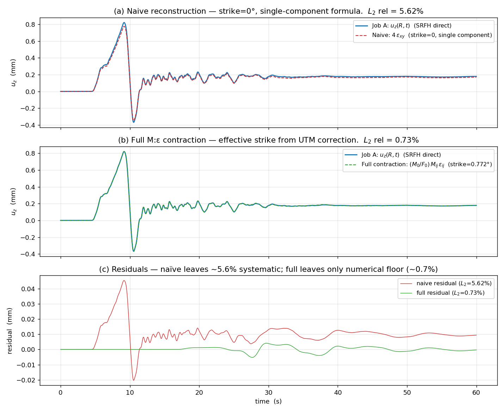

# Reciprocity-Based Green's-Tensor Workflow for Finite-Fault Slip Inversion

This document describes how to compute strain Green's-tensor kernels in
Hercules using the `FORCE` body-force source type, validate them against an
`SRFH` forward simulation via the elastodynamic reciprocity theorem, and use
them in a finite-fault slip-inversion workflow.

## 1. Physics

For a slipping fault discretized into sub-sources at positions `x_s_n` with
moment tensors `M_ij(x_s_n, t)`, the displacement at any receiver `R` in
direction `k` is

```
u_k(R, t) = Σ_n A_n · ∫ M_ij(x_s_n, τ) · ε_ij^(k)(x_s_n, t−τ; R) dτ
```

where `A_n` is the patch area and `ε_ij^(k)(x_s, t; R)` is the **strain at
fault patch `x_s` at time `t` due to a unit impulsive force in direction `k`
at receiver `R`**. This strain is the strain Green's tensor; by the
reciprocity theorem, it equals the spatial derivative of the displacement
Green's tensor with arguments swapped:

```
ε_ij^(k)(x_s, t; R) = ½ ( ∂_j G_ki(R, t; x_s) + ∂_i G_kj(R, t; x_s) )
```

The practical implication: **one FORCE simulation per receiver and direction
gives you the kernel for every sub-source on the fault**. For `M` receivers
and 3 force directions you do `3M` simulations, versus one forward simulation
per candidate slip model. The kernel is reused for every iteration of the
inversion — the cost saving is enormous for large faults.

## 2. Matched-STF reconstruction (no deconvolution needed)

If the same peak-normalized source-time function `g(t)` is used in both
runs, the convolution `(G_imp ⊛ g)` factors out of the ratio and the
reconstruction becomes a **direct scalar product** at every time step:

```
u_k(R, t) = (1/F_0) · Σ_n M_0_ij^(n) · ε_ij^(k)(x_s_n, t − τ_n)
```

with rupture-onset delays `τ_n` from each patch's `tinit`. No FFT, no
time-domain convolution, no deconvolution. This works because Hercules
applies `M_ij(t) = M_0_ij · g(t)` (SRFH) and `F_k(t) = F_0 · g(t)` (FORCE)
with the same `g(t)`, so the spectral content of the recorded strain
exactly matches the spectral content needed for the receiver displacement.

If you ever need to invert slip-rate time histories rather than just slip
amplitudes, use a short compact basis pulse as `g(t)` and represent the slip
as a sum of shifted copies — each shift contributes a time-shifted kernel,
still no deconvolution required.

## 3. Source-time-function convention (slip vs slip-rate, displacement vs velocity)

Hercules' SRFH treats `slipfunction.in` as the cumulative slip `s(t)`. The
applied moment is `M_ij(t) = μ · A · s(t) · v_ij`. The receiver records the
**displacement** response to this moment history.

For inversion against real (broadband) seismograms, observed data is
**ground velocity**, not displacement. Two equivalent paths:

| Path | Job A STF | Job A read | Job B STF | Job B read |
|---|---|---|---|---|
| Displacement-domain | `slip(t)` | columns 1–3 (`dx,dy,dz`) | same `slip(t)` | strain (10–15) |
| Velocity-domain (recommended) | `slip(t)` | columns 4–6 (`vx,vy,vz`) | `slip_rate(t)` = `d/dt slip(t)` | strain (10–15) |

The velocity-domain approach avoids time-differentiating FEM strain output
(which amplifies high-frequency numerical noise) by moving the
differentiation onto the analytic STF instead.

## 4. The moment-direction tensor `v_ij`

For each sub-source, the unit moment direction is

```
v_ij = n_i · t_j + n_j · t_i
```

where `n` is the fault normal and `t` is the slip-direction unit vector,
computed from strike/dip/rake in Hercules' convention (x = north,
y = east, z = down):

```python
def v_6vec(strike_deg, dip_deg, rake_deg):
    """Return v_ij packed in Hercules station-file ordering
    (XX, YY, ZZ, XY, YZ, XZ) with the factor of 2 already absorbed
    into the off-diagonals — so a dot product with the strain 6-vector
    gives M:ε directly."""
    import numpy as np
    s, d, r = np.deg2rad([strike_deg, dip_deg, rake_deg])
    n = np.array([-np.sin(s)*np.sin(d),  np.cos(s)*np.sin(d), -np.cos(d)])
    t = np.array([ np.cos(r)*np.sin(np.pi/2-s) + np.sin(r)*np.sin(s)*np.cos(d),
                   np.cos(r)*np.sin(s)        - np.sin(r)*np.cos(s)*np.cos(d),
                  -np.sin(r)*np.sin(d)])
    v = np.outer(n, t) + np.outer(t, n)
    return np.array([v[0,0], v[1,1], v[2,2],
                     2*v[0,1], 2*v[1,2], 2*v[0,2]])
```

### 4.1 UTM grid-convergence correction (important!)

**Use the effective strike that Hercules actually applied**, not the
user-input strike from `strike.in`. Hercules' SRFH automatically rotates
the input strike by the **UTM grid-convergence angle** at the source's
lat/lon to convert from true geographic north (the seismological
convention) to the simulation's cartesian frame:

```
γ ≈ arctan(tan(Δλ) · sin(φ))
```

where `Δλ` is the longitude offset from the local UTM zone's central
meridian. For typical regional simulations this is a few tenths of a
degree, but it produces a non-negligible perturbation in the moment
tensor — `v_xx` and `v_yy` pick up small values that would be exactly
zero for a pure strike-slip on a north-striking vertical fault. Ignoring
this correction produces a constant ~5% amplitude bias in the
reconstruction even when reciprocity is otherwise satisfied to numerical
precision.

To read the effective strike, run with `HERCULES_SRC_DEBUG=1` and grep
the log for `[SRC DEBUG SRFH]`. The printed `strike=...` value is what
Hercules actually applied. Pass it to `v_6vec(...)` in the reconstruction.

The FORCE source on the other hand specifies its force vector directly
in Cartesian (`force_x_n`, `force_y_n`, `force_z_n`), so it is
**convergence-angle-free** — no correction is applied.

## 5. Reconstruction formula

Given the strain time series `ε_6(t) = [ε_xx, ε_yy, ε_zz, ε_xy, ε_yz, ε_xz]`
recorded at fault patch `n` in Job B (with applied force `F_0` in
direction `k` at receiver `R`), reconstruct the receiver displacement as:

```python
v6 = v_6vec(strike_eff, dip_eff, rake_eff)             # effective strike from [SRC DEBUG]
M0 = mu * area * slip0                                  # per-patch scalar moment
uz_recon = (M0 / F0) * (v6 @ eps6)                      # full M:ε contraction
```

For multiple sub-sources, sum the contributions with their respective
`tinit` time-shifts:

```python
u_k_recon = np.zeros(N_t)
for n in range(N_patches):
    v6_n = v_6vec(strike_eff[n], dip_eff[n], rake_eff[n])
    M0_n = mu_n * area_n * slip0_n
    shift = int(round(tinit_n / dt))
    eps6_n_shifted = np.roll(eps6[n], shift, axis=-1)
    if shift > 0: eps6_n_shifted[:, :shift] = 0
    u_k_recon += (M0_n / F0) * (v6_n @ eps6_n_shifted)
```

## 6. Setting up the two jobs

### Job A (forward, SRFH)

Standard SRFH source with `source_function_type = discrete` and the
`slipfunction.in` you'd use for the real simulation. One sub-source for
testing; many sub-sources for a real fault model.

`source.in`:
```
type_of_source       = srfh
source_function_type = discrete
number_of_point_sources = 1   # (or however many patches)
```

`coords.in` (**lon lat depth** order, one line per sub-source):
```
121.0  22.65  8000.0
```

`area.in`, `strike.in`, `dip.in`, `rake.in`, `slip.in`: one value per
sub-source. `slipfunction.in` header (`nt1 tinit dt`) followed by
`nt1` peak-normalized samples per sub-source.

`parameter.in` receivers: surface stations at the seismometer locations.

### Job B (reciprocal, FORCE)

Body-force source at the **receiver location** from Job A; stations
at the **sub-source locations** from Job A with `print_station_strains = yes`.

`source.in`:
```
type_of_source       = force
source_function_type = discrete

lonlat_or_cartesian  = 0          # lat/lon for the source position
hypocenter_lat_deg   = 22.683104025
hypocenter_long_deg  = 120.991700470
hypocenter_depth_m   = 0.0

force_x_n            = 0.0
force_y_n            = 0.0
force_z_n            = 1.0e15     # repeat with F_x, F_y for full kernel
```

`forcefunction.in`: **same** peak-normalized samples as Job A's
`slipfunction.in` (matched-STF reconstruction).

`parameter.in` stations: one per sub-source from Job A's `coords.in`,
with `print_station_strains = yes`. Order of columns in the station
file: `t, dx, dy, dz, vx, vy, vz, ax, ay, az, Eps_XX, Eps_YY, Eps_ZZ,
Eps_XY, Eps_YZ, Eps_XZ, Sig_XX, Sig_YY, Sig_ZZ, Sig_XY, Sig_YZ, Sig_XZ`.

> **Coordinate-order gotcha:** SRFH `coords.in` is `lon lat depth`;
> `parameter.in output_stations` is `lat lon depth`; FORCE `source.in`
> uses explicit `hypocenter_{lat,long}_deg` keys. Mixing these up puts
> the source/station at `(-1, -1)` (the linear-interp failure
> sentinel) and the receiver records garbage.

## 7. Validation: the reciprocity check

Run both jobs (on the same mesh), then verify that the kernel
reconstructs Job A's seismograms:

```python
import numpy as np

A = np.genfromtxt('Output/jobA_srfh/station.0', skip_header=1)
B = np.genfromtxt('Output/jobB_force_Fz/station.0', skip_header=1)
t  = A[:,0]
uz_A = A[:,3]              # Job A receiver displacement

eps6 = np.stack([B[:,10], B[:,11], B[:,12],     # Eps_XX, YY, ZZ
                 B[:,13], B[:,14], B[:,15]])     # Eps_XY, YZ, XZ

v6   = v_6vec(strike_eff, dip_eff, rake_eff)    # from [SRC DEBUG]
M0   = mu * area * slip0
uz_recon = (M0 / F0) * (v6 @ eps6)

l2 = np.linalg.norm(uz_A - uz_recon) / np.linalg.norm(uz_A)
print(f"L2 relative error = {l2:.3e}")          # should be ~10^-3
```

Expected: `L2 rel < 1e-2` (typically `~7e-3` for a single-patch
single-receiver test). For example, validation against a single-patch
SRFH (strike=0°, dip=90°, rake=0°, slip=1 m, area=1 km²) at lat=22.65°,
lon=121.0°, depth=8 km in a `Vs=1000 m/s`, `ρ=2000 kg/m³` medium, with
a unit FORCE in the `z` direction at lat=22.683°, lon=120.992°, depth=0:



Panel (a): naive single-component reconstruction `u_z = 4·ε_xy` (ignoring
UTM strike correction) — leaves a constant `5.6%` amplitude bias.
Panel (b): full `M:ε` contraction with the effective strike `0.772°`
applied — `L2 rel = 0.73%`, essentially the numerical floor.
Panel (c): residuals overlaid — the systematic offset disappears once the
correct moment-direction tensor is used.

Higher errors usually mean:
- Strike correction not applied → 5–6% bias (UTM grid convergence)
- STF peaks differ between jobs → constant scale offset
- Mismatched `tinit` between `slipfunction.in` and `forcefunction.in` → time shift
- Mesh/element snapping → small bias from sub-source-vs-station
  landing in different elements

## 8. Building the kernel for a real inversion

For `M` receivers and `N` fault patches:

1. **3M FORCE runs** (one per receiver × force direction).
2. Each run writes `N` station files containing 6-component strain
   tensors at the fault patches.
3. Store as `G[m, k, n, ij, t]` with shape `(M, 3, N, 6, N_t)` — the
   strain Green's tensor (already divided by `F_0`).
4. For each candidate slip model `slip(x_s_n, t)`, compute moment tensors
   `M_n(t) = μ_n · A_n · slip_n(t) · v_ij^(n)` and convolve (or, in the
   matched-STF formulation, multiply-and-shift) with `G` to get
   synthetic seismograms. **No new wave-propagation simulations.**

The kernel is also the right object for **adjoint-state** computations: the
adjoint receiver-side field at the fault is exactly `ε_ij^(k)`, so the
gradient of any data misfit `J = ½ Σ (d_obs − d_syn)²` with respect to
fault slip is one weighted sum over the kernel — no separate adjoint
simulation needed.

## 9. Debugging: `HERCULES_SRC_DEBUG`

To inspect the source-amplitude inputs (μ, area, maxSlip, muArea, M0,
the effective post-correction strike, force vector) and the per-node
weighting array Hercules actually constructs, set:

```
export HERCULES_SRC_DEBUG=1
```

before launching `psolve`. The owning rank prints one `[SRC DEBUG <type>]`
block per source-application call (one for POINT/FORCE; one per sub-source
for SRFH) to stderr, followed by eight `[SRC DEBUG]` lines giving the
24 entries of `nodalForce[8][3]`. Default off; the prints add no overhead
when the variable is unset or zero.

## 10. References

- Aki & Richards, *Quantitative Seismology* (2nd ed.), ch. 3.1, 10.4
  (reciprocity theorem, moment tensor representation, kinematic inversion).
- Eisner & Clayton, *3-D synthetic seismogram computation using
  reciprocity*, BSSA 91(2), 2001.
- Zhao et al., *Three-dimensional Fréchet differential kernels for
  seismic delay times*, GJI 165(3), 2006.

## 11. Files in this branch related to the workflow

| Path | Purpose |
|---|---|
| [quake/forward/quakesource.cc](../quake/forward/quakesource.cc) | FORCE source, discrete STF loader, `[SRC DEBUG]` prints |
| [quake/forward/quakesource.h](../quake/forward/quakesource.h) | `FORCE` enum, `forceVec` field in `ptsrc_t` |
| [examples/test1/sourceforce/source.in](../examples/test1/sourceforce/source.in) | Example FORCE source input |
| [examples/test1/sourceforce/forcefunction.in](../examples/test1/sourceforce/forcefunction.in) | Example Ricker STF |
